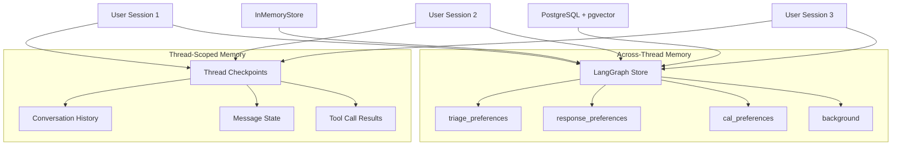
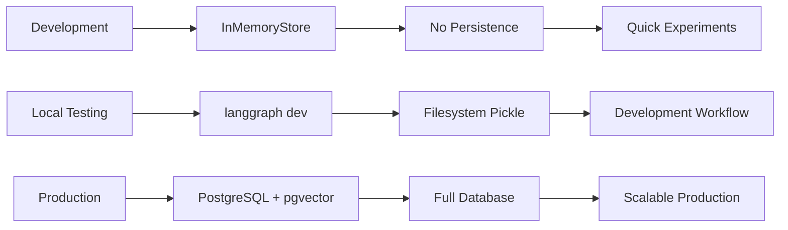
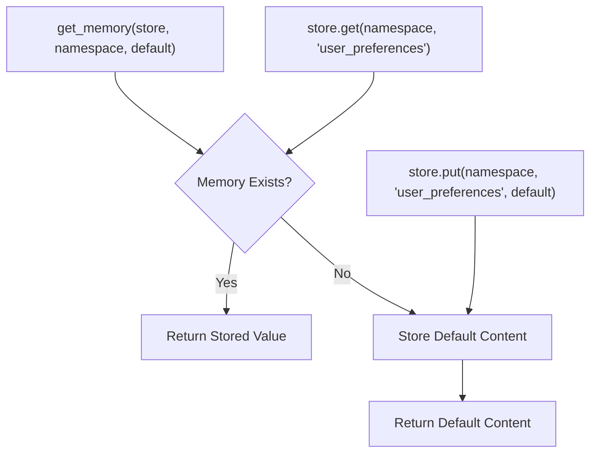
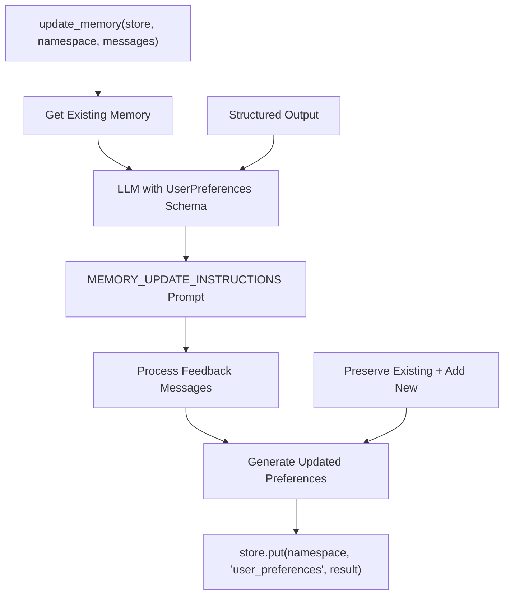
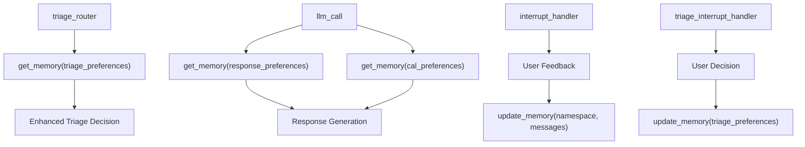
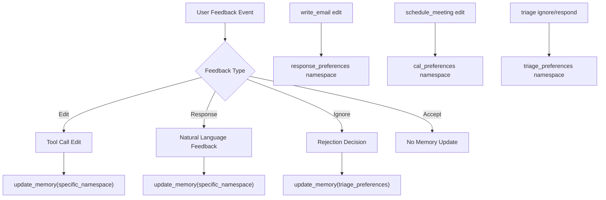
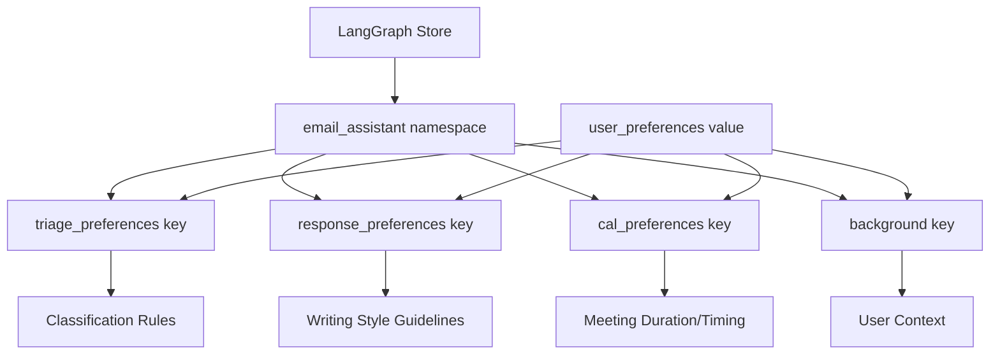

<!-- source: DeepWiki mcp.deepwiki.com · repo langchain-ai/agents-from-scratch · page 3.3 Memory System · fetched 2026-10-26 -->

# Memory System

Relevant source files

The following files were used as context for generating this wiki page:

- [README.md](README.md)
- [notebooks/memory.ipynb](notebooks/memory.ipynb)
- [src/email_assistant/email_assistant_hitl_memory.py](src/email_assistant/email_assistant_hitl_memory.py)

This document covers the memory system that enables the email assistant to learn from user feedback and adapt its behavior over time. The memory system captures user preferences from human-in-the-loop interactions and applies them to future email processing decisions.

For information about the human-in-the-loop workflow that generates the feedback, see [Human-in-the-Loop (HITL) Integration](#2.2). For details about the core email processing workflow, see [Email Assistant Core Architecture](#2).

## Memory Architecture

The LangGraph memory system provides two complementary types of memory storage that serve different purposes in the email assistant:

**Thread-Scoped Memory** maintains state within individual email processing sessions through LangGraph's checkpoint system. This includes conversation history, tool call results, and intermediate processing state.

**Across-Thread Memory** persists user preferences and learning across all email processing sessions using the LangGraph Store. This is where the system accumulates knowledge about user preferences for triage decisions, response style, and calendar scheduling.

Sources: [notebooks/memory.ipynb:50-89](), [src/email_assistant/email_assistant_hitl_memory.py:30-55]()

## Store Implementations

The memory system supports different Store implementations depending on deployment context:

| Implementation | Use Case | Persistence | Semantic Search |
|---------------|----------|-------------|-----------------|
| `InMemoryStore` | Development/Testing | None (Python dict) | Configurable |
| Local Development | `langgraph dev` | Pickled to filesystem | Configurable |
| Production | LangGraph Platform | PostgreSQL + pgvector | Cosine similarity |

Sources: [notebooks/memory.ipynb:66-89]()

## Memory Management Functions

The memory system provides two core functions for managing user preferences:

### get_memory Function

The `get_memory` function retrieves existing preferences or initializes defaults:

The function takes a `namespace` tuple like `("email_assistant", "triage_preferences")` and a `default_content` parameter for initialization.

### update_memory Function

The `update_memory` function processes user feedback to update stored preferences:

The function uses an LLM with structured output to intelligently merge new feedback with existing preferences while preserving all previous learning.

Sources: [src/email_assistant/email_assistant_hitl_memory.py:30-76]()

## Memory Integration in Workflow

Memory is integrated throughout the email assistant workflow at key decision points:

### Triage Router Integration

The `triage_router` function retrieves triage preferences to enhance email classification decisions:

The router combines default instructions with learned preferences from the `("email_assistant", "triage_preferences")` namespace.

### Response Agent Integration

The `llm_call` function incorporates response and calendar preferences into LLM prompts:

Both `response_preferences` and `cal_preferences` are retrieved and injected into the system prompt for consistent application of user preferences.

Sources: [src/email_assistant/email_assistant_hitl_memory.py:78-247]()

## Memory Update Triggers

The system updates memory in response to specific user interactions during human-in-the-loop processing:

### Edit-Based Updates

When users edit tool calls, the system captures the differences and updates relevant preferences:

- Email edits trigger `response_preferences` updates
- Meeting edits trigger `cal_preferences` updates  
- The system compares initial vs edited content to extract preference patterns

### Feedback-Based Updates

Natural language feedback from users provides rich learning signals:

- Response-type feedback incorporates user guidance into memory
- Ignore decisions update triage preferences to avoid similar classifications
- The `MEMORY_UPDATE_INSTRUCTIONS` prompt ensures targeted, additive updates

Sources: [src/email_assistant/email_assistant_hitl_memory.py:249-456]()

## Memory Namespaces and Structure

The memory system organizes preferences using namespaced storage with specific key patterns:

| Namespace | Purpose | Default Content Source |
|-----------|---------|----------------------|
| `("email_assistant", "triage_preferences")` | Email classification rules | `default_triage_instructions` |
| `("email_assistant", "response_preferences")` | Email writing style/content | `default_response_preferences` |
| `("email_assistant", "cal_preferences")` | Meeting scheduling preferences | `default_cal_preferences` |
| `("email_assistant", "background")` | User context information | `default_background` |

Each namespace uses the consistent key `"user_preferences"` with string-based content that the LLM can understand and modify. The `UserPreferences` schema ensures structured updates while maintaining readability.

Sources: [src/email_assistant/email_assistant_hitl_memory.py:30-76](), [notebooks/memory.ipynb:394-421]()

---

