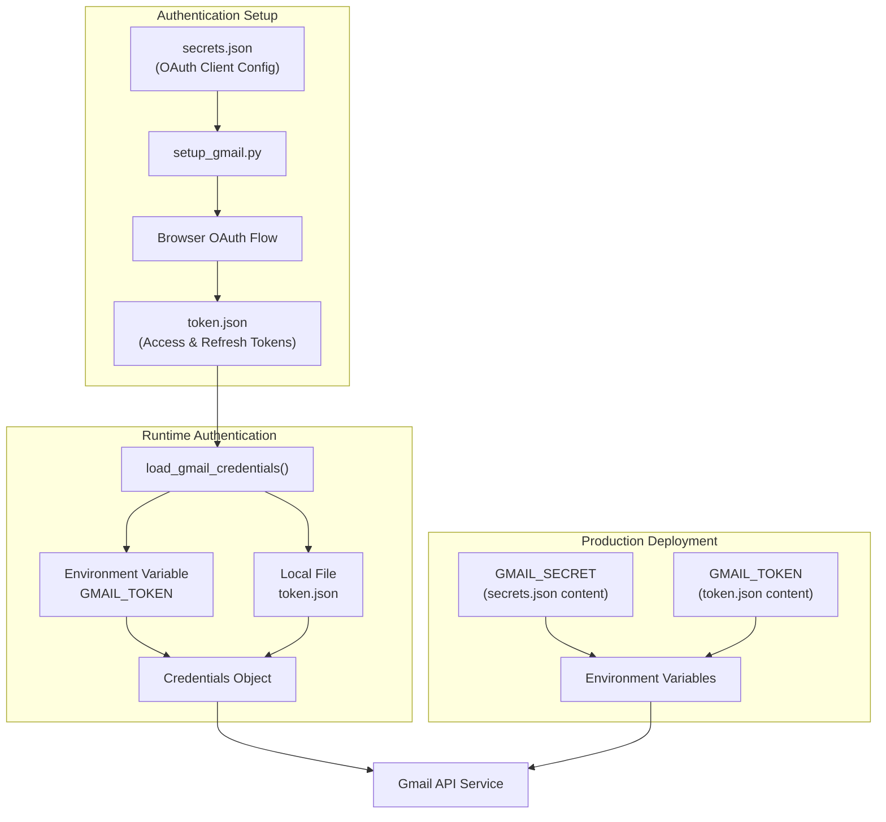
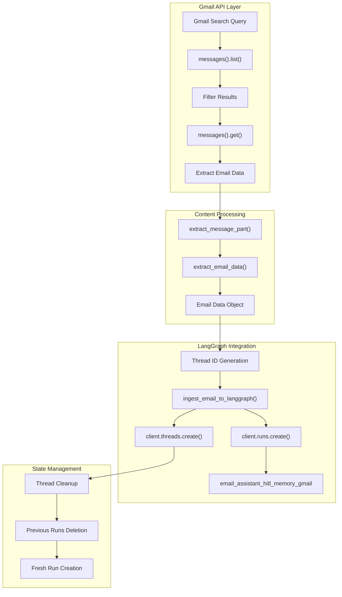
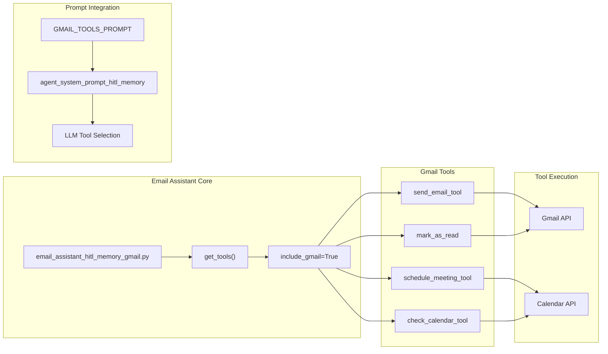
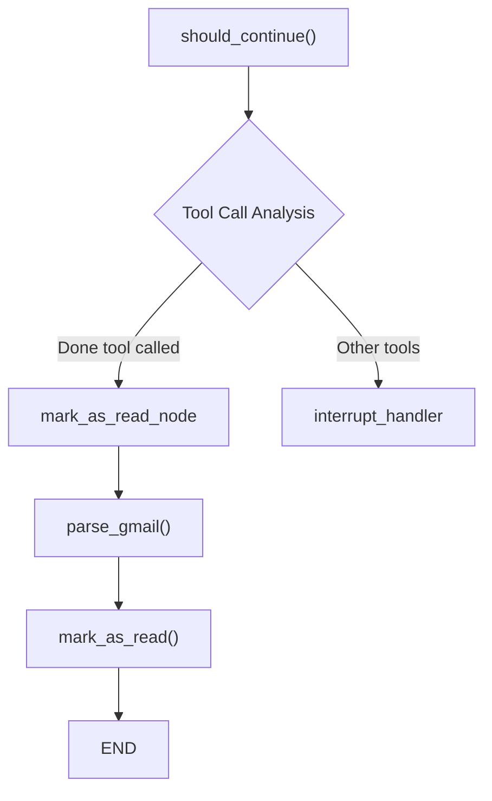
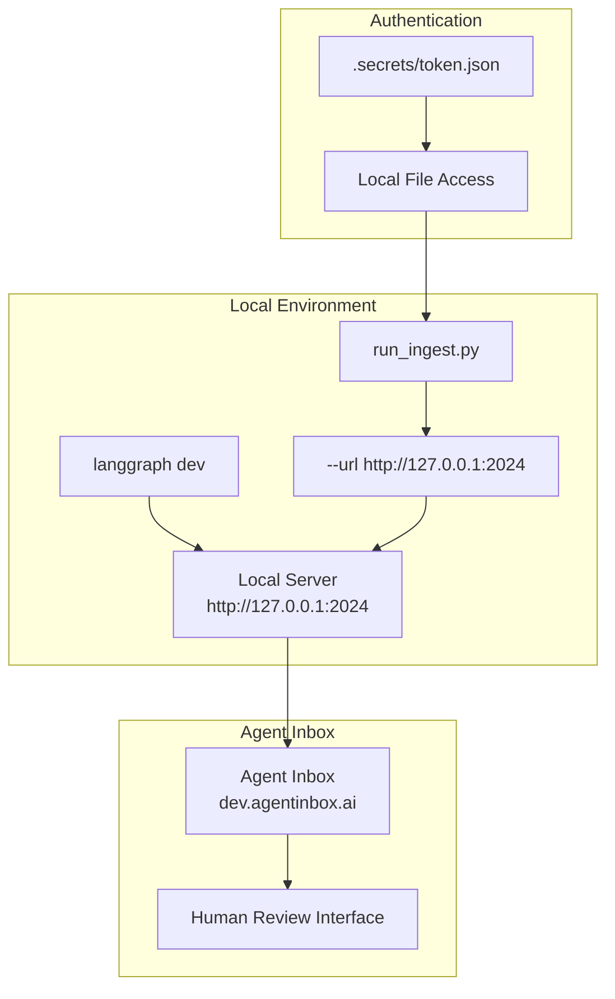
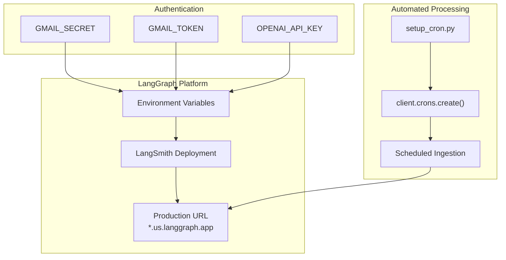
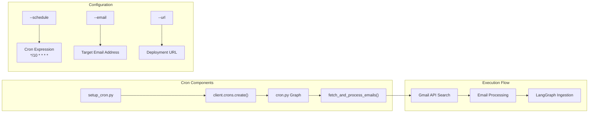

<!-- source: DeepWiki mcp.deepwiki.com · repo langchain-ai/agents-from-scratch · page 3.4 Gmail Integration · fetched 2026-10-26 -->

# Gmail Integration

<details>
<summary>Relevant source files</summary>

The following files were used as context for generating this wiki page:

- [src/email_assistant/email_assistant_hitl_memory.py](src/email_assistant/email_assistant_hitl_memory.py)
- [src/email_assistant/tools/base.py](src/email_assistant/tools/base.py)
- [src/email_assistant/tools/gmail/README.md](src/email_assistant/tools/gmail/README.md)
- [src/email_assistant/tools/gmail/gmail_tools.py](src/email_assistant/tools/gmail/gmail_tools.py)

</details>


This document covers the Gmail API integration that enables the email assistant to process real Gmail messages and send responses through Google's email and calendar services. The Gmail integration transforms the email assistant from a prototype system into a production-ready automation tool that can handle live email workflows.

For information about the core email assistant architecture without Gmail integration, see [Email Assistant Core Architecture](#2). For details about prompt templates and Gmail-specific tools, see [Gmail Tools](#3.1).

## Authentication System

The Gmail integration uses OAuth 2.0 authentication to securely access Gmail and Google Calendar APIs. The authentication system supports both local development and production deployment scenarios.

### OAuth Flow and Credential Management

The authentication process involves two main files stored in the `.secrets` directory:



**Gmail Authentication Flow**

Sources: [src/email_assistant/tools/gmail/setup_gmail.py:24-84](), [src/email_assistant/tools/gmail/run_ingest.py:61-113](), [src/email_assistant/tools/gmail/README.md:12-57]()

The `setup_gmail.py` script handles the initial OAuth flow by reading client configuration from `secrets.json`, opening a browser for user authentication, and storing the resulting tokens in `token.json`. The `load_gmail_credentials()` function provides flexible credential loading that prioritizes environment variables for production deployments while falling back to local files for development.

### Credential Loading Strategy

The `load_gmail_credentials()` function implements a fallback strategy for credential loading:

| Priority | Source | Use Case |
|----------|--------|----------|
| 1 | `GMAIL_TOKEN` environment variable | Production deployments |
| 2 | Local `.secrets/token.json` file | Development environments |

Sources: [src/email_assistant/tools/gmail/run_ingest.py:61-113]()

## Email Ingestion Pipeline

The email ingestion pipeline processes Gmail messages and converts them into LangGraph workflow inputs. The pipeline handles email fetching, content extraction, thread management, and workflow orchestration.

### Ingestion Workflow



**Email Ingestion Pipeline Architecture**

Sources: [src/email_assistant/tools/gmail/run_ingest.py:204-284](), [src/email_assistant/tools/gmail/run_ingest.py:141-202]()

### Email Content Extraction

The `extract_message_part()` function handles Gmail's multipart message structure with content type prioritization:

1. **Text/Plain Priority** - Attempts to extract plain text content first
2. **Text/HTML Fallback** - Falls back to HTML content if plain text unavailable  
3. **Recursive Processing** - Handles nested multipart structures
4. **Base64 Decoding** - Decodes Gmail's base64-encoded message bodies

Sources: [src/email_assistant/tools/gmail/run_ingest.py:30-59]()

### Thread Management and State Consistency

The ingestion process ensures clean state management by:

- Generating consistent thread IDs using MD5 hashing of Gmail thread IDs
- Cleaning up previous runs to prevent state accumulation
- Creating fresh runs for each email processing cycle
- Updating thread metadata with current email ID

Sources: [src/email_assistant/tools/gmail/run_ingest.py:146-202]()

## Gmail Tools Integration

The Gmail integration extends the email assistant with real email and calendar capabilities through specialized tools and prompt templates.

### Tool Integration Architecture



**Gmail Tools Integration Pattern**

Sources: [src/email_assistant/email_assistant_hitl_memory_gmail.py:19-21](), [src/email_assistant/email_assistant_hitl_memory_gmail.py:238-243]()

### Email Processing and State Updates

The Gmail-enabled email assistant includes automatic email marking functionality through the `mark_as_read_node`:



**Email State Management Flow**

Sources: [src/email_assistant/email_assistant_hitl_memory_gmail.py:460-476]()

## Deployment Options

The Gmail integration supports multiple deployment patterns with different authentication and operational characteristics.

### Local Development Deployment



**Local Development Architecture**

For local development, the system uses file-based authentication and connects to a locally running LangGraph server. The `run_ingest.py` script processes emails and sends them to the local deployment.

Sources: [src/email_assistant/tools/gmail/README.md:58-104]()

### Hosted Production Deployment



**Production Deployment Architecture**

Production deployments use environment variables for credential management and support automated cron-based email processing through the LangGraph Platform's scheduling capabilities.

Sources: [src/email_assistant/tools/gmail/README.md:105-183]()

## Automated Email Processing

The Gmail integration supports automated email processing through cron jobs that run the ingestion pipeline on a scheduled basis.

### Cron Job Architecture



**Automated Processing Architecture**

Sources: [src/email_assistant/tools/gmail/README.md:137-183]()

### Email Filtering and Processing Logic

The ingestion system applies intelligent filtering to process only relevant emails:

| Filter Type | Default Behavior | Override Flag |
|-------------|------------------|---------------|
| **Unread Filter** | Only unread emails | `--include-read` |
| **Sender Filter** | Skip self-sent emails | `--skip-filters` |
| **Thread Position Filter** | Latest message only | `--skip-filters` |

The filtering logic ensures that automated processing focuses on actionable emails while avoiding duplicate processing and self-generated content.

Sources: [src/email_assistant/tools/gmail/README.md:217-267]()

### Cron Job Management

Cron jobs can be managed programmatically through the LangGraph SDK:

```python
# List existing cron jobs
cron_jobs = await client.crons.list()

# Delete a cron job  
await client.crons.delete(cron_job_id)
```

This management interface allows dynamic control of automated email processing schedules and configurations.

Sources: [src/email_assistant/tools/gmail/README.md:166-182]()

---

