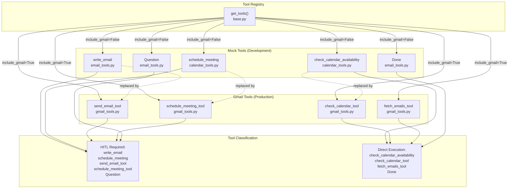
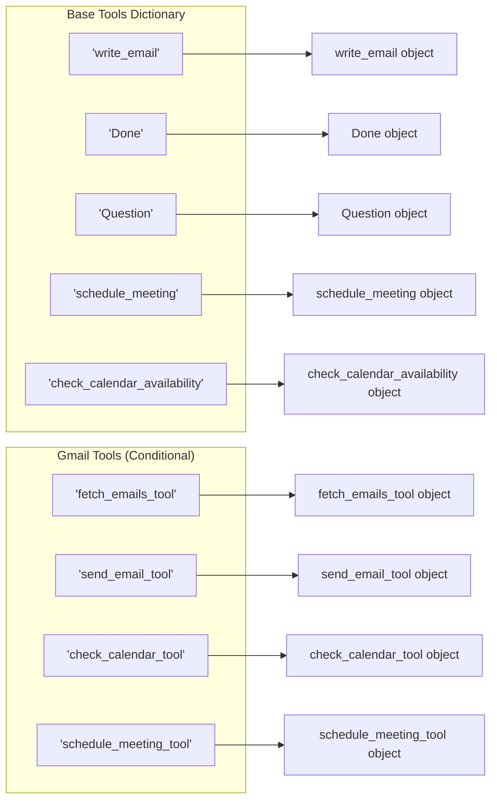
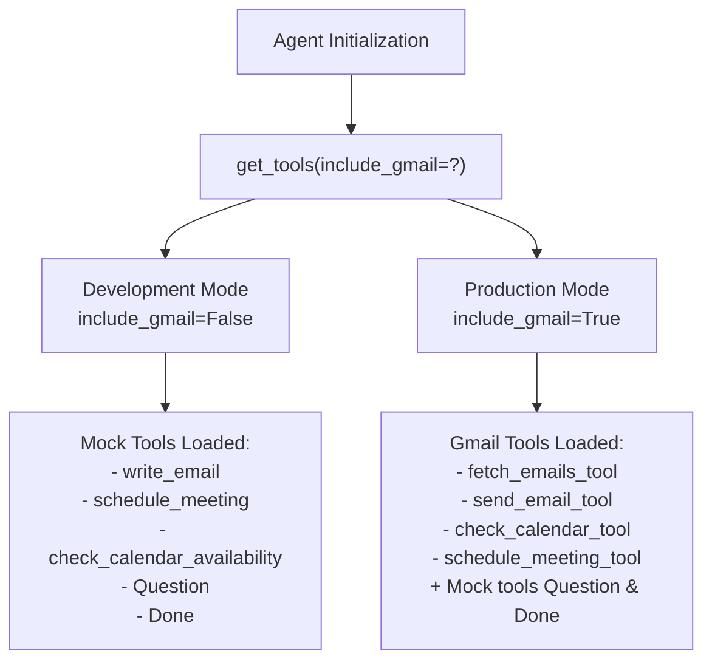
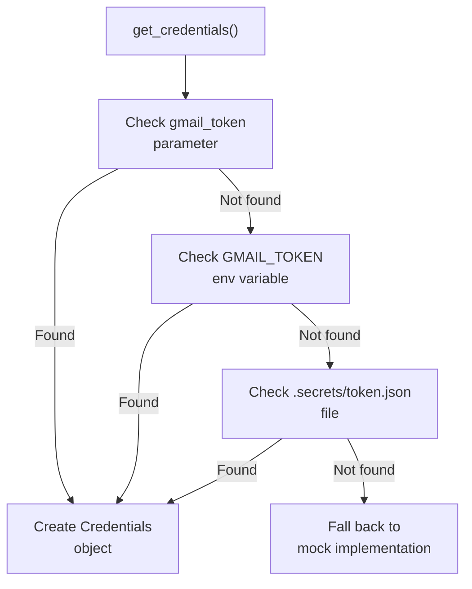
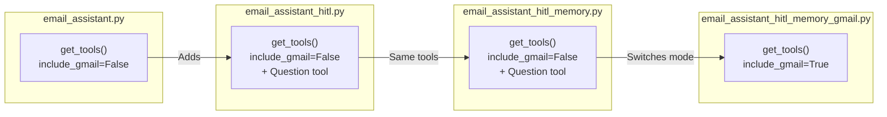
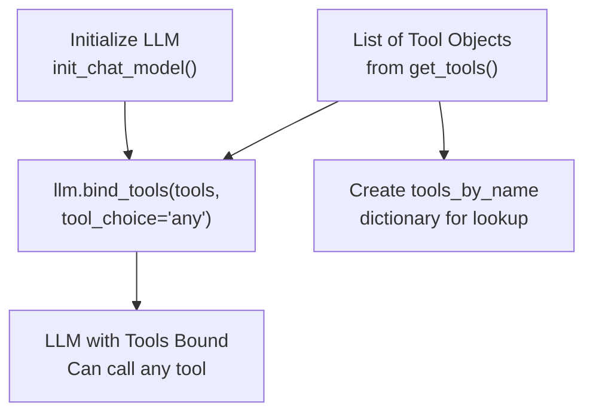
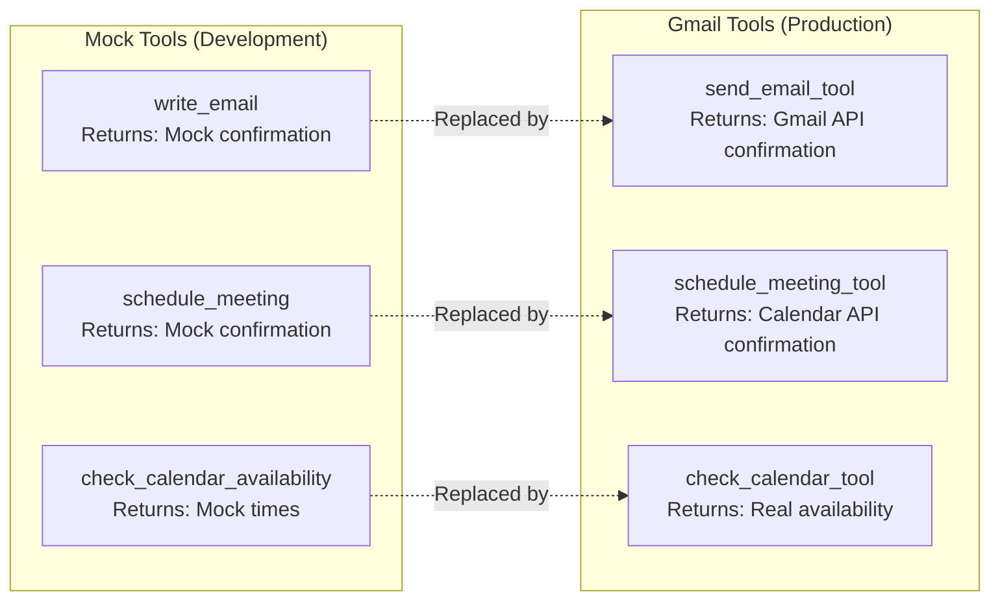
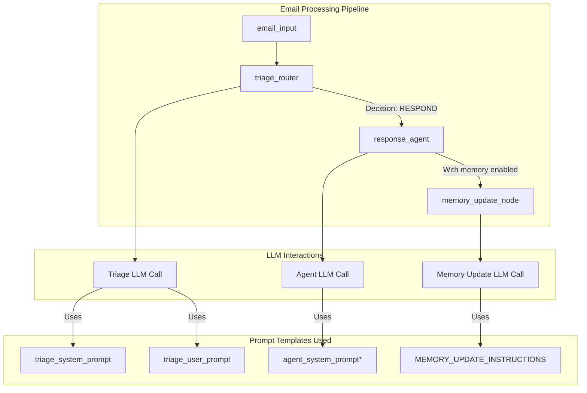

<!-- source: DeepWiki mcp.deepwiki.com · repo langchain-ai/agents-from-scratch · page 4 Tool System · fetched 2026-10-26 -->

# Tool System

<details>
<summary>Relevant source files</summary>

The following files were used as context for generating this wiki page:

- [README.md](README.md)
- [notebooks/agent.ipynb](notebooks/agent.ipynb)
- [src/email_assistant/tools/base.py](src/email_assistant/tools/base.py)
- [src/email_assistant/tools/gmail/gmail_tools.py](src/email_assistant/tools/gmail/gmail_tools.py)

</details>


## Purpose and Scope

This document details the tool system architecture used throughout the email assistant implementations. The tool system provides the assistant with concrete capabilities to interact with emails, calendars, and users. This page focuses on tool registration via `get_tools()`, the classification of tools into HITL vs direct execution categories, and the dual-mode design pattern that enables both development (mock) and production (Gmail API) usage.

## Tool System Architecture

The tool system implements a dual-mode architecture where tools can operate in either mock mode (for development and testing) or production mode (with real Gmail and Calendar API integration). The system is centered around a tool registry that conditionally loads tools based on the deployment environment.

### Tool System Architecture Overview



Sources: [src/email_assistant/tools/base.py:1-58](), [src/email_assistant/tools/gmail/gmail_tools.py:1-946]()

## Tool Registration System

The tool registration system is implemented in [src/email_assistant/tools/base.py]() and provides a central point for accessing tools. The `get_tools()` function conditionally loads tools based on the `include_gmail` parameter and optional tool name filtering.

### Tool Registration Function Signature

```python
def get_tools(
    tool_names: Optional[List[str]] = None, 
    include_gmail: bool = False
) -> List[BaseTool]
```

**Parameters:**
- `tool_names`: Optional list of specific tool names to include. If `None`, returns all tools.
- `include_gmail`: Whether to include Gmail/Calendar API tools. Defaults to `False`.

**Returns:**
- List of `BaseTool` objects ready for use with LangChain/LangGraph

### Tool Dictionary Structure

The `get_tools()` function maintains an `all_tools` dictionary that maps tool names to tool objects:



Sources: [src/email_assistant/tools/base.py:4-50]()

## Tool Categories and Classification

The tool system classifies tools into two execution categories based on their risk profile and need for human oversight:

### HITL (Human-in-the-Loop) Tools

HITL tools require human approval before execution because they perform actions that could have significant consequences:

| Tool Name | Function | Why HITL Required |
|-----------|----------|-------------------|
| `write_email` | Draft email responses | Prevents unauthorized communications |
| `send_email_tool` | Send email via Gmail API | Prevents unauthorized communications |
| `schedule_meeting` | Mock calendar scheduling | Prevents unauthorized calendar modifications |
| `schedule_meeting_tool` | Real calendar scheduling via API | Prevents unauthorized calendar modifications |
| `Question` | Ask user for clarification | Requires human interaction by definition |

These tools trigger an interrupt in the LangGraph workflow, pausing execution until a human reviews and approves (or modifies) the tool call. See page 3.2 for details on the HITL interrupt mechanism.

### Direct Execution Tools

Direct execution tools run immediately without human approval because they are read-only or control flow operations:

| Tool Name | Function | Why Direct Execution |
|-----------|----------|----------------------|
| `check_calendar_availability` | Mock calendar lookup | Read-only operation |
| `check_calendar_tool` | Real calendar lookup via API | Read-only operation |
| `fetch_emails_tool` | Retrieve emails via Gmail API | Read-only operation |
| `Done` | Signal task completion | Control flow only |

Sources: [notebooks/agent.ipynb:46-83](), [src/email_assistant/tools/gmail/gmail_tools.py:455-488]()

## Dual-Mode Design Pattern

The tool system implements a dual-mode design pattern that allows the same codebase to operate in development mode (with mock tools) or production mode (with real API integration). This pattern is essential for development, testing, and deployment workflows.

### Mode Selection Mechanism

Mode selection occurs at tool registration time via the `include_gmail` parameter:



### Mock Tool Implementation

Mock tools return simulated responses for development and testing:

**Example: `write_email` mock tool**

```python
@tool
def write_email(to: str, subject: str, content: str) -> str:
    """Write and send an email."""
    # Placeholder response - in real app would send email
    return f"Email sent to {to} with subject '{subject}' and content: {content}"
```

**Example: `check_calendar_availability` mock tool**

```python
@tool
def check_calendar_availability(day: str) -> str:
    """Check calendar availability for a given day."""
    # Placeholder response - in real app would check actual calendar
    return f"Available times on {day}: 9:00 AM, 2:00 PM, 4:00 PM"
```

Sources: [notebooks/agent.ipynb:58-77]()

### Gmail Tool Implementation

Gmail tools integrate with real Google APIs using OAuth credentials:

**Example: `send_email_tool` production tool**

The `send_email_tool` wraps the `send_email()` helper function which:
1. Authenticates using `get_credentials()` with token from environment or file
2. Retrieves the original message to extract thread context
3. Constructs a proper email reply with MIME formatting
4. Sends via Gmail API maintaining thread continuity

**Example: `check_calendar_tool` production tool**

The `check_calendar_tool` wraps the `get_calendar_events()` helper function which:
1. Authenticates using `get_credentials()`
2. Queries Google Calendar API for events on specified dates
3. Calculates busy slots and available windows
4. Returns formatted availability information

Sources: [src/email_assistant/tools/gmail/gmail_tools.py:508-632](), [src/email_assistant/tools/gmail/gmail_tools.py:641-785]()

### Credential Management

Gmail tools support multiple credential sources with fallback:



Sources: [src/email_assistant/tools/gmail/gmail_tools.py:64-136]()

## Tool Definition with LangChain

Tools are defined using the LangChain `@tool` decorator and Pydantic models for input validation. This section shows how tools are structured at the code level.

### Function-Based Tool Definition

Simple tools can be defined as decorated functions:

```python
@tool
def write_email(to: str, subject: str, content: str) -> str:
    """Write and send an email."""
    return f"Email sent to {to} with subject '{subject}' and content: {content}"
```

The `@tool` decorator:
- Converts the function into a `BaseTool` object
- Extracts parameter information from type hints
- Uses the docstring as the tool description for the LLM

### Class-Based Tool Definition

More complex tools use Pydantic `BaseModel` with the `@tool` decorator:

```python
@tool
class Done(BaseModel):
    """E-mail has been sent."""
    done: bool
```

This approach:
- Provides explicit schema validation
- Allows for complex nested structures
- Offers better IDE support and type checking

Sources: [notebooks/agent.ipynb:58-82]()

### Tool Input Schemas

Gmail tools use explicit Pydantic input schemas for structured validation:

```python
class SendEmailInput(BaseModel):
    """Input schema for the send_email_tool."""
    email_id: str = Field(
        description="Gmail message ID to reply to. Must be valid ID from fetch_emails_tool."
    )
    response_text: str = Field(
        description="Content of the reply"
    )
    email_address: str = Field(
        description="Current user's email address"
    )
    additional_recipients: Optional[List[str]] = Field(
        default=None,
        description="Optional additional recipients to include"
    )

@tool(args_schema=SendEmailInput)
def send_email_tool(...) -> str:
    ...
```

The `args_schema` parameter ensures:
- Strict input validation
- Clear field descriptions for the LLM
- Type safety at runtime

Sources: [src/email_assistant/tools/gmail/gmail_tools.py:489-506]()

## Tool Evolution Across Implementations

The tool system remains consistent across implementations, with the primary change being the mode selection:



**Implementation Details:**

| Implementation | `include_gmail` | Tools Available |
|----------------|-----------------|-----------------|
| `email_assistant.py` | `False` | Mock tools (4): `write_email`, `schedule_meeting`, `check_calendar_availability`, `Done` |
| `email_assistant_hitl.py` | `False` | Mock tools (5): Previous 4 + `Question` |
| `email_assistant_hitl_memory.py` | `False` | Mock tools (5): Same as HITL |
| `email_assistant_hitl_memory_gmail.py` | `True` | Gmail tools (6): `fetch_emails_tool`, `send_email_tool`, `check_calendar_tool`, `schedule_meeting_tool`, `Question`, `Done` |

Sources: [src/email_assistant/tools/base.py:4-50]()

## Tool Binding and LLM Integration

Tools are bound to the LLM using LangChain's `bind_tools()` method, which enables the LLM to call tools during execution.

### Tool Binding Process



**Code Example:**

```python
# Collect all tools
tools = [write_email, schedule_meeting, check_calendar_availability, Done]
tools_by_name = {tool.name: tool for tool in tools}

# Initialize the LLM, enforcing tool use
llm = init_chat_model("openai:gpt-4.1", temperature=0.0)
llm_with_tools = llm.bind_tools(tools, tool_choice="any")
```

The `tool_choice="any"` parameter enforces that the LLM must call at least one tool on every invocation, implementing a strict ReAct pattern where the agent always takes an action.

Sources: [notebooks/agent.ipynb:346-352]()

### Tool Execution in Graph Nodes

Tools are executed in the `tool_handler` node, which processes tool calls from the LLM response:

```python
def tool_handler(state: State):
    """Performs the tool call."""
    result = []
    
    # Iterate through tool calls
    for tool_call in state["messages"][-1].tool_calls:
        # Get the tool
        tool = tools_by_name[tool_call["name"]]
        # Run it
        observation = tool.invoke(tool_call["args"])
        # Create a tool message
        result.append({
            "role": "tool", 
            "content": observation, 
            "tool_call_id": tool_call["id"]
        })
    
    return {"messages": result}
```

The workflow:
1. Extract tool calls from the last LLM message
2. Look up each tool by name in `tools_by_name` dictionary
3. Invoke the tool with the provided arguments
4. Package the result as a tool message
5. Add to the conversation history

Sources: [notebooks/agent.ipynb:396-412]()

## Tool Replacement Pattern in Production

When transitioning from development to production, the Gmail tools replace their mock counterparts while maintaining the same functional interface. This allows the rest of the system to remain unchanged.

### Mock-to-Production Tool Mapping



**Functional Equivalence:**

| Mock Tool | Gmail Tool | Shared Interface |
|-----------|------------|------------------|
| `write_email(to, subject, content)` | `send_email_tool(email_id, response_text, email_address, additional_recipients)` | Email composition and sending |
| `schedule_meeting(attendees, subject, duration_minutes, preferred_day, start_time)` | `schedule_meeting_tool(attendees, title, start_time, end_time, organizer_email, timezone)` | Meeting scheduling |
| `check_calendar_availability(day)` | `check_calendar_tool(dates)` | Calendar availability lookup |

**Note:** The parameter signatures differ between mock and production tools because the production versions integrate with real APIs that require additional context (e.g., `email_id` for threading, `timezone` for calendar events). However, both versions fulfill the same functional role in the workflow.

Sources: [notebooks/agent.ipynb:58-77](), [src/email_assistant/tools/gmail/gmail_tools.py:489-934]()

## Integration with Email Assistant Workflow

The prompt system integrates with the overall email assistant workflow, guiding the behavior of different components:

### Workflow Integration Architecture



Sources: [src/email_assistant/prompts.py:4-283]()

## Summary

The prompt system is central to the email assistant's functionality, providing structured guidance for the LLM in different contexts. It evolves with each implementation, adding new capabilities while maintaining core functionality. The system's structured approach, with clearly defined sections and roles, ensures consistent behavior across different scenarios while allowing for customization through user preferences.

---

