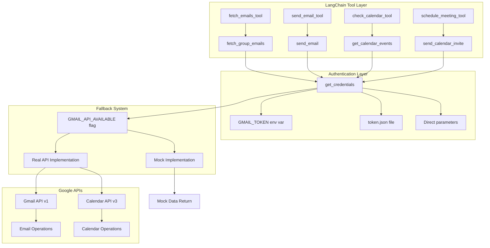
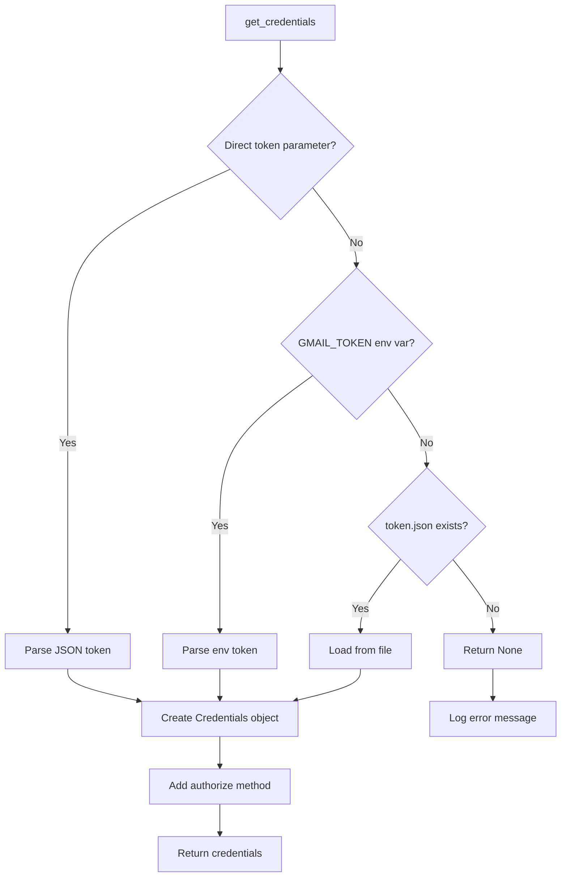
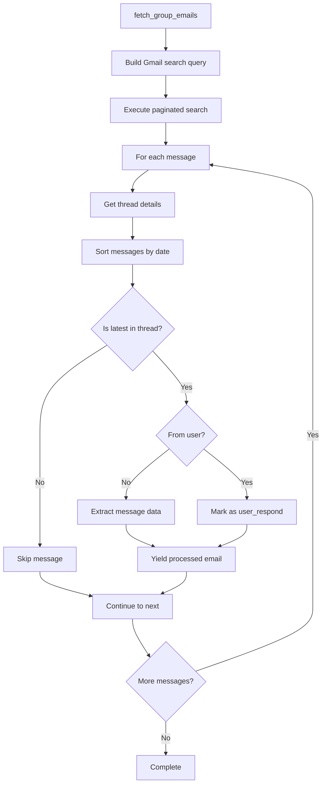
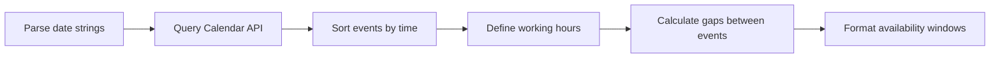
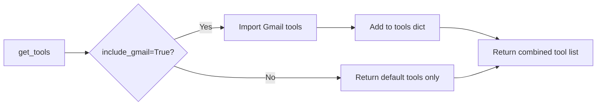

<!-- source: DeepWiki mcp.deepwiki.com · repo langchain-ai/agents-from-scratch · page 4.1 Gmail Tools · fetched 2026-10-26 -->

# Gmail Tools

<details>
<summary>Relevant source files</summary>

The following files were used as context for generating this wiki page:

- [src/email_assistant/tools/base.py](src/email_assistant/tools/base.py)
- [src/email_assistant/tools/gmail/README.md](src/email_assistant/tools/gmail/README.md)
- [src/email_assistant/tools/gmail/gmail_tools.py](src/email_assistant/tools/gmail/gmail_tools.py)

</details>


This document details the Gmail-specific tools for email fetching, sending, and calendar integration with authentication and fallback mechanisms. These tools provide the production-ready Gmail API integration layer for the email assistant system.

For information about the default email tools and utility functions, see [Default Tools and Utility Functions](#3.2). For broader tool integration patterns, see [Email Assistant Core Architecture](#2).

## Overview

The Gmail tools module provides four main LangChain tools that interface with Google's Gmail and Calendar APIs: `fetch_emails_tool`, `send_email_tool`, `check_calendar_tool`, and `schedule_meeting_tool`. The module includes robust authentication handling, fallback mechanisms for development environments, and comprehensive error handling.

### Gmail Tools Architecture



**Sources:** [src/email_assistant/tools/gmail/gmail_tools.py:1-946]()

## Authentication System

The Gmail tools use a hierarchical credential loading system implemented in the `get_credentials()` function. This system attempts to load OAuth2 credentials from multiple sources in priority order.

### Credential Loading Priority

| Priority | Source | Description |
|----------|--------|-------------|
| 1 | Direct parameters | `gmail_token` and `gmail_secret` passed directly to functions |
| 2 | Environment variables | `GMAIL_TOKEN` and `GMAIL_SECRET` environment variables |
| 3 | Local files | `.secrets/token.json` and `.secrets/secrets.json` files |

### Authentication Flow



The `get_credentials()` function creates a Google OAuth2 `Credentials` object with the required scopes for Gmail and Calendar access. It includes error handling for malformed JSON and missing credential sources.

**Sources:** [src/email_assistant/tools/gmail/gmail_tools.py:64-137]()

## Email Tools

### Email Fetching

The `fetch_emails_tool` retrieves recent emails from Gmail based on specified criteria. It uses the `fetch_group_emails()` helper function which provides sophisticated filtering and pagination handling.

#### Key Features

- **Time-based filtering**: Retrieves emails newer than specified minutes
- **Thread handling**: Processes complete email threads and identifies latest messages  
- **Read status filtering**: Option to include or exclude already-read emails
- **Sender filtering**: Skips emails sent by the user to avoid processing self-responses

#### Email Processing Logic



The function handles thread analysis by retrieving complete conversation history and identifying the chronologically latest message to determine if a response is needed.

**Sources:** [src/email_assistant/tools/gmail/gmail_tools.py:149-441](), [src/email_assistant/tools/gmail/gmail_tools.py:455-487]()

### Email Sending

The `send_email_tool` sends replies to existing email threads or creates new emails. It uses the `send_email()` helper function which handles both reply and new message scenarios.

#### Reply Logic

1. **Thread identification**: Attempts to retrieve original message to extract headers
2. **Subject handling**: Adds "Re:" prefix if not already present
3. **Recipient extraction**: Uses original sender as primary recipient
4. **Thread continuity**: Maintains thread ID for proper conversation grouping

The tool gracefully handles cases where the original message cannot be retrieved, defaulting to new message creation.

**Sources:** [src/email_assistant/tools/gmail/gmail_tools.py:508-631]()

## Calendar Tools

### Calendar Checking

The `check_calendar_tool` retrieves events for specified dates and calculates availability windows. It uses the `get_calendar_events()` function which interfaces with the Google Calendar API v3.

#### Availability Calculation

The tool implements working hours logic (9 AM to 5 PM) and calculates free time slots between scheduled events:



**Sources:** [src/email_assistant/tools/gmail/gmail_tools.py:641-802]()

### Meeting Scheduling

The `schedule_meeting_tool` creates calendar events with attendee invitations. The `send_calendar_invite()` function constructs the event object with proper timezone handling and notification settings.

#### Event Configuration

| Property | Description | Default |
|----------|-------------|---------|
| `summary` | Meeting title | User-provided |
| `start`/`end` | ISO datetime with timezone | User-provided |
| `attendees` | List of email addresses | User-provided |
| `timezone` | Event timezone | "America/Los_Angeles" |
| `sendUpdates` | Email notifications | "all" |
| `reminders` | Meeting reminders | Google defaults |

**Sources:** [src/email_assistant/tools/gmail/gmail_tools.py:828-934]()

## Fallback Mechanisms

The Gmail tools include comprehensive fallback mechanisms for development and testing environments where the Gmail API may not be available or configured.

### Fallback Triggers

1. **Missing dependencies**: `ImportError` when Google API libraries are unavailable
2. **Missing credentials**: No valid authentication sources found
3. **API errors**: Runtime errors during Gmail/Calendar API calls

### Mock Implementation

When fallbacks are triggered, the tools return mock data that maintains the expected data structure:

```python
mock_email = {
    "from_email": "sender@example.com",
    "to_email": email_address,
    "subject": "Sample Email Subject",
    "page_content": "This is a sample email body for testing the email assistant.",
    "id": "mock-email-id-123",
    "thread_id": "mock-thread-id-123",
    "send_time": datetime.now().isoformat()
}
```

The `GMAIL_API_AVAILABLE` flag controls whether to use real API calls or mock implementations throughout the module.

**Sources:** [src/email_assistant/tools/gmail/gmail_tools.py:143-146](), [src/email_assistant/tools/gmail/gmail_tools.py:193-206]()

## Tool Integration

The Gmail tools are integrated into the broader email assistant system through the `get_tools()` function in the base tools module. They are conditionally included based on the `include_gmail` parameter.

### Tool Registration



The integration allows the email assistant to fall back to default tools when Gmail integration is not available, maintaining system functionality across different deployment environments.

**Sources:** [src/email_assistant/tools/base.py:27-45]()

---

