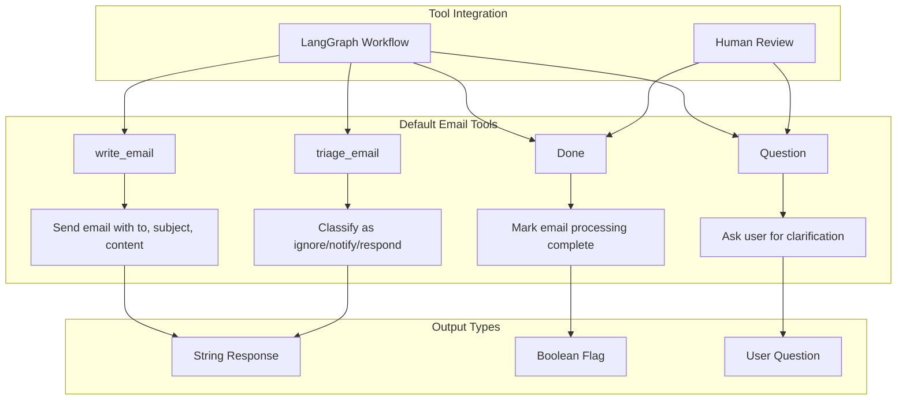
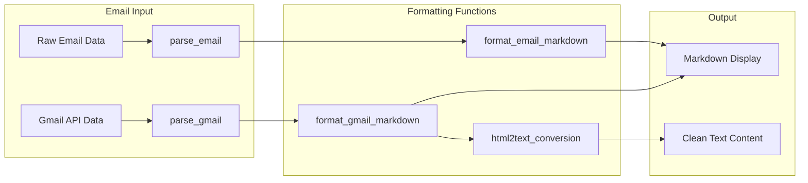
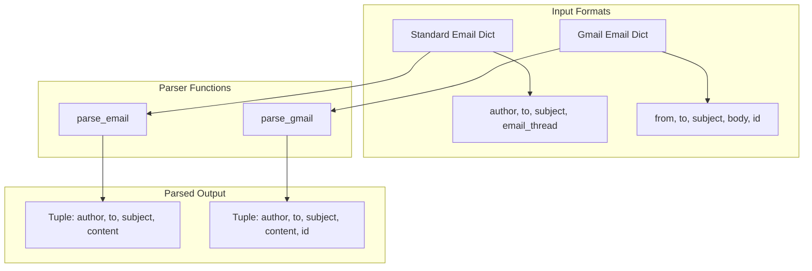
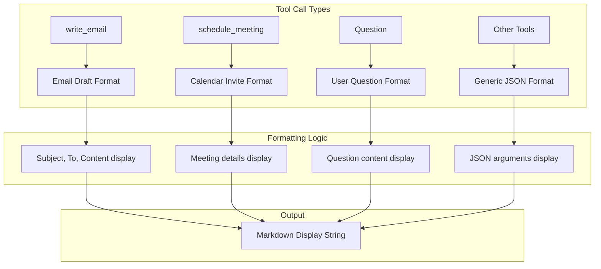
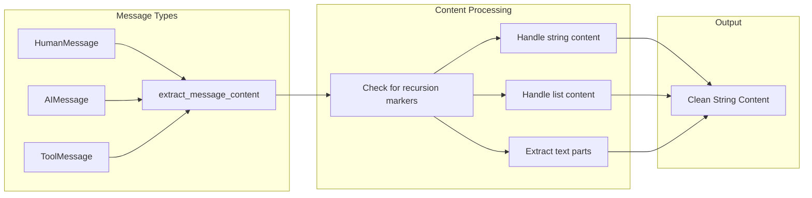
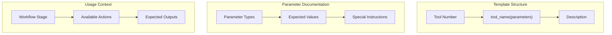
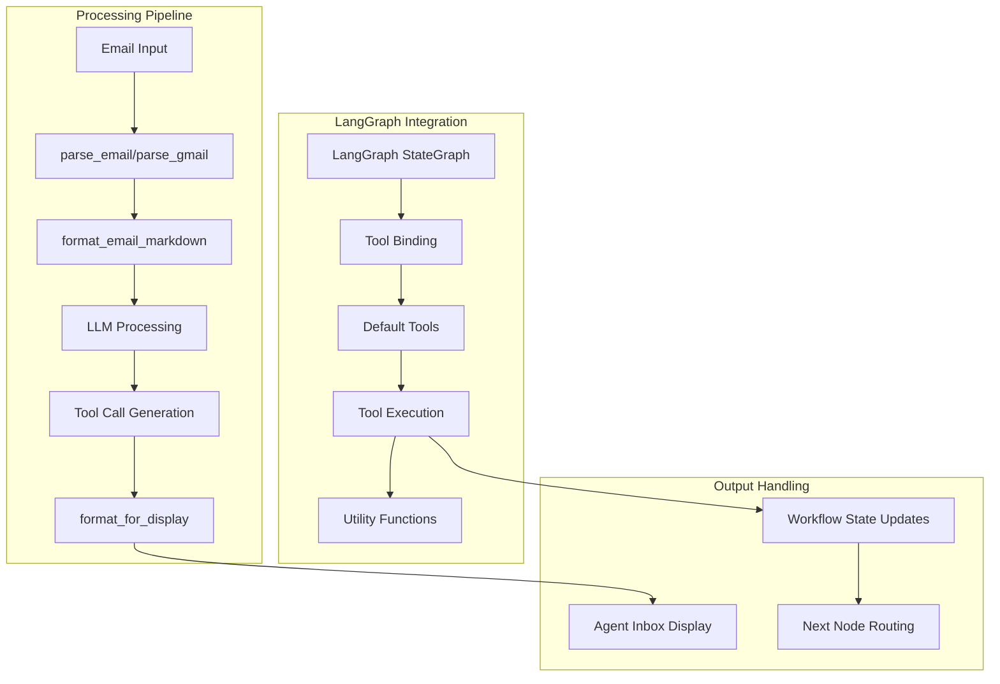

<!-- source: DeepWiki mcp.deepwiki.com · repo langchain-ai/agents-from-scratch · page 4.2 Default Tools and Utility Functions · fetched 2026-10-26 -->

# Default Tools and Utility Functions

Relevant source files

The following files were used as context for generating this wiki page:

- [notebooks/agent.ipynb](notebooks/agent.ipynb)
- [src/email_assistant/tools/base.py](src/email_assistant/tools/base.py)
- [src/email_assistant/tools/gmail/gmail_tools.py](src/email_assistant/tools/gmail/gmail_tools.py)
- [src/email_assistant/utils.py](src/email_assistant/utils.py)

This page documents the foundational tools and utility functions that provide core email processing capabilities across all variants of the email assistant system. These include the basic email tools for triage and response generation, utility functions for formatting and parsing email data, and helper functions for tool call processing. For Gmail-specific tools and API integration, see [Gmail Tools](#3.1).

## Default Email Tools

The default email tools provide the basic functionality for email processing and are defined in [src/email_assistant/tools/default/email_tools.py:1-25](). These tools form the foundation that all email assistant variants build upon.

### Core Tool Functions

**Sources:** [src/email_assistant/tools/default/email_tools.py:1-25]()

The `write_email` function [src/email_assistant/tools/default/email_tools.py:6-9]() serves as a placeholder for email sending functionality, returning a formatted string response. The `triage_email` function [src/email_assistant/tools/default/email_tools.py:12-14]() classifies emails into three categories using a Literal type constraint.

The `Done` and `Question` classes [src/email_assistant/tools/default/email_tools.py:17-24]() are Pydantic BaseModel tools that provide structured data for workflow control and user interaction respectively.

### Tool Usage Patterns

| Tool | Purpose | Return Type | Usage Context |
|------|---------|-------------|---------------|
| `write_email` | Send email responses | `str` | Response generation workflow |
| `triage_email` | Classify incoming emails | `str` | Email triage workflow |
| `Done` | Signal completion | `bool` | Workflow termination |
| `Question` | Request user input | `str` | Human-in-the-loop scenarios |

**Sources:** [src/email_assistant/tools/default/email_tools.py:1-25]()

## Email Processing Utilities

The utility functions in [src/email_assistant/utils.py:1-266]() provide essential email formatting, parsing, and content extraction capabilities used throughout the system.

### Email Formatting Functions

**Sources:** [src/email_assistant/utils.py:5-61]()

The `format_email_markdown` function [src/email_assistant/utils.py:5-26]() creates formatted markdown strings for email display, while `format_gmail_markdown` [src/email_assistant/utils.py:28-61]() extends this functionality with HTML-to-text conversion using the `html2text` library for Gmail integration.

### Email Parsing Functions

The parsing functions handle different email data formats:

- `parse_email` [src/email_assistant/utils.py:108-131]() - Extracts basic email fields from a dictionary input
- `parse_gmail` [src/email_assistant/utils.py:132-166]() - Handles Gmail-specific format including message IDs

**Sources:** [src/email_assistant/utils.py:108-166]()

## Tool Call Processing

The system provides specialized functions for handling tool calls in the human-in-the-loop workflow.

### Tool Call Formatting

The `format_for_display` function [src/email_assistant/utils.py:63-106]() converts tool calls into human-readable format for the Agent Inbox interface:

**Sources:** [src/email_assistant/utils.py:63-106]()

### Tool Call Extraction

The `extract_tool_calls` function [src/email_assistant/utils.py:232-243]() safely extracts tool call names from message objects, handling both dictionary and object formats with proper error checking.

## Message Content Processing

The system includes utilities for processing different message types and extracting clean content.

### Content Extraction Pipeline

**Sources:** [src/email_assistant/utils.py:168-197]()

The `extract_message_content` function [src/email_assistant/utils.py:168-197]() handles recursive content detection and processes both string and list-based message content formats safely.

## Prompt Templates

The prompt templates in [src/email_assistant/tools/default/prompt_templates.py:1-37]() provide standardized tool descriptions for different workflow variants.

### Template Hierarchy

| Template | Tools Included | Use Case |
|----------|---------------|----------|
| `STANDARD_TOOLS_PROMPT` | All tools including triage | Basic email assistant |
| `HITL_TOOLS_PROMPT` | Response tools + Question | Human-in-the-loop workflow |
| `HITL_MEMORY_TOOLS_PROMPT` | Same as HITL | Memory-enabled workflow |
| `AGENT_TOOLS_PROMPT` | Response tools only | Post-triage processing |

**Sources:** [src/email_assistant/tools/default/prompt_templates.py:4-37]()

### Tool Description Format

**Sources:** [src/email_assistant/tools/default/prompt_templates.py:1-37]()

The templates follow a consistent numbering scheme and include parameter details, with special notes for complex parameters like `preferred_day` datetime objects in the `schedule_meeting` tool.

## Integration with LangGraph Workflows

These default tools and utilities integrate with the broader LangGraph workflow system:

**Sources:** [src/email_assistant/utils.py:1-266](), [src/email_assistant/tools/default/email_tools.py:1-25]()

---

