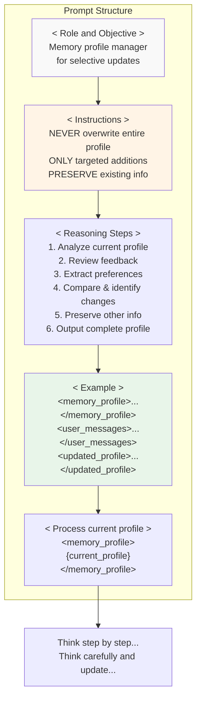
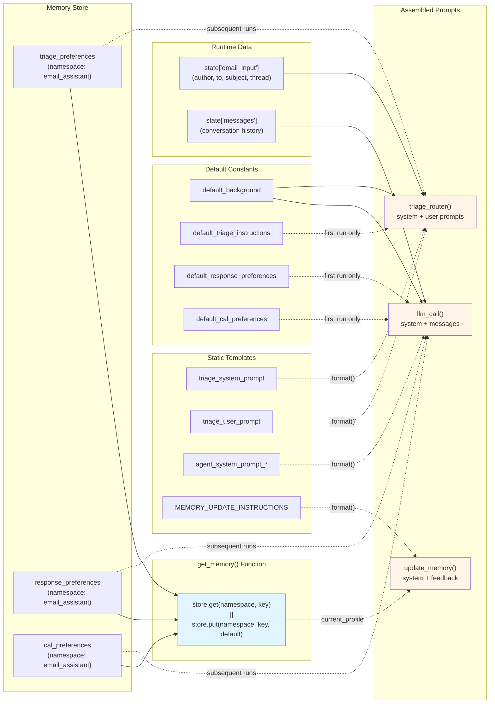
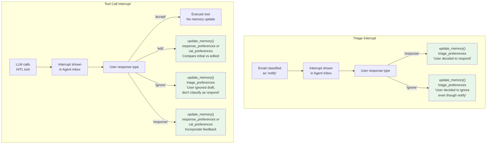

<!-- source: DeepWiki mcp.deepwiki.com · repo langchain-ai/agents-from-scratch · page 5 Prompt Engineering · fetched 2026-10-26 -->

# Prompt Engineering

<details>
<summary>Relevant source files</summary>

The following files were used as context for generating this wiki page:

- [notebooks/agent.ipynb](notebooks/agent.ipynb)
- [notebooks/hitl.ipynb](notebooks/hitl.ipynb)
- [notebooks/memory.ipynb](notebooks/memory.ipynb)
- [src/email_assistant/email_assistant_hitl_memory.py](src/email_assistant/email_assistant_hitl_memory.py)

</details>


This document describes the prompt architecture used throughout the email assistant system, including the structure, composition, and purpose of prompts for triage routing, agent response generation, and memory management.

For information about the tools that agents can invoke, see [Tool System](#4). For details on memory persistence and retrieval, see [Memory System](#3.3).

---

## Overview

The email assistant employs a multi-stage prompt architecture where different prompts serve distinct purposes across the workflow. Prompts are organized as reusable templates with placeholder variables that are populated at runtime based on user preferences, email content, and conversation state.

**Prompt Categories:**

| Category | Purpose | Key Templates | Structured Output |
|----------|---------|---------------|-------------------|
| Triage | Email classification (ignore/notify/respond) | `triage_system_prompt`, `triage_user_prompt` | `RouterSchema` |
| Agent | Tool selection and response generation | `agent_system_prompt_*` variants | Tool calls |
| Memory | LLM-driven preference updates | `MEMORY_UPDATE_INSTRUCTIONS` | `UserPreferences` |
| Tools | Tool usage guidelines | `AGENT_TOOLS_PROMPT`, `HITL_TOOLS_PROMPT` | N/A (embedded) |

Sources: [notebooks/agent.ipynb:156-212](), [notebooks/memory.ipynb:248-251](), [src/email_assistant/email_assistant_hitl_memory.py:9-11]()

---

## System Prompt Flow

The following diagram shows how different prompts flow through the system and which code entities are responsible for assembling them:

```mermaid
graph TB
    subgraph "Triage Phase"
        TS["triage_system_prompt"]
        TU["triage_user_prompt"]
        TI["default_triage_instructions<br/>or<br/>memory-retrieved<br/>triage_preferences"]
        BG1["default_background"]
        
        TS -->|format()| TSF["Formatted System Prompt"]
        TU -->|format()| TUF["Formatted User Prompt"]
        TI -->|injected into| TS
        BG1 -->|injected into| TS
    end
    
    subgraph "triage_router() Node"
        TSF --> LLM_ROUTER["llm_router.invoke()"]
        TUF --> LLM_ROUTER
        LLM_ROUTER --> RS["RouterSchema<br/>{classification, reasoning}"]
    end
    
    subgraph "Agent Phase"
        AS["agent_system_prompt_*"]
        TP["AGENT_TOOLS_PROMPT<br/>or HITL variant"]
        BG2["default_background"]
        RP["response_preferences<br/>(memory-retrieved)"]
        CP["cal_preferences<br/>(memory-retrieved)"]
        
        AS -->|format()| ASF["Formatted System Prompt"]
        TP -->|injected into| AS
        BG2 -->|injected into| AS
        RP -->|injected into| AS
        CP -->|injected into| AS
    end
    
    subgraph "llm_call() Node"
        ASF --> LLM_TOOLS["llm_with_tools.invoke()"]
        MSGS["state['messages']"] --> LLM_TOOLS
        LLM_TOOLS --> TC["Tool Calls<br/>{name, args, id}"]
    end
    
    subgraph "Memory Update Phase"
        MUI["MEMORY_UPDATE_INSTRUCTIONS"]
        MUIR["MEMORY_UPDATE_INSTRUCTIONS_REINFORCEMENT"]
        CP_OLD["current_profile<br/>(from store)"]
        FEEDBACK["feedback_messages"]
        
        MUI -->|format()| MUIF["Formatted Memory Prompt"]
        CP_OLD -->|injected into| MUI
        MUIF --> LLM_MEM["llm.invoke()<br/>.with_structured_output()"]
        FEEDBACK --> LLM_MEM
        LLM_MEM --> UP["UserPreferences<br/>{chain_of_thought,<br/>user_preferences}"]
    end
    
    subgraph "update_memory() Function"
        UP --> STORE["store.put()<br/>(namespace, key, value)"]
    end
    
    RS -.->|"if 'respond'"| AS
    TC -.->|"if 'ignore' or 'response'"| MUI
    
    style TS fill:#f9f9f9
    style AS fill:#f9f9f9
    style MUI fill:#f9f9f9
    style LLM_ROUTER fill:#e1f5ff
    style LLM_TOOLS fill:#e1f5ff
    style LLM_MEM fill:#e1f5ff
```

Sources: [notebooks/agent.ipynb:237-287](), [notebooks/agent.ipynb:354-374](), [notebooks/memory.ipynb:645-666](), [src/email_assistant/email_assistant_hitl_memory.py:79-153](), [src/email_assistant/email_assistant_hitl_memory.py:224-247]()

---

## Triage Router Prompts

The triage router uses a two-part prompt structure: a system prompt that establishes the role and rules, and a user prompt that presents the email content.

### System Prompt Structure

The `triage_system_prompt` template defines the classification task and is populated with background information and triage instructions:

```
triage_system_prompt.format(
    background=<user background>,
    triage_instructions=<classification rules>
)
```

**Template Variables:**

- `{background}`: Context about the user (defaults to `default_background`)
- `{triage_instructions}`: Rules for classification (defaults to `default_triage_instructions`, or memory-retrieved `triage_preferences`)

The prompt defines three classification categories:
1. **IGNORE**: Marketing, spam, CC threads without questions
2. **NOTIFY**: Important FYI information without requiring response
3. **RESPOND**: Direct questions, meeting requests, critical issues

Sources: [notebooks/agent.ipynb:180-212](), [src/email_assistant/email_assistant_hitl_memory.py:98-104]()

### User Prompt Structure

The `triage_user_prompt` template presents the email content to be classified:

```
triage_user_prompt.format(
    author=<email sender>,
    to=<email recipient>,
    subject=<email subject>,
    email_thread=<email body>
)
```

The user prompt is formatted after parsing the incoming email via `parse_email(state["email_input"])`.

Sources: [notebooks/agent.ipynb:240-248](), [src/email_assistant/email_assistant_hitl_memory.py:89-92]()

### Structured Output

The triage router uses `llm_router = llm.with_structured_output(RouterSchema)` to enforce structured classification:

```python
class RouterSchema(BaseModel):
    reasoning: str = Field(description="Step-by-step reasoning...")
    classification: Literal["ignore", "respond", "notify"] = Field(description="...")
```

This ensures the LLM output is always parseable and type-safe.

Sources: [notebooks/agent.ipynb:221-235]()

---

## Agent Response Prompts

The agent uses a more complex system prompt that includes tool descriptions, background information, and learned preferences. Unlike the triage router, the agent prompt evolves across implementation stages.

### Prompt Variants

| Variant | File Reference | Additional Components |
|---------|---------------|----------------------|
| `agent_system_prompt` | Basic agent | `AGENT_TOOLS_PROMPT` |
| `agent_system_prompt_hitl` | HITL agent | `HITL_TOOLS_PROMPT` (includes `Question` tool) |
| `agent_system_prompt_hitl_memory` | Memory-enabled | `HITL_MEMORY_TOOLS_PROMPT` + memory-retrieved preferences |

Sources: [notebooks/agent.ipynb:315-317](), [notebooks/hitl.ipynb:80](), [notebooks/memory.ipynb:248]()

### System Prompt Assembly

The agent system prompt is assembled by injecting multiple components:

```python
agent_system_prompt_hitl_memory.format(
    tools_prompt=HITL_MEMORY_TOOLS_PROMPT,
    background=default_background,
    response_preferences=response_preferences,  # from memory
    cal_preferences=cal_preferences  # from memory
)
```

**Template Variables:**

- `{tools_prompt}`: Descriptions of available tools and usage patterns
- `{background}`: User context (same as triage)
- `{response_preferences}`: Learned preferences for email style and content (retrieved via `get_memory()`)
- `{cal_preferences}`: Learned preferences for meeting scheduling (retrieved via `get_memory()`)

Sources: [notebooks/agent.ipynb:363-368](), [src/email_assistant/email_assistant_hitl_memory.py:237-242]()

### Tool Binding

The agent LLM is bound with tools and forced to always call one:

```python
llm_with_tools = llm.bind_tools(tools, tool_choice="required")
```

This implements a strict ReAct pattern where the LLM must select a tool at every step (including the `Done` tool to signal completion).

Sources: [notebooks/agent.ipynb:352](), [src/email_assistant/email_assistant_hitl_memory.py:28]()

### Message History

The agent system prompt is prepended to the conversation history:

```python
llm_with_tools.invoke([
    {"role": "system", "content": formatted_system_prompt}
] + state["messages"])
```

This allows the agent to maintain context across multiple tool calls within a single email response.

Sources: [notebooks/agent.ipynb:360-372](), [src/email_assistant/email_assistant_hitl_memory.py:234-246]()

---

## Memory Update Prompts

The memory update mechanism uses LLM-driven prompt engineering to selectively update user preferences based on human feedback. This is one of the most sophisticated prompt patterns in the system.

### Memory Update Instructions

The `MEMORY_UPDATE_INSTRUCTIONS` template defines the memory update task with explicit constraints:



**Key Prompting Techniques:**

1. **Repetition**: Instructions appear at start, end (`MEMORY_UPDATE_INSTRUCTIONS_REINFORCEMENT`), and in feedback messages
2. **XML Delimiters**: Clear structure using `<memory_profile>`, `<user_messages>`, `<updated_profile>` tags
3. **Explicit Constraints**: "NEVER overwrite", "ONLY make targeted additions", "PRESERVE all other"
4. **Examples**: Before-and-after example showing minimal targeted update
5. **Chain of Thought**: Structured reasoning steps embedded in instructions

Sources: [notebooks/memory.ipynb:438-592](), [src/email_assistant/email_assistant_hitl_memory.py:11]()

### Reinforcement Instructions

The `MEMORY_UPDATE_INSTRUCTIONS_REINFORCEMENT` constant repeats the core constraints:

```
Remember:
• NEVER overwrite the entire memory profile
• ONLY make targeted additions...
• PRESERVE all other existing information...
```

This is appended to feedback messages to remind the LLM of constraints at the point of decision-making.

Sources: [notebooks/memory.ipynb:596-631](), [src/email_assistant/email_assistant_hitl_memory.py:363-364]()

### Memory Update Invocation

The `update_memory()` function assembles the complete prompt:

```python
def update_memory(store, namespace, messages):
    user_preferences = store.get(namespace, "user_preferences")
    
    llm = init_chat_model("openai:gpt-4.1").with_structured_output(UserPreferences)
    result = llm.invoke([
        {"role": "system", "content": MEMORY_UPDATE_INSTRUCTIONS.format(
            current_profile=user_preferences.value,
            namespace=namespace
        )},
    ] + messages)
    
    store.put(namespace, "user_preferences", result.user_preferences)
```

The `messages` parameter contains the feedback context (original email, tool calls, user edits/responses).

Sources: [notebooks/memory.ipynb:645-666](), [src/email_assistant/email_assistant_hitl_memory.py:57-76]()

### Structured Output Schema

Memory updates use a chain-of-thought schema to capture reasoning:

```python
class UserPreferences(BaseModel):
    chain_of_thought: str = Field(
        description="Reasoning about which user preferences need to add/update"
    )
    user_preferences: str = Field(
        description="Updated user preferences"
    )
```

The `chain_of_thought` field encourages the LLM to explicitly reason before updating, improving update quality.

Sources: [notebooks/memory.ipynb:640-643](), [src/email_assistant/email_assistant_hitl_memory.py:12]()

---

## Prompt Assembly Patterns

The following diagram shows how prompt templates are assembled at runtime with different data sources:



### Default-to-Memory Pattern

The `get_memory()` function implements a pattern where defaults are used initially, then replaced by learned preferences:

```python
def get_memory(store, namespace, default_content=None):
    user_preferences = store.get(namespace, "user_preferences")
    
    if user_preferences:
        return user_preferences.value  # Use learned preferences
    else:
        store.put(namespace, "user_preferences", default_content)
        return default_content  # Use defaults first time
```

This allows the system to start with sensible defaults and progressively refine them based on user feedback.

Sources: [notebooks/memory.ipynb:395-420](), [src/email_assistant/email_assistant_hitl_memory.py:30-55]()

### Memory Namespaces

Preferences are organized by namespace tuples:

| Namespace | Purpose | Updated By |
|-----------|---------|------------|
| `("email_assistant", "triage_preferences")` | Email classification rules | `triage_interrupt_handler()`, `interrupt_handler()` (ignore cases) |
| `("email_assistant", "response_preferences")` | Email writing style/content | `interrupt_handler()` (edit/response on write_email) |
| `("email_assistant", "cal_preferences")` | Meeting scheduling preferences | `interrupt_handler()` (edit/response on schedule_meeting) |

Sources: [src/email_assistant/email_assistant_hitl_memory.py:98](), [src/email_assistant/email_assistant_hitl_memory.py:228-230](), [src/email_assistant/email_assistant_hitl_memory.py:361-379]()

---

## Feedback Integration Points

The system updates memory at specific points based on user actions during HITL interactions:



Each `update_memory()` call includes contextual messages that explain what action the user took and what should be learned.

Sources: [src/email_assistant/email_assistant_hitl_memory.py:155-222](), [src/email_assistant/email_assistant_hitl_memory.py:249-456]()

---

## Prompt Optimization Techniques

The prompts employ several techniques derived from the GPT-4.1 prompting guide:

**Technique Summary Table:**

| Technique | Application | Location |
|-----------|-------------|----------|
| **Instruction Repetition** | Key rules repeated at start and end | Memory update prompts |
| **XML Delimiters** | Structured sections with clear boundaries | Memory update prompts |
| **Chain of Thought** | Explicit reasoning steps before output | `RouterSchema.reasoning`, `UserPreferences.chain_of_thought` |
| **Few-Shot Examples** | Before/after example of minimal update | `MEMORY_UPDATE_INSTRUCTIONS` |
| **Role Definition** | Clear role statement at prompt start | All system prompts |
| **Explicit Constraints** | "NEVER", "ONLY", "PRESERVE" imperatives | Memory update prompts |
| **Format Specification** | "Generate as string", "Format consistently" | Memory update prompts |
| **Tool Choice Enforcement** | `tool_choice="required"` forces tool use | Agent LLM binding |

Sources: [notebooks/memory.ipynb:428-434](), [notebooks/agent.ipynb:352]()

---

