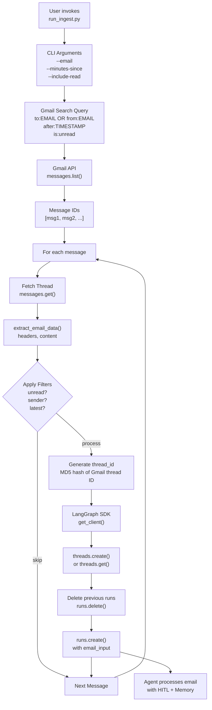
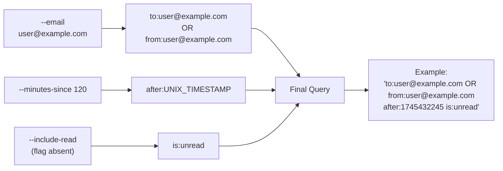
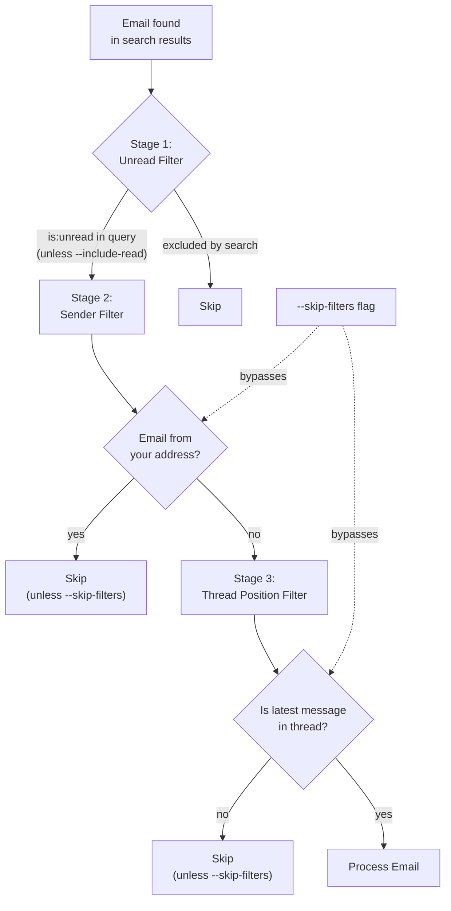
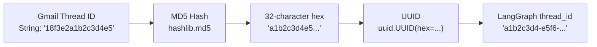
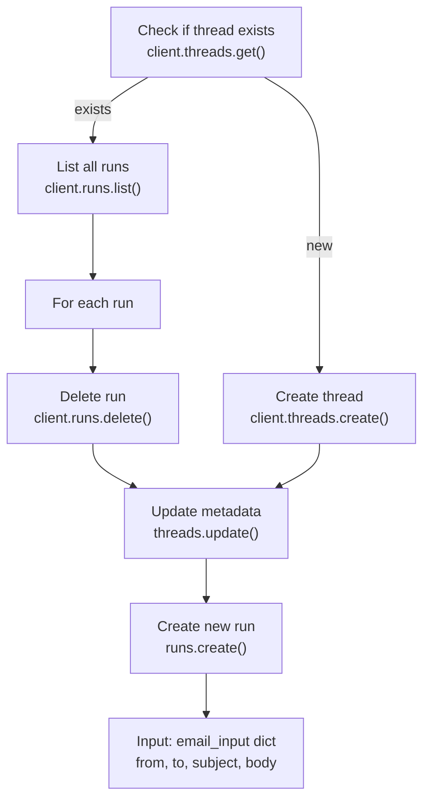
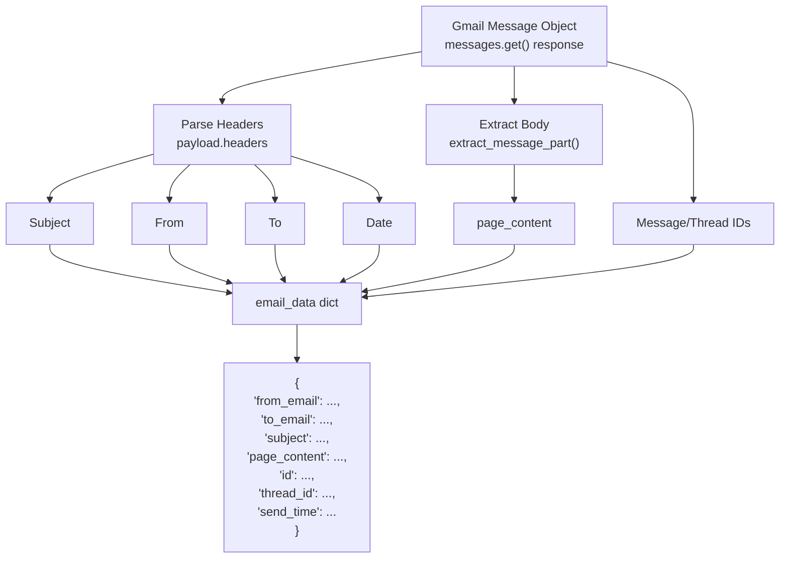
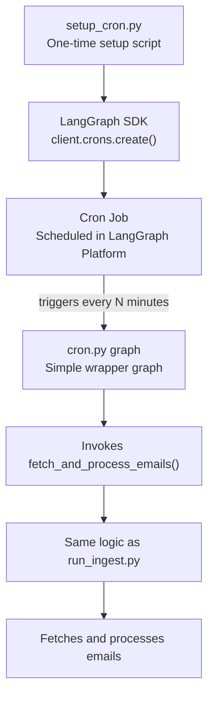
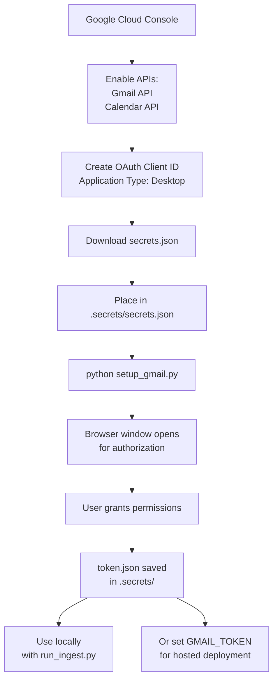
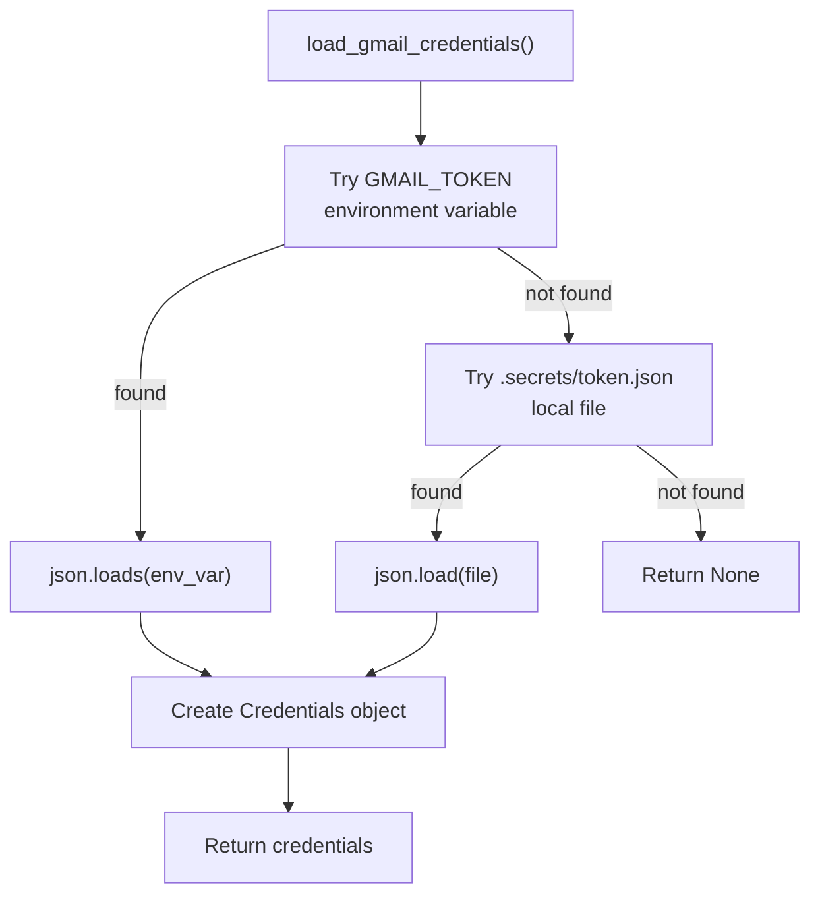

<!-- source: DeepWiki mcp.deepwiki.com · repo langchain-ai/agents-from-scratch · page 6 Email Ingestion and Automation · fetched 2026-10-26 -->

# Email Ingestion and Automation

<details>
<summary>Relevant source files</summary>

The following files were used as context for generating this wiki page:

- [README.md](README.md)
- [src/email_assistant/tools/gmail/README.md](src/email_assistant/tools/gmail/README.md)
- [src/email_assistant/tools/gmail/run_ingest.py](src/email_assistant/tools/gmail/run_ingest.py)
- [src/email_assistant/tools/gmail/setup_gmail.py](src/email_assistant/tools/gmail/setup_gmail.py)

</details>


## Purpose and Scope

This page documents the automated email ingestion system that fetches emails from Gmail and routes them to the LangGraph email assistant for processing. The ingestion system handles Gmail API integration, email filtering, thread management, and optional cron-based automation.

For information about the Gmail API tools used by the assistant itself (send email, schedule meeting, etc.), see [Gmail Integration](#3.4). This page focuses specifically on the **ingestion** side: how emails are discovered, filtered, and fed into the system for processing.

## System Overview

The email ingestion system consists of three main components:

1. **`run_ingest.py`** - Command-line script for fetching and processing emails
2. **Gmail API Integration** - OAuth-authenticated access to Gmail search and retrieval
3. **LangGraph SDK Integration** - Creates threads and runs for each email



**Sources:** [src/email_assistant/tools/gmail/run_ingest.py:1-341](), [src/email_assistant/tools/gmail/README.md:184-280]()

## The run_ingest.py Script

### Core Functionality

The `run_ingest.py` script serves as the primary entry point for email ingestion. It authenticates with Gmail, searches for relevant emails, applies filtering rules, and submits each email to the LangGraph server.

**Key Functions:**

| Function | Purpose | Lines |
|----------|---------|-------|
| `load_gmail_credentials()` | Loads OAuth credentials from `token.json` or `GMAIL_TOKEN` env var | [61-113]() |
| `extract_message_part()` | Recursively extracts email content from MIME parts, preferring text/plain | [30-59]() |
| `extract_email_data()` | Parses message headers and body into structured format | [115-139]() |
| `ingest_email_to_langgraph()` | Creates LangGraph thread and run for an email | [141-202]() |
| `fetch_and_process_emails()` | Main orchestration function | [204-284]() |

**Sources:** [src/email_assistant/tools/gmail/run_ingest.py:1-341]()

### Command-Line Parameters

The script accepts several parameters that control email fetching and filtering behavior:

```bash
python src/email_assistant/tools/gmail/run_ingest.py \
  --email user@example.com \
  --minutes-since 120 \
  --graph-name email_assistant_hitl_memory_gmail \
  --url http://127.0.0.1:2024 \
  --include-read \
  --early
```

| Parameter | Type | Default | Description |
|-----------|------|---------|-------------|
| `--email` | string | **required** | Email address to fetch messages for |
| `--minutes-since` | int | 120 | Only retrieve emails newer than N minutes |
| `--graph-name` | string | `email_assistant_hitl_memory_gmail` | LangGraph graph to invoke |
| `--url` | string | `http://127.0.0.1:2024` | LangGraph deployment URL |
| `--include-read` | flag | false | Process read emails (default: unread only) |
| `--early` | flag | false | Stop after processing first email |
| `--rerun` | flag | false | Reprocess previously processed emails |
| `--skip-filters` | flag | false | Bypass sender and thread-position filters |

**Sources:** [src/email_assistant/tools/gmail/run_ingest.py:286-334](), [src/email_assistant/tools/gmail/README.md:78-96]()

## Gmail Search Query Construction

The script constructs Gmail API search queries dynamically based on CLI parameters:



The query assembly happens in `fetch_and_process_emails()`:

```python
# Construct Gmail search query
query = f"to:{email_address} OR from:{email_address}"

# Add time constraint if specified
if args.minutes_since > 0:
    from datetime import timedelta
    after = int((datetime.now() - timedelta(minutes=args.minutes_since)).timestamp())
    query += f" after:{after}"
    
# Only include unread emails unless include_read is True
if not args.include_read:
    query += " is:unread"
```

**Sources:** [src/email_assistant/tools/gmail/run_ingest.py:222-234](), [src/email_assistant/tools/gmail/README.md:189-205]()

## Email Filtering Logic

The ingestion system applies multiple layers of filtering to determine which emails should be processed:

### Three-Stage Filter Pipeline



**Filter Details:**

| Filter | Default Behavior | Override | Implementation |
|--------|-----------------|----------|----------------|
| **Unread** | Only unread emails | `--include-read` | Gmail search query: `is:unread` |
| **Sender** | Skip emails from your address | `--skip-filters` | Check if email address in From header |
| **Thread Position** | Only latest message in thread | `--skip-filters` | Compare message ID with thread's last message |

**Important:** The `--skip-filters` flag does NOT bypass the unread filter. To process read messages, you must use `--include-read`.

**Sources:** [src/email_assistant/tools/gmail/README.md:219-267]()

## Thread Management and Deduplication

### Thread ID Mapping

The system maps Gmail thread IDs to deterministic UUIDs for use as LangGraph thread identifiers:



**Implementation:**

```python
def ingest_email_to_langgraph(email_data, graph_name, url="http://127.0.0.1:2024"):
    # Create a consistent UUID for the thread
    raw_thread_id = email_data["thread_id"]
    thread_id = str(
        uuid.UUID(hex=hashlib.md5(raw_thread_id.encode("UTF-8")).hexdigest())
    )
    print(f"Gmail thread ID: {raw_thread_id} → LangGraph thread ID: {thread_id}")
```

This ensures that:
- Multiple emails in the same Gmail thread map to the same LangGraph thread
- The mapping is deterministic (same input → same output)
- Thread IDs are valid UUIDs

**Sources:** [src/email_assistant/tools/gmail/run_ingest.py:146-150]()

### Run Cleanup and State Management

When processing an email for an existing thread, the script cleans up previous runs to avoid state accumulation:



**Key Operations:**

1. **Check Thread Existence** - [src/email_assistant/tools/gmail/run_ingest.py:154-162]()
2. **Cleanup Previous Runs** - [src/email_assistant/tools/gmail/run_ingest.py:165-179]()
3. **Update Metadata** - [src/email_assistant/tools/gmail/run_ingest.py:182]()
4. **Create Fresh Run** - [src/email_assistant/tools/gmail/run_ingest.py:187-198]()

The `multitask_strategy="rollback"` parameter ensures that if a new email arrives while the agent is processing a previous one, the new run rolls back the old one rather than running concurrently.

**Sources:** [src/email_assistant/tools/gmail/run_ingest.py:141-202]()

## Email Data Extraction

The script extracts structured email data from Gmail's API response:



### MIME Part Extraction

The `extract_message_part()` function handles complex multipart MIME structures with a priority system:

1. **Prefer text/plain** - Most readable format
2. **Fallback to text/html** - If no plain text available
3. **Recursive search** - Navigate nested multipart structures

**Sources:** [src/email_assistant/tools/gmail/run_ingest.py:30-59](), [src/email_assistant/tools/gmail/run_ingest.py:115-139]()

## Cron Job Automation

For production deployments, the system supports scheduled ingestion via cron jobs.

### Cron Architecture



**Sources:** [src/email_assistant/tools/gmail/README.md:136-182]()

### Setting Up a Cron Job

```bash
python src/email_assistant/tools/gmail/setup_cron.py \
  --email user@example.com \
  --url https://your-deployment.us.langgraph.app \
  --schedule "*/10 * * * *" \
  --minutes-since 60
```

**Parameters:**

| Parameter | Default | Description |
|-----------|---------|-------------|
| `--email` | **required** | Email address to monitor |
| `--url` | **required** | LangGraph deployment URL |
| `--schedule` | `"*/10 * * * *"` | Cron expression (every 10 minutes) |
| `--minutes-since` | 60 | Time window for email fetching |
| `--graph-name` | `email_assistant_hitl_memory_gmail` | Graph to use |
| `--include-read` | false | Include read emails |

### Cron Implementation Components

The cron system consists of two files:

1. **`src/email_assistant/cron.py`** - Defines a LangGraph graph that wraps the ingestion logic
2. **`src/email_assistant/tools/gmail/setup_cron.py`** - Creates the scheduled job via SDK

**Managing Cron Jobs:**

```python
from langgraph_sdk import get_client

client = get_client(url="https://your-deployment.us.langgraph.app")

# List all cron jobs
cron_jobs = await client.crons.list()

# Delete a cron job
await client.crons.delete(cron_job_id)
```

**Sources:** [src/email_assistant/tools/gmail/README.md:156-182]()

## Deployment Modes

The ingestion system supports two deployment modes with different setup requirements:

### Local Development

For local development with `langgraph dev`:

```bash
# Terminal 1: Start LangGraph server
langgraph dev

# Terminal 2: Run ingestion
python src/email_assistant/tools/gmail/run_ingest.py \
  --email user@example.com \
  --minutes-since 1000 \
  --url http://127.0.0.1:2024
```

**Requirements:**
- Local `token.json` file in `.secrets/` directory
- LangGraph server running on port 2024
- Can process emails interactively

**Sources:** [src/email_assistant/tools/gmail/README.md:58-97]()

### Hosted Deployment

For production deployments on LangGraph Platform:

```bash
# One-time setup: Deploy graph to platform (via LangSmith UI)
# Set environment variables:
#   GMAIL_TOKEN - Full contents of token.json
#   GMAIL_SECRET - Full contents of secrets.json
#   OPENAI_API_KEY

# Run ingestion against hosted deployment
python src/email_assistant/tools/gmail/run_ingest.py \
  --email user@example.com \
  --minutes-since 120 \
  --url https://your-deployment.us.langgraph.app

# Or set up automated cron job
python src/email_assistant/tools/gmail/setup_cron.py \
  --email user@example.com \
  --url https://your-deployment.us.langgraph.app
```

**Requirements:**
- Deployed graph on LangGraph Platform
- Environment variables set in deployment config
- Optional: Cron job for continuous monitoring

**Sources:** [src/email_assistant/tools/gmail/README.md:105-154]()

## Authentication Setup

Before running ingestion, OAuth credentials must be configured:

### Initial Setup Process



The `setup_gmail.py` script handles the OAuth flow:

1. Reads client configuration from `.secrets/secrets.json`
2. Initiates OAuth flow with required scopes (Gmail + Calendar)
3. Opens browser for user authorization
4. Saves access/refresh tokens to `.secrets/token.json`

**Required Scopes:**
- `https://www.googleapis.com/auth/gmail.modify`
- `https://www.googleapis.com/auth/calendar`

**Sources:** [src/email_assistant/tools/gmail/setup_gmail.py:1-87](), [src/email_assistant/tools/gmail/README.md:11-56]()

## Credential Loading

The `load_gmail_credentials()` function supports multiple credential sources:



This dual-source approach enables:
- **Local development**: Use `token.json` file
- **Hosted deployment**: Use `GMAIL_TOKEN` environment variable

**Sources:** [src/email_assistant/tools/gmail/run_ingest.py:61-113]()

## Gmail API Limitations

The ingestion system must work within Gmail API constraints:

| Limitation | Impact | Mitigation |
|------------|--------|------------|
| **Search-based retrieval** | No direct "get all emails" endpoint | Use comprehensive search queries |
| **Indexing lag** | Very recent emails may not appear in search | Use `--minutes-since` with buffer time |
| **Two-stage process** | Search returns IDs, then fetch full messages | Script handles both stages automatically |
| **Thread complexity** | Must fetch entire thread to get context | Script fetches full thread for each message |
| **Search result incompleteness** | Search may not return all matching emails | Use broader time windows when troubleshooting |

**Troubleshooting Missing Emails:**

```bash
# Most comprehensive search - processes everything
python run_ingest.py \
  --email user@example.com \
  --minutes-since 10000 \
  --include-read \
  --skip-filters
```

**Sources:** [src/email_assistant/tools/gmail/README.md:268-280](), [src/email_assistant/tools/gmail/README.md:89-96]()

---

