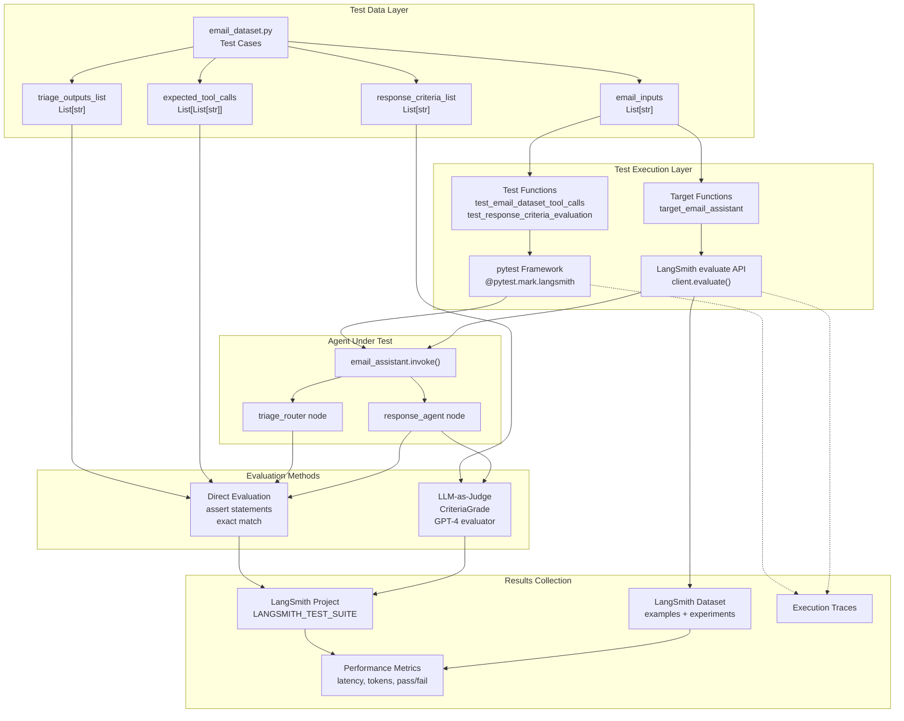
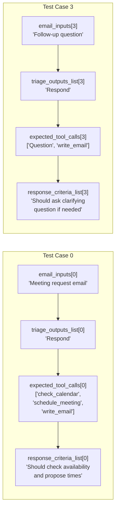
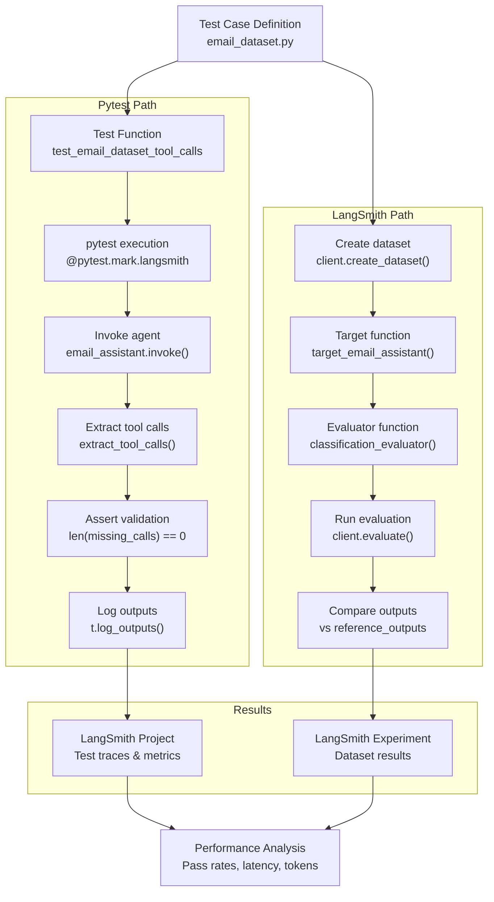
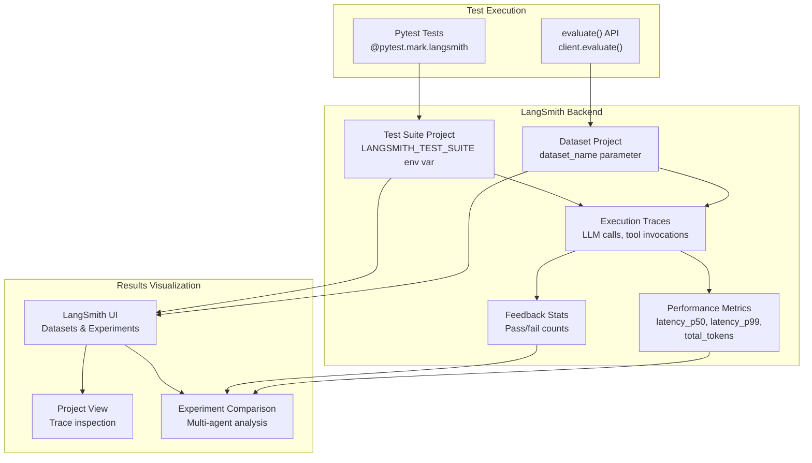
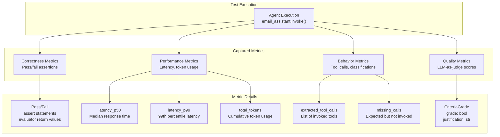

<!-- source: DeepWiki mcp.deepwiki.com · repo langchain-ai/agents-from-scratch · page 7 Evaluation System · fetched 2026-10-26 -->

# Evaluation System

<details>
<summary>Relevant source files</summary>

The following files were used as context for generating this wiki page:

- [README.md](README.md)
- [notebooks/evaluation.ipynb](notebooks/evaluation.ipynb)

</details>


## Purpose and Scope

This document describes the evaluation system for the email assistant agent, including test dataset structure, evaluation methodologies, and integration with LangSmith for tracking results. The system supports both traditional pytest-based testing and LangSmith's dataset evaluation API, enabling comprehensive assessment of agent behavior across triage decisions, tool calling accuracy, and response quality.

For detailed information about the pytest testing framework implementation, see [Testing Framework](#7.1). For information about LLM-based evaluation methodologies, see [LLM-as-Judge Evaluation](#7.2).

**Sources:** [README.md:92-166](), [notebooks/evaluation.ipynb:1-584]()

---

## Evaluation Architecture Overview

The evaluation system operates on multiple layers to assess different aspects of the email assistant's behavior. Tests range from unit-level evaluations (triage classification, tool call verification) to end-to-end integration tests (complete email response quality).

### System Components Diagram



**Sources:** [notebooks/evaluation.ipynb:10-53](), [notebooks/evaluation.ipynb:187-346]()

---

## Test Dataset Structure

The test dataset is defined in `eval/email_dataset.py` and provides comprehensive test cases covering diverse email scenarios. Each test case includes multiple dimensions for evaluation.

### Dataset Components

| Component | Variable Name | Type | Purpose |
|-----------|--------------|------|---------|
| Input Emails | `email_inputs` | `List[str]` | Collection of diverse email examples for testing |
| Triage Classifications | `triage_outputs_list` | `List[str]` | Ground truth for triage decisions (`Respond`, `Notify`, `Ignore`) |
| Expected Tool Calls | `expected_tool_calls` | `List[List[str]]` | Tools that should be invoked for each email |
| Response Criteria | `response_criteria_list` | `List[str]` | Success criteria for evaluating response quality |

**Sources:** [notebooks/evaluation.ipynb:60-93]()

### Dataset Structure Example



**Sources:** [notebooks/evaluation.ipynb:74-93]()

### Structured Dataset for LangSmith

For LangSmith evaluate API, the dataset is structured as a list of examples with explicit input/output pairs:

```python
examples_triage = [
    {
        "inputs": {"email_input": email_input_1},
        "outputs": {"classification": triage_output_1},  # Becomes reference_output
    },
    ...
]
```

This structure is used in [notebooks/evaluation.ipynb:196-262]() to create datasets via `client.create_dataset()`.

**Sources:** [notebooks/evaluation.ipynb:196-262]()

---

## Evaluation Approaches

The system supports two complementary evaluation approaches, each with distinct advantages and use cases.

### Comparison of Evaluation Methods

| Aspect | Pytest Integration | LangSmith Datasets |
|--------|-------------------|-------------------|
| **Primary Use Case** | Complex evaluations requiring custom logic per test | Standardized evaluations across shared datasets |
| **Test Definition** | Python test functions with `@pytest.mark.langsmith` | Dataset + target function + evaluators |
| **Collaboration** | Individual developer workflows | Team-based dataset curation |
| **Test Data** | Parametrized via `@pytest.mark.parametrize` | Centralized LangSmith dataset |
| **Execution** | Command-line pytest | `client.evaluate()` API |
| **Best For** | Tool call verification, specific edge cases | Triage classification, standardized metrics |

**Sources:** [notebooks/evaluation.ipynb:39-53]()

### Evaluation Flow Diagram



**Sources:** [notebooks/evaluation.ipynb:99-168](), [notebooks/evaluation.ipynb:187-346]()

---

## Integration with LangSmith

All evaluation runs integrate with LangSmith for tracing, metrics collection, and result visualization. This integration provides observability into agent execution and enables performance comparison across implementations.

### LangSmith Integration Components



**Sources:** [notebooks/evaluation.ipynb:160-180](), [notebooks/evaluation.ipynb:523-547]()

### Environment Configuration

Tests are configured via environment variables:

| Variable | Purpose | Example |
|----------|---------|---------|
| `LANGSMITH_TEST_SUITE` | Project name for pytest results | `"Email assistant: Test Tools For Interrupt"` |
| `LANGSMITH_EXPERIMENT` | Experiment identifier | `"email_assistant"` |
| `LANGSMITH_PROJECT` | Default project for traces | `"interrupt-workshop"` |
| `LANGSMITH_API_KEY` | Authentication | Required |
| `LANGSMITH_TRACING` | Enable tracing | `"true"` |

**Sources:** [README.md:24-45](), [notebooks/evaluation.ipynb:160-180]()

---

## Evaluation Metrics and Results

The evaluation system collects multiple types of metrics to assess agent performance comprehensively.

### Metrics Collection



**Sources:** [notebooks/evaluation.ipynb:128-153](), [notebooks/evaluation.ipynb:529-547]()

### Results Access via API

Results can be programmatically accessed using the LangSmith client:

```python
# Access experiment results
experiment_results = client.read_project(
    project_name=experiment_name, 
    include_stats=True
)

# Available metrics:
# - experiment_results.latency_p50
# - experiment_results.latency_p99
# - experiment_results.total_tokens
# - experiment_results.feedback_stats
```

This code pattern is demonstrated in [notebooks/evaluation.ipynb:529-547]().

**Sources:** [notebooks/evaluation.ipynb:523-547]()

---

## Running Evaluations

### Running Tests with Pytest

Tests can be executed via the command line with environment variables:

```bash
# Run all tests
python tests/run_all_tests.py

# Run specific test suite
LANGSMITH_TEST_SUITE='Email assistant: Test Tools' pytest notebooks/test_tools.py

# Run response evaluation
LANGSMITH_TEST_SUITE='Email assistant: Test Full Response' \
LANGSMITH_EXPERIMENT='email_assistant' \
pytest tests/test_response.py --agent-module email_assistant
```

**Sources:** [README.md:132-166](), [notebooks/evaluation.ipynb:164-168]()

### Running Tests with LangSmith evaluate API

Dataset-based evaluation uses the LangSmith client:

```python
experiment_results = client.evaluate(
    target_email_assistant,           # Target function
    data=dataset_name,                # Dataset name
    evaluators=[classification_evaluator],  # List of evaluators
    experiment_prefix="E-mail assistant workflow",
    max_concurrency=2,
)
```

This pattern is shown in [notebooks/evaluation.ipynb:325-346]().

**Sources:** [notebooks/evaluation.ipynb:317-346]()

---

## Test Case Categories

The evaluation system tests multiple aspects of agent behavior through different test categories:

| Test Category | Evaluated Component | Key Assertions | Files |
|--------------|-------------------|----------------|-------|
| **Triage Classification** | `triage_router` node | Classification matches ground truth | `notebooks/evaluation.ipynb` |
| **Tool Call Verification** | Tool execution | Expected tools invoked, no missing calls | `notebooks/test_tools.py`, `tests/test_response.py` |
| **Response Quality** | Complete agent output | LLM-as-judge evaluation against criteria | `tests/test_response.py` |
| **Notebook Validation** | Educational materials | All notebooks execute without errors | `tests/test_notebooks.py` |

**Sources:** [README.md:132-166](), [notebooks/evaluation.ipynb:60-72]()

---

## Key Functions and Classes

### Test Data Access

- `email_inputs`: List of test email strings from [eval/email_dataset.py]()
- `triage_outputs_list`: Ground truth classifications from [eval/email_dataset.py]()
- `expected_tool_calls`: Expected tool invocations from [eval/email_dataset.py]()
- `response_criteria_list`: Success criteria strings from [eval/email_dataset.py]()
- `examples_triage`: Structured dataset for LangSmith from [eval/email_dataset.py]()

### Utility Functions

- `extract_tool_calls(messages)`: Extracts tool call names from message list in [email_assistant/utils.py]()
- `format_messages_string(messages)`: Formats messages for display/evaluation in [email_assistant/utils.py]()

### Evaluation Functions

- `classification_evaluator(outputs, reference_outputs)`: Exact match evaluator in [notebooks/evaluation.ipynb:307-310]()
- `target_email_assistant(inputs)`: Target function wrapper in [notebooks/evaluation.ipynb:279-283]()

### LangSmith Client Operations

- `client.create_dataset()`: Creates evaluation dataset in [notebooks/evaluation.ipynb:216-222]()
- `client.evaluate()`: Runs evaluation experiment in [notebooks/evaluation.ipynb:334-346]()
- `client.read_project()`: Retrieves experiment results in [notebooks/evaluation.ipynb:542]()

**Sources:** [notebooks/evaluation.ipynb:74-153](), [notebooks/evaluation.ipynb:196-283](), [notebooks/evaluation.ipynb:307-346]()

---

## Further Reading

For detailed information about specific evaluation subsystems:

- **[Testing Framework](#7.1)**: Pytest integration, parametrization, tool call extraction, and logging to LangSmith projects
- **[LLM-as-Judge Evaluation](#7.2)**: CriteriaGrade schema, response quality assessment, and GPT-4 evaluator configuration

---

