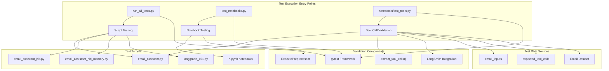
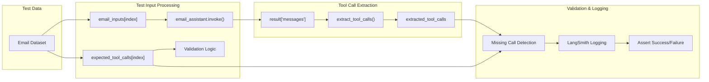
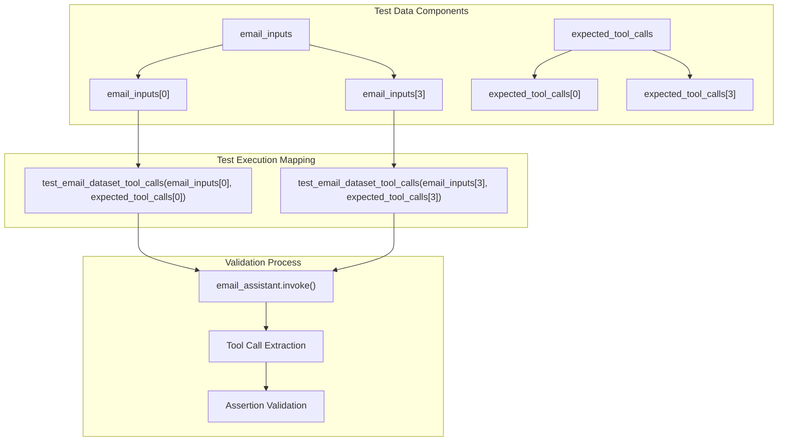
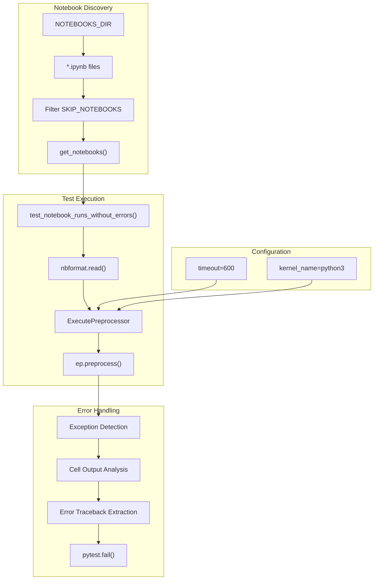
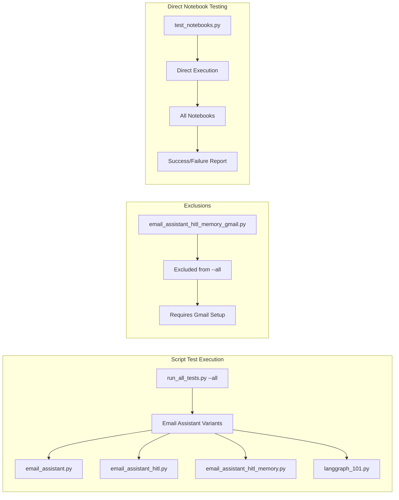
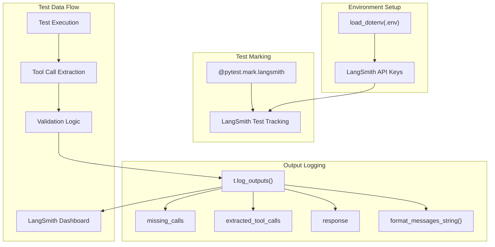

<!-- source: DeepWiki mcp.deepwiki.com · repo langchain-ai/agents-from-scratch · page 7.1 Testing Framework · fetched 2026-10-26 -->

# Testing Framework

Relevant source files

The following files were used as context for generating this wiki page:

- [README.md](README.md)
- [notebooks/evaluation.ipynb](notebooks/evaluation.ipynb)

## Purpose and Scope

This document covers the automated testing infrastructure that validates the email assistant implementations and ensures code quality across all system variants. The testing framework provides both unit-level validation of tool execution and integration testing of complete workflows through notebook execution.

For broader evaluation approaches including LLM-as-judge methodologies and performance metrics, see [Evaluation System](#5).

## Testing Architecture

The testing framework consists of two primary testing strategies: automated tool call validation and notebook execution testing. Both leverage pytest as the underlying test runner while providing specialized validation for different aspects of the system.

### Testing Infrastructure Overview

**Sources:** [tests/test_notebooks.py:1-62](), [notebooks/test_tools.py:1-46](), [AGENTS.md:69-91]()

## Automated Tool Call Validation

The core testing functionality validates that email processing generates the expected tool calls through the `test_tools.py` framework. This ensures the email assistant correctly interprets incoming emails and plans appropriate responses.

### Tool Call Testing Implementation

**Sources:** [notebooks/test_tools.py:19-45]()

The test implementation uses parametrized testing to validate multiple email scenarios:

| Test Component | Implementation | Purpose |
|---|---|---|
| `test_email_dataset_tool_calls` | Parameterized pytest function | Validates tool call generation against expected outputs |
| `extract_tool_calls()` | Utility function from `email_assistant.utils` | Extracts tool calls from message sequences |
| LangSmith integration | `@pytest.mark.langsmith` decorator | Provides test tracking and output logging |
| Missing call detection | List comprehension validation | Identifies discrepancies between expected and actual tool calls |

**Sources:** [notebooks/test_tools.py:27-45]()

### Test Data Structure

The testing framework operates on structured test datasets containing email inputs and their corresponding expected tool calls:

**Sources:** [notebooks/test_tools.py:10-26]()

## Notebook Testing Framework

The notebook testing system ensures all Jupyter notebooks execute without errors, providing integration testing for the complete email assistant workflows and educational materials.

### Notebook Execution Pipeline

**Sources:** [tests/test_notebooks.py:14-51]()

### Notebook Test Configuration

The notebook testing framework provides flexible configuration for different execution environments:

| Parameter | Value | Purpose |
|---|---|---|
| `timeout` | 600 seconds | Prevents hanging on long-running cells |
| `kernel_name` | "python3" | Specifies execution environment |
| `SKIP_NOTEBOOKS` | Configurable list | Excludes notebooks requiring special setup |
| `metadata.path` | `notebook_path.parent` | Sets execution context for relative imports |

**Sources:** [tests/test_notebooks.py:11-36]()

## Test Execution Workflows

The testing framework supports both automated CI/CD execution and manual development testing through multiple entry points.

### Script-Based Testing

**Sources:** [AGENTS.md:73-89]()

The testing system provides two execution modes:

1. **Automated Testing**: Uses `run_all_tests.py --all` to validate core implementations while excluding Gmail integration that requires external authentication
2. **Direct Notebook Execution**: Runs `test_notebooks.py` directly for immediate feedback during development

**Sources:** [AGENTS.md:77-89](), [tests/test_notebooks.py:52-62]()

## Integration with LangSmith

The testing framework integrates with LangSmith for enhanced test tracking and debugging capabilities, particularly for tool call validation tests.

### LangSmith Test Integration

**Sources:** [notebooks/test_tools.py:15-42]()

The LangSmith integration provides structured logging for test analysis:
- **Missing Calls**: Lists expected tool calls that were not generated
- **Extracted Tool Calls**: Shows all tool calls found in the response
- **Response**: Complete formatted message sequence for debugging
- **Environment Configuration**: Loads API credentials from `.env` file

**Sources:** [notebooks/test_tools.py:17-42]()

---

