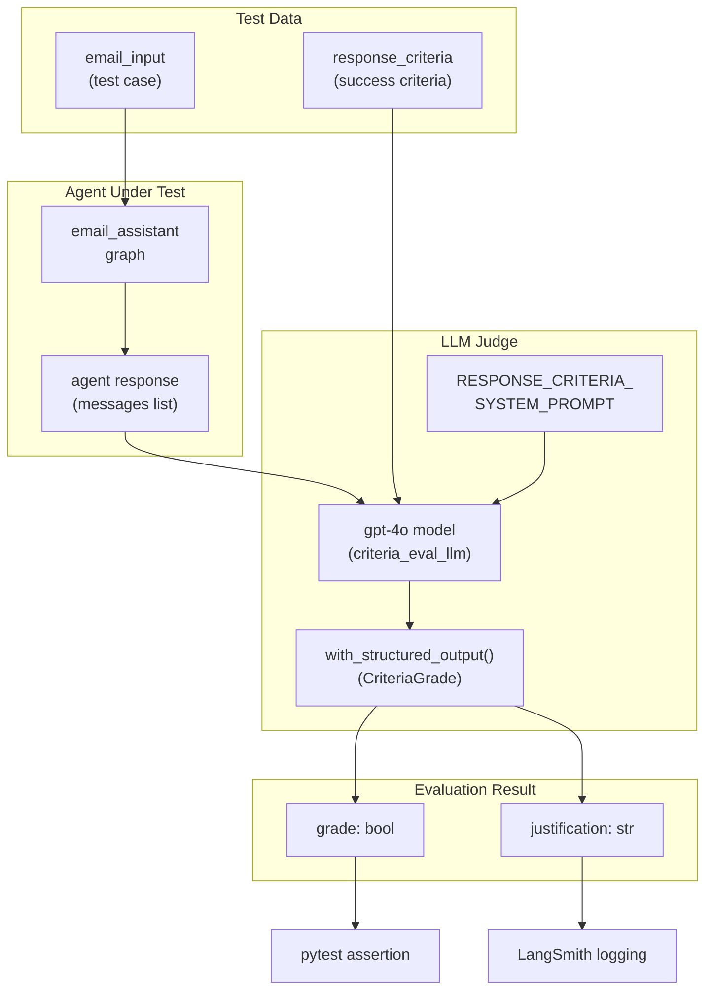
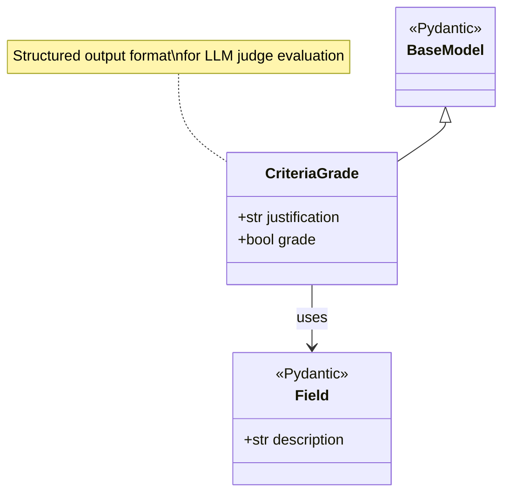
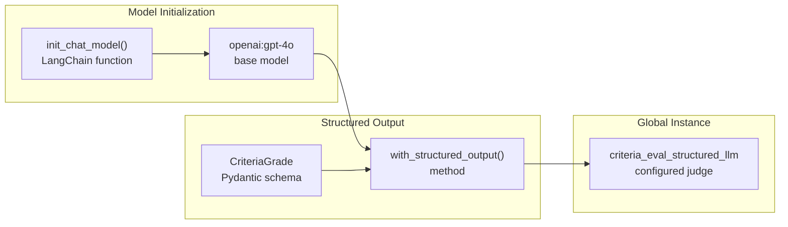
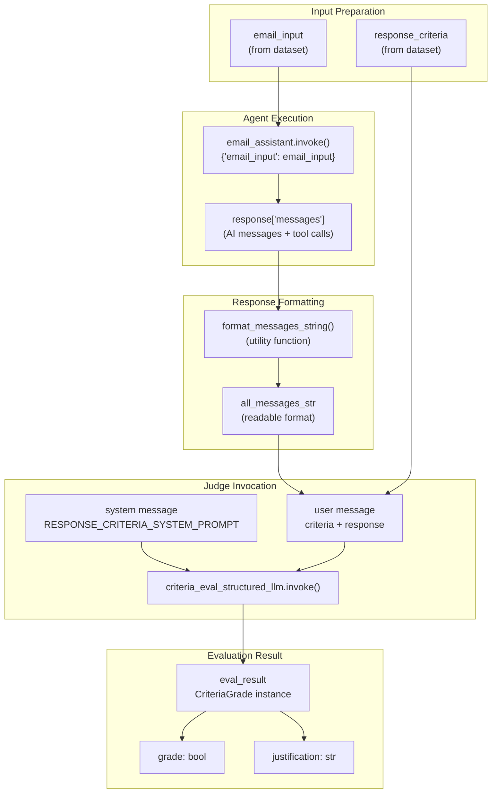
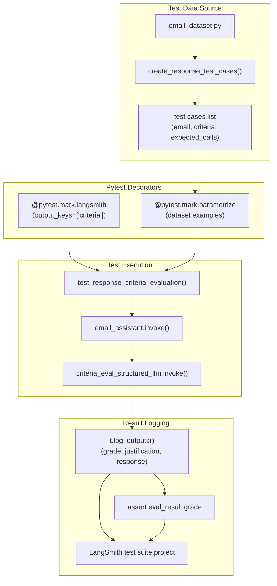
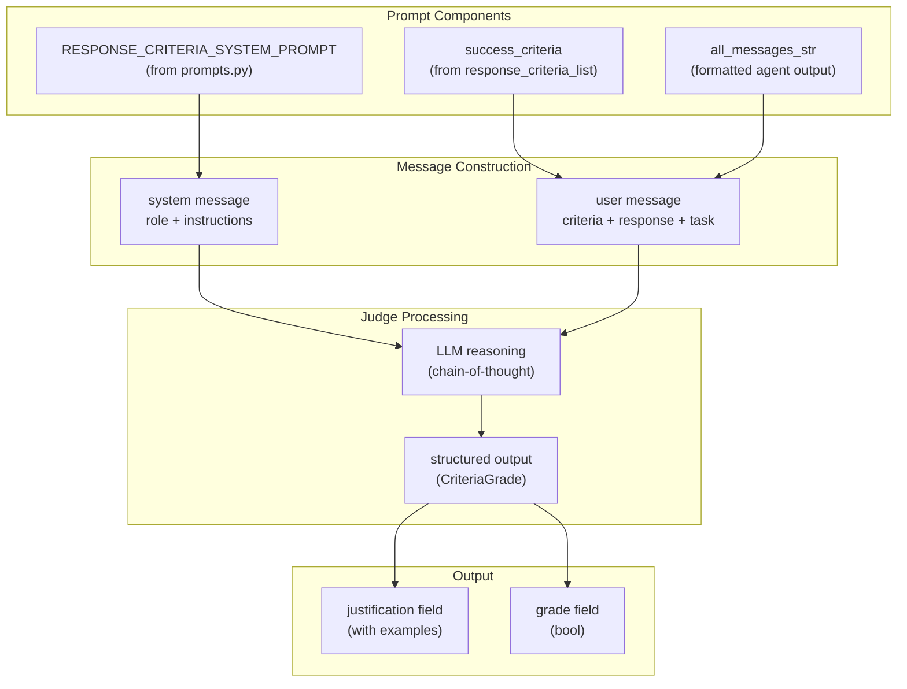
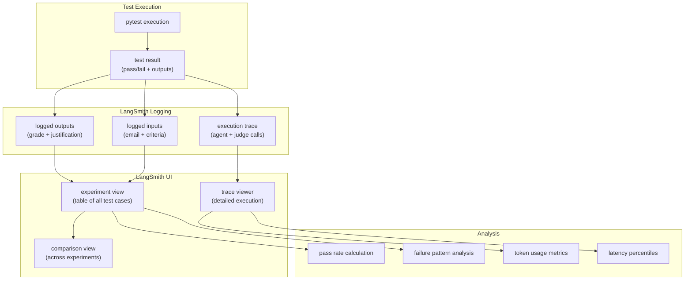

<!-- source: DeepWiki mcp.deepwiki.com · repo langchain-ai/agents-from-scratch · page 7.2 LLM-as-Judge Evaluation · fetched 2026-10-26 -->

# LLM-as-Judge Evaluation

<details>
<summary>Relevant source files</summary>

The following files were used as context for generating this wiki page:

- [notebooks/evaluation.ipynb](notebooks/evaluation.ipynb)

</details>


## Purpose and Scope

This document explains the LLM-as-Judge evaluation methodology used to assess email assistant response quality against human-defined criteria. Unlike traditional unit tests that check for exact matches or specific tool calls (covered in [Testing Framework](#7.1)), LLM-as-Judge evaluation uses GPT-4 to assess whether agent responses meet qualitative success criteria such as tone, completeness, and relevance.

The LLM-as-Judge pattern is primarily used for end-to-end integration testing where responses cannot be easily validated with deterministic assertions. This evaluation method complements the pytest-based testing framework and the LangSmith evaluate API discussed in [Evaluation System](#7).

## LLM-as-Judge Pattern Overview

The LLM-as-Judge pattern treats a large language model (typically GPT-4) as an evaluator that grades agent responses against defined criteria. This approach is valuable when:

- Response quality cannot be measured with exact string matching
- Multiple valid responses exist for a given input
- Evaluation requires understanding semantic meaning, tone, or context
- Human-like judgment is needed to assess success

The pattern involves three key components:

1. **Structured Output Schema**: Defines the format of the judge's evaluation
2. **System Prompt**: Instructs the judge on how to evaluate responses
3. **Evaluation Logic**: Invokes the judge and processes its assessment

**Evaluation Context Diagram**



Sources: [notebooks/evaluation.ipynb:363-443]()

## CriteriaGrade Schema

The `CriteriaGrade` Pydantic model defines the structured output format for the LLM judge. This schema ensures the judge returns consistent, parseable evaluations.

**Schema Definition**

| Field | Type | Description |
|-------|------|-------------|
| `justification` | `str` | Explanation for the grade including specific examples from the response |
| `grade` | `bool` | Boolean indicating whether response meets the criteria |

The schema is implemented as a Pydantic `BaseModel` at [notebooks/evaluation.ipynb:384-391]():

```python
class CriteriaGrade(BaseModel):
    """Score the response against specific criteria."""
    justification: str = Field(description="The justification for the grade and score, including specific examples from the response.")
    grade: bool = Field(description="Does the response meet the provided criteria?")
```

**Key Design Decisions:**

- **Boolean grade**: Simplifies pass/fail assertions in pytest
- **Justification first**: Encourages chain-of-thought reasoning before grading
- **Field descriptions**: Provide instructions to the LLM about expected content

**CriteriaGrade Structure**



Sources: [notebooks/evaluation.ipynb:384-391]()

## LLM Judge Configuration

The LLM judge is configured as a GPT-4 model with structured output capabilities. This configuration is performed once and reused across all evaluations to avoid recreation overhead.

**Model Initialization**

The judge uses `init_chat_model()` from LangChain to initialize GPT-4o, then applies `with_structured_output()` to enforce the `CriteriaGrade` schema:

[notebooks/evaluation.ipynb:389-391]()
```python
criteria_eval_llm = init_chat_model("openai:gpt-4o")
criteria_eval_structured_llm = criteria_eval_llm.with_structured_output(CriteriaGrade)
```

**Configuration Parameters:**

| Component | Value | Purpose |
|-----------|-------|---------|
| Model | `openai:gpt-4o` | Latest GPT-4 variant with strong reasoning capabilities |
| Structured Output | `CriteriaGrade` | Enforces consistent evaluation format |
| Global Instance | `criteria_eval_structured_llm` | Reused across evaluations for efficiency |

The model is intentionally configured as a global variable to prevent recreation on each test case execution, reducing latency and API costs.

**LLM Judge Component Architecture**



Sources: [notebooks/evaluation.ipynb:389-391]()

## Evaluation Flow

The evaluation process follows a multi-step pipeline that runs the agent, formats its output, and invokes the LLM judge to assess quality.

**Step-by-Step Process:**

1. **Agent Invocation**: Run the email assistant with test input
2. **Response Formatting**: Convert message list to readable string format
3. **Judge Invocation**: Pass response and criteria to the LLM judge
4. **Result Extraction**: Parse the `CriteriaGrade` output

**Complete Evaluation Flow**



**Example Code Flow** [notebooks/evaluation.ipynb:422-442]():

```python
# Step 1: Run agent
response = email_assistant.invoke({"email_input": email_input})

# Step 2: Format response
all_messages_str = format_messages_string(response['messages'])

# Step 3: Invoke judge
eval_result = criteria_eval_structured_llm.invoke([
    {"role": "system", "content": RESPONSE_CRITERIA_SYSTEM_PROMPT},
    {"role": "user", "content": f"""
        Response criteria: {success_criteria}
        Assistant's response: {all_messages_str}
        Evaluate whether the assistant's response meets the criteria and provide justification.
    """}
])

# eval_result is now a CriteriaGrade instance with .grade and .justification
```

Sources: [notebooks/evaluation.ipynb:422-442]()

## Integration with Pytest

The LLM-as-Judge evaluation integrates with pytest to enable automated testing with human-readable test results logged to LangSmith. This integration appears in the production test suite.

**Test Function Structure**

The pytest integration uses parametrized tests to run the LLM judge across multiple email examples. The test structure in `tests/test_response.py` (referenced at [notebooks/evaluation.ipynb:477-513]()):

```python
@pytest.mark.langsmith(output_keys=["criteria"])
@pytest.mark.parametrize("email_input,email_name,criteria,expected_calls", create_response_test_cases())
def test_response_criteria_evaluation(email_input, email_name, criteria, expected_calls):
    # Run agent
    result = email_assistant.invoke({"email_input": email_input})
    
    # Format response
    all_messages_str = format_messages_string(result['messages'])
    
    # Evaluate with LLM judge
    eval_result = criteria_eval_structured_llm.invoke([
        {"role": "system", "content": RESPONSE_CRITERIA_SYSTEM_PROMPT},
        {"role": "user", "content": f"""
            Response criteria: {criteria}
            Assistant's response: {all_messages_str}
            Evaluate whether the assistant's response meets the criteria.
        """}
    ])
    
    # Log outputs to LangSmith
    t.log_outputs({
        "grade": eval_result.grade,
        "justification": eval_result.justification,
        "response": all_messages_str
    })
    
    # Assert on grade
    assert eval_result.grade, f"Response failed criteria: {eval_result.justification}"
```

**Pytest Integration Architecture**



**Running Tests:**

From the command line:
```bash
LANGSMITH_TEST_SUITE='Email assistant: Test Full Response' \
LANGSMITH_EXPERIMENT='email_assistant' \
pytest tests/test_response.py --agent-module email_assistant
```

**Test Result Visibility:**

- **Pass/Fail**: Determined by `assert eval_result.grade`
- **Justification**: Logged to LangSmith `Outputs` column
- **Response**: Full agent response logged for debugging
- **Experiment View**: All results aggregated in LangSmith UI under the specified test suite name

Sources: [notebooks/evaluation.ipynb:477-513]()

## System Prompt and Evaluation Criteria

The system prompt instructs the LLM judge on how to evaluate agent responses. This prompt is defined in `email_assistant/eval/prompts.py` as `RESPONSE_CRITERIA_SYSTEM_PROMPT` and referenced at [notebooks/evaluation.ipynb:432, 452]().

**Prompt Structure:**

The system prompt establishes the judge's role and evaluation methodology:

1. **Role Definition**: Positions the LLM as an impartial evaluator
2. **Evaluation Instructions**: Specifies how to assess responses against criteria
3. **Output Format Guidance**: Instructs the judge to provide specific examples in justification
4. **Objectivity Requirements**: Emphasizes factual assessment over subjective opinion

**Evaluation Criteria Sources:**

The success criteria passed to the judge come from test datasets defined in `email_assistant/eval/email_dataset.py`. The `response_criteria_list` contains human-authored criteria for each test email, such as:

- "Response should acknowledge the meeting request and check calendar availability"
- "Response should be professional and offer alternative meeting times"
- "Response should include specific details from the original email"

**User Message Construction:**

The user message combines three elements [notebooks/evaluation.ipynb:439]():

```python
f"""
Response criteria: {success_criteria}

Assistant's response:
{all_messages_str}

Evaluate whether the assistant's response meets the criteria and provide justification for your evaluation.
"""
```

**Prompt Flow Diagram**



**Criteria Quality Guidelines:**

Effective evaluation criteria should be:
- **Specific**: Clear, measurable requirements
- **Verifiable**: Can be confirmed by examining the response
- **Relevant**: Aligned with actual email assistant use cases
- **Comprehensive**: Cover all important aspects of response quality

Sources: [notebooks/evaluation.ipynb:432-442, 452]()

## Results and Interpretation

LLM-as-Judge evaluation results appear in both pytest output and the LangSmith UI, providing multiple views into agent performance.

**Result Components:**

| Component | Type | Purpose |
|-----------|------|---------|
| `grade` | `bool` | Binary pass/fail for pytest assertions |
| `justification` | `str` | Detailed explanation of the grade |
| `response` | `str` | Full agent response for debugging |
| `criteria` | `str` | Success criteria used for evaluation |

**LangSmith Visualization:**

Test results are logged to LangSmith under the specified `LANGSMITH_TEST_SUITE` environment variable. Each test case creates a row in the experiment view showing:

- **Inputs**: Email input and criteria
- **Outputs**: Grade, justification, and full response
- **Pass/Fail**: Green/red indicator based on assertion
- **Traces**: Full execution trace of agent and judge

**Accessing Experiment Results:**

Programmatic access to results [notebooks/evaluation.ipynb:537-546]():

```python
experiment_name = "email_assistant:8286b3b8"
experiment_results = client.read_project(project_name=experiment_name, include_stats=True)

# Available metrics
print("Latency p50:", experiment_results.latency_p50)
print("Latency p99:", experiment_results.latency_p99)
print("Token Usage:", experiment_results.total_tokens)
print("Feedback Stats:", experiment_results.feedback_stats)
```

**Result Interpretation Workflow**



**Interpreting Failure Cases:**

When `grade = False`, the `justification` field provides insight into failure modes:
- Missing information in the response
- Incorrect tone or formality level
- Failure to address specific requirements from criteria
- Incomplete or incorrect tool usage

**Performance Metrics:**

The experiment results include operational metrics:
- **Latency p50/p99**: Response time distribution for agent + judge
- **Total tokens**: Combined token usage across all test cases
- **Feedback stats**: Aggregated grade statistics (pass rate)

Sources: [notebooks/evaluation.ipynb:537-546]()

## Best Practices

**Judge Model Selection:**
- Use GPT-4 or equivalent for evaluation to ensure high-quality judgments
- Avoid using the same model for agent and judge to prevent bias

**Criteria Design:**
- Write specific, measurable criteria rather than vague requirements
- Include positive criteria (what should be present) rather than only negative
- Test criteria on a few examples manually before automating

**Result Analysis:**
- Review justifications for failed tests to identify systematic issues
- Compare pass rates across different agent versions or configurations
- Monitor token usage to ensure evaluation costs remain reasonable

**Limitations:**
- LLM judges can be inconsistent across runs (stochastic outputs)
- Judge performance depends on prompt quality and model capabilities
- More expensive and slower than deterministic assertions
- Best used for qualitative aspects that resist traditional testing

Sources: [notebooks/evaluation.ipynb:363-470]()

---

