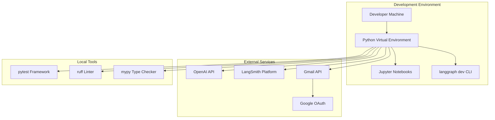
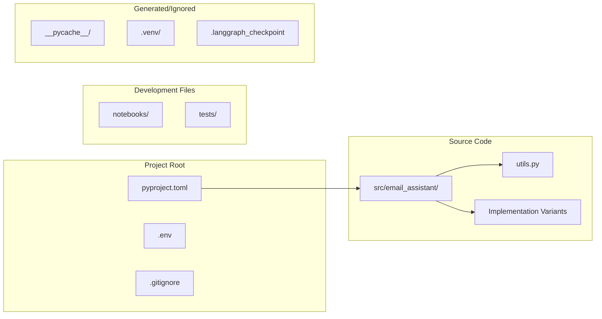

<!-- source: DeepWiki mcp.deepwiki.com · repo langchain-ai/agents-from-scratch · page 8 Development Setup · fetched 2026-10-26 -->

# Development Setup

<details>
<summary>Relevant source files</summary>

The following files were used as context for generating this wiki page:

- [.gitignore](.gitignore)
- [README.md](README.md)
- [pyproject.toml](pyproject.toml)
- [src/email_assistant/tools/gmail/README.md](src/email_assistant/tools/gmail/README.md)

</details>


This document provides comprehensive guidance for setting up a local development environment for the email assistant system. It covers dependency installation, environment configuration, project structure, and development workflow to get developers productive quickly.

For information about the core email processing architecture, see [Email Assistant Core Architecture](#2). For details about automated email processing in production, see [Automated Email Processing](#6.1).

## Prerequisites and Dependencies

The email assistant requires Python 3.11 or higher and uses a modern Python packaging setup with `pyproject.toml` configuration.

### Core Dependencies

The system builds on the LangChain ecosystem with specific integrations:

| Category | Dependencies | Purpose |
|----------|-------------|---------|
| **AI/ML Framework** | `langchain>=0.3.9`, `langchain-core>=0.3.59`, `langchain-openai` | Core LLM functionality and OpenAI integration |
| **Orchestration** | `langgraph>=0.4.2`, `langgraph-cli[inmem]` | State graph management and CLI tools |
| **Evaluation** | `langsmith[pytest]>=0.3.4` | Testing and evaluation framework |
| **Gmail Integration** | `google-api-python-client>=2.128.0`, `google-auth-oauthlib`, `google-auth-httplib2` | Gmail API access and authentication |
| **Development** | `jupyter`, `pytest`, `pytest-xdist`, `rich` | Interactive development and testing |
| **Utilities** | `pandas`, `matplotlib`, `python-dotenv`, `html2text` | Data processing and email formatting |

Sources: [pyproject.toml:6-25]()

### Development Dependencies

Optional development tools for code quality:

```toml
[project.optional-dependencies]
dev = ["mypy>=1.11.1", "ruff>=0.6.1"]
```

Sources: [pyproject.toml:27-28]()

## Environment Configuration

### Required Environment Variables

Create a `.env` file in the project root with the following variables:

```bash
# OpenAI API for LLM functionality
OPENAI_API_KEY=your_openai_api_key

# LangSmith for evaluation and tracing
LANGSMITH_TRACING=true
LANGSMITH_API_KEY=your_langsmith_api_key
LANGSMITH_PROJECT="interrupt-workshop"
```

Sources: [.env.example:1-4]()

### Additional Configuration for Gmail Integration

For Gmail functionality (used in production variants), additional Google OAuth credentials are required. These are configured through the Google Cloud Console and loaded at runtime by the Gmail tools.

## Project Structure and Package Layout

### Development Environment Architecture



Sources: [pyproject.toml:6-25](), [.env.example:1-4]()

### Package Structure



The package is configured with `setuptools` to install as `email_assistant` from the `src/email_assistant` directory.

Sources: [pyproject.toml:34-38](), [.gitignore:1-63]()

## Installation and Setup

### 1. Environment Setup

Create and activate a Python virtual environment:

```bash
python -m venv .venv
source .venv/bin/activate  # On Windows: .venv\Scripts\activate
```

### 2. Install Dependencies

Install the package in development mode:

```bash
pip install -e .
```

For development with optional tools:

```bash
pip install -e ".[dev]"
```

### 3. Environment Configuration

Copy the example environment file and configure with your API keys:

```bash
cp .env.example .env
# Edit .env with your actual API keys
```

### 4. Verify Installation

Test the setup by running the basic LangGraph example:

```bash
python -m email_assistant.langgraph_101
```

Sources: [pyproject.toml:1-32](), [.env.example:1-4]()

## Development Workflow

### Interactive Development with Notebooks

The system includes Jupyter notebooks for interactive development and testing. Key notebooks are preserved in the repository while temporary notebooks are ignored.

```bash
jupyter lab
```

Notebook locations:
- `notebooks/*.ipynb` - Main development notebooks
- `notebooks/notebooks/*.ipynb` - Nested notebook examples
- `tests/*.ipynb` - Test notebooks

Sources: [.gitignore:24-30]()

### Local Development Server

Use the LangGraph CLI for local development and testing:

```bash
langgraph dev
```

This starts a local development server with the in-memory checkpoint store for testing state persistence.

Sources: [pyproject.toml:17]()

### Code Quality Tools

The project uses `ruff` for linting and formatting with specific configuration:

```bash
# Run linting
ruff check .

# Auto-fix issues
ruff check --fix .
```

Linting configuration includes:
- pycodestyle (`E`)
- pyflakes (`F`) 
- isort (`I`)
- pydocstyle (`D`)
- Modern Python upgrades (`UP`)

Sources: [pyproject.toml:43-66]()

Type checking with `mypy`:

```bash
mypy src/
```

### Testing Framework

Run tests using pytest:

```bash
# Run all tests
pytest

# Run tests in parallel
pytest -n auto

# Run specific test files
pytest tests/
```

The testing framework integrates with LangSmith for evaluation and includes utilities for testing tool calls and message formatting.

Sources: [pyproject.toml:14-15](), [src/email_assistant/utils.py:232-247]()

### Development File Management

Key files ignored during development:

| Pattern | Purpose |
|---------|---------|
| `__pycache__/`, `*.pyc` | Python bytecode |
| `.venv/`, `venv/` | Virtual environments |
| `.ipynb_checkpoints` | Jupyter checkpoints |
| `.langgraph_checkpoint` | LangGraph state persistence |
| `.env` | Environment variables |
| `.secrets/` | Credential files |

Sources: [.gitignore:1-63]()

## Utility Functions and Development Helpers

The system includes comprehensive utility functions for development and testing:

### Email Formatting Utilities

The `utils.py` module provides functions for formatting emails in different contexts:

- `format_email_markdown()` - Basic email formatting for display
- `format_gmail_markdown()` - Gmail-specific formatting with HTML conversion
- `format_for_display()` - Agent Inbox formatting for tool calls

Sources: [src/email_assistant/utils.py:5-106]()

### Testing and Debugging Utilities

Development helpers include:

- `extract_tool_calls()` - Extract tool call names from messages
- `format_messages_string()` - Format message chains for analysis
- `show_graph()` - Display LangGraph diagrams with fallback rendering
- `extract_message_content()` - Safe content extraction from different message types

Sources: [src/email_assistant/utils.py:232-266]()

### Graph Visualization

The `show_graph()` function provides robust diagram rendering with automatic fallback:

```python
from email_assistant.utils import show_graph
show_graph(graph, xray=False)  # Basic graph view
show_graph(graph, xray=True)   # Detailed internal view
```

This handles timeout errors from mermaid.ink by falling back to pyppeteer rendering.

Sources: [src/email_assistant/utils.py:249-266]()

---

