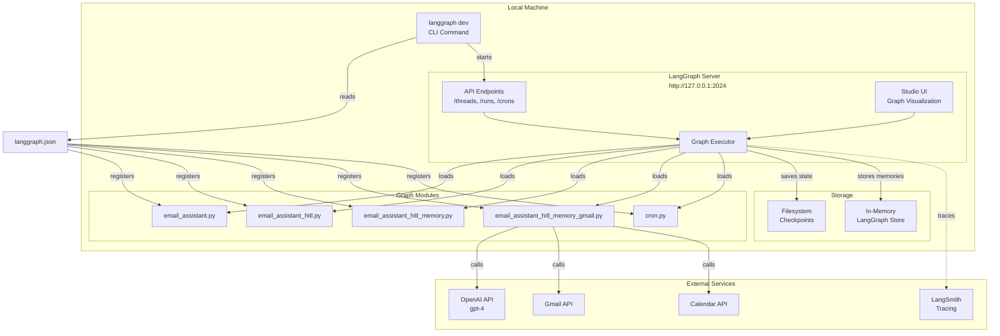
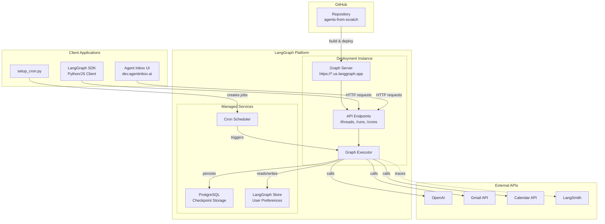
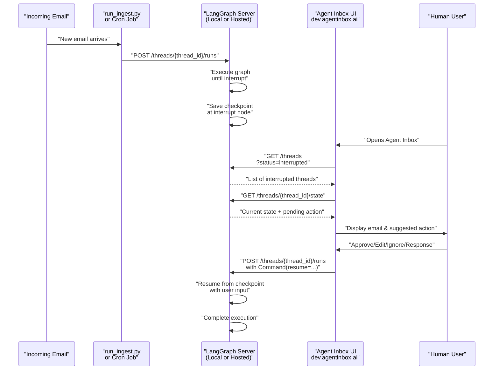
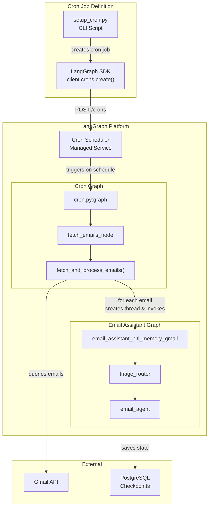
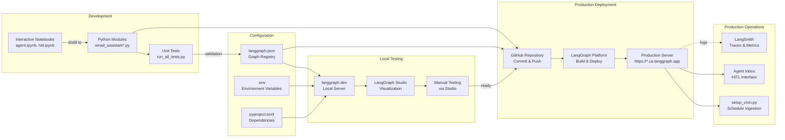

<!-- source: DeepWiki mcp.deepwiki.com · repo langchain-ai/agents-from-scratch · page 8.1 Deployment · fetched 2026-10-26 -->

# Deployment

<details>
<summary>Relevant source files</summary>

The following files were used as context for generating this wiki page:

- [README.md](README.md)
- [langgraph.json](langgraph.json)
- [notebooks/langgraph_101.ipynb](notebooks/langgraph_101.ipynb)
- [src/email_assistant/langgraph_101.py](src/email_assistant/langgraph_101.py)
- [src/email_assistant/schemas.py](src/email_assistant/schemas.py)
- [src/email_assistant/tools/gmail/README.md](src/email_assistant/tools/gmail/README.md)

</details>


This document covers deployment options for the email assistant agents, including local development deployment, LangGraph Platform (cloud) hosting, Agent Inbox integration, and automated email ingestion via cron jobs. For initial development environment setup and package installation, see [Development Setup](#8). For Gmail API OAuth configuration, see [Gmail Integration](#3.4).

## Overview

The repository provides two primary deployment modes:

1. **Local Development**: Using `langgraph dev` for rapid iteration with local checkpointing
2. **LangGraph Platform**: Cloud-hosted deployment with managed infrastructure and persistent PostgreSQL storage

Both deployment modes are configured through a single [langgraph.json:1-16]() configuration file that registers all available graph implementations.

**Sources:** [README.md:119-157](), [notebooks/langgraph_101.ipynb:708-743]()

---

## LangGraph Configuration File

### Graph Registry

The [langgraph.json:1-16]() file defines the deployment configuration for all graph variants:

```json
{
  "dockerfile_lines": [],
  "graphs": {
    "langgraph101": "./src/email_assistant/langgraph_101.py:app",
    "email_assistant": "./src/email_assistant/email_assistant.py:email_assistant",
    "email_assistant_hitl": "./src/email_assistant/email_assistant_hitl.py:email_assistant",
    "email_assistant_hitl_memory": "./src/email_assistant/email_assistant_hitl_memory.py:email_assistant",
    "email_assistant_hitl_memory_gmail": "./src/email_assistant/email_assistant_hitl_memory_gmail.py:email_assistant",
    "cron": "./src/email_assistant/cron.py:graph"
  },
  "python_version": "3.11",
  "env": ".env",
  "dependencies": ["."]
}
```

### Configuration Fields

| Field | Purpose | Example Value |
|-------|---------|---------------|
| `graphs` | Maps graph IDs to Python module paths | `"email_assistant": "./src/email_assistant/email_assistant.py:email_assistant"` |
| `python_version` | Specifies required Python version | `"3.11"` |
| `env` | Path to environment variables file | `".env"` |
| `dependencies` | Python package dependencies | `["."]` (installs from pyproject.toml) |
| `dockerfile_lines` | Custom Docker instructions (optional) | `[]` |

The graph ID (left side of colon in `graphs`) becomes the API endpoint identifier and Studio selector. The module path (right side) points to the compiled LangGraph object.

**Sources:** [langgraph.json:1-16](), [notebooks/langgraph_101.ipynb:714-727]()

---

## Local Development Deployment

### Project Structure Requirements

LangGraph deployment requires a specific project structure:

```
agents-from-scratch/
├── src/email_assistant/           # All graph implementations
│   ├── email_assistant.py         # Basic agent
│   ├── email_assistant_hitl.py    # + HITL
│   ├── email_assistant_hitl_memory.py  # + Memory
│   └── email_assistant_hitl_memory_gmail.py  # + Gmail
├── .env                            # Environment variables
├── langgraph.json                  # Graph registry
└── pyproject.toml                  # Dependencies
```

### Starting Local Server

```bash
# From repository root
langgraph dev
```

This command:
1. Reads [langgraph.json:1-16]() to discover graph definitions
2. Loads environment variables from [.env]()
3. Installs dependencies specified in `pyproject.toml`
4. Starts server on `http://127.0.0.1:2024`
5. Saves checkpoints to local filesystem

### Accessing Local Deployment

**LangGraph Studio UI:**
- Automatically opens in browser at `http://127.0.0.1:2024`
- Provides graph visualization and state inspection
- Allows interactive testing with custom inputs

**API Documentation:**
- Available at `http://127.0.0.1:2024/docs`
- Provides OpenAPI/Swagger interface for all endpoints

### Local Deployment Architecture



**Sources:** [notebooks/langgraph_101.ipynb:714-757](), [README.md:119-130]()

---

## LangGraph Platform Deployment

### Prerequisites

Before deploying to LangGraph Platform:

1. LangSmith account with deployment access
2. GitHub repository fork of `langchain-ai/agents-from-scratch`
3. Required environment variables (see below)
4. For Gmail integration: OAuth credentials configured per [Gmail Integration](#3.4)

### Deployment Steps

#### 1. Navigate to Deployments Page

Access LangSmith deployments at `https://smith.langchain.com/`

#### 2. Create New Deployment

1. Click "New Deployment"
2. Connect to GitHub repository fork
3. Select branch for deployment (e.g., `main`)
4. Provide deployment name (e.g., `yourname-email-assistant`)

#### 3. Configure Environment Variables

| Variable | Purpose | Source |
|----------|---------|--------|
| `OPENAI_API_KEY` | OpenAI API access | OpenAI platform |
| `LANGSMITH_API_KEY` | LangSmith tracing | LangSmith settings |
| `LANGSMITH_TRACING` | Enable tracing | Set to `true` |
| `LANGSMITH_PROJECT` | Project name for traces | Custom name |
| `GMAIL_SECRET` | Gmail OAuth client secret | Full JSON from `.secrets/secrets.json` |
| `GMAIL_TOKEN` | Gmail OAuth token | Full JSON from `.secrets/token.json` |

For Gmail-enabled deployment (`email_assistant_hitl_memory_gmail`), both `GMAIL_SECRET` and `GMAIL_TOKEN` must contain the complete JSON dictionary contents from their respective files.

#### 4. Deploy and Obtain URL

After submission, the deployment process:
1. Builds Docker container from repository
2. Installs dependencies from [pyproject.toml]()
3. Registers graphs from [langgraph.json:1-16]()
4. Provisions PostgreSQL database for checkpoints
5. Starts server at assigned URL

Deployment URL format: `https://your-deployment-name-xxx.us.langgraph.app`

### Hosted Deployment Architecture



**Sources:** [src/email_assistant/tools/gmail/README.md:105-118](), [notebooks/langgraph_101.ipynb:708-743]()

---

## Agent Inbox Integration

Agent Inbox (`https://dev.agentinbox.ai/`) provides a web interface for human-in-the-loop interactions with deployed email assistants. It connects to either local or hosted LangGraph deployments.

### Configuration for Local Deployment

After starting `langgraph dev`, configure Agent Inbox:

| Field | Value |
|-------|-------|
| Deployment URL | `http://127.0.0.1:2024` |
| Assistant/Graph ID | `email_assistant_hitl_memory_gmail` |
| Name | Any descriptive name |

### Configuration for Hosted Deployment

For LangGraph Platform deployments:

| Field | Value | Example |
|-------|-------|---------|
| Deployment URL | Platform-assigned URL | `https://your-deployment-xxx.us.langgraph.app` |
| Assistant/Graph ID | Graph name from langgraph.json | `email_assistant_hitl_memory_gmail` |
| Name | Any descriptive name | `Production Email Assistant` |
| LangSmith API Key | Your LangSmith API key | Required for hosted deployments |

### Agent Inbox Workflow



**Sources:** [src/email_assistant/tools/gmail/README.md:98-134](), [README.md:102-109]()

---

## Automated Email Ingestion

### Manual Ingestion

For testing or one-time email processing:

```bash
python src/email_assistant/tools/gmail/run_ingest.py \
  --email your.email@example.com \
  --minutes-since 1440 \
  --url https://your-deployment-xxx.us.langgraph.app
```

### Cron Job Setup

For production automated ingestion, use [setup_cron.py:1-100]():

```bash
python src/email_assistant/tools/gmail/setup_cron.py \
  --email your.email@example.com \
  --url https://your-deployment-xxx.us.langgraph.app \
  --schedule "*/10 * * * *"
```

#### Cron Parameters

| Parameter | Purpose | Default |
|-----------|---------|---------|
| `--email` | Email address to monitor | Required |
| `--url` | LangGraph deployment URL | Required |
| `--schedule` | Cron expression | `"*/10 * * * *"` (every 10 minutes) |
| `--minutes-since` | Lookback window | `60` |
| `--graph-name` | Graph to invoke | `email_assistant_hitl_memory_gmail` |
| `--include-read` | Process read emails | `false` |

#### Cron Schedule Examples

| Expression | Frequency |
|------------|-----------|
| `*/10 * * * *` | Every 10 minutes |
| `0 * * * *` | Every hour on the hour |
| `0 9-17 * * 1-5` | Every hour from 9 AM to 5 PM, Monday-Friday |
| `*/30 * * * *` | Every 30 minutes |

### Cron Architecture

The cron system consists of two components:

1. **[src/email_assistant/cron.py:1-50]()**: Defines a simple LangGraph graph that wraps email fetching logic
2. **[src/email_assistant/tools/gmail/setup_cron.py:1-100]()**: Creates scheduled job using LangGraph SDK



The [cron.py]() graph is registered in [langgraph.json:9]() alongside the email assistant graphs. When triggered, it fetches emails via Gmail API and invokes the main email assistant graph for each email, creating separate threads.

**Sources:** [src/email_assistant/tools/gmail/README.md:136-182](), [langgraph.json:9]()

### Managing Cron Jobs

Using the LangGraph SDK to list and delete cron jobs:

```python
from langgraph_sdk import get_client

# Connect to deployment
client = get_client(url="https://your-deployment-xxx.us.langgraph.app")

# List all cron jobs
cron_jobs = await client.crons.list()
for job in cron_jobs:
    print(f"Job ID: {job['cron_id']}, Schedule: {job['schedule']}")

# Delete a cron job
await client.crons.delete(cron_job_id)
```

**Sources:** [src/email_assistant/tools/gmail/README.md:168-182]()

---

## Deployment Comparison

### Feature Matrix

| Feature | Local (`langgraph dev`) | LangGraph Platform |
|---------|------------------------|-------------------|
| **Checkpoint Storage** | Local filesystem | Managed PostgreSQL |
| **Memory Store** | In-memory | Persistent database |
| **Startup Command** | `langgraph dev` | Automatic on deploy |
| **URL** | `http://127.0.0.1:2024` | `https://*.us.langgraph.app` |
| **Scaling** | Single process | Auto-scaling |
| **Cron Jobs** | Manual scripts | Managed scheduler |
| **Cost** | Free | Usage-based |
| **Best For** | Development, testing | Production, automation |

### When to Use Each

**Local Development:**
- Rapid iteration on graph logic
- Testing with mock tools
- Debugging with Studio UI
- Learning LangGraph concepts

**LangGraph Platform:**
- Production email monitoring
- Automated ingestion via cron
- Multi-user access via Agent Inbox
- Persistent state across sessions
- Scalable email processing

**Sources:** [notebooks/langgraph_101.ipynb:733-738](), [src/email_assistant/tools/gmail/README.md:58-104]()

---

## Deployment Workflow

### Complete Deployment Pipeline



**Sources:** [README.md:1-175](), [src/email_assistant/tools/gmail/README.md:105-145]()