# Page: Overview

# Overview

<details>
<summary>Relevant source files</summary>

The following files were used as context for generating this wiki page:

- [.gitignore](.gitignore)
- [README.md](README.md)
- [langgraph.json](langgraph.json)
- [pyproject.toml](pyproject.toml)
- [src/email_assistant/schemas.py](src/email_assistant/schemas.py)

</details>


## Purpose and Scope

This document provides a high-level introduction to the **agents-from-scratch** repository, a hands-on tutorial for building a production-ready email assistant agent using LangGraph. The repository teaches agent development through progressive implementation, starting from basic ReAct patterns and advancing to human-in-the-loop oversight, memory-enabled learning, and Gmail API integration.

The tutorial is structured as four cumulative stages, each combining an interactive Jupyter notebook for learning and experimentation with production Python modules for deployment. By the final stage, the system demonstrates a fully functional "ambient" agent capable of triaging, responding to, and learning from email interactions with real Gmail and Google Calendar APIs.

For details on the LangGraph framework concepts used throughout (StateGraph, checkpoints, interrupts), see [LangGraph Framework](#2). For environment setup and deployment instructions, see [Development Setup](#8) and [Deployment](#8.1). For the core architecture details, see [Email Assistant Core Architecture](#3).

**Sources**: [README.md:1-6](), [README.md:75-130]()

---

## Repository Organization

The repository follows a **notebook-driven development pattern** where concepts are prototyped interactively before being hardened into production code. Each learning module consists of a paired notebook and Python implementation.

### File Structure Overview

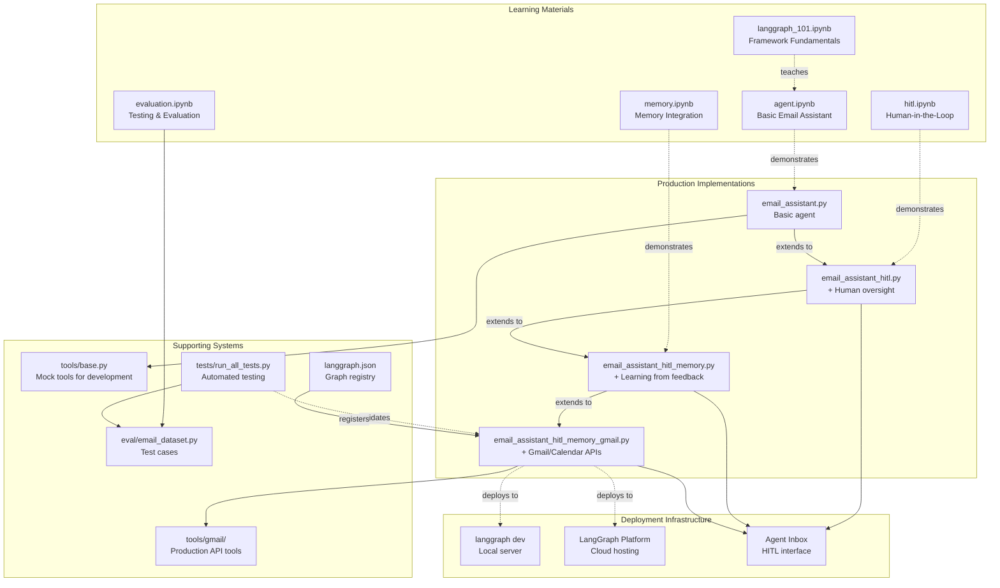

**Sources**: [README.md:75-130](), [langgraph.json:1-16]()

### Repository Directory Structure

| Directory/File | Purpose |
|----------------|---------|
| `notebooks/` | Interactive Jupyter notebooks for learning and experimentation |
| `src/email_assistant/` | Production Python modules implementing the agent variants |
| `src/email_assistant/tools/` | Tool implementations (mock and Gmail API) |
| `eval/` | Test datasets and evaluation utilities |
| `tests/` | Automated test suite using pytest and LangSmith |
| `langgraph.json` | Graph registry for LangGraph Platform deployment |
| `pyproject.toml` | Python dependencies and package configuration |

**Sources**: [README.md:75-130](), [pyproject.toml:1-66]()

---

## Four-Stage Learning Path

The tutorial progresses through four cumulative implementation stages, each adding new capabilities while preserving all previous features. This design allows learners to understand how production agents evolve from simple prototypes.

### Stage Progression Diagram

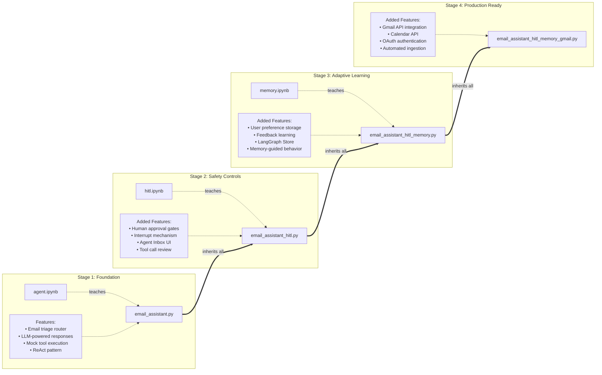

**Sources**: [README.md:82-130]()

### Feature Accumulation Table

| Stage | Notebook | Production Module | Core Feature Added | Key Concepts |
|-------|----------|------------------|-------------------|--------------|
| **Preface** | `langgraph_101.ipynb` | `langgraph_101.py` | LangGraph fundamentals | StateGraph, nodes, edges, memory |
| **1: Foundation** | `agent.ipynb` | `email_assistant.py` | Email triage + response agent | ReAct pattern, tool calling, routing |
| **Evaluation** | `evaluation.ipynb` | N/A | Testing framework | Pytest, LLM-as-judge, LangSmith evaluate |
| **2: Safety** | `hitl.ipynb` | `email_assistant_hitl.py` | Human approval gates | Interrupts, checkpoints, Agent Inbox |
| **3: Learning** | `memory.ipynb` | `email_assistant_hitl_memory.py` | User preference memory | LangGraph Store, feedback loops |
| **4: Production** | N/A | `email_assistant_hitl_memory_gmail.py` | Gmail/Calendar APIs | OAuth, API integration, cron ingestion |

**Sources**: [README.md:79-130](), [langgraph.json:4-9]()

---

## High-Level Architecture

The email assistant implements a **two-phase workflow**: triage routing followed by agent-based response generation. Both phases leverage LLM decision-making, tool execution, and optional human oversight.

### Core Workflow Architecture

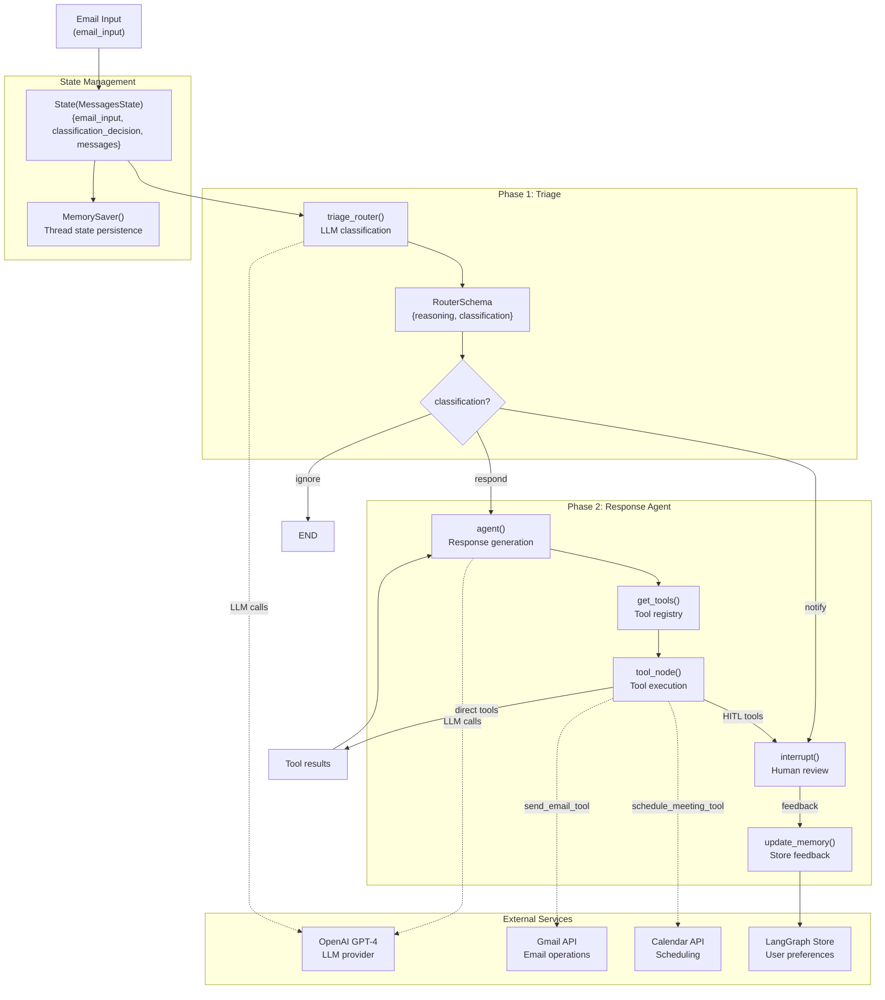

**Sources**: [src/email_assistant/schemas.py:1-38](), [README.md:82-130]()

### Key Architectural Components

#### State Management: `State` Class

The `State` class extends `MessagesState` to track email processing:

```python
# From schemas.py
class State(MessagesState):
    email_input: dict              # Original email data
    classification_decision: str    # Triage decision (ignore/respond/notify)
    # messages: list[Message]       # Inherited from MessagesState
```

**Sources**: [src/email_assistant/schemas.py:21-24]()

#### Workflow Phases

1. **Triage Phase** (`triage_router` node):
   - Uses LLM with structured output (`RouterSchema`) to classify emails
   - Three outcomes: `ignore`, `notify` (requires human review), `respond` (proceed to agent)
   - Reads from LangGraph Store to apply learned preferences

2. **Agent Phase** (`agent` node):
   - Implements ReAct pattern with `tool_choice="required"`
   - Executes tools via `tool_node` with conditional HITL gating
   - Updates memory based on human feedback

3. **Tool Execution** (`tool_node`):
   - Separates tools into HITL-required vs direct execution
   - HITL tools: `write_email`, `schedule_meeting`, `Question`
   - Direct tools: `check_calendar_availability`, `Done`, `fetch_emails_tool`

**Sources**: [src/email_assistant/schemas.py:5-16](), [README.md:82-130]()

---

## Key Technologies and Dependencies

The system integrates multiple technologies to provide agent capabilities, observability, and deployment infrastructure.

### Technology Stack Diagram

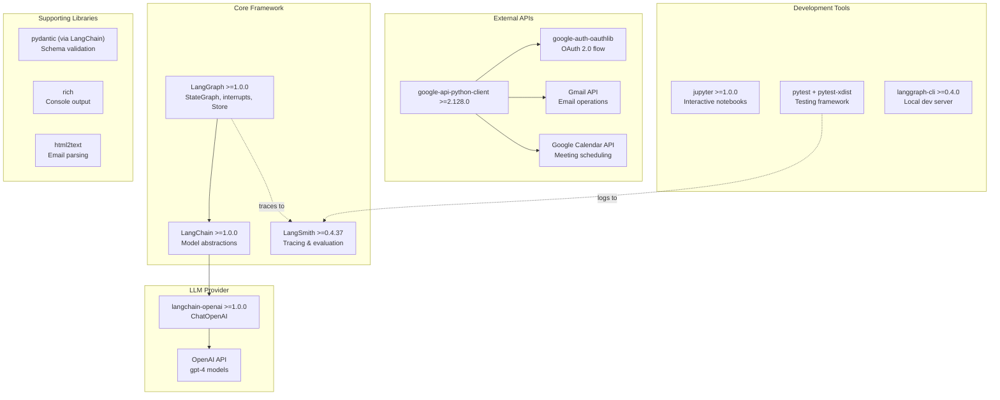

**Sources**: [pyproject.toml:6-25]()

### Required Environment Variables

| Variable | Purpose | Required For |
|----------|---------|--------------|
| `OPENAI_API_KEY` | OpenAI API authentication | All implementations |
| `LANGSMITH_API_KEY` | LangSmith tracing and evaluation | All implementations (optional but recommended) |
| `LANGSMITH_TRACING` | Enable LangSmith tracing | All implementations |
| `LANGSMITH_PROJECT` | Project name for trace organization | All implementations |
| Google OAuth credentials | Gmail/Calendar API access | Stage 4 only (`email_assistant_hitl_memory_gmail.py`) |

**Sources**: [README.md:18-45]()

---

## Development and Deployment Workflow

The repository supports both local development and cloud deployment through LangGraph Platform.

### Deployment Architecture

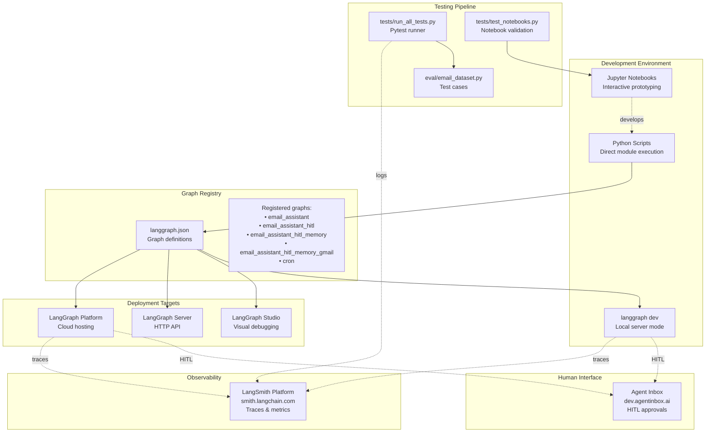

**Sources**: [README.md:132-166](), [langgraph.json:1-16]()

### Graph Registration via `langgraph.json`

The [langgraph.json:1-16]() file registers five graphs for deployment:

| Graph ID | Module Path | Purpose |
|----------|-------------|---------|
| `langgraph101` | `src/email_assistant/langgraph_101.py:app` | Educational example |
| `email_assistant` | `src/email_assistant/email_assistant.py:email_assistant` | Stage 1: Basic agent |
| `email_assistant_hitl` | `src/email_assistant/email_assistant_hitl.py:email_assistant` | Stage 2: + HITL |
| `email_assistant_hitl_memory` | `src/email_assistant/email_assistant_hitl_memory.py:email_assistant` | Stage 3: + Memory |
| `email_assistant_hitl_memory_gmail` | `src/email_assistant/email_assistant_hitl_memory_gmail.py:email_assistant` | Stage 4: + Gmail |
| `cron` | `src/email_assistant/cron.py:graph` | Automated email ingestion |

**Sources**: [langgraph.json:3-9]()

---

## Next Steps

This overview provides the foundation for understanding the agents-from-scratch repository structure and learning path. To dive deeper into specific components:

- **LangGraph fundamentals**: See [LangGraph Framework](#2) for StateGraph, interrupts, and checkpoints
- **Agent architecture details**: See [Email Assistant Core Architecture](#3) for triage router and agent implementation
- **HITL implementation**: See [Human-in-the-Loop (HITL) Integration](#3.2) for interrupt handling and Agent Inbox
- **Memory system**: See [Memory System](#3.3) for LangGraph Store and preference learning
- **Tool architecture**: See [Tool System](#4) for mock vs production tools
- **Evaluation methodology**: See [Evaluation System](#7) for testing and LLM-as-judge
- **Setup instructions**: See [Development Setup](#8) for environment configuration

**Sources**: [README.md:1-175]()

---

# Page: LangGraph Framework

# LangGraph Framework

<details>
<summary>Relevant source files</summary>

The following files were used as context for generating this wiki page:

- [README.md](README.md)
- [notebooks/langgraph_101.ipynb](notebooks/langgraph_101.ipynb)
- [src/email_assistant/langgraph_101.py](src/email_assistant/langgraph_101.py)

</details>


This document introduces the core LangGraph framework concepts and demonstrates how the email assistant system leverages state graphs, nodes, edges, and workflow orchestration to build sophisticated AI applications with human oversight capabilities.

For information about specific email assistant implementations, see [Email Assistant Core Architecture](#2). For deployment and automation details, see [Development Setup](#6).

## Framework Overview

LangGraph is a framework for building stateful, multi-step applications with Large Language Models (LLMs). It provides low-level infrastructure that enables developers to create both pre-defined workflows and dynamic agent behaviors with built-in persistence, human-in-the-loop capabilities, and deployment support.

### Core Benefits

LangGraph provides three primary benefits over direct LLM usage:

| Benefit | Description | Email Assistant Usage |
|---------|-------------|----------------------|
| **Control** | Define application flow as graphs with state, nodes, and edges | Triage routing, response generation, tool execution |
| **Persistence** | Built-in state management through checkpointers | Conversation memory, user preferences storage |
| **Deployment** | Integrated testing, debugging, and deployment tools | LangGraph Platform hosting, local development |

**LangGraph Core Architecture**

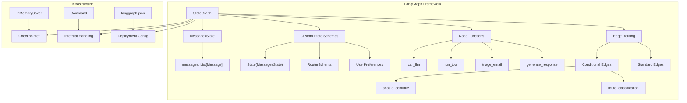

Sources: [notebooks/langgraph_101.ipynb:245-272](), [src/email_assistant/schemas.py:21-24](), [langgraph.json:1-16]()

## State Management

LangGraph applications are built around a central `State` concept that tracks information throughout the application lifecycle. The email assistant uses both built-in and custom state schemas.

### State Schema Hierarchy

```mermaid
graph TB
    subgraph "State Schema Types"
        A["MessagesState"] --> B["messages: List[Message]"]
        
        C["State(MessagesState)"] --> B
        C --> D["email_input: dict"]
        C --> E["classification_decision: Literal"]
        
        F["StateInput"] --> G["email_input: dict"]
        
        H["EmailData"] --> I["id: str"]
        H --> J["thread_id: str"]
        H --> K["from_email: str"]
        H --> L["subject: str"]
        H --> M["page_content: str"]
        H --> N["send_time: str"]
        H --> O["to_email: str"]
    end
    
    subgraph "Usage in Email Assistant"
        P["email_assistant.py"] --> C
        Q["email_assistant_hitl.py"] --> C
        R["email_assistant_hitl_memory.py"] --> C
        S["langgraph_101.py"] --> A
    end
    
    C --> P
    C --> Q
    C --> R
    A --> S
```

The `MessagesState` provides built-in message handling, while custom `State` classes extend this with email-specific fields like `email_input` and `classification_decision`.

Sources: [src/email_assistant/schemas.py:21-33](), [notebooks/langgraph_101.ipynb:281-288]()

## Node and Edge Architecture

LangGraph applications are composed of nodes (Python functions) connected by edges (control flow). Each node receives the current state and returns updates to merge back into the state.

### Email Assistant Node Structure

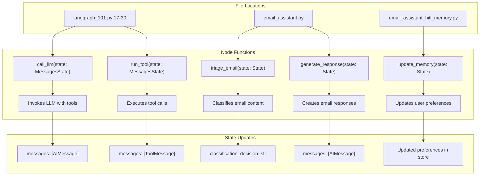

### Edge Types and Routing

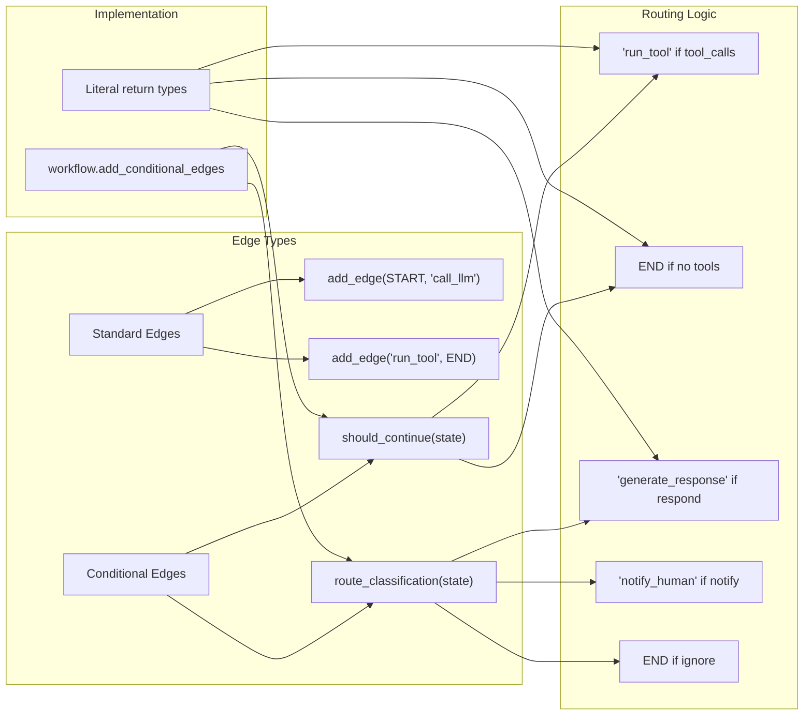

Sources: [src/email_assistant/langgraph_101.py:45-50](), [notebooks/langgraph_101.ipynb:308-417]()

## Control Flow and Routing

LangGraph uses conditional edges to implement dynamic routing based on state content. The email assistant demonstrates this with classification-based routing and tool execution logic.

### Email Classification Router

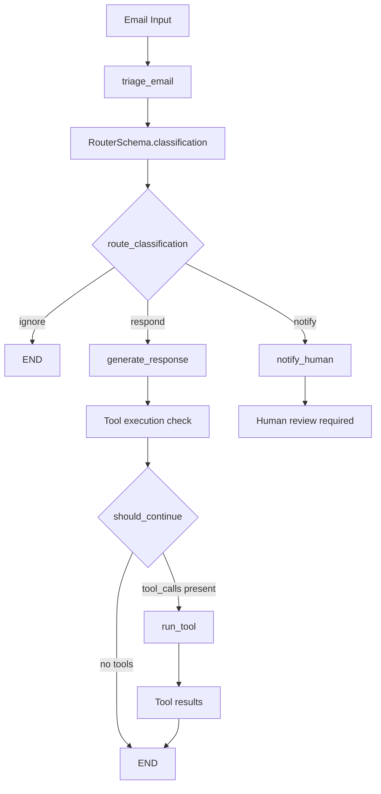

### Conditional Edge Implementation

The routing logic uses typed return values to ensure type safety:

```python
def route_classification(state: State) -> Literal["generate_response", "notify_human", "__end__"]:
    """Route based on email classification"""
    classification = state["classification_decision"]
    if classification == "respond":
        return "generate_response"
    elif classification == "notify":
        return "notify_human"
    else:  # ignore
        return END
```

Sources: [notebooks/langgraph_101.ipynb:362-417](), [src/email_assistant/schemas.py:5-15]()

## Persistence and Memory

LangGraph provides built-in persistence through checkpointers, enabling applications to maintain state across executions and support human-in-the-loop workflows.

### Checkpointer Types

| Checkpointer | Use Case | Email Assistant Usage |
|--------------|----------|----------------------|
| `InMemorySaver` | Development, testing | Local development and demos |
| `PostgreSQLSaver` | Production deployment | Hosted LangGraph Platform |
| Custom checkpointers | Specialized storage | Integration with existing systems |

### Thread-based Persistence

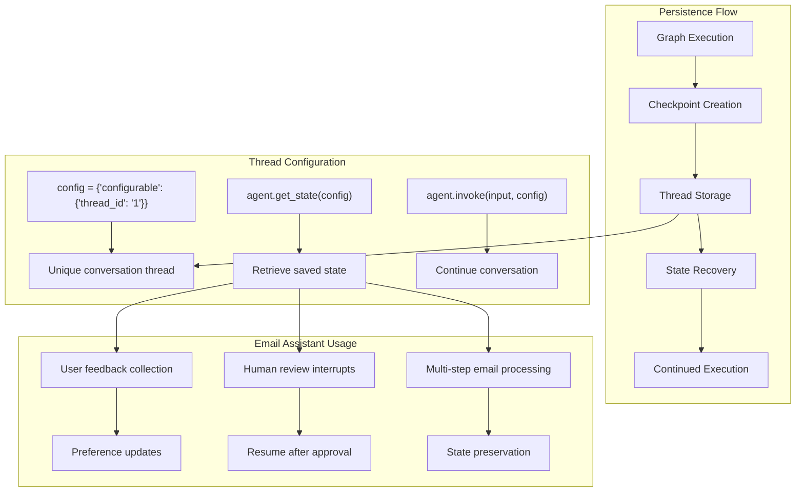

Sources: [notebooks/langgraph_101.ipynb:482-558](), [src/email_assistant/langgraph_101.py:1-52]()

## Human-in-the-Loop with Interrupts

LangGraph supports interrupts that pause execution at specific points to collect human input. The email assistant uses this for review workflows and feedback collection.

### Interrupt Implementation

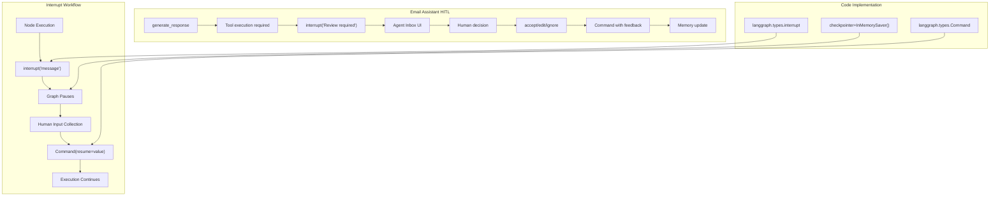

### Memory Update Flow

The human-in-the-loop variants use interrupts to collect feedback and update user preferences:

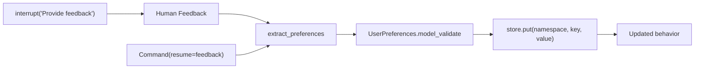

Sources: [notebooks/langgraph_101.ipynb:565-675](), [src/email_assistant/schemas.py:35-38]()

## Deployment Configuration

LangGraph applications are deployed through the LangGraph Platform using configuration files and structured project layouts.

### Project Structure

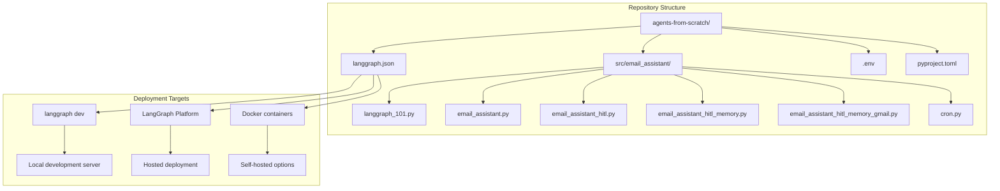

### Graph Registration

The `langgraph.json` file maps graph names to their Python module paths:

```json
{
  "graphs": {
    "langgraph101": "./src/email_assistant/langgraph_101.py:app",
    "email_assistant": "./src/email_assistant/email_assistant.py:email_assistant",
    "email_assistant_hitl": "./src/email_assistant/email_assistant_hitl.py:email_assistant",
    "email_assistant_hitl_memory": "./src/email_assistant/email_assistant_hitl_memory.py:email_assistant",
    "email_assistant_hitl_memory_gmail": "./src/email_assistant/email_assistant_hitl_memory_gmail.py:email_assistant",
    "cron": "./src/email_assistant/cron.py:graph"
  }
}
```

Each graph represents a different variant of the email assistant with progressive complexity and capabilities.

Sources: [langgraph.json:1-16](), [notebooks/langgraph_101.ipynb:708-757]()

---

# Page: Email Assistant Core Architecture

# Email Assistant Core Architecture

<details>
<summary>Relevant source files</summary>

The following files were used as context for generating this wiki page:

- [README.md](README.md)
- [notebooks/agent.ipynb](notebooks/agent.ipynb)
- [src/email_assistant/email_assistant.py](src/email_assistant/email_assistant.py)

</details>


## Purpose and Scope

This document describes the fundamental architecture of the email assistant system as implemented in the basic `email_assistant.py` module. It covers the two-phase workflow structure (triage router + response agent), state management primitives, node implementations, and the ReAct (Reasoning + Acting) pattern that drives agent behavior.

For progressive feature additions across implementation variants, see [Implementation Variants](#3.1). For human-in-the-loop mechanisms, see [HITL Integration](#3.2). For memory and learning capabilities, see [Memory System](#3.3). For production Gmail API integration, see [Gmail Integration](#3.4).

**Sources:** [src/email_assistant/email_assistant.py:1-161](), [notebooks/agent.ipynb:1-686](), [README.md:82-88]()

---

## System Overview

The email assistant implements a two-phase workflow pattern that separates email classification from response generation:

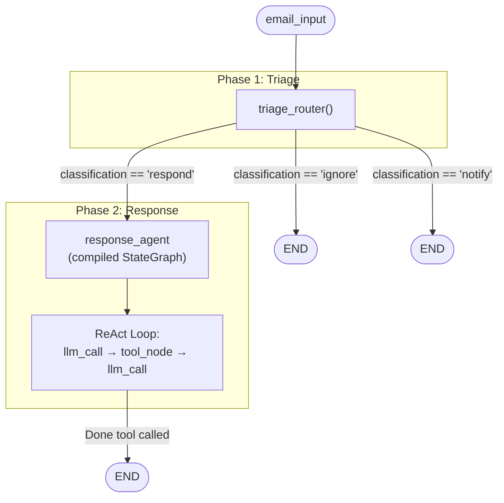

**Workflow Phases**

| Phase | Entry Point | Purpose | Output |
|-------|-------------|---------|--------|
| **Triage** | `triage_router()` | Classify email as `ignore`, `notify`, or `respond` using `llm_router.with_structured_output(RouterSchema)` | Classification decision and optional messages |
| **Response** | `response_agent` (subgraph) | Execute multi-step reasoning and action loop to craft response using tools | Completed email response via tool calls |

The triage phase uses structured output to ensure deterministic classification, while the response phase implements an agentic ReAct loop with tool calling capabilities.

**Sources:** [src/email_assistant/email_assistant.py:94-161](), [notebooks/agent.ipynb:86-102]()

---

## State Management

The system uses LangGraph's `MessagesState` as a foundation and extends it with custom fields:

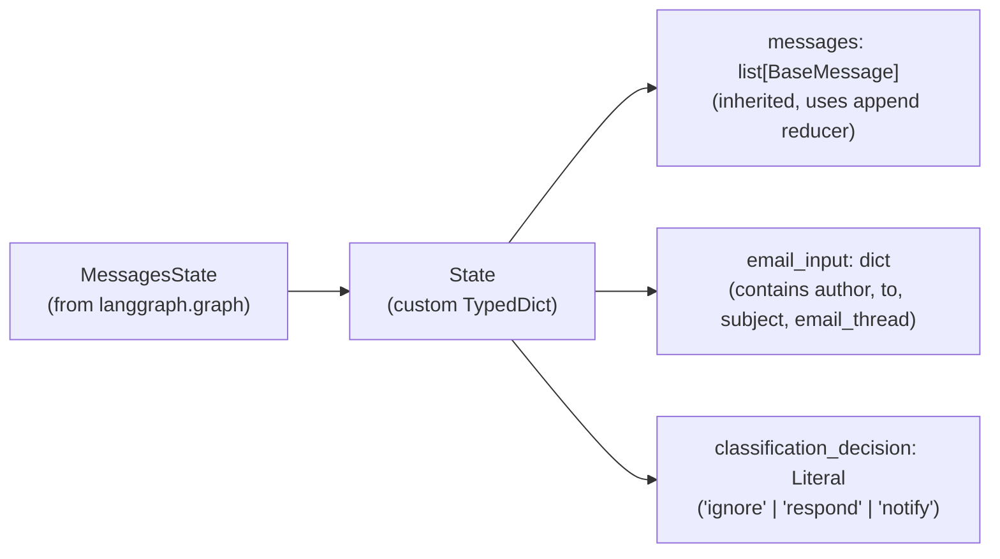

### State Schema Definition

The `State` class in [src/email_assistant/schemas.py]() defines the shared state structure:

| Field | Type | Purpose | Reducer |
|-------|------|---------|---------|
| `messages` | `list[BaseMessage]` | Conversation history for LLM context | Append (inherited from `MessagesState`) |
| `email_input` | `dict` | Raw email data with keys: `author`, `to`, `subject`, `email_thread` | Overwrite |
| `classification_decision` | `Literal["ignore", "respond", "notify"]` | Triage classification result | Overwrite |

The `messages` field automatically appends new messages returned by nodes due to the [reducer pattern](https://langchain-ai.github.io/langgraph/concepts/low_level/#reducers) inherited from `MessagesState`. This eliminates the need for manual message concatenation logic.

**Sources:** [notebooks/agent.ipynb:104-120](), [src/email_assistant/email_assistant.py:8]()

---

## Triage Router

The `triage_router()` function implements Phase 1 classification logic using structured output to ensure deterministic routing decisions.

### Classification Schema

```python
class RouterSchema(BaseModel):
    reasoning: str  # Step-by-step classification justification
    classification: Literal["ignore", "respond", "notify"]
```

The `reasoning` field enables chain-of-thought processing before classification, improving decision quality.

### Triage Node Implementation

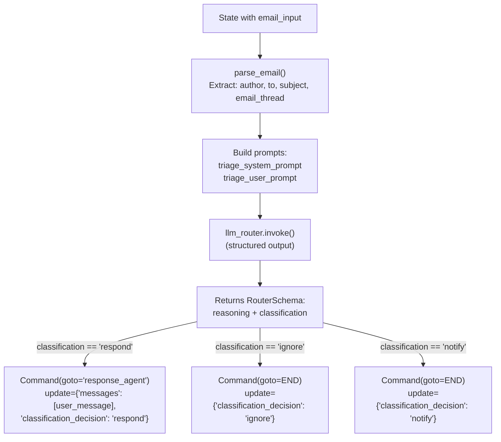

**Key Implementation Details:**

1. **Email Parsing** ([src/email_assistant/email_assistant.py:102]()):
   ```python
   author, to, subject, email_thread = parse_email(state["email_input"])
   ```

2. **LLM Router Invocation** ([src/email_assistant/email_assistant.py:116-121]()):
   - Uses `llm.with_structured_output(RouterSchema)` for guaranteed schema compliance
   - System prompt includes `triage_system_prompt.format(background=..., triage_instructions=...)`
   - User prompt provides formatted email content

3. **Command Object Routing** ([src/email_assistant/email_assistant.py:126-151]()):
   - Returns `Command(goto=..., update=...)` to both route and update state
   - `goto="response_agent"` triggers Phase 2 agent execution
   - `goto=END` terminates workflow for `ignore` and `notify` classifications

**Sources:** [src/email_assistant/email_assistant.py:94-151](), [notebooks/agent.ipynb:127-288]()

---

## Response Agent Architecture

The response agent implements a ReAct loop as a compiled `StateGraph` subgraph. It consists of three core components: LLM decision node, tool execution node, and conditional routing logic.

### Agent Graph Structure

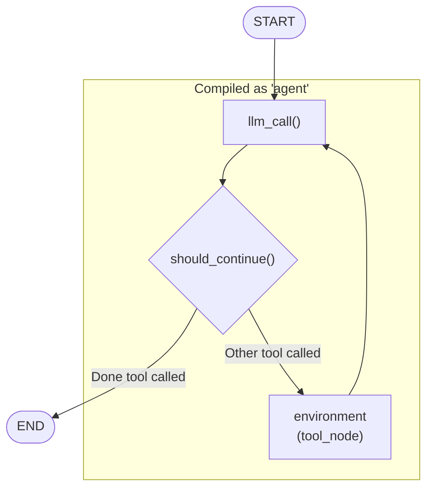

This graph is compiled once and embedded as a subgraph within the overall workflow at node name `"response_agent"`.

### LLM Call Node

The `llm_call()` function ([src/email_assistant/email_assistant.py:29-47]()) implements the reasoning phase:

**Node Behavior:**

| Step | Implementation | Purpose |
|------|----------------|---------|
| 1. Construct prompt | Prepend `agent_system_prompt.format(...)` to `state["messages"]` | Provide tool descriptions and response guidelines |
| 2. Invoke LLM | `llm_with_tools.invoke([system_msg] + messages)` | Get tool call decision |
| 3. Return message | `{"messages": [ai_message]}` | Update state with LLM's tool choice |

**Tool Binding Configuration:**

```python
llm_with_tools = llm.bind_tools(tools, tool_choice="any")
```

The `tool_choice="any"` parameter enforces that the LLM must select at least one tool on every invocation, implementing a strict ReAct pattern with no "direct response" mode.

**Sources:** [src/email_assistant/email_assistant.py:24-47](), [notebooks/agent.ipynb:301-375]()

### Tool Handler Node

The `tool_node()` function ([src/email_assistant/email_assistant.py:49-57]()) executes tool calls:

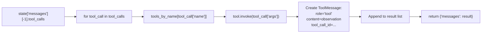

**Implementation Details:**

1. **Tool Registry Lookup** ([src/email_assistant/email_assistant.py:16-18]()):
   ```python
   tools = get_tools()
   tools_by_name = get_tools_by_name(tools)
   ```

2. **Multiple Tool Support** ([src/email_assistant/email_assistant.py:52-56]()):
   - Iterates through all tool calls in the last AI message
   - Creates separate `ToolMessage` for each execution result
   - Returns all tool messages in a single update

3. **Tool Message Format**:
   - `role="tool"` identifies the message type
   - `tool_call_id` links response to specific tool call in AI message
   - `content` contains string representation of tool output

**Sources:** [src/email_assistant/email_assistant.py:49-57](), [notebooks/agent.ipynb:382-413]()

### Conditional Routing Logic

The `should_continue()` function ([src/email_assistant/email_assistant.py:60-69]()) determines loop continuation:

**Routing Decision Tree:**

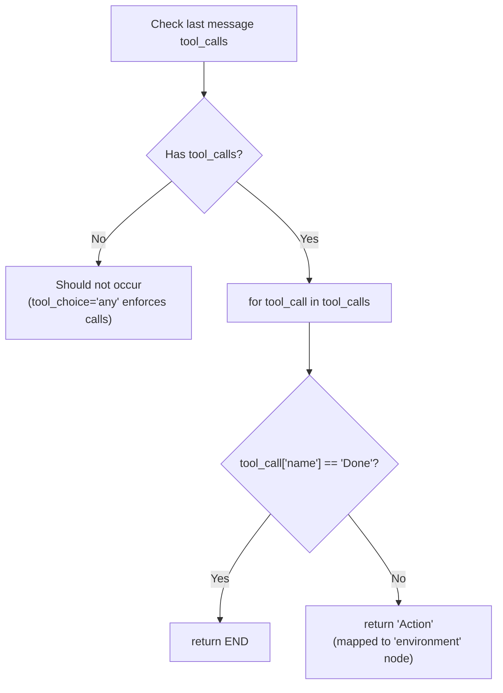

**Termination Condition:**

The `Done` tool serves as the explicit completion signal. When the LLM determines that the email response task is complete, it calls `Done(done=True)`, triggering workflow termination.

**Sources:** [src/email_assistant/email_assistant.py:60-69](), [notebooks/agent.ipynb:420-446]()

---

## Workflow Composition

The overall workflow combines the triage router and response agent as peer nodes in a parent graph:

### Graph Compilation

```mermaid
graph TB
    START([START]) --> triage_router["triage_router()"]
    
    triage_router -->|"Command(goto='response_agent')"| response_agent["response_agent<br/>(embedded StateGraph)"]
    triage_router -->|"Command(goto=END)"| END1([END])
    
    response_agent --> END2([END])
    
    subgraph "overall_workflow (StateGraph)"
        triage_router
        response_agent
    end
```

**Compilation Code** ([src/email_assistant/email_assistant.py:154-161]()):

```python
overall_workflow = (
    StateGraph(State, input=StateInput)
    .add_node(triage_router)
    .add_node("response_agent", agent)  # 'agent' is pre-compiled StateGraph
    .add_edge(START, "triage_router")
)

email_assistant = overall_workflow.compile()
```

**Key Architectural Decisions:**

| Decision | Rationale |
|----------|-----------|
| No explicit edges from `triage_router` | Uses `Command` objects for dynamic routing |
| `response_agent` is a compiled subgraph | Encapsulation: triage phase doesn't need to know agent internals |
| No edge from `response_agent` to other nodes | Always terminates workflow (reaches own internal `END`) |
| Single entry point (`START → triage_router`) | All emails must pass through triage classification |

**Sources:** [src/email_assistant/email_assistant.py:154-161](), [notebooks/agent.ipynb:519-558]()

---

## ReAct Pattern Implementation

The response agent implements the ReAct (Reasoning + Acting) pattern through enforced tool calling and iterative execution:

### ReAct Cycle

```mermaid
stateDiagram-v2
    [*] --> Reasoning
    
    Reasoning: llm_call()<br/>LLM generates reasoning<br/>Selects tool(s) to call
    
    Acting: environment<br/>tool_node()<br/>Execute tool(s)<br/>Return observations
    
    Evaluation: should_continue()<br/>Check if Done tool called
    
    Reasoning --> Acting: Tool calls in message
    Acting --> Evaluation: Tool results in messages
    Evaluation --> Reasoning: Continue (other tools)
    Evaluation --> [*]: Terminate (Done tool)
```

### Enforcement Mechanisms

| Mechanism | Implementation | Effect |
|-----------|----------------|--------|
| **Mandatory tool use** | `tool_choice="any"` in `llm.bind_tools()` | LLM cannot respond without calling a tool |
| **Explicit completion** | `Done` tool required for termination | Prevents premature workflow exit |
| **Observation integration** | Tool results added to `messages` state | LLM receives feedback in next iteration |
| **No direct responses** | No conditional edge bypassing tools | Forces action step in every cycle |

### Example Execution Trace

**Turn 1 - Reasoning:**
```
AI Message: {tool_calls: [{name: "check_calendar_availability", args: {day: "Monday"}}]}
```

**Turn 1 - Acting:**
```
Tool Message: {content: "Available times on Monday: 9:00 AM, 2:00 PM, 4:00 PM", tool_call_id: "..."}
```

**Turn 2 - Reasoning:**
```
AI Message: {tool_calls: [{name: "schedule_meeting", args: {attendees: [...], preferred_day: "2024-03-04", start_time: 14}}]}
```

**Turn 2 - Acting:**
```
Tool Message: {content: "Meeting 'API Review' scheduled on Monday, March 04, 2024 at 14 for 60 minutes with 2 attendees", tool_call_id: "..."}
```

**Turn 3 - Reasoning:**
```
AI Message: {tool_calls: [{name: "write_email", args: {to: "alice@...", subject: "Re: API documentation", content: "..."}}]}
```

**Turn 3 - Acting:**
```
Tool Message: {content: "Email sent to alice@... with subject 'Re: API documentation' and content: ...", tool_call_id: "..."}
```

**Turn 4 - Reasoning:**
```
AI Message: {tool_calls: [{name: "Done", args: {done: true}}]}
```

**Turn 4 - Termination:**
```
should_continue() returns END
```

This trace demonstrates how the ReAct pattern enables multi-step reasoning where each tool observation informs the next decision.

**Sources:** [src/email_assistant/email_assistant.py:29-89](), [notebooks/agent.ipynb:449-512]()

---

## Module Entry Point

The module exports a single compiled graph as the primary interface:

```python
# Exported at module level (src/email_assistant/email_assistant.py:161)
email_assistant = overall_workflow.compile()
```

**Invocation Contract:**

```python
# Input schema
input = {
    "email_input": {
        "author": "Alice <alice@example.com>",
        "to": "Bob <bob@example.com>",
        "subject": "Meeting request",
        "email_thread": "Hi Bob,\n\nCould we schedule a meeting next week?\n\nAlice"
    }
}

# Synchronous execution
result = email_assistant.invoke(input)

# Output contains:
# - result["messages"]: Full conversation history including tool calls
# - result["classification_decision"]: "ignore" | "respond" | "notify"
# - result["email_input"]: Original input (unchanged)
```

The `email_assistant` graph is registered in `langgraph.json` for deployment to LangGraph Platform.

**Sources:** [src/email_assistant/email_assistant.py:161](), [notebooks/agent.ipynb:605-616]()

---

# Page: Implementation Variants

# Implementation Variants

<details>
<summary>Relevant source files</summary>

The following files were used as context for generating this wiki page:

- [README.md](README.md)
- [notebooks/agent.ipynb](notebooks/agent.ipynb)
- [src/email_assistant/email_assistant.py](src/email_assistant/email_assistant.py)

</details>


This document covers the progressive evolution of email assistant implementations, from basic automation to sophisticated human-AI collaboration with learning capabilities and Gmail integration. Each variant builds upon the previous one, adding new capabilities while maintaining the core email processing workflow.

For information about the underlying LangGraph framework concepts, see [LangGraph Framework](#4). For details about the human oversight mechanisms, see [Human-in-the-Loop (HITL) Integration](#2.2). For memory and learning capabilities, see [Memory System](#2.3). For production deployment with Gmail, see [Gmail Integration](#2.4).

## Implementation Evolution Overview

The email assistant system consists of four main implementation variants, each building incrementally on the previous version:

### Implementation Progression

```mermaid
graph LR
    A["email_assistant.py<br/>Basic Automation"] --> B["email_assistant_hitl.py<br/>+ Human Oversight"]
    B --> C["email_assistant_hitl_memory.py<br/>+ Learning System"]
    C --> D["email_assistant_hitl_memory_gmail.py<br/>+ Gmail Integration"]
    
    subgraph "Core Features"
        E["triage_router()"]
        F["response_agent"]
        G["tool_node()"]
    end
    
    subgraph "HITL Features"
        H["interrupt_handler()"]
        I["triage_interrupt_handler()"]
        J["interrupt()"]
    end
    
    subgraph "Memory Features"
        K["get_memory()"]
        L["update_memory()"]
        M["BaseStore"]
    end
    
    subgraph "Gmail Features"
        N["send_email_tool"]
        O["mark_as_read_node()"]
        P["parse_gmail()"]
    end
    
    A --> E
    A --> F
    A --> G
    
    B --> H
    B --> I
    B --> J
    
    C --> K
    C --> L
    C --> M
    
    D --> N
    D --> O
    D --> P
```

**Sources:** [src/email_assistant/email_assistant.py](), [src/email_assistant/email_assistant_hitl.py](), [src/email_assistant/email_assistant_hitl_memory.py](), [src/email_assistant/email_assistant_hitl_memory_gmail.py]()

## Basic Email Assistant

### Architecture

The foundational implementation provides automated email triage and response without human intervention.

```mermaid
graph TD
    A["email_input"] --> B["triage_router()"]
    B --> C{RouterSchema.classification}
    
    C -->|"respond"| D["response_agent"]
    C -->|"ignore"| E["END"]
    C -->|"notify"| E
    
    D --> F["llm_call()"]
    F --> G["should_continue()"]
    G --> H["tool_node()"]
    H --> F
    G --> I["END"]
    
    subgraph "Tools"
        J["write_email"]
        K["schedule_meeting"]
        L["check_calendar_availability"]
        M["Done"]
    end
    
    H --> J
    H --> K
    H --> L
    H --> M
```

**Key Components:**

| Component | Function | Purpose |
|-----------|----------|---------|
| `triage_router` | [src/email_assistant/email_assistant.py:94-151]() | Classifies emails using `llm_router.with_structured_output(RouterSchema)` |
| `response_agent` | [src/email_assistant/email_assistant.py:153-159]() | Compiled `StateGraph` for handling email responses |
| `tool_node` | [src/email_assistant/email_assistant.py:49-57]() | Executes tool calls using `tools_by_name[tool_call["name"]]` |
| `should_continue` | [src/email_assistant/email_assistant.py:60-69]() | Routes workflow based on `Done` tool detection |

**Sources:** [src/email_assistant/email_assistant.py:1-161]()

## Human-in-the-Loop (HITL) Email Assistant

### Enhanced Architecture

Adds human oversight at both triage and action execution stages through interrupt mechanisms.

```mermaid
graph TD
    A["email_input"] --> B["triage_router()"]
    B --> C{classification}
    
    C -->|"respond"| D["response_agent"]
    C -->|"ignore"| E["END"]
    C -->|"notify"| F["triage_interrupt_handler()"]
    
    F --> G["interrupt()"]
    G --> H{Human Decision}
    H -->|"response"| D
    H -->|"ignore"| E
    
    D --> I["llm_call()"]
    I --> J["should_continue()"]
    J --> K["interrupt_handler()"]
    K --> L["interrupt()"]
    L --> M{Human Action}
    
    M -->|"accept"| N["Execute Tool"]
    M -->|"edit"| O["Execute with edited_args"]
    M -->|"ignore"| P["END"]
    M -->|"response"| Q["Add feedback message"]
    
    N --> I
    O --> I
    Q --> I
```

**Key HITL Components:**

| Component | Function | Purpose |
|-----------|----------|---------|
| `triage_interrupt_handler` | [src/email_assistant/email_assistant_hitl.py:101-158]() | Creates `interrupt([request])` for triage decisions |
| `interrupt_handler` | [src/email_assistant/email_assistant_hitl.py:179-346]() | Manages tool call interrupts with configurable actions |
| `hitl_tools` | [src/email_assistant/email_assistant_hitl.py:192]() | List `["write_email", "schedule_meeting", "Question"]` |

**Sources:** [src/email_assistant/email_assistant_hitl.py:1-391]()

## HITL + Memory Email Assistant

### Memory-Enhanced Architecture

Adds persistent memory storage and learning from human feedback to improve future decisions.

```mermaid
graph TD
    A["email_input"] --> B["triage_router()"]
    B --> C["get_memory()"]
    C --> D["store.get(namespace, 'user_preferences')"]
    
    B --> E{classification}
    E -->|"respond"| F["response_agent"]
    E -->|"notify"| G["triage_interrupt_handler()"]
    
    G --> H["interrupt()"]
    H --> I{Human Decision}
    I -->|"feedback"| J["update_memory()"]
    J --> K["llm.with_structured_output(UserPreferences)"]
    K --> L["store.put(namespace, 'user_preferences', result)"]
    
    F --> M["llm_call()"]
    M --> N["get_memory() for response_preferences"]
    M --> O["get_memory() for cal_preferences"]
    
    subgraph "Memory Namespaces"
        P["('email_assistant', 'triage_preferences')"]
        Q["('email_assistant', 'response_preferences')"]
        R["('email_assistant', 'cal_preferences')"]
    end
    
    D --> P
    N --> Q
    O --> R
```

**Memory System Components:**

| Component | Function | Purpose |
|-----------|----------|---------|
| `get_memory` | [src/email_assistant/email_assistant_hitl_memory.py:30-55]() | Retrieves or initializes memory from `BaseStore` |
| `update_memory` | [src/email_assistant/email_assistant_hitl_memory.py:57-76]() | Updates memory using LLM with `UserPreferences` schema |
| `BaseStore` | [src/email_assistant/email_assistant_hitl_memory.py:6]() | LangGraph persistent storage interface |

**Sources:** [src/email_assistant/email_assistant_hitl_memory.py:1-501]()

## HITL + Memory + Gmail Email Assistant

### Production-Ready Architecture

Integrates with Gmail API for real-world email processing with authentication and email management.

```mermaid
graph TD
    A["Gmail Email Input"] --> B["parse_gmail()"]
    B --> C["triage_router()"]
    C --> D["get_memory()"]
    
    C --> E{classification}
    E -->|"respond"| F["response_agent"]
    E -->|"notify"| G["triage_interrupt_handler()"]
    
    F --> H["llm_call()"]
    H --> I["should_continue()"]
    I -->|"Done"| J["mark_as_read_node()"]
    I -->|"tool_calls"| K["interrupt_handler()"]
    
    J --> L["mark_as_read()"]
    L --> M["END"]
    
    K --> N["interrupt()"]
    N --> O{Human Action}
    O -->|"accept"| P["send_email_tool.invoke()"]
    O -->|"edit"| Q["schedule_meeting_tool.invoke()"]
    
    subgraph "Gmail Tools"
        R["send_email_tool"]
        S["schedule_meeting_tool"]
        T["check_calendar_tool"]
    end
    
    P --> R
    Q --> S
    H --> T
```

**Gmail Integration Components:**

| Component | Function | Purpose |
|-----------|----------|---------|
| `parse_gmail` | [src/email_assistant/email_assistant_hitl_memory_gmail.py:14]() | Extracts `email_id` along with standard email fields |
| `format_gmail_markdown` | [src/email_assistant/email_assistant_hitl_memory_gmail.py:14]() | Formats Gmail emails for display with ID tracking |
| `mark_as_read_node` | [src/email_assistant/email_assistant_hitl_memory_gmail.py:472-475]() | Calls `mark_as_read(email_id)` after processing |
| Gmail tools | [src/email_assistant/email_assistant_hitl_memory_gmail.py:20]() | `["send_email_tool", "schedule_meeting_tool", "check_calendar_tool"]` |

**Sources:** [src/email_assistant/email_assistant_hitl_memory_gmail.py:1-511]()

## Implementation Comparison

### Feature Matrix

| Feature | Basic | HITL | HITL + Memory | HITL + Memory + Gmail |
|---------|-------|------|---------------|----------------------|
| Email Triage | ✓ | ✓ | ✓ | ✓ |
| Automated Response | ✓ | ✓ | ✓ | ✓ |
| Human Oversight | ✗ | ✓ | ✓ | ✓ |
| Learning from Feedback | ✗ | ✗ | ✓ | ✓ |
| Gmail Integration | ✗ | ✗ | ✗ | ✓ |
| Production Ready | ✗ | ✗ | ✗ | ✓ |

### Code Entity Mapping

```mermaid
graph TB
    subgraph "Common Core"
        A["State"]
        B["RouterSchema"]
        C["StateInput"]
        D["triage_system_prompt"]
        E["agent_system_prompt"]
    end
    
    subgraph "Basic Implementation"
        F["email_assistant.py"]
        G["tool_node()"]
        H["should_continue()"]
        I["AGENT_TOOLS_PROMPT"]
    end
    
    subgraph "HITL Implementation"
        J["email_assistant_hitl.py"]
        K["interrupt_handler()"]
        L["triage_interrupt_handler()"]
        M["HITL_TOOLS_PROMPT"]
    end
    
    subgraph "Memory Implementation"
        N["email_assistant_hitl_memory.py"]
        O["get_memory()"]
        P["update_memory()"]
        Q["UserPreferences"]
        R["HITL_MEMORY_TOOLS_PROMPT"]
    end
    
    subgraph "Gmail Implementation"
        S["email_assistant_hitl_memory_gmail.py"]
        T["parse_gmail()"]
        U["mark_as_read_node()"]
        V["GMAIL_TOOLS_PROMPT"]
    end
    
    A --> F
    A --> J
    A --> N
    A --> S
    
    B --> F
    B --> J
    B --> N
    B --> S
```

**Sources:** [src/email_assistant/schemas.py](), [src/email_assistant/prompts.py](), [src/email_assistant/tools/default/prompt_templates.py](), [src/email_assistant/tools/gmail/prompt_templates.py]()

## Testing Considerations

The testing framework in [tests/run_all_tests.py:25-33]() excludes HITL and memory variants due to the `Question` tool not being included in evaluation datasets and infinite loop issues with hardcoded resume commands.

**Testing Coverage:**

| Implementation | Tested | Reason |
|----------------|--------|--------|
| `email_assistant` | ✓ | Full compatibility with test datasets |
| `email_assistant_hitl` | ✗ | `Question` tool causes test loop issues |
| `email_assistant_hitl_memory` | ✗ | Same as HITL + memory complexity |
| `email_assistant_hitl_memory_gmail` | ✗ | Requires Gmail authentication |

**Sources:** [tests/run_all_tests.py:25-47]()

---

# Page: Human-in-the-Loop (HITL) Integration

# Human-in-the-Loop (HITL) Integration

<details>
<summary>Relevant source files</summary>

The following files were used as context for generating this wiki page:

- [README.md](README.md)
- [notebooks/hitl.ipynb](notebooks/hitl.ipynb)
- [src/email_assistant/email_assistant_hitl.py](src/email_assistant/email_assistant_hitl.py)

</details>


## Purpose and Overview

The Human-in-the-Loop (HITL) integration enables the email assistant to pause at critical decision points for human review and approval. This feature is essential for sensitive tasks like email management, where fully autonomous operation might not be appropriate. The HITL system allows humans to review, edit, approve or reject specific actions before they are executed, creating a collaborative workflow between AI and human users.

This document details how human intervention is incorporated into the email assistant workflow, focusing on the interrupt mechanism, user interaction types, and implementation architecture. For information about the core email assistant functionality, see [Email Assistant Core Architecture](#2).

## HITL Architecture

The HITL functionality extends the basic email assistant by adding interrupt mechanisms that pause execution at specific points for human input. The implementation in `email_assistant_hitl.py` consists of two main graph structures:

1. **Triage-level interrupts** - Via `triage_interrupt_handler()` when `classification == "notify"`
2. **Tool-level interrupts** - Via `interrupt_handler()` for sensitive tools like `write_email`, `schedule_meeting`, and `Question`

**High-Level HITL Flow Diagram**

```mermaid
flowchart TD
    StateInput["StateInput"] --> triage_router["triage_router()"]
    
    triage_router -->|"classification='respond'"| response_agent
    triage_router -->|"classification='notify'"| triage_interrupt_handler["triage_interrupt_handler()"]
    triage_router -->|"classification='ignore'"| END1["END"]
    
    triage_interrupt_handler -->|"interrupt([request])"| Human1["Human Review<br/>Agent Inbox"]
    Human1 -->|"type='response'"| response_agent
    Human1 -->|"type='ignore'"| END2["END"]
    
    subgraph response_agent["response_agent (nested StateGraph)"]
        llm_call["llm_call()"]
        should_continue["should_continue()"]
        interrupt_handler["interrupt_handler()"]
        
        llm_call --> should_continue
        should_continue -->|"Done tool called"| END3["END"]
        should_continue -->|"other tool calls"| interrupt_handler
        
        interrupt_handler -->|"tool in hitl_tools"| Human2["interrupt([request])"]
        interrupt_handler -->|"tool not in hitl_tools"| DirectExec["tool.invoke()"]
        
        Human2 -->|"type='accept/edit/response'"| interrupt_handler
        Human2 -->|"type='ignore'"| END4["END"]
        DirectExec --> interrupt_handler
        
        interrupt_handler -->|"Command(goto='llm_call')"| llm_call
    end
```

Sources: [src/email_assistant/email_assistant_hitl.py:30-99](), [src/email_assistant/email_assistant_hitl.py:101-158](), [src/email_assistant/email_assistant_hitl.py:179-346](), [src/email_assistant/email_assistant_hitl.py:349-391]()

## Interrupt Points

The HITL integration adds two main interrupt points where human review and feedback are incorporated:

### 1. Triage Interrupt

When `result.classification == "notify"` in `triage_router()`, the system creates a `Command(goto="triage_interrupt_handler")` to pause execution for user review.

```mermaid
flowchart LR
    triage_router["triage_router()"] -->|"classification='notify'"| triage_interrupt_handler["triage_interrupt_handler()"]
    triage_interrupt_handler --> interrupt_call["interrupt([request])"]
    interrupt_call --> user_response["response['type']"]
    user_response -->|"'response'"| response_agent["Command(goto='response_agent')"]
    user_response -->|"'ignore'"| END_node["Command(goto=END)"]
```

The `triage_interrupt_handler()` function creates an interrupt with specific configuration:

```python
request = {
    "action_request": {
        "action": f"Email Assistant: {state['classification_decision']}",
        "args": {}
    },
    "config": {
        "allow_ignore": True,  
        "allow_respond": True, 
        "allow_edit": False, 
        "allow_accept": False,  
    }
}
```

Sources: [src/email_assistant/email_assistant_hitl.py:87-95](), [src/email_assistant/email_assistant_hitl.py:116-129](), [src/email_assistant/email_assistant_hitl.py:135-151]()

### 2. Tool Call Interrupts

The `interrupt_handler()` function at [src/email_assistant/email_assistant_hitl.py:179-346]() filters tool calls using a hardcoded list defined at line 192:

```python
hitl_tools = ["write_email", "schedule_meeting", "Question"]
```

**HITL Tool Classification**

| Tool | Purpose | Interrupt Reason | Execution |
|------|---------|------------------|-----------|
| `write_email` | Create and send emails | Email sending has external impact | Requires HITL |
| `schedule_meeting` | Book calendar meetings | Calendar changes impact scheduling | Requires HITL |
| `Question` | Ask user for clarification | Requires direct human input | Requires HITL |
| `check_calendar_availability` | Query calendar | Read-only operation | Direct execution |
| `Done` | Signal workflow completion | Control flow signal | Direct execution |

**Interrupt Handler Flow**

```mermaid
flowchart TD
    interrupt_handler["interrupt_handler(state)"] --> iterate["for tool_call in<br/>state['messages'][-1].tool_calls"]
    iterate --> check_hitl{"tool_call['name']<br/>in hitl_tools?"}
    
    check_hitl -->|"False"| direct["tool = tools_by_name[tool_call['name']]<br/>observation = tool.invoke(tool_call['args'])<br/>result.append({'role': 'tool', ...})"]
    direct --> continue_loop["continue to next tool_call"]
    
    check_hitl -->|"True"| format_request["Format interrupt request:<br/>- action_request<br/>- config (allow_ignore, allow_respond, etc)<br/>- description"]
    
    format_request --> call_interrupt["response = interrupt([request])[0]"]
    
    call_interrupt --> response_switch{"response['type']"}
    
    response_switch -->|"'accept'"| exec_original["tool.invoke(tool_call['args'])<br/>result.append({'role': 'tool', ...})"]
    response_switch -->|"'edit'"| exec_edited["edited_args = response['args']['args']<br/>tool.invoke(edited_args)<br/>Update AI message tool_calls<br/>result.append({'role': 'tool', ...})"]
    response_switch -->|"'response'"| add_feedback["result.append({'role': 'tool',<br/>'content': f'User gave feedback...'})"]
    response_switch -->|"'ignore'"| add_ignore["result.append({'role': 'tool',<br/>'content': 'User ignored...'}) <br/>goto = END"]
    
    exec_original --> update_state["Command(goto=goto,<br/>update={'messages': result})"]
    exec_edited --> update_state
    add_feedback --> update_state
    add_ignore --> update_state
    continue_loop --> update_state
```

Sources: [src/email_assistant/email_assistant_hitl.py:179-346](), [src/email_assistant/email_assistant_hitl.py:191-201](), [src/email_assistant/email_assistant_hitl.py:250-340]()

## User Interaction Types

The HITL system supports four types of user interactions, returned as `response["type"]` from the `interrupt()` call:

| Interaction | Description | Effect on Workflow | Implementation |
|-------------|-------------|-------------------|----------------|
| `accept` | Approve the action as proposed | Tool executes with original `tool_call["args"]` | `tool.invoke(tool_call["args"])` at line 255 |
| `edit` | Modify the action before execution | Tool executes with `response["args"]["args"]` | `tool.invoke(edited_args)` at lines 284, 294 |
| `response` | Provide feedback or answer questions | Feedback added to `messages` as tool response | Lines 325-333 |
| `ignore` | Reject the proposed action | Cancels tool execution, `goto = END` | Lines 303-320 |

**Per-Tool Interrupt Configuration**

Each tool's allowed interactions are configured in `interrupt_handler()` at [src/email_assistant/email_assistant_hitl.py:213-235]():

```mermaid
flowchart TD
    check_tool{"tool_call['name']"}
    
    check_tool -->|"'write_email'"| we_config["Lines 213-219:<br/>allow_ignore = True<br/>allow_respond = True<br/>allow_edit = True<br/>allow_accept = True"]
    
    check_tool -->|"'schedule_meeting'"| sm_config["Lines 220-226:<br/>allow_ignore = True<br/>allow_respond = True<br/>allow_edit = True<br/>allow_accept = True"]
    
    check_tool -->|"'Question'"| q_config["Lines 227-233:<br/>allow_ignore = True<br/>allow_respond = True<br/>allow_edit = False<br/>allow_accept = False"]
    
    we_config --> create_request["request = {<br/>'action_request': {...},<br/>'config': config,<br/>'description': description<br/>}"]
    sm_config --> create_request
    q_config --> create_request
    
    create_request --> interrupt_call["response = interrupt([request])[0]"]
```

The `Question` tool intentionally disables `allow_edit` and `allow_accept` because questions require natural language responses, not structured argument editing.

Sources: [src/email_assistant/email_assistant_hitl.py:213-235](), [src/email_assistant/email_assistant_hitl.py:250-340]()

## Implementation Details

### HITL Tools

The system uses `get_tools()` to load tools including the special `Question` and `Done` tools for HITL operations:

```python
tools = get_tools(["write_email", "schedule_meeting", "check_calendar_availability", "Question", "Done"])
tools_by_name = get_tools_by_name(tools)
```

```mermaid
flowchart TD
    get_tools["get_tools(['write_email', 'schedule_meeting', 'check_calendar_availability', 'Question', 'Done'])"] --> tools_list["tools"]
    get_tools_by_name["get_tools_by_name(tools)"] --> tools_dict["tools_by_name"]
    
    tools_list --> llm_bind["llm.bind_tools(tools, tool_choice='required')"]
    tools_dict --> tool_lookup["tools_by_name[tool_call['name']]"]
    
    subgraph "Special HITL Tools"
        Question_tool["@tool\nclass Question(BaseModel):\n  content: str"]
        Done_tool["@tool\nclass Done(BaseModel):\n  done: bool"]
    end
    
    Question_tool --> hitl_only["Only for user consultation"]
    Done_tool --> workflow_end["Triggers should_continue() -> END"]
```

The `Question` tool enables direct user consultation, while `Done` signals workflow completion.

Sources: [src/email_assistant/email_assistant_hitl.py:18-19](), [src/email_assistant/email_assistant_hitl.py:27](), [notebooks/hitl.ipynb:109-117]()

### Triage Interrupt Handler

The `triage_interrupt_handler` function manages interrupts during the email triage process:

1. Parses and formats the email for display
2. Creates an interrupt request with the email content
3. Processes the user's response (respond or ignore)
4. Updates the workflow state based on the decision

Key code location: [src/email_assistant/email_assistant_hitl.py:101-158]()

### Tool Call Interrupt Handler

The `interrupt_handler` function manages interrupts for tool calls:

1. Identifies which tools require human review
2. Creates tailored interrupt requests based on tool type
3. Processes user responses (accept, edit, ignore, or feedback)
4. Executes or modifies tools based on user input

Key code location: [src/email_assistant/email_assistant_hitl.py:179-346]()

### State Graph Construction

The HITL email assistant is constructed from two nested `StateGraph` instances at [src/email_assistant/email_assistant_hitl.py:361-391]():

**Graph Construction Code Structure**

```mermaid
flowchart TB
    subgraph inner["Inner Graph: agent_builder = StateGraph(State)"]
        direction TB
        inner_start["START"] --> node_llm["add_node('llm_call', llm_call)"]
        node_llm --> node_int["add_node('interrupt_handler', interrupt_handler)"]
        node_int --> cond_edge["add_conditional_edges('llm_call', should_continue)"]
        cond_edge --> compile1["response_agent = agent_builder.compile()"]
    end
    
    subgraph outer["Outer Graph: overall_workflow = StateGraph(State, input=StateInput)"]
        direction TB
        outer_start["START"] --> node_triage["add_node(triage_router)"]
        node_triage --> node_triage_int["add_node(triage_interrupt_handler)"]
        node_triage_int --> node_resp["add_node('response_agent', response_agent)"]
        node_resp --> edge_start["add_edge(START, 'triage_router')"]
        edge_start --> compile2["email_assistant = overall_workflow.compile()"]
    end
    
    compile1 -.->|"nested into"| node_resp
```

**Detailed Graph Topology**

```mermaid
flowchart TD
    START1["START"] --> triage_router["triage_router<br/>(line 384)"]
    
    triage_router -->|"Command(goto='response_agent')"| response_agent_entry["response_agent entry"]
    triage_router -->|"Command(goto='triage_interrupt_handler')"| triage_int["triage_interrupt_handler<br/>(line 385)"]
    triage_router -->|"Command(goto=END)"| END1["END"]
    
    triage_int -->|"Command(goto='response_agent')"| response_agent_entry
    triage_int -->|"Command(goto=END)"| END1
    
    subgraph response_agent["response_agent<br/>(compiled at line 379, added at line 386)"]
        direction TB
        START2["START"] --> llm_call["llm_call<br/>(node added line 364)"]
        llm_call --> should_continue["should_continue()<br/>(conditional edge line 369)"]
        should_continue -->|"'interrupt_handler'"| interrupt_handler["interrupt_handler<br/>(node added line 365)"]
        should_continue -->|"END"| END2["END"]
        interrupt_handler -->|"Command(goto='llm_call')"| llm_call
        interrupt_handler -->|"Command(goto=END)"| END2
    end
    
    response_agent_entry --> START2
```

The `should_continue()` function at [src/email_assistant/email_assistant_hitl.py:349-358]() checks if the `Done` tool was called to determine whether to continue to `interrupt_handler` or end the workflow.

Sources: [src/email_assistant/email_assistant_hitl.py:349-358](), [src/email_assistant/email_assistant_hitl.py:361-391]()

## Workflow Examples

### Email Triage with HITL

When an email is classified as "notify":

1. System pauses with email displayed to user
2. User can:
   - Respond with feedback on how to handle the email
   - Ignore the notification to end the workflow
3. If user chooses to respond, their feedback is incorporated into the response agent

Sources: [notebooks/hitl.ipynb:672-696]()

### Tool Call Review and Editing

For tools like `write_email` and `schedule_meeting`:

1. System proposes action (e.g., draft email or meeting details)
2. User can:
   - Accept proposal as-is
   - Edit proposal (e.g., modify email content or meeting duration)
   - Provide textual feedback to guide revisions
   - Ignore the proposal to cancel the action
3. System processes user input and continues accordingly

The edit capability is particularly powerful, allowing users to:
- Change meeting duration from 45 to 30 minutes
- Modify email content to be more concise
- Adjust email tone to be less formal

Sources: [notebooks/hitl.ipynb:836-884](), [notebooks/hitl.ipynb:963-1003]()

### Question-Answer Interactions

The `Question` tool enables direct consultation with users:

1. Assistant encounters uncertainty and asks user a question
2. System pauses for user response
3. User provides answer or guidance
4. Assistant incorporates this information into its actions

Sources: [notebooks/hitl.ipynb:1183-1216](), [notebooks/hitl.ipynb:1226-1233]()

## Integration with Agent Inbox

The HITL system integrates with [Agent Inbox](https://github.com/langchain-ai/agent-inbox) at [dev.agentinbox.ai](https://dev.agentinbox.ai/) to provide a user-friendly interface for reviewing interrupts. Agent Inbox connects to the LangGraph server and displays all threads with status `interrupted`.

**Interrupt Request Format for Agent Inbox**

Each interrupt is structured as a dictionary with three keys, formatted at [src/email_assistant/email_assistant_hitl.py:238-245]():

```python
request = {
    "action_request": {
        "action": tool_call["name"],        # Displayed as header in Agent Inbox
        "args": tool_call["args"]           # Tool call arguments
    },
    "config": {                              # UI configuration
        "allow_ignore": True,
        "allow_respond": True,
        "allow_edit": True,
        "allow_accept": True
    },
    "description": description               # Markdown description with email content
}
```

**Agent Inbox Connection**

To connect Agent Inbox to a local LangGraph development server:
- Graph name: `email_assistant_hitl` (from `langgraph.json`)
- Graph URL: `http://127.0.0.1:2024/`

Agent Inbox then uses the `Command` interface with `resume` to send user responses back to the graph:

```python
Command(resume=[{"type": "accept"}])           # Accept as-is
Command(resume=[{"type": "edit", "args": {...}}])  # Edit arguments
Command(resume=[{"type": "response", "args": "..."}])  # Provide feedback
Command(resume=[{"type": "ignore"}])           # Cancel action
```

Sources: [src/email_assistant/email_assistant_hitl.py:238-245](), [notebooks/hitl.ipynb:1318-1342]()

## Technical Implementation

### Interrupt and Resume Mechanism

The HITL system uses LangGraph's `interrupt()` function and `Command` interface from [langgraph.types](https://langchain-ai.github.io/langgraph/concepts/interrupts/):

**Creating an Interrupt**

At [src/email_assistant/email_assistant_hitl.py:248]():
```python
response = interrupt([request])[0]
```

This pauses graph execution and returns control to the client (e.g., Agent Inbox), storing the current state with a checkpoint.

**Resuming After Interrupt**

The graph resumes when it receives a `Command` with `resume`, as demonstrated in [notebooks/hitl.ipynb:726-729]():

```python
# Accept the tool call
Command(resume=[{"type": "accept"}])

# Edit the tool call
Command(resume=[{"type": "edit", "args": {"args": edited_args}}])

# Provide feedback
Command(resume=[{"type": "response", "args": "user feedback text"}])

# Ignore/cancel
Command(resume=[{"type": "ignore"}])
```

The `resume` value is passed back to the `interrupt()` call site as the return value, allowing `interrupt_handler()` to process the user's decision at [src/email_assistant/email_assistant_hitl.py:250-340]().

**Checkpointer Requirement**

Interrupts require a checkpointer to save the graph state during the pause. The HITL graph compilation at [notebooks/hitl.ipynb:687-688]() uses `InMemorySaver`:

```python
from langgraph.checkpoint.memory import InMemorySaver
graph = overall_workflow.compile(checkpointer=InMemorySaver())
```

In production deployments, a persistent checkpointer (like PostgreSQL) is used to maintain interrupted threads across server restarts.

Sources: [src/email_assistant/email_assistant_hitl.py:248](), [notebooks/hitl.ipynb:726-729](), [notebooks/hitl.ipynb:687-688]()

## Conclusion

The HITL integration transforms the email assistant from a fully autonomous system into a collaborative tool that leverages both AI capabilities and human judgment. By pausing at critical decision points for human input, the system maintains high accuracy while giving users control over sensitive actions like sending emails and scheduling meetings.

The flexible interaction types (accept, edit, ignore, and feedback) provide multiple ways for users to guide the system's behavior, leading to outputs that better match user preferences and standards.

---

# Page: Memory System

# Memory System

<details>
<summary>Relevant source files</summary>

The following files were used as context for generating this wiki page:

- [README.md](README.md)
- [notebooks/memory.ipynb](notebooks/memory.ipynb)
- [src/email_assistant/email_assistant_hitl_memory.py](src/email_assistant/email_assistant_hitl_memory.py)

</details>


This document covers the memory system that enables the email assistant to learn from user feedback and adapt its behavior over time. The memory system captures user preferences from human-in-the-loop interactions and applies them to future email processing decisions.

For information about the human-in-the-loop workflow that generates the feedback, see [Human-in-the-Loop (HITL) Integration](#2.2). For details about the core email processing workflow, see [Email Assistant Core Architecture](#2).

## Memory Architecture

The LangGraph memory system provides two complementary types of memory storage that serve different purposes in the email assistant:

```mermaid
graph TB
    subgraph "Thread-Scoped Memory"
        A["Thread Checkpoints"] --> B["Conversation History"]
        A --> C["Message State"]
        A --> D["Tool Call Results"]
    end
    
    subgraph "Across-Thread Memory"
        E["LangGraph Store"] --> F["triage_preferences"]
        E --> G["response_preferences"] 
        E --> H["cal_preferences"]
        E --> I["background"]
    end
    
    J["User Session 1"] --> A
    K["User Session 2"] --> A
    L["User Session 3"] --> A
    
    J --> E
    K --> E
    L --> E
    
    M["InMemoryStore"] --> E
    N["PostgreSQL + pgvector"] --> E
```

**Thread-Scoped Memory** maintains state within individual email processing sessions through LangGraph's checkpoint system. This includes conversation history, tool call results, and intermediate processing state.

**Across-Thread Memory** persists user preferences and learning across all email processing sessions using the LangGraph Store. This is where the system accumulates knowledge about user preferences for triage decisions, response style, and calendar scheduling.

Sources: [notebooks/memory.ipynb:50-89](), [src/email_assistant/email_assistant_hitl_memory.py:30-55]()

## Store Implementations

The memory system supports different Store implementations depending on deployment context:

| Implementation | Use Case | Persistence | Semantic Search |
|---------------|----------|-------------|-----------------|
| `InMemoryStore` | Development/Testing | None (Python dict) | Configurable |
| Local Development | `langgraph dev` | Pickled to filesystem | Configurable |
| Production | LangGraph Platform | PostgreSQL + pgvector | Cosine similarity |

```mermaid
graph LR
    A["Development"] --> B["InMemoryStore"]
    C["Local Testing"] --> D["langgraph dev"]
    E["Production"] --> F["PostgreSQL + pgvector"]
    
    B --> G["No Persistence"]
    D --> H["Filesystem Pickle"]
    F --> I["Full Database"]
    
    G --> J["Quick Experiments"]
    H --> K["Development Workflow"]
    I --> L["Scalable Production"]
```

Sources: [notebooks/memory.ipynb:66-89]()

## Memory Management Functions

The memory system provides two core functions for managing user preferences:

### get_memory Function

The `get_memory` function retrieves existing preferences or initializes defaults:

```mermaid
graph TD
    A["get_memory(store, namespace, default)"] --> B{"Memory Exists?"}
    B -->|Yes| C["Return Stored Value"]
    B -->|No| D["Store Default Content"]
    D --> E["Return Default Content"]
    
    F["store.get(namespace, 'user_preferences')"] --> B
    G["store.put(namespace, 'user_preferences', default)"] --> D
```

The function takes a `namespace` tuple like `("email_assistant", "triage_preferences")` and a `default_content` parameter for initialization.

### update_memory Function

The `update_memory` function processes user feedback to update stored preferences:

```mermaid
graph TD
    A["update_memory(store, namespace, messages)"] --> B["Get Existing Memory"]
    B --> C["LLM with UserPreferences Schema"]
    C --> D["MEMORY_UPDATE_INSTRUCTIONS Prompt"]
    D --> E["Process Feedback Messages"]
    E --> F["Generate Updated Preferences"]
    F --> G["store.put(namespace, 'user_preferences', result)"]
    
    H["Structured Output"] --> C
    I["Preserve Existing + Add New"] --> F
```

The function uses an LLM with structured output to intelligently merge new feedback with existing preferences while preserving all previous learning.

Sources: [src/email_assistant/email_assistant_hitl_memory.py:30-76]()

## Memory Integration in Workflow

Memory is integrated throughout the email assistant workflow at key decision points:

```mermaid
graph TD
    A["triage_router"] --> B["get_memory(triage_preferences)"]
    B --> C["Enhanced Triage Decision"]
    
    D["llm_call"] --> E["get_memory(response_preferences)"]
    D --> F["get_memory(cal_preferences)"]
    E --> G["Response Generation"]
    F --> G
    
    H["interrupt_handler"] --> I["User Feedback"]
    I --> J["update_memory(namespace, messages)"]
    
    K["triage_interrupt_handler"] --> L["User Decision"]
    L --> M["update_memory(triage_preferences)"]
```

### Triage Router Integration

The `triage_router` function retrieves triage preferences to enhance email classification decisions:

The router combines default instructions with learned preferences from the `("email_assistant", "triage_preferences")` namespace.

### Response Agent Integration

The `llm_call` function incorporates response and calendar preferences into LLM prompts:

Both `response_preferences` and `cal_preferences` are retrieved and injected into the system prompt for consistent application of user preferences.

Sources: [src/email_assistant/email_assistant_hitl_memory.py:78-247]()

## Memory Update Triggers

The system updates memory in response to specific user interactions during human-in-the-loop processing:

```mermaid
graph TD
    A["User Feedback Event"] --> B{"Feedback Type"}
    
    B -->|Edit| C["Tool Call Edit"]
    B -->|Response| D["Natural Language Feedback"]
    B -->|Ignore| E["Rejection Decision"]
    B -->|Accept| F["No Memory Update"]
    
    C --> G["update_memory(specific_namespace)"]
    D --> H["update_memory(specific_namespace)"] 
    E --> I["update_memory(triage_preferences)"]
    
    J["write_email edit"] --> K["response_preferences namespace"]
    L["schedule_meeting edit"] --> M["cal_preferences namespace"]
    N["triage ignore/respond"] --> O["triage_preferences namespace"]
```

### Edit-Based Updates

When users edit tool calls, the system captures the differences and updates relevant preferences:

- Email edits trigger `response_preferences` updates
- Meeting edits trigger `cal_preferences` updates  
- The system compares initial vs edited content to extract preference patterns

### Feedback-Based Updates

Natural language feedback from users provides rich learning signals:

- Response-type feedback incorporates user guidance into memory
- Ignore decisions update triage preferences to avoid similar classifications
- The `MEMORY_UPDATE_INSTRUCTIONS` prompt ensures targeted, additive updates

Sources: [src/email_assistant/email_assistant_hitl_memory.py:249-456]()

## Memory Namespaces and Structure

The memory system organizes preferences using namespaced storage with specific key patterns:

| Namespace | Purpose | Default Content Source |
|-----------|---------|----------------------|
| `("email_assistant", "triage_preferences")` | Email classification rules | `default_triage_instructions` |
| `("email_assistant", "response_preferences")` | Email writing style/content | `default_response_preferences` |
| `("email_assistant", "cal_preferences")` | Meeting scheduling preferences | `default_cal_preferences` |
| `("email_assistant", "background")` | User context information | `default_background` |

```mermaid
graph TD
    A["LangGraph Store"] --> B["email_assistant namespace"]
    B --> C["triage_preferences key"]
    B --> D["response_preferences key"] 
    B --> E["cal_preferences key"]
    B --> F["background key"]
    
    C --> G["Classification Rules"]
    D --> H["Writing Style Guidelines"]
    E --> I["Meeting Duration/Timing"]
    F --> J["User Context"]
    
    K["user_preferences value"] --> C
    K --> D
    K --> E
    K --> F
```

Each namespace uses the consistent key `"user_preferences"` with string-based content that the LLM can understand and modify. The `UserPreferences` schema ensures structured updates while maintaining readability.

Sources: [src/email_assistant/email_assistant_hitl_memory.py:30-76](), [notebooks/memory.ipynb:394-421]()

---

# Page: Gmail Integration

# Gmail Integration

<details>
<summary>Relevant source files</summary>

The following files were used as context for generating this wiki page:

- [src/email_assistant/email_assistant_hitl_memory.py](src/email_assistant/email_assistant_hitl_memory.py)
- [src/email_assistant/tools/base.py](src/email_assistant/tools/base.py)
- [src/email_assistant/tools/gmail/README.md](src/email_assistant/tools/gmail/README.md)
- [src/email_assistant/tools/gmail/gmail_tools.py](src/email_assistant/tools/gmail/gmail_tools.py)

</details>


This document covers the Gmail API integration that enables the email assistant to process real Gmail messages and send responses through Google's email and calendar services. The Gmail integration transforms the email assistant from a prototype system into a production-ready automation tool that can handle live email workflows.

For information about the core email assistant architecture without Gmail integration, see [Email Assistant Core Architecture](#2). For details about prompt templates and Gmail-specific tools, see [Gmail Tools](#3.1).

## Authentication System

The Gmail integration uses OAuth 2.0 authentication to securely access Gmail and Google Calendar APIs. The authentication system supports both local development and production deployment scenarios.

### OAuth Flow and Credential Management

The authentication process involves two main files stored in the `.secrets` directory:

```mermaid
graph TB
    subgraph "Authentication Setup"
        A["secrets.json<br/>(OAuth Client Config)"] --> B["setup_gmail.py"]
        B --> C["Browser OAuth Flow"]
        C --> D["token.json<br/>(Access & Refresh Tokens)"]
    end
    
    subgraph "Runtime Authentication"
        E["load_gmail_credentials()"] --> F["Environment Variable<br/>GMAIL_TOKEN"]
        E --> G["Local File<br/>token.json"]
        F --> H["Credentials Object"]
        G --> H
    end
    
    subgraph "Production Deployment"
        I["GMAIL_SECRET<br/>(secrets.json content)"] --> J["Environment Variables"]
        K["GMAIL_TOKEN<br/>(token.json content)"] --> J
    end
    
    D --> E
    H --> L["Gmail API Service"]
    J --> L
```

**Gmail Authentication Flow**

Sources: [src/email_assistant/tools/gmail/setup_gmail.py:24-84](), [src/email_assistant/tools/gmail/run_ingest.py:61-113](), [src/email_assistant/tools/gmail/README.md:12-57]()

The `setup_gmail.py` script handles the initial OAuth flow by reading client configuration from `secrets.json`, opening a browser for user authentication, and storing the resulting tokens in `token.json`. The `load_gmail_credentials()` function provides flexible credential loading that prioritizes environment variables for production deployments while falling back to local files for development.

### Credential Loading Strategy

The `load_gmail_credentials()` function implements a fallback strategy for credential loading:

| Priority | Source | Use Case |
|----------|--------|----------|
| 1 | `GMAIL_TOKEN` environment variable | Production deployments |
| 2 | Local `.secrets/token.json` file | Development environments |

Sources: [src/email_assistant/tools/gmail/run_ingest.py:61-113]()

## Email Ingestion Pipeline

The email ingestion pipeline processes Gmail messages and converts them into LangGraph workflow inputs. The pipeline handles email fetching, content extraction, thread management, and workflow orchestration.

### Ingestion Workflow

```mermaid
graph TD
    subgraph "Gmail API Layer"
        A["Gmail Search Query"] --> B["messages().list()"]
        B --> C["Filter Results"]
        C --> D["messages().get()"]
        D --> E["Extract Email Data"]
    end
    
    subgraph "Content Processing"
        E --> F["extract_message_part()"]
        F --> G["extract_email_data()"]
        G --> H["Email Data Object"]
    end
    
    subgraph "LangGraph Integration"
        H --> I["Thread ID Generation"]
        I --> J["ingest_email_to_langgraph()"]
        J --> K["client.threads.create()"]
        J --> L["client.runs.create()"]
        L --> M["email_assistant_hitl_memory_gmail"]
    end
    
    subgraph "State Management"
        K --> N["Thread Cleanup"]
        N --> O["Previous Runs Deletion"]
        O --> P["Fresh Run Creation"]
    end
```

**Email Ingestion Pipeline Architecture**

Sources: [src/email_assistant/tools/gmail/run_ingest.py:204-284](), [src/email_assistant/tools/gmail/run_ingest.py:141-202]()

### Email Content Extraction

The `extract_message_part()` function handles Gmail's multipart message structure with content type prioritization:

1. **Text/Plain Priority** - Attempts to extract plain text content first
2. **Text/HTML Fallback** - Falls back to HTML content if plain text unavailable  
3. **Recursive Processing** - Handles nested multipart structures
4. **Base64 Decoding** - Decodes Gmail's base64-encoded message bodies

Sources: [src/email_assistant/tools/gmail/run_ingest.py:30-59]()

### Thread Management and State Consistency

The ingestion process ensures clean state management by:

- Generating consistent thread IDs using MD5 hashing of Gmail thread IDs
- Cleaning up previous runs to prevent state accumulation
- Creating fresh runs for each email processing cycle
- Updating thread metadata with current email ID

Sources: [src/email_assistant/tools/gmail/run_ingest.py:146-202]()

## Gmail Tools Integration

The Gmail integration extends the email assistant with real email and calendar capabilities through specialized tools and prompt templates.

### Tool Integration Architecture

```mermaid
graph LR
    subgraph "Email Assistant Core"
        A["email_assistant_hitl_memory_gmail.py"] --> B["get_tools()"]
        B --> C["include_gmail=True"]
    end
    
    subgraph "Gmail Tools"
        C --> D["send_email_tool"]
        C --> E["schedule_meeting_tool"] 
        C --> F["check_calendar_tool"]
        C --> G["mark_as_read"]
    end
    
    subgraph "Tool Execution"
        D --> H["Gmail API"]
        E --> I["Calendar API"]
        F --> I
        G --> H
    end
    
    subgraph "Prompt Integration"
        J["GMAIL_TOOLS_PROMPT"] --> K["agent_system_prompt_hitl_memory"]
        K --> L["LLM Tool Selection"]
    end
```

**Gmail Tools Integration Pattern**

Sources: [src/email_assistant/email_assistant_hitl_memory_gmail.py:19-21](), [src/email_assistant/email_assistant_hitl_memory_gmail.py:238-243]()

### Email Processing and State Updates

The Gmail-enabled email assistant includes automatic email marking functionality through the `mark_as_read_node`:

```mermaid
graph TD
    A["should_continue()"] --> B{"Tool Call Analysis"}
    B -->|"Done tool called"| C["mark_as_read_node"]
    B -->|"Other tools"| D["interrupt_handler"]
    C --> E["parse_gmail()"]
    E --> F["mark_as_read()"]
    F --> G["END"]
```

**Email State Management Flow**

Sources: [src/email_assistant/email_assistant_hitl_memory_gmail.py:460-476]()

## Deployment Options

The Gmail integration supports multiple deployment patterns with different authentication and operational characteristics.

### Local Development Deployment

```mermaid
graph TB
    subgraph "Local Environment"
        A["langgraph dev"] --> B["Local Server<br/>http://127.0.0.1:2024"]
        C["run_ingest.py"] --> D["--url http://127.0.0.1:2024"]
        D --> B
    end
    
    subgraph "Authentication"
        E[".secrets/token.json"] --> F["Local File Access"]
        F --> C
    end
    
    subgraph "Agent Inbox"
        B --> G["Agent Inbox<br/>dev.agentinbox.ai"]
        G --> H["Human Review Interface"]
    end
```

**Local Development Architecture**

For local development, the system uses file-based authentication and connects to a locally running LangGraph server. The `run_ingest.py` script processes emails and sends them to the local deployment.

Sources: [src/email_assistant/tools/gmail/README.md:58-104]()

### Hosted Production Deployment

```mermaid
graph TB
    subgraph "LangGraph Platform"
        A["LangSmith Deployment"] --> B["Production URL<br/>*.us.langgraph.app"]
        C["Environment Variables"] --> A
    end
    
    subgraph "Authentication"
        D["GMAIL_SECRET"] --> C
        E["GMAIL_TOKEN"] --> C
        F["OPENAI_API_KEY"] --> C
    end
    
    subgraph "Automated Processing"
        G["setup_cron.py"] --> H["client.crons.create()"]
        H --> I["Scheduled Ingestion"]
        I --> B
    end
```

**Production Deployment Architecture**

Production deployments use environment variables for credential management and support automated cron-based email processing through the LangGraph Platform's scheduling capabilities.

Sources: [src/email_assistant/tools/gmail/README.md:105-183]()

## Automated Email Processing

The Gmail integration supports automated email processing through cron jobs that run the ingestion pipeline on a scheduled basis.

### Cron Job Architecture

```mermaid
graph LR
    subgraph "Cron Components"
        A["setup_cron.py"] --> B["client.crons.create()"]
        B --> C["cron.py Graph"]
        C --> D["fetch_and_process_emails()"]
    end
    
    subgraph "Execution Flow"
        D --> E["Gmail API Search"]
        E --> F["Email Processing"]
        F --> G["LangGraph Ingestion"]
    end
    
    subgraph "Configuration"
        H["--schedule"] --> I["Cron Expression<br/>*/10 * * * *"]
        J["--email"] --> K["Target Email Address"]
        L["--url"] --> M["Deployment URL"]
    end
```

**Automated Processing Architecture**

Sources: [src/email_assistant/tools/gmail/README.md:137-183]()

### Email Filtering and Processing Logic

The ingestion system applies intelligent filtering to process only relevant emails:

| Filter Type | Default Behavior | Override Flag |
|-------------|------------------|---------------|
| **Unread Filter** | Only unread emails | `--include-read` |
| **Sender Filter** | Skip self-sent emails | `--skip-filters` |
| **Thread Position Filter** | Latest message only | `--skip-filters` |

The filtering logic ensures that automated processing focuses on actionable emails while avoiding duplicate processing and self-generated content.

Sources: [src/email_assistant/tools/gmail/README.md:217-267]()

### Cron Job Management

Cron jobs can be managed programmatically through the LangGraph SDK:

```python
# List existing cron jobs
cron_jobs = await client.crons.list()

# Delete a cron job  
await client.crons.delete(cron_job_id)
```

This management interface allows dynamic control of automated email processing schedules and configurations.

Sources: [src/email_assistant/tools/gmail/README.md:166-182]()

---

# Page: Tool System

# Tool System

<details>
<summary>Relevant source files</summary>

The following files were used as context for generating this wiki page:

- [README.md](README.md)
- [notebooks/agent.ipynb](notebooks/agent.ipynb)
- [src/email_assistant/tools/base.py](src/email_assistant/tools/base.py)
- [src/email_assistant/tools/gmail/gmail_tools.py](src/email_assistant/tools/gmail/gmail_tools.py)

</details>


## Purpose and Scope

This document details the tool system architecture used throughout the email assistant implementations. The tool system provides the assistant with concrete capabilities to interact with emails, calendars, and users. This page focuses on tool registration via `get_tools()`, the classification of tools into HITL vs direct execution categories, and the dual-mode design pattern that enables both development (mock) and production (Gmail API) usage.

## Tool System Architecture

The tool system implements a dual-mode architecture where tools can operate in either mock mode (for development and testing) or production mode (with real Gmail and Calendar API integration). The system is centered around a tool registry that conditionally loads tools based on the deployment environment.

### Tool System Architecture Overview

```mermaid
flowchart TD
    subgraph "Tool Registry"
        get_tools["get_tools()<br/>base.py"]
    end
    
    subgraph "Mock Tools (Development)"
        write_email["write_email<br/>email_tools.py"]
        schedule_meeting["schedule_meeting<br/>calendar_tools.py"]
        check_calendar_availability["check_calendar_availability<br/>calendar_tools.py"]
        Question["Question<br/>email_tools.py"]
        Done["Done<br/>email_tools.py"]
    end
    
    subgraph "Gmail Tools (Production)"
        fetch_emails_tool["fetch_emails_tool<br/>gmail_tools.py"]
        send_email_tool["send_email_tool<br/>gmail_tools.py"]
        check_calendar_tool["check_calendar_tool<br/>gmail_tools.py"]
        schedule_meeting_tool["schedule_meeting_tool<br/>gmail_tools.py"]
    end
    
    subgraph "Tool Classification"
        HITL_Required["HITL Required:<br/>write_email<br/>schedule_meeting<br/>send_email_tool<br/>schedule_meeting_tool<br/>Question"]
        Direct_Execution["Direct Execution:<br/>check_calendar_availability<br/>check_calendar_tool<br/>fetch_emails_tool<br/>Done"]
    end
    
    get_tools -->|"include_gmail=False"| write_email
    get_tools -->|"include_gmail=False"| schedule_meeting
    get_tools -->|"include_gmail=False"| check_calendar_availability
    get_tools -->|"include_gmail=False"| Question
    get_tools -->|"include_gmail=False"| Done
    
    get_tools -->|"include_gmail=True"| fetch_emails_tool
    get_tools -->|"include_gmail=True"| send_email_tool
    get_tools -->|"include_gmail=True"| check_calendar_tool
    get_tools -->|"include_gmail=True"| schedule_meeting_tool
    
    write_email -.->|"replaced by"| send_email_tool
    schedule_meeting -.->|"replaced by"| schedule_meeting_tool
    check_calendar_availability -.->|"replaced by"| check_calendar_tool
    
    write_email --> HITL_Required
    schedule_meeting --> HITL_Required
    send_email_tool --> HITL_Required
    schedule_meeting_tool --> HITL_Required
    Question --> HITL_Required
    
    check_calendar_availability --> Direct_Execution
    check_calendar_tool --> Direct_Execution
    fetch_emails_tool --> Direct_Execution
    Done --> Direct_Execution
```

Sources: [src/email_assistant/tools/base.py:1-58](), [src/email_assistant/tools/gmail/gmail_tools.py:1-946]()

## Tool Registration System

The tool registration system is implemented in [src/email_assistant/tools/base.py]() and provides a central point for accessing tools. The `get_tools()` function conditionally loads tools based on the `include_gmail` parameter and optional tool name filtering.

### Tool Registration Function Signature

```python
def get_tools(
    tool_names: Optional[List[str]] = None, 
    include_gmail: bool = False
) -> List[BaseTool]
```

**Parameters:**
- `tool_names`: Optional list of specific tool names to include. If `None`, returns all tools.
- `include_gmail`: Whether to include Gmail/Calendar API tools. Defaults to `False`.

**Returns:**
- List of `BaseTool` objects ready for use with LangChain/LangGraph

### Tool Dictionary Structure

The `get_tools()` function maintains an `all_tools` dictionary that maps tool names to tool objects:

```mermaid
flowchart LR
    subgraph "Base Tools Dictionary"
        write_email_key["'write_email'"]
        Done_key["'Done'"]
        Question_key["'Question'"]
        schedule_meeting_key["'schedule_meeting'"]
        check_calendar_key["'check_calendar_availability'"]
    end
    
    subgraph "Gmail Tools (Conditional)"
        fetch_key["'fetch_emails_tool'"]
        send_key["'send_email_tool'"]
        check_cal_key["'check_calendar_tool'"]
        schedule_cal_key["'schedule_meeting_tool'"]
    end
    
    write_email_key --> write_email_obj["write_email object"]
    Done_key --> Done_obj["Done object"]
    Question_key --> Question_obj["Question object"]
    schedule_meeting_key --> schedule_obj["schedule_meeting object"]
    check_calendar_key --> check_avail_obj["check_calendar_availability object"]
    
    fetch_key --> fetch_obj["fetch_emails_tool object"]
    send_key --> send_obj["send_email_tool object"]
    check_cal_key --> check_cal_obj["check_calendar_tool object"]
    schedule_cal_key --> schedule_cal_obj["schedule_meeting_tool object"]
```

Sources: [src/email_assistant/tools/base.py:4-50]()

## Tool Categories and Classification

The tool system classifies tools into two execution categories based on their risk profile and need for human oversight:

### HITL (Human-in-the-Loop) Tools

HITL tools require human approval before execution because they perform actions that could have significant consequences:

| Tool Name | Function | Why HITL Required |
|-----------|----------|-------------------|
| `write_email` | Draft email responses | Prevents unauthorized communications |
| `send_email_tool` | Send email via Gmail API | Prevents unauthorized communications |
| `schedule_meeting` | Mock calendar scheduling | Prevents unauthorized calendar modifications |
| `schedule_meeting_tool` | Real calendar scheduling via API | Prevents unauthorized calendar modifications |
| `Question` | Ask user for clarification | Requires human interaction by definition |

These tools trigger an interrupt in the LangGraph workflow, pausing execution until a human reviews and approves (or modifies) the tool call. See page 3.2 for details on the HITL interrupt mechanism.

### Direct Execution Tools

Direct execution tools run immediately without human approval because they are read-only or control flow operations:

| Tool Name | Function | Why Direct Execution |
|-----------|----------|----------------------|
| `check_calendar_availability` | Mock calendar lookup | Read-only operation |
| `check_calendar_tool` | Real calendar lookup via API | Read-only operation |
| `fetch_emails_tool` | Retrieve emails via Gmail API | Read-only operation |
| `Done` | Signal task completion | Control flow only |

Sources: [notebooks/agent.ipynb:46-83](), [src/email_assistant/tools/gmail/gmail_tools.py:455-488]()

## Dual-Mode Design Pattern

The tool system implements a dual-mode design pattern that allows the same codebase to operate in development mode (with mock tools) or production mode (with real API integration). This pattern is essential for development, testing, and deployment workflows.

### Mode Selection Mechanism

Mode selection occurs at tool registration time via the `include_gmail` parameter:

```mermaid
flowchart TD
    agent_init["Agent Initialization"]
    
    get_tools_call["get_tools(include_gmail=?)"]
    
    development_mode["Development Mode<br/>include_gmail=False"]
    production_mode["Production Mode<br/>include_gmail=True"]
    
    mock_tools["Mock Tools Loaded:<br/>- write_email<br/>- schedule_meeting<br/>- check_calendar_availability<br/>- Question<br/>- Done"]
    
    gmail_tools["Gmail Tools Loaded:<br/>- fetch_emails_tool<br/>- send_email_tool<br/>- check_calendar_tool<br/>- schedule_meeting_tool<br/>+ Mock tools Question & Done"]
    
    agent_init --> get_tools_call
    get_tools_call --> development_mode
    get_tools_call --> production_mode
    
    development_mode --> mock_tools
    production_mode --> gmail_tools
```

### Mock Tool Implementation

Mock tools return simulated responses for development and testing:

**Example: `write_email` mock tool**

```python
@tool
def write_email(to: str, subject: str, content: str) -> str:
    """Write and send an email."""
    # Placeholder response - in real app would send email
    return f"Email sent to {to} with subject '{subject}' and content: {content}"
```

**Example: `check_calendar_availability` mock tool**

```python
@tool
def check_calendar_availability(day: str) -> str:
    """Check calendar availability for a given day."""
    # Placeholder response - in real app would check actual calendar
    return f"Available times on {day}: 9:00 AM, 2:00 PM, 4:00 PM"
```

Sources: [notebooks/agent.ipynb:58-77]()

### Gmail Tool Implementation

Gmail tools integrate with real Google APIs using OAuth credentials:

**Example: `send_email_tool` production tool**

The `send_email_tool` wraps the `send_email()` helper function which:
1. Authenticates using `get_credentials()` with token from environment or file
2. Retrieves the original message to extract thread context
3. Constructs a proper email reply with MIME formatting
4. Sends via Gmail API maintaining thread continuity

**Example: `check_calendar_tool` production tool**

The `check_calendar_tool` wraps the `get_calendar_events()` helper function which:
1. Authenticates using `get_credentials()`
2. Queries Google Calendar API for events on specified dates
3. Calculates busy slots and available windows
4. Returns formatted availability information

Sources: [src/email_assistant/tools/gmail/gmail_tools.py:508-632](), [src/email_assistant/tools/gmail/gmail_tools.py:641-785]()

### Credential Management

Gmail tools support multiple credential sources with fallback:

```mermaid
flowchart TD
    get_creds["get_credentials()"]
    
    check_param["Check gmail_token<br/>parameter"]
    check_env["Check GMAIL_TOKEN<br/>env variable"]
    check_file["Check .secrets/token.json<br/>file"]
    
    mock_fallback["Fall back to<br/>mock implementation"]
    
    create_creds["Create Credentials<br/>object"]
    
    get_creds --> check_param
    check_param -->|"Found"| create_creds
    check_param -->|"Not found"| check_env
    check_env -->|"Found"| create_creds
    check_env -->|"Not found"| check_file
    check_file -->|"Found"| create_creds
    check_file -->|"Not found"| mock_fallback
```

Sources: [src/email_assistant/tools/gmail/gmail_tools.py:64-136]()

## Tool Definition with LangChain

Tools are defined using the LangChain `@tool` decorator and Pydantic models for input validation. This section shows how tools are structured at the code level.

### Function-Based Tool Definition

Simple tools can be defined as decorated functions:

```python
@tool
def write_email(to: str, subject: str, content: str) -> str:
    """Write and send an email."""
    return f"Email sent to {to} with subject '{subject}' and content: {content}"
```

The `@tool` decorator:
- Converts the function into a `BaseTool` object
- Extracts parameter information from type hints
- Uses the docstring as the tool description for the LLM

### Class-Based Tool Definition

More complex tools use Pydantic `BaseModel` with the `@tool` decorator:

```python
@tool
class Done(BaseModel):
    """E-mail has been sent."""
    done: bool
```

This approach:
- Provides explicit schema validation
- Allows for complex nested structures
- Offers better IDE support and type checking

Sources: [notebooks/agent.ipynb:58-82]()

### Tool Input Schemas

Gmail tools use explicit Pydantic input schemas for structured validation:

```python
class SendEmailInput(BaseModel):
    """Input schema for the send_email_tool."""
    email_id: str = Field(
        description="Gmail message ID to reply to. Must be valid ID from fetch_emails_tool."
    )
    response_text: str = Field(
        description="Content of the reply"
    )
    email_address: str = Field(
        description="Current user's email address"
    )
    additional_recipients: Optional[List[str]] = Field(
        default=None,
        description="Optional additional recipients to include"
    )

@tool(args_schema=SendEmailInput)
def send_email_tool(...) -> str:
    ...
```

The `args_schema` parameter ensures:
- Strict input validation
- Clear field descriptions for the LLM
- Type safety at runtime

Sources: [src/email_assistant/tools/gmail/gmail_tools.py:489-506]()

## Tool Evolution Across Implementations

The tool system remains consistent across implementations, with the primary change being the mode selection:

```mermaid
flowchart LR
    subgraph "email_assistant.py"
        basic_tools["get_tools()<br/>include_gmail=False"]
    end
    
    subgraph "email_assistant_hitl.py"
        hitl_tools["get_tools()<br/>include_gmail=False<br/>+ Question tool"]
    end
    
    subgraph "email_assistant_hitl_memory.py"
        memory_tools["get_tools()<br/>include_gmail=False<br/>+ Question tool"]
    end
    
    subgraph "email_assistant_hitl_memory_gmail.py"
        gmail_tools["get_tools()<br/>include_gmail=True"]
    end
    
    basic_tools -->|"Adds"| hitl_tools
    hitl_tools -->|"Same tools"| memory_tools
    memory_tools -->|"Switches mode"| gmail_tools
```

**Implementation Details:**

| Implementation | `include_gmail` | Tools Available |
|----------------|-----------------|-----------------|
| `email_assistant.py` | `False` | Mock tools (4): `write_email`, `schedule_meeting`, `check_calendar_availability`, `Done` |
| `email_assistant_hitl.py` | `False` | Mock tools (5): Previous 4 + `Question` |
| `email_assistant_hitl_memory.py` | `False` | Mock tools (5): Same as HITL |
| `email_assistant_hitl_memory_gmail.py` | `True` | Gmail tools (6): `fetch_emails_tool`, `send_email_tool`, `check_calendar_tool`, `schedule_meeting_tool`, `Question`, `Done` |

Sources: [src/email_assistant/tools/base.py:4-50]()

## Tool Binding and LLM Integration

Tools are bound to the LLM using LangChain's `bind_tools()` method, which enables the LLM to call tools during execution.

### Tool Binding Process

```mermaid
flowchart TD
    tools_list["List of Tool Objects<br/>from get_tools()"]
    
    llm_init["Initialize LLM<br/>init_chat_model()"]
    
    bind_tools["llm.bind_tools(tools,<br/>tool_choice='any')"]
    
    llm_with_tools["LLM with Tools Bound<br/>Can call any tool"]
    
    tools_by_name["Create tools_by_name<br/>dictionary for lookup"]
    
    tools_list --> bind_tools
    llm_init --> bind_tools
    bind_tools --> llm_with_tools
    
    tools_list --> tools_by_name
```

**Code Example:**

```python
# Collect all tools
tools = [write_email, schedule_meeting, check_calendar_availability, Done]
tools_by_name = {tool.name: tool for tool in tools}

# Initialize the LLM, enforcing tool use
llm = init_chat_model("openai:gpt-4.1", temperature=0.0)
llm_with_tools = llm.bind_tools(tools, tool_choice="any")
```

The `tool_choice="any"` parameter enforces that the LLM must call at least one tool on every invocation, implementing a strict ReAct pattern where the agent always takes an action.

Sources: [notebooks/agent.ipynb:346-352]()

### Tool Execution in Graph Nodes

Tools are executed in the `tool_handler` node, which processes tool calls from the LLM response:

```python
def tool_handler(state: State):
    """Performs the tool call."""
    result = []
    
    # Iterate through tool calls
    for tool_call in state["messages"][-1].tool_calls:
        # Get the tool
        tool = tools_by_name[tool_call["name"]]
        # Run it
        observation = tool.invoke(tool_call["args"])
        # Create a tool message
        result.append({
            "role": "tool", 
            "content": observation, 
            "tool_call_id": tool_call["id"]
        })
    
    return {"messages": result}
```

The workflow:
1. Extract tool calls from the last LLM message
2. Look up each tool by name in `tools_by_name` dictionary
3. Invoke the tool with the provided arguments
4. Package the result as a tool message
5. Add to the conversation history

Sources: [notebooks/agent.ipynb:396-412]()

## Tool Replacement Pattern in Production

When transitioning from development to production, the Gmail tools replace their mock counterparts while maintaining the same functional interface. This allows the rest of the system to remain unchanged.

### Mock-to-Production Tool Mapping

```mermaid
flowchart LR
    subgraph "Mock Tools (Development)"
        write_email_mock["write_email<br/>Returns: Mock confirmation"]
        schedule_meeting_mock["schedule_meeting<br/>Returns: Mock confirmation"]
        check_calendar_mock["check_calendar_availability<br/>Returns: Mock times"]
    end
    
    subgraph "Gmail Tools (Production)"
        send_email_prod["send_email_tool<br/>Returns: Gmail API confirmation"]
        schedule_meeting_prod["schedule_meeting_tool<br/>Returns: Calendar API confirmation"]
        check_calendar_prod["check_calendar_tool<br/>Returns: Real availability"]
    end
    
    write_email_mock -.->|"Replaced by"| send_email_prod
    schedule_meeting_mock -.->|"Replaced by"| schedule_meeting_prod
    check_calendar_mock -.->|"Replaced by"| check_calendar_prod
```

**Functional Equivalence:**

| Mock Tool | Gmail Tool | Shared Interface |
|-----------|------------|------------------|
| `write_email(to, subject, content)` | `send_email_tool(email_id, response_text, email_address, additional_recipients)` | Email composition and sending |
| `schedule_meeting(attendees, subject, duration_minutes, preferred_day, start_time)` | `schedule_meeting_tool(attendees, title, start_time, end_time, organizer_email, timezone)` | Meeting scheduling |
| `check_calendar_availability(day)` | `check_calendar_tool(dates)` | Calendar availability lookup |

**Note:** The parameter signatures differ between mock and production tools because the production versions integrate with real APIs that require additional context (e.g., `email_id` for threading, `timezone` for calendar events). However, both versions fulfill the same functional role in the workflow.

Sources: [notebooks/agent.ipynb:58-77](), [src/email_assistant/tools/gmail/gmail_tools.py:489-934]()

## Integration with Email Assistant Workflow

The prompt system integrates with the overall email assistant workflow, guiding the behavior of different components:

### Workflow Integration Architecture

```mermaid
flowchart TD
    subgraph "Email Processing Pipeline"
        email_input["email_input"]
        triage_router["triage_router"]
        response_agent["response_agent"]
        memory_update["memory_update_node"]
    end
    
    subgraph "Prompt Templates Used"
        triage_system_prompt["triage_system_prompt"]
        triage_user_prompt["triage_user_prompt"]
        agent_system_prompt_variants["agent_system_prompt*"]
        MEMORY_UPDATE_INSTRUCTIONS["MEMORY_UPDATE_INSTRUCTIONS"]
    end
    
    subgraph "LLM Interactions"
        triage_llm["Triage LLM Call"]
        agent_llm["Agent LLM Call"]
        memory_llm["Memory Update LLM Call"]
    end
    
    email_input --> triage_router
    triage_router --> triage_llm
    triage_llm -->|"Uses"| triage_system_prompt
    triage_llm -->|"Uses"| triage_user_prompt
    
    triage_router -->|"Decision: RESPOND"| response_agent
    response_agent --> agent_llm
    agent_llm -->|"Uses"| agent_system_prompt_variants
    
    response_agent -->|"With memory enabled"| memory_update
    memory_update --> memory_llm
    memory_llm -->|"Uses"| MEMORY_UPDATE_INSTRUCTIONS
```

Sources: [src/email_assistant/prompts.py:4-283]()

## Summary

The prompt system is central to the email assistant's functionality, providing structured guidance for the LLM in different contexts. It evolves with each implementation, adding new capabilities while maintaining core functionality. The system's structured approach, with clearly defined sections and roles, ensures consistent behavior across different scenarios while allowing for customization through user preferences.

---

# Page: Gmail Tools

# Gmail Tools

<details>
<summary>Relevant source files</summary>

The following files were used as context for generating this wiki page:

- [src/email_assistant/tools/base.py](src/email_assistant/tools/base.py)
- [src/email_assistant/tools/gmail/README.md](src/email_assistant/tools/gmail/README.md)
- [src/email_assistant/tools/gmail/gmail_tools.py](src/email_assistant/tools/gmail/gmail_tools.py)

</details>


This document details the Gmail-specific tools for email fetching, sending, and calendar integration with authentication and fallback mechanisms. These tools provide the production-ready Gmail API integration layer for the email assistant system.

For information about the default email tools and utility functions, see [Default Tools and Utility Functions](#3.2). For broader tool integration patterns, see [Email Assistant Core Architecture](#2).

## Overview

The Gmail tools module provides four main LangChain tools that interface with Google's Gmail and Calendar APIs: `fetch_emails_tool`, `send_email_tool`, `check_calendar_tool`, and `schedule_meeting_tool`. The module includes robust authentication handling, fallback mechanisms for development environments, and comprehensive error handling.

### Gmail Tools Architecture

```mermaid
graph TB
    subgraph "LangChain Tool Layer"
        A[fetch_emails_tool] --> B[fetch_group_emails]
        C[send_email_tool] --> D[send_email]
        E[check_calendar_tool] --> F[get_calendar_events]
        G[schedule_meeting_tool] --> H[send_calendar_invite]
    end
    
    subgraph "Authentication Layer"
        I[get_credentials] --> J[GMAIL_TOKEN env var]
        I --> K[token.json file]
        I --> L[Direct parameters]
    end
    
    subgraph "Google APIs"
        M[Gmail API v1] --> N[Email Operations]
        O[Calendar API v3] --> P[Calendar Operations]
    end
    
    subgraph "Fallback System"
        Q[GMAIL_API_AVAILABLE flag] --> R[Mock Implementation]
        Q --> S[Real API Implementation]
    end
    
    B --> I
    D --> I
    F --> I
    H --> I
    
    S --> M
    S --> O
    R --> T[Mock Data Return]
    
    I --> Q
```

**Sources:** [src/email_assistant/tools/gmail/gmail_tools.py:1-946]()

## Authentication System

The Gmail tools use a hierarchical credential loading system implemented in the `get_credentials()` function. This system attempts to load OAuth2 credentials from multiple sources in priority order.

### Credential Loading Priority

| Priority | Source | Description |
|----------|--------|-------------|
| 1 | Direct parameters | `gmail_token` and `gmail_secret` passed directly to functions |
| 2 | Environment variables | `GMAIL_TOKEN` and `GMAIL_SECRET` environment variables |
| 3 | Local files | `.secrets/token.json` and `.secrets/secrets.json` files |

### Authentication Flow

```mermaid
graph TD
    A[get_credentials] --> B{Direct token parameter?}
    B -->|Yes| C[Parse JSON token]
    B -->|No| D{GMAIL_TOKEN env var?}
    D -->|Yes| E[Parse env token]
    D -->|No| F{token.json exists?}
    F -->|Yes| G[Load from file]
    F -->|No| H[Return None]
    
    C --> I[Create Credentials object]
    E --> I
    G --> I
    
    I --> J[Add authorize method]
    J --> K[Return credentials]
    
    H --> L[Log error message]
```

The `get_credentials()` function creates a Google OAuth2 `Credentials` object with the required scopes for Gmail and Calendar access. It includes error handling for malformed JSON and missing credential sources.

**Sources:** [src/email_assistant/tools/gmail/gmail_tools.py:64-137]()

## Email Tools

### Email Fetching

The `fetch_emails_tool` retrieves recent emails from Gmail based on specified criteria. It uses the `fetch_group_emails()` helper function which provides sophisticated filtering and pagination handling.

#### Key Features

- **Time-based filtering**: Retrieves emails newer than specified minutes
- **Thread handling**: Processes complete email threads and identifies latest messages  
- **Read status filtering**: Option to include or exclude already-read emails
- **Sender filtering**: Skips emails sent by the user to avoid processing self-responses

#### Email Processing Logic

```mermaid
graph TD
    A[fetch_group_emails] --> B[Build Gmail search query]
    B --> C[Execute paginated search]
    C --> D[For each message]
    D --> E[Get thread details]
    E --> F[Sort messages by date]
    F --> G{Is latest in thread?}
    G -->|No| H[Skip message]
    G -->|Yes| I{From user?}
    I -->|Yes| J[Mark as user_respond]
    I -->|No| K[Extract message data]
    K --> L[Yield processed email]
    J --> L
    H --> M[Continue to next]
    L --> M
    M --> N{More messages?}
    N -->|Yes| D
    N -->|No| O[Complete]
```

The function handles thread analysis by retrieving complete conversation history and identifying the chronologically latest message to determine if a response is needed.

**Sources:** [src/email_assistant/tools/gmail/gmail_tools.py:149-441](), [src/email_assistant/tools/gmail/gmail_tools.py:455-487]()

### Email Sending

The `send_email_tool` sends replies to existing email threads or creates new emails. It uses the `send_email()` helper function which handles both reply and new message scenarios.

#### Reply Logic

1. **Thread identification**: Attempts to retrieve original message to extract headers
2. **Subject handling**: Adds "Re:" prefix if not already present
3. **Recipient extraction**: Uses original sender as primary recipient
4. **Thread continuity**: Maintains thread ID for proper conversation grouping

The tool gracefully handles cases where the original message cannot be retrieved, defaulting to new message creation.

**Sources:** [src/email_assistant/tools/gmail/gmail_tools.py:508-631]()

## Calendar Tools

### Calendar Checking

The `check_calendar_tool` retrieves events for specified dates and calculates availability windows. It uses the `get_calendar_events()` function which interfaces with the Google Calendar API v3.

#### Availability Calculation

The tool implements working hours logic (9 AM to 5 PM) and calculates free time slots between scheduled events:

```mermaid
graph LR
    A[Parse date strings] --> B[Query Calendar API]
    B --> C[Sort events by time]
    C --> D[Define working hours]
    D --> E[Calculate gaps between events]
    E --> F[Format availability windows]
```

**Sources:** [src/email_assistant/tools/gmail/gmail_tools.py:641-802]()

### Meeting Scheduling

The `schedule_meeting_tool` creates calendar events with attendee invitations. The `send_calendar_invite()` function constructs the event object with proper timezone handling and notification settings.

#### Event Configuration

| Property | Description | Default |
|----------|-------------|---------|
| `summary` | Meeting title | User-provided |
| `start`/`end` | ISO datetime with timezone | User-provided |
| `attendees` | List of email addresses | User-provided |
| `timezone` | Event timezone | "America/Los_Angeles" |
| `sendUpdates` | Email notifications | "all" |
| `reminders` | Meeting reminders | Google defaults |

**Sources:** [src/email_assistant/tools/gmail/gmail_tools.py:828-934]()

## Fallback Mechanisms

The Gmail tools include comprehensive fallback mechanisms for development and testing environments where the Gmail API may not be available or configured.

### Fallback Triggers

1. **Missing dependencies**: `ImportError` when Google API libraries are unavailable
2. **Missing credentials**: No valid authentication sources found
3. **API errors**: Runtime errors during Gmail/Calendar API calls

### Mock Implementation

When fallbacks are triggered, the tools return mock data that maintains the expected data structure:

```python
mock_email = {
    "from_email": "sender@example.com",
    "to_email": email_address,
    "subject": "Sample Email Subject",
    "page_content": "This is a sample email body for testing the email assistant.",
    "id": "mock-email-id-123",
    "thread_id": "mock-thread-id-123",
    "send_time": datetime.now().isoformat()
}
```

The `GMAIL_API_AVAILABLE` flag controls whether to use real API calls or mock implementations throughout the module.

**Sources:** [src/email_assistant/tools/gmail/gmail_tools.py:143-146](), [src/email_assistant/tools/gmail/gmail_tools.py:193-206]()

## Tool Integration

The Gmail tools are integrated into the broader email assistant system through the `get_tools()` function in the base tools module. They are conditionally included based on the `include_gmail` parameter.

### Tool Registration

```mermaid
graph LR
    A[get_tools] --> B{include_gmail=True?}
    B -->|Yes| C[Import Gmail tools]
    B -->|No| D[Return default tools only]
    C --> E[Add to tools dict]
    E --> F[Return combined tool list]
    D --> F
```

The integration allows the email assistant to fall back to default tools when Gmail integration is not available, maintaining system functionality across different deployment environments.

**Sources:** [src/email_assistant/tools/base.py:27-45]()

---

# Page: Default Tools and Utility Functions

# Default Tools and Utility Functions

<details>
<summary>Relevant source files</summary>

The following files were used as context for generating this wiki page:

- [notebooks/agent.ipynb](notebooks/agent.ipynb)
- [src/email_assistant/tools/base.py](src/email_assistant/tools/base.py)
- [src/email_assistant/tools/gmail/gmail_tools.py](src/email_assistant/tools/gmail/gmail_tools.py)
- [src/email_assistant/utils.py](src/email_assistant/utils.py)

</details>


This page documents the foundational tools and utility functions that provide core email processing capabilities across all variants of the email assistant system. These include the basic email tools for triage and response generation, utility functions for formatting and parsing email data, and helper functions for tool call processing. For Gmail-specific tools and API integration, see [Gmail Tools](#3.1).

## Default Email Tools

The default email tools provide the basic functionality for email processing and are defined in [src/email_assistant/tools/default/email_tools.py:1-25](). These tools form the foundation that all email assistant variants build upon.

### Core Tool Functions

```mermaid
graph TB
    subgraph "Default Email Tools"
        A[write_email] --> B["Send email with to, subject, content"]
        C[triage_email] --> D["Classify as ignore/notify/respond"]
        E[Done] --> F["Mark email processing complete"]
        G[Question] --> H["Ask user for clarification"]
    end
    
    subgraph "Tool Integration"
        I["LangGraph Workflow"] --> A
        I --> C
        I --> E
        I --> G
        J["Human Review"] --> E
        J --> G
    end
    
    subgraph "Output Types"
        B --> K["String Response"]
        D --> K
        F --> L["Boolean Flag"]
        H --> M["User Question"]
    end
```

**Sources:** [src/email_assistant/tools/default/email_tools.py:1-25]()

The `write_email` function [src/email_assistant/tools/default/email_tools.py:6-9]() serves as a placeholder for email sending functionality, returning a formatted string response. The `triage_email` function [src/email_assistant/tools/default/email_tools.py:12-14]() classifies emails into three categories using a Literal type constraint.

The `Done` and `Question` classes [src/email_assistant/tools/default/email_tools.py:17-24]() are Pydantic BaseModel tools that provide structured data for workflow control and user interaction respectively.

### Tool Usage Patterns

| Tool | Purpose | Return Type | Usage Context |
|------|---------|-------------|---------------|
| `write_email` | Send email responses | `str` | Response generation workflow |
| `triage_email` | Classify incoming emails | `str` | Email triage workflow |
| `Done` | Signal completion | `bool` | Workflow termination |
| `Question` | Request user input | `str` | Human-in-the-loop scenarios |

**Sources:** [src/email_assistant/tools/default/email_tools.py:1-25]()

## Email Processing Utilities

The utility functions in [src/email_assistant/utils.py:1-266]() provide essential email formatting, parsing, and content extraction capabilities used throughout the system.

### Email Formatting Functions

```mermaid
graph LR
    subgraph "Email Input"
        A["Raw Email Data"] --> B[parse_email]
        C["Gmail API Data"] --> D[parse_gmail]
    end
    
    subgraph "Formatting Functions"
        B --> E[format_email_markdown]
        D --> F[format_gmail_markdown]
        F --> G[html2text_conversion]
    end
    
    subgraph "Output"
        E --> H["Markdown Display"]
        F --> H
        G --> I["Clean Text Content"]
    end
```

**Sources:** [src/email_assistant/utils.py:5-61]()

The `format_email_markdown` function [src/email_assistant/utils.py:5-26]() creates formatted markdown strings for email display, while `format_gmail_markdown` [src/email_assistant/utils.py:28-61]() extends this functionality with HTML-to-text conversion using the `html2text` library for Gmail integration.

### Email Parsing Functions

The parsing functions handle different email data formats:

- `parse_email` [src/email_assistant/utils.py:108-131]() - Extracts basic email fields from a dictionary input
- `parse_gmail` [src/email_assistant/utils.py:132-166]() - Handles Gmail-specific format including message IDs

```mermaid
graph TB
    subgraph "Input Formats"
        A["Standard Email Dict"] --> B["author, to, subject, email_thread"]
        C["Gmail Email Dict"] --> D["from, to, subject, body, id"]
    end
    
    subgraph "Parser Functions"
        A --> E[parse_email]
        C --> F[parse_gmail]
    end
    
    subgraph "Parsed Output"
        E --> G["Tuple: author, to, subject, content"]
        F --> H["Tuple: author, to, subject, content, id"]
    end
```

**Sources:** [src/email_assistant/utils.py:108-166]()

## Tool Call Processing

The system provides specialized functions for handling tool calls in the human-in-the-loop workflow.

### Tool Call Formatting

The `format_for_display` function [src/email_assistant/utils.py:63-106]() converts tool calls into human-readable format for the Agent Inbox interface:

```mermaid
graph TB
    subgraph "Tool Call Types"
        A["write_email"] --> B["Email Draft Format"]
        C["schedule_meeting"] --> D["Calendar Invite Format"]
        E["Question"] --> F["User Question Format"]
        G["Other Tools"] --> H["Generic JSON Format"]
    end
    
    subgraph "Formatting Logic"
        B --> I["Subject, To, Content display"]
        D --> J["Meeting details display"]
        F --> K["Question content display"]
        H --> L["JSON arguments display"]
    end
    
    subgraph "Output"
        I --> M["Markdown Display String"]
        J --> M
        K --> M
        L --> M
    end
```

**Sources:** [src/email_assistant/utils.py:63-106]()

### Tool Call Extraction

The `extract_tool_calls` function [src/email_assistant/utils.py:232-243]() safely extracts tool call names from message objects, handling both dictionary and object formats with proper error checking.

## Message Content Processing

The system includes utilities for processing different message types and extracting clean content.

### Content Extraction Pipeline

```mermaid
graph LR
    subgraph "Message Types"
        A["HumanMessage"] --> D[extract_message_content]
        B["AIMessage"] --> D
        C["ToolMessage"] --> D
    end
    
    subgraph "Content Processing"
        D --> E["Check for recursion markers"]
        E --> F["Handle string content"]
        E --> G["Handle list content"]
        E --> H["Extract text parts"]
    end
    
    subgraph "Output"
        F --> I["Clean String Content"]
        G --> I
        H --> I
    end
```

**Sources:** [src/email_assistant/utils.py:168-197]()

The `extract_message_content` function [src/email_assistant/utils.py:168-197]() handles recursive content detection and processes both string and list-based message content formats safely.

## Prompt Templates

The prompt templates in [src/email_assistant/tools/default/prompt_templates.py:1-37]() provide standardized tool descriptions for different workflow variants.

### Template Hierarchy

| Template | Tools Included | Use Case |
|----------|---------------|----------|
| `STANDARD_TOOLS_PROMPT` | All tools including triage | Basic email assistant |
| `HITL_TOOLS_PROMPT` | Response tools + Question | Human-in-the-loop workflow |
| `HITL_MEMORY_TOOLS_PROMPT` | Same as HITL | Memory-enabled workflow |
| `AGENT_TOOLS_PROMPT` | Response tools only | Post-triage processing |

**Sources:** [src/email_assistant/tools/default/prompt_templates.py:4-37]()

### Tool Description Format

```mermaid
graph TB
    subgraph "Template Structure"
        A["Tool Number"] --> B["tool_name(parameters)"]
        B --> C["Description"]
    end
    
    subgraph "Parameter Documentation"
        D["Parameter Types"] --> E["Expected Values"]
        E --> F["Special Instructions"]
    end
    
    subgraph "Usage Context"
        G["Workflow Stage"] --> H["Available Actions"]
        H --> I["Expected Outputs"]
    end
```

**Sources:** [src/email_assistant/tools/default/prompt_templates.py:1-37]()

The templates follow a consistent numbering scheme and include parameter details, with special notes for complex parameters like `preferred_day` datetime objects in the `schedule_meeting` tool.

## Integration with LangGraph Workflows

These default tools and utilities integrate with the broader LangGraph workflow system:

```mermaid
graph TB
    subgraph "LangGraph Integration"
        A["LangGraph StateGraph"] --> B["Tool Binding"]
        B --> C["Default Tools"]
        C --> D["Tool Execution"]
        D --> E["Utility Functions"]
    end
    
    subgraph "Processing Pipeline"
        F["Email Input"] --> G[parse_email/parse_gmail]
        G --> H[format_email_markdown]
        H --> I["LLM Processing"]
        I --> J["Tool Call Generation"]
        J --> K[format_for_display]
    end
    
    subgraph "Output Handling"
        K --> L["Agent Inbox Display"]
        D --> M["Workflow State Updates"]
        M --> N["Next Node Routing"]
    end
```

**Sources:** [src/email_assistant/utils.py:1-266](), [src/email_assistant/tools/default/email_tools.py:1-25]()

---

# Page: Prompt Engineering

# Prompt Engineering

<details>
<summary>Relevant source files</summary>

The following files were used as context for generating this wiki page:

- [notebooks/agent.ipynb](notebooks/agent.ipynb)
- [notebooks/hitl.ipynb](notebooks/hitl.ipynb)
- [notebooks/memory.ipynb](notebooks/memory.ipynb)
- [src/email_assistant/email_assistant_hitl_memory.py](src/email_assistant/email_assistant_hitl_memory.py)

</details>


This document describes the prompt architecture used throughout the email assistant system, including the structure, composition, and purpose of prompts for triage routing, agent response generation, and memory management.

For information about the tools that agents can invoke, see [Tool System](#4). For details on memory persistence and retrieval, see [Memory System](#3.3).

---

## Overview

The email assistant employs a multi-stage prompt architecture where different prompts serve distinct purposes across the workflow. Prompts are organized as reusable templates with placeholder variables that are populated at runtime based on user preferences, email content, and conversation state.

**Prompt Categories:**

| Category | Purpose | Key Templates | Structured Output |
|----------|---------|---------------|-------------------|
| Triage | Email classification (ignore/notify/respond) | `triage_system_prompt`, `triage_user_prompt` | `RouterSchema` |
| Agent | Tool selection and response generation | `agent_system_prompt_*` variants | Tool calls |
| Memory | LLM-driven preference updates | `MEMORY_UPDATE_INSTRUCTIONS` | `UserPreferences` |
| Tools | Tool usage guidelines | `AGENT_TOOLS_PROMPT`, `HITL_TOOLS_PROMPT` | N/A (embedded) |

Sources: [notebooks/agent.ipynb:156-212](), [notebooks/memory.ipynb:248-251](), [src/email_assistant/email_assistant_hitl_memory.py:9-11]()

---

## System Prompt Flow

The following diagram shows how different prompts flow through the system and which code entities are responsible for assembling them:

```mermaid
graph TB
    subgraph "Triage Phase"
        TS["triage_system_prompt"]
        TU["triage_user_prompt"]
        TI["default_triage_instructions<br/>or<br/>memory-retrieved<br/>triage_preferences"]
        BG1["default_background"]
        
        TS -->|format()| TSF["Formatted System Prompt"]
        TU -->|format()| TUF["Formatted User Prompt"]
        TI -->|injected into| TS
        BG1 -->|injected into| TS
    end
    
    subgraph "triage_router() Node"
        TSF --> LLM_ROUTER["llm_router.invoke()"]
        TUF --> LLM_ROUTER
        LLM_ROUTER --> RS["RouterSchema<br/>{classification, reasoning}"]
    end
    
    subgraph "Agent Phase"
        AS["agent_system_prompt_*"]
        TP["AGENT_TOOLS_PROMPT<br/>or HITL variant"]
        BG2["default_background"]
        RP["response_preferences<br/>(memory-retrieved)"]
        CP["cal_preferences<br/>(memory-retrieved)"]
        
        AS -->|format()| ASF["Formatted System Prompt"]
        TP -->|injected into| AS
        BG2 -->|injected into| AS
        RP -->|injected into| AS
        CP -->|injected into| AS
    end
    
    subgraph "llm_call() Node"
        ASF --> LLM_TOOLS["llm_with_tools.invoke()"]
        MSGS["state['messages']"] --> LLM_TOOLS
        LLM_TOOLS --> TC["Tool Calls<br/>{name, args, id}"]
    end
    
    subgraph "Memory Update Phase"
        MUI["MEMORY_UPDATE_INSTRUCTIONS"]
        MUIR["MEMORY_UPDATE_INSTRUCTIONS_REINFORCEMENT"]
        CP_OLD["current_profile<br/>(from store)"]
        FEEDBACK["feedback_messages"]
        
        MUI -->|format()| MUIF["Formatted Memory Prompt"]
        CP_OLD -->|injected into| MUI
        MUIF --> LLM_MEM["llm.invoke()<br/>.with_structured_output()"]
        FEEDBACK --> LLM_MEM
        LLM_MEM --> UP["UserPreferences<br/>{chain_of_thought,<br/>user_preferences}"]
    end
    
    subgraph "update_memory() Function"
        UP --> STORE["store.put()<br/>(namespace, key, value)"]
    end
    
    RS -.->|"if 'respond'"| AS
    TC -.->|"if 'ignore' or 'response'"| MUI
    
    style TS fill:#f9f9f9
    style AS fill:#f9f9f9
    style MUI fill:#f9f9f9
    style LLM_ROUTER fill:#e1f5ff
    style LLM_TOOLS fill:#e1f5ff
    style LLM_MEM fill:#e1f5ff
```

Sources: [notebooks/agent.ipynb:237-287](), [notebooks/agent.ipynb:354-374](), [notebooks/memory.ipynb:645-666](), [src/email_assistant/email_assistant_hitl_memory.py:79-153](), [src/email_assistant/email_assistant_hitl_memory.py:224-247]()

---

## Triage Router Prompts

The triage router uses a two-part prompt structure: a system prompt that establishes the role and rules, and a user prompt that presents the email content.

### System Prompt Structure

The `triage_system_prompt` template defines the classification task and is populated with background information and triage instructions:

```
triage_system_prompt.format(
    background=<user background>,
    triage_instructions=<classification rules>
)
```

**Template Variables:**

- `{background}`: Context about the user (defaults to `default_background`)
- `{triage_instructions}`: Rules for classification (defaults to `default_triage_instructions`, or memory-retrieved `triage_preferences`)

The prompt defines three classification categories:
1. **IGNORE**: Marketing, spam, CC threads without questions
2. **NOTIFY**: Important FYI information without requiring response
3. **RESPOND**: Direct questions, meeting requests, critical issues

Sources: [notebooks/agent.ipynb:180-212](), [src/email_assistant/email_assistant_hitl_memory.py:98-104]()

### User Prompt Structure

The `triage_user_prompt` template presents the email content to be classified:

```
triage_user_prompt.format(
    author=<email sender>,
    to=<email recipient>,
    subject=<email subject>,
    email_thread=<email body>
)
```

The user prompt is formatted after parsing the incoming email via `parse_email(state["email_input"])`.

Sources: [notebooks/agent.ipynb:240-248](), [src/email_assistant/email_assistant_hitl_memory.py:89-92]()

### Structured Output

The triage router uses `llm_router = llm.with_structured_output(RouterSchema)` to enforce structured classification:

```python
class RouterSchema(BaseModel):
    reasoning: str = Field(description="Step-by-step reasoning...")
    classification: Literal["ignore", "respond", "notify"] = Field(description="...")
```

This ensures the LLM output is always parseable and type-safe.

Sources: [notebooks/agent.ipynb:221-235]()

---

## Agent Response Prompts

The agent uses a more complex system prompt that includes tool descriptions, background information, and learned preferences. Unlike the triage router, the agent prompt evolves across implementation stages.

### Prompt Variants

| Variant | File Reference | Additional Components |
|---------|---------------|----------------------|
| `agent_system_prompt` | Basic agent | `AGENT_TOOLS_PROMPT` |
| `agent_system_prompt_hitl` | HITL agent | `HITL_TOOLS_PROMPT` (includes `Question` tool) |
| `agent_system_prompt_hitl_memory` | Memory-enabled | `HITL_MEMORY_TOOLS_PROMPT` + memory-retrieved preferences |

Sources: [notebooks/agent.ipynb:315-317](), [notebooks/hitl.ipynb:80](), [notebooks/memory.ipynb:248]()

### System Prompt Assembly

The agent system prompt is assembled by injecting multiple components:

```python
agent_system_prompt_hitl_memory.format(
    tools_prompt=HITL_MEMORY_TOOLS_PROMPT,
    background=default_background,
    response_preferences=response_preferences,  # from memory
    cal_preferences=cal_preferences  # from memory
)
```

**Template Variables:**

- `{tools_prompt}`: Descriptions of available tools and usage patterns
- `{background}`: User context (same as triage)
- `{response_preferences}`: Learned preferences for email style and content (retrieved via `get_memory()`)
- `{cal_preferences}`: Learned preferences for meeting scheduling (retrieved via `get_memory()`)

Sources: [notebooks/agent.ipynb:363-368](), [src/email_assistant/email_assistant_hitl_memory.py:237-242]()

### Tool Binding

The agent LLM is bound with tools and forced to always call one:

```python
llm_with_tools = llm.bind_tools(tools, tool_choice="required")
```

This implements a strict ReAct pattern where the LLM must select a tool at every step (including the `Done` tool to signal completion).

Sources: [notebooks/agent.ipynb:352](), [src/email_assistant/email_assistant_hitl_memory.py:28]()

### Message History

The agent system prompt is prepended to the conversation history:

```python
llm_with_tools.invoke([
    {"role": "system", "content": formatted_system_prompt}
] + state["messages"])
```

This allows the agent to maintain context across multiple tool calls within a single email response.

Sources: [notebooks/agent.ipynb:360-372](), [src/email_assistant/email_assistant_hitl_memory.py:234-246]()

---

## Memory Update Prompts

The memory update mechanism uses LLM-driven prompt engineering to selectively update user preferences based on human feedback. This is one of the most sophisticated prompt patterns in the system.

### Memory Update Instructions

The `MEMORY_UPDATE_INSTRUCTIONS` template defines the memory update task with explicit constraints:

```mermaid
graph TB
    subgraph "Prompt Structure"
        ROLE["< Role and Objective ><br/>Memory profile manager<br/>for selective updates"]
        INST["< Instructions ><br/>NEVER overwrite entire profile<br/>ONLY targeted additions<br/>PRESERVE existing info"]
        STEPS["< Reasoning Steps ><br/>1. Analyze current profile<br/>2. Review feedback<br/>3. Extract preferences<br/>4. Compare & identify changes<br/>5. Preserve other info<br/>6. Output complete profile"]
        EXAMPLE["< Example ><br/>&lt;memory_profile&gt;...&lt;/memory_profile&gt;<br/>&lt;user_messages&gt;...&lt;/user_messages&gt;<br/>&lt;updated_profile&gt;...&lt;/updated_profile&gt;"]
        CURRENT["< Process current profile ><br/>&lt;memory_profile&gt;{current_profile}&lt;/memory_profile&gt;"]
    end
    
    ROLE --> INST
    INST --> STEPS
    STEPS --> EXAMPLE
    EXAMPLE --> CURRENT
    CURRENT --> FEEDBACK_SLOT["Think step by step...<br/>Think carefully and update..."]
    
    style ROLE fill:#f9f9f9
    style INST fill:#fff4e6
    style EXAMPLE fill:#e8f5e9
```

**Key Prompting Techniques:**

1. **Repetition**: Instructions appear at start, end (`MEMORY_UPDATE_INSTRUCTIONS_REINFORCEMENT`), and in feedback messages
2. **XML Delimiters**: Clear structure using `<memory_profile>`, `<user_messages>`, `<updated_profile>` tags
3. **Explicit Constraints**: "NEVER overwrite", "ONLY make targeted additions", "PRESERVE all other"
4. **Examples**: Before-and-after example showing minimal targeted update
5. **Chain of Thought**: Structured reasoning steps embedded in instructions

Sources: [notebooks/memory.ipynb:438-592](), [src/email_assistant/email_assistant_hitl_memory.py:11]()

### Reinforcement Instructions

The `MEMORY_UPDATE_INSTRUCTIONS_REINFORCEMENT` constant repeats the core constraints:

```
Remember:
• NEVER overwrite the entire memory profile
• ONLY make targeted additions...
• PRESERVE all other existing information...
```

This is appended to feedback messages to remind the LLM of constraints at the point of decision-making.

Sources: [notebooks/memory.ipynb:596-631](), [src/email_assistant/email_assistant_hitl_memory.py:363-364]()

### Memory Update Invocation

The `update_memory()` function assembles the complete prompt:

```python
def update_memory(store, namespace, messages):
    user_preferences = store.get(namespace, "user_preferences")
    
    llm = init_chat_model("openai:gpt-4.1").with_structured_output(UserPreferences)
    result = llm.invoke([
        {"role": "system", "content": MEMORY_UPDATE_INSTRUCTIONS.format(
            current_profile=user_preferences.value,
            namespace=namespace
        )},
    ] + messages)
    
    store.put(namespace, "user_preferences", result.user_preferences)
```

The `messages` parameter contains the feedback context (original email, tool calls, user edits/responses).

Sources: [notebooks/memory.ipynb:645-666](), [src/email_assistant/email_assistant_hitl_memory.py:57-76]()

### Structured Output Schema

Memory updates use a chain-of-thought schema to capture reasoning:

```python
class UserPreferences(BaseModel):
    chain_of_thought: str = Field(
        description="Reasoning about which user preferences need to add/update"
    )
    user_preferences: str = Field(
        description="Updated user preferences"
    )
```

The `chain_of_thought` field encourages the LLM to explicitly reason before updating, improving update quality.

Sources: [notebooks/memory.ipynb:640-643](), [src/email_assistant/email_assistant_hitl_memory.py:12]()

---

## Prompt Assembly Patterns

The following diagram shows how prompt templates are assembled at runtime with different data sources:

```mermaid
graph LR
    subgraph "Static Templates"
        PT1["triage_system_prompt"]
        PT2["triage_user_prompt"]
        PT3["agent_system_prompt_*"]
        PT4["MEMORY_UPDATE_INSTRUCTIONS"]
    end
    
    subgraph "Default Constants"
        DC1["default_background"]
        DC2["default_triage_instructions"]
        DC3["default_response_preferences"]
        DC4["default_cal_preferences"]
    end
    
    subgraph "Runtime Data"
        RD1["state['email_input']<br/>(author, to, subject, thread)"]
        RD2["state['messages']<br/>(conversation history)"]
    end
    
    subgraph "Memory Store"
        MS1["triage_preferences<br/>(namespace: email_assistant)"]
        MS2["response_preferences<br/>(namespace: email_assistant)"]
        MS3["cal_preferences<br/>(namespace: email_assistant)"]
    end
    
    subgraph "get_memory() Function"
        GM["store.get(namespace, key)<br/>||<br/>store.put(namespace, key, default)"]
    end
    
    subgraph "Assembled Prompts"
        AP1["triage_router()<br/>system + user prompts"]
        AP2["llm_call()<br/>system + messages"]
        AP3["update_memory()<br/>system + feedback"]
    end
    
    PT1 -.->|".format()"| AP1
    PT2 -.->|".format()"| AP1
    DC1 --> AP1
    DC2 -.->|"first run only"| AP1
    MS1 -.->|"subsequent runs"| AP1
    RD1 --> AP1
    
    PT3 -.->|".format()"| AP2
    DC1 --> AP2
    DC3 -.->|"first run only"| AP2
    DC4 -.->|"first run only"| AP2
    MS2 -.->|"subsequent runs"| AP2
    MS3 -.->|"subsequent runs"| AP2
    RD2 --> AP2
    
    PT4 -.->|".format()"| AP3
    MS1 --> GM
    MS2 --> GM
    MS3 --> GM
    GM -.->|"current_profile"| AP3
    
    style GM fill:#e1f5ff
    style AP1 fill:#fff4e6
    style AP2 fill:#fff4e6
    style AP3 fill:#fff4e6
```

### Default-to-Memory Pattern

The `get_memory()` function implements a pattern where defaults are used initially, then replaced by learned preferences:

```python
def get_memory(store, namespace, default_content=None):
    user_preferences = store.get(namespace, "user_preferences")
    
    if user_preferences:
        return user_preferences.value  # Use learned preferences
    else:
        store.put(namespace, "user_preferences", default_content)
        return default_content  # Use defaults first time
```

This allows the system to start with sensible defaults and progressively refine them based on user feedback.

Sources: [notebooks/memory.ipynb:395-420](), [src/email_assistant/email_assistant_hitl_memory.py:30-55]()

### Memory Namespaces

Preferences are organized by namespace tuples:

| Namespace | Purpose | Updated By |
|-----------|---------|------------|
| `("email_assistant", "triage_preferences")` | Email classification rules | `triage_interrupt_handler()`, `interrupt_handler()` (ignore cases) |
| `("email_assistant", "response_preferences")` | Email writing style/content | `interrupt_handler()` (edit/response on write_email) |
| `("email_assistant", "cal_preferences")` | Meeting scheduling preferences | `interrupt_handler()` (edit/response on schedule_meeting) |

Sources: [src/email_assistant/email_assistant_hitl_memory.py:98](), [src/email_assistant/email_assistant_hitl_memory.py:228-230](), [src/email_assistant/email_assistant_hitl_memory.py:361-379]()

---

## Feedback Integration Points

The system updates memory at specific points based on user actions during HITL interactions:

```mermaid
graph TD
    subgraph "Triage Interrupt"
        TI_NOTIFY["Email classified<br/>as 'notify'"]
        TI_INT["Interrupt shown<br/>in Agent Inbox"]
        TI_RESP["User response type"]
        
        TI_NOTIFY --> TI_INT
        TI_INT --> TI_RESP
        TI_RESP -->|"'response'"| TI_MEM1["update_memory()<br/>triage_preferences<br/>'User decided to respond'"]
        TI_RESP -->|"'ignore'"| TI_MEM2["update_memory()<br/>triage_preferences<br/>'User decided to ignore<br/>even though notify'"]
    end
    
    subgraph "Tool Call Interrupt"
        TC_CALL["LLM calls<br/>HITL tool"]
        TC_INT["Interrupt shown<br/>in Agent Inbox"]
        TC_RESP["User response type"]
        
        TC_CALL --> TC_INT
        TC_INT --> TC_RESP
        
        TC_RESP -->|"'accept'"| TC_EXEC["Execute tool<br/>No memory update"]
        TC_RESP -->|"'edit'"| TC_MEM1["update_memory()<br/>response_preferences or<br/>cal_preferences<br/>Compare initial vs edited"]
        TC_RESP -->|"'ignore'"| TC_MEM2["update_memory()<br/>triage_preferences<br/>'User ignored draft,<br/>don't classify as respond'"]
        TC_RESP -->|"'response'"| TC_MEM3["update_memory()<br/>response_preferences or<br/>cal_preferences<br/>Incorporate feedback"]
    end
    
    style TI_MEM1 fill:#e8f5e9
    style TI_MEM2 fill:#e8f5e9
    style TC_MEM1 fill:#e8f5e9
    style TC_MEM2 fill:#e8f5e9
    style TC_MEM3 fill:#e8f5e9
```

Each `update_memory()` call includes contextual messages that explain what action the user took and what should be learned.

Sources: [src/email_assistant/email_assistant_hitl_memory.py:155-222](), [src/email_assistant/email_assistant_hitl_memory.py:249-456]()

---

## Prompt Optimization Techniques

The prompts employ several techniques derived from the GPT-4.1 prompting guide:

**Technique Summary Table:**

| Technique | Application | Location |
|-----------|-------------|----------|
| **Instruction Repetition** | Key rules repeated at start and end | Memory update prompts |
| **XML Delimiters** | Structured sections with clear boundaries | Memory update prompts |
| **Chain of Thought** | Explicit reasoning steps before output | `RouterSchema.reasoning`, `UserPreferences.chain_of_thought` |
| **Few-Shot Examples** | Before/after example of minimal update | `MEMORY_UPDATE_INSTRUCTIONS` |
| **Role Definition** | Clear role statement at prompt start | All system prompts |
| **Explicit Constraints** | "NEVER", "ONLY", "PRESERVE" imperatives | Memory update prompts |
| **Format Specification** | "Generate as string", "Format consistently" | Memory update prompts |
| **Tool Choice Enforcement** | `tool_choice="required"` forces tool use | Agent LLM binding |

Sources: [notebooks/memory.ipynb:428-434](), [notebooks/agent.ipynb:352]()

---

# Page: Email Ingestion and Automation

# Email Ingestion and Automation

<details>
<summary>Relevant source files</summary>

The following files were used as context for generating this wiki page:

- [README.md](README.md)
- [src/email_assistant/tools/gmail/README.md](src/email_assistant/tools/gmail/README.md)
- [src/email_assistant/tools/gmail/run_ingest.py](src/email_assistant/tools/gmail/run_ingest.py)
- [src/email_assistant/tools/gmail/setup_gmail.py](src/email_assistant/tools/gmail/setup_gmail.py)

</details>


## Purpose and Scope

This page documents the automated email ingestion system that fetches emails from Gmail and routes them to the LangGraph email assistant for processing. The ingestion system handles Gmail API integration, email filtering, thread management, and optional cron-based automation.

For information about the Gmail API tools used by the assistant itself (send email, schedule meeting, etc.), see [Gmail Integration](#3.4). This page focuses specifically on the **ingestion** side: how emails are discovered, filtered, and fed into the system for processing.

## System Overview

The email ingestion system consists of three main components:

1. **`run_ingest.py`** - Command-line script for fetching and processing emails
2. **Gmail API Integration** - OAuth-authenticated access to Gmail search and retrieval
3. **LangGraph SDK Integration** - Creates threads and runs for each email

```mermaid
flowchart TB
    User["User invokes<br/>run_ingest.py"]
    CLI["CLI Arguments<br/>--email<br/>--minutes-since<br/>--include-read"]
    
    User --> CLI
    CLI --> SearchQuery["Gmail Search Query<br/>to:EMAIL OR from:EMAIL<br/>after:TIMESTAMP<br/>is:unread"]
    
    SearchQuery --> GmailAPI["Gmail API<br/>messages.list()"]
    
    GmailAPI --> Messages["Message IDs<br/>[msg1, msg2, ...]"]
    
    Messages --> Loop["For each message"]
    
    Loop --> FetchThread["Fetch Thread<br/>messages.get()"]
    FetchThread --> Extract["extract_email_data()<br/>headers, content"]
    
    Extract --> Filter{"Apply Filters<br/>unread?<br/>sender?<br/>latest?"}
    
    Filter -->|skip| Next["Next Message"]
    Filter -->|process| ThreadID["Generate thread_id<br/>MD5 hash of Gmail thread ID"]
    
    ThreadID --> LGClient["LangGraph SDK<br/>get_client()"]
    
    LGClient --> CreateThread["threads.create()<br/>or threads.get()"]
    CreateThread --> CleanupRuns["Delete previous runs<br/>runs.delete()"]
    CleanupRuns --> CreateRun["runs.create()<br/>with email_input"]
    
    CreateRun --> Next
    Next --> Loop
    
    CreateRun --> HITL["Agent processes email<br/>with HITL + Memory"]
```

**Sources:** [src/email_assistant/tools/gmail/run_ingest.py:1-341](), [src/email_assistant/tools/gmail/README.md:184-280]()

## The run_ingest.py Script

### Core Functionality

The `run_ingest.py` script serves as the primary entry point for email ingestion. It authenticates with Gmail, searches for relevant emails, applies filtering rules, and submits each email to the LangGraph server.

**Key Functions:**

| Function | Purpose | Lines |
|----------|---------|-------|
| `load_gmail_credentials()` | Loads OAuth credentials from `token.json` or `GMAIL_TOKEN` env var | [61-113]() |
| `extract_message_part()` | Recursively extracts email content from MIME parts, preferring text/plain | [30-59]() |
| `extract_email_data()` | Parses message headers and body into structured format | [115-139]() |
| `ingest_email_to_langgraph()` | Creates LangGraph thread and run for an email | [141-202]() |
| `fetch_and_process_emails()` | Main orchestration function | [204-284]() |

**Sources:** [src/email_assistant/tools/gmail/run_ingest.py:1-341]()

### Command-Line Parameters

The script accepts several parameters that control email fetching and filtering behavior:

```bash
python src/email_assistant/tools/gmail/run_ingest.py \
  --email user@example.com \
  --minutes-since 120 \
  --graph-name email_assistant_hitl_memory_gmail \
  --url http://127.0.0.1:2024 \
  --include-read \
  --early
```

| Parameter | Type | Default | Description |
|-----------|------|---------|-------------|
| `--email` | string | **required** | Email address to fetch messages for |
| `--minutes-since` | int | 120 | Only retrieve emails newer than N minutes |
| `--graph-name` | string | `email_assistant_hitl_memory_gmail` | LangGraph graph to invoke |
| `--url` | string | `http://127.0.0.1:2024` | LangGraph deployment URL |
| `--include-read` | flag | false | Process read emails (default: unread only) |
| `--early` | flag | false | Stop after processing first email |
| `--rerun` | flag | false | Reprocess previously processed emails |
| `--skip-filters` | flag | false | Bypass sender and thread-position filters |

**Sources:** [src/email_assistant/tools/gmail/run_ingest.py:286-334](), [src/email_assistant/tools/gmail/README.md:78-96]()

## Gmail Search Query Construction

The script constructs Gmail API search queries dynamically based on CLI parameters:

```mermaid
flowchart LR
    Email["--email<br/>user@example.com"] --> Base["to:user@example.com<br/>OR from:user@example.com"]
    
    Minutes["--minutes-since 120"] --> After["after:UNIX_TIMESTAMP"]
    
    IncludeRead["--include-read<br/>(flag absent)"] --> Unread["is:unread"]
    
    Base --> Query["Final Query"]
    After --> Query
    Unread --> Query
    
    Query --> Example["Example:<br/>'to:user@example.com OR from:user@example.com<br/>after:1745432245 is:unread'"]
```

The query assembly happens in `fetch_and_process_emails()`:

```python
# Construct Gmail search query
query = f"to:{email_address} OR from:{email_address}"

# Add time constraint if specified
if args.minutes_since > 0:
    from datetime import timedelta
    after = int((datetime.now() - timedelta(minutes=args.minutes_since)).timestamp())
    query += f" after:{after}"
    
# Only include unread emails unless include_read is True
if not args.include_read:
    query += " is:unread"
```

**Sources:** [src/email_assistant/tools/gmail/run_ingest.py:222-234](), [src/email_assistant/tools/gmail/README.md:189-205]()

## Email Filtering Logic

The ingestion system applies multiple layers of filtering to determine which emails should be processed:

### Three-Stage Filter Pipeline

```mermaid
flowchart TD
    Start["Email found<br/>in search results"]
    
    Start --> Unread{"Stage 1:<br/>Unread Filter"}
    Unread -->|"is:unread in query<br/>(unless --include-read)"| Stage2["Stage 2:<br/>Sender Filter"]
    Unread -->|excluded by search| Skip1["Skip"]
    
    Stage2 --> SenderCheck{"Email from<br/>your address?"}
    SenderCheck -->|yes| Skip2["Skip<br/>(unless --skip-filters)"]
    SenderCheck -->|no| Stage3["Stage 3:<br/>Thread Position Filter"]
    
    Stage3 --> PositionCheck{"Is latest message<br/>in thread?"}
    PositionCheck -->|no| Skip3["Skip<br/>(unless --skip-filters)"]
    PositionCheck -->|yes| Process["Process Email"]
    
    SkipFilters["--skip-filters flag"] -.->|bypasses| SenderCheck
    SkipFilters -.->|bypasses| PositionCheck
```

**Filter Details:**

| Filter | Default Behavior | Override | Implementation |
|--------|-----------------|----------|----------------|
| **Unread** | Only unread emails | `--include-read` | Gmail search query: `is:unread` |
| **Sender** | Skip emails from your address | `--skip-filters` | Check if email address in From header |
| **Thread Position** | Only latest message in thread | `--skip-filters` | Compare message ID with thread's last message |

**Important:** The `--skip-filters` flag does NOT bypass the unread filter. To process read messages, you must use `--include-read`.

**Sources:** [src/email_assistant/tools/gmail/README.md:219-267]()

## Thread Management and Deduplication

### Thread ID Mapping

The system maps Gmail thread IDs to deterministic UUIDs for use as LangGraph thread identifiers:

```mermaid
flowchart LR
    Gmail["Gmail Thread ID<br/>String: '18f3e2a1b2c3d4e5'"]
    
    Gmail --> Hash["MD5 Hash<br/>hashlib.md5"]
    Hash --> Hex["32-character hex<br/>'a1b2c3d4e5...'"]
    Hex --> UUID["UUID<br/>uuid.UUID(hex=...)"]
    
    UUID --> LG["LangGraph thread_id<br/>'a1b2c3d4-e5f6-...'"]
```

**Implementation:**

```python
def ingest_email_to_langgraph(email_data, graph_name, url="http://127.0.0.1:2024"):
    # Create a consistent UUID for the thread
    raw_thread_id = email_data["thread_id"]
    thread_id = str(
        uuid.UUID(hex=hashlib.md5(raw_thread_id.encode("UTF-8")).hexdigest())
    )
    print(f"Gmail thread ID: {raw_thread_id} → LangGraph thread ID: {thread_id}")
```

This ensures that:
- Multiple emails in the same Gmail thread map to the same LangGraph thread
- The mapping is deterministic (same input → same output)
- Thread IDs are valid UUIDs

**Sources:** [src/email_assistant/tools/gmail/run_ingest.py:146-150]()

### Run Cleanup and State Management

When processing an email for an existing thread, the script cleans up previous runs to avoid state accumulation:

```mermaid
flowchart TD
    CheckThread["Check if thread exists<br/>client.threads.get()"]
    
    CheckThread -->|exists| ListRuns["List all runs<br/>client.runs.list()"]
    CheckThread -->|new| CreateThread["Create thread<br/>client.threads.create()"]
    
    ListRuns --> DeleteLoop["For each run"]
    DeleteLoop --> DeleteRun["Delete run<br/>client.runs.delete()"]
    
    DeleteRun --> UpdateMeta["Update metadata<br/>threads.update()"]
    CreateThread --> UpdateMeta
    
    UpdateMeta --> CreateRun["Create new run<br/>runs.create()"]
    CreateRun --> Input["Input: email_input dict<br/>from, to, subject, body"]
```

**Key Operations:**

1. **Check Thread Existence** - [src/email_assistant/tools/gmail/run_ingest.py:154-162]()
2. **Cleanup Previous Runs** - [src/email_assistant/tools/gmail/run_ingest.py:165-179]()
3. **Update Metadata** - [src/email_assistant/tools/gmail/run_ingest.py:182]()
4. **Create Fresh Run** - [src/email_assistant/tools/gmail/run_ingest.py:187-198]()

The `multitask_strategy="rollback"` parameter ensures that if a new email arrives while the agent is processing a previous one, the new run rolls back the old one rather than running concurrently.

**Sources:** [src/email_assistant/tools/gmail/run_ingest.py:141-202]()

## Email Data Extraction

The script extracts structured email data from Gmail's API response:

```mermaid
flowchart TD
    Message["Gmail Message Object<br/>messages.get() response"]
    
    Message --> Headers["Parse Headers<br/>payload.headers"]
    Message --> Body["Extract Body<br/>extract_message_part()"]
    
    Headers --> Subject["Subject"]
    Headers --> From["From"]
    Headers --> To["To"]
    Headers --> Date["Date"]
    
    Body --> Content["page_content"]
    
    Subject --> EmailData["email_data dict"]
    From --> EmailData
    To --> EmailData
    Date --> EmailData
    Content --> EmailData
    
    Message --> IDs["Message/Thread IDs"]
    IDs --> EmailData
    
    EmailData --> Format["{<br/>'from_email': ...,<br/>'to_email': ...,<br/>'subject': ...,<br/>'page_content': ...,<br/>'id': ...,<br/>'thread_id': ...,<br/>'send_time': ...<br/>}"]
```

### MIME Part Extraction

The `extract_message_part()` function handles complex multipart MIME structures with a priority system:

1. **Prefer text/plain** - Most readable format
2. **Fallback to text/html** - If no plain text available
3. **Recursive search** - Navigate nested multipart structures

**Sources:** [src/email_assistant/tools/gmail/run_ingest.py:30-59](), [src/email_assistant/tools/gmail/run_ingest.py:115-139]()

## Cron Job Automation

For production deployments, the system supports scheduled ingestion via cron jobs.

### Cron Architecture

```mermaid
flowchart TD
    Setup["setup_cron.py<br/>One-time setup script"]
    
    Setup --> SDK["LangGraph SDK<br/>client.crons.create()"]
    
    SDK --> CronJob["Cron Job<br/>Scheduled in LangGraph Platform"]
    
    CronJob -->|"triggers every N minutes"| CronGraph["cron.py graph<br/>Simple wrapper graph"]
    
    CronGraph --> Invoke["Invokes fetch_and_process_emails()"]
    
    Invoke --> RunIngest["Same logic as run_ingest.py"]
    
    RunIngest --> Emails["Fetches and processes emails"]
```

**Sources:** [src/email_assistant/tools/gmail/README.md:136-182]()

### Setting Up a Cron Job

```bash
python src/email_assistant/tools/gmail/setup_cron.py \
  --email user@example.com \
  --url https://your-deployment.us.langgraph.app \
  --schedule "*/10 * * * *" \
  --minutes-since 60
```

**Parameters:**

| Parameter | Default | Description |
|-----------|---------|-------------|
| `--email` | **required** | Email address to monitor |
| `--url` | **required** | LangGraph deployment URL |
| `--schedule` | `"*/10 * * * *"` | Cron expression (every 10 minutes) |
| `--minutes-since` | 60 | Time window for email fetching |
| `--graph-name` | `email_assistant_hitl_memory_gmail` | Graph to use |
| `--include-read` | false | Include read emails |

### Cron Implementation Components

The cron system consists of two files:

1. **`src/email_assistant/cron.py`** - Defines a LangGraph graph that wraps the ingestion logic
2. **`src/email_assistant/tools/gmail/setup_cron.py`** - Creates the scheduled job via SDK

**Managing Cron Jobs:**

```python
from langgraph_sdk import get_client

client = get_client(url="https://your-deployment.us.langgraph.app")

# List all cron jobs
cron_jobs = await client.crons.list()

# Delete a cron job
await client.crons.delete(cron_job_id)
```

**Sources:** [src/email_assistant/tools/gmail/README.md:156-182]()

## Deployment Modes

The ingestion system supports two deployment modes with different setup requirements:

### Local Development

For local development with `langgraph dev`:

```bash
# Terminal 1: Start LangGraph server
langgraph dev

# Terminal 2: Run ingestion
python src/email_assistant/tools/gmail/run_ingest.py \
  --email user@example.com \
  --minutes-since 1000 \
  --url http://127.0.0.1:2024
```

**Requirements:**
- Local `token.json` file in `.secrets/` directory
- LangGraph server running on port 2024
- Can process emails interactively

**Sources:** [src/email_assistant/tools/gmail/README.md:58-97]()

### Hosted Deployment

For production deployments on LangGraph Platform:

```bash
# One-time setup: Deploy graph to platform (via LangSmith UI)
# Set environment variables:
#   GMAIL_TOKEN - Full contents of token.json
#   GMAIL_SECRET - Full contents of secrets.json
#   OPENAI_API_KEY

# Run ingestion against hosted deployment
python src/email_assistant/tools/gmail/run_ingest.py \
  --email user@example.com \
  --minutes-since 120 \
  --url https://your-deployment.us.langgraph.app

# Or set up automated cron job
python src/email_assistant/tools/gmail/setup_cron.py \
  --email user@example.com \
  --url https://your-deployment.us.langgraph.app
```

**Requirements:**
- Deployed graph on LangGraph Platform
- Environment variables set in deployment config
- Optional: Cron job for continuous monitoring

**Sources:** [src/email_assistant/tools/gmail/README.md:105-154]()

## Authentication Setup

Before running ingestion, OAuth credentials must be configured:

### Initial Setup Process

```mermaid
flowchart TD
    Console["Google Cloud Console"]
    
    Console --> EnableAPIs["Enable APIs:<br/>Gmail API<br/>Calendar API"]
    EnableAPIs --> CreateOAuth["Create OAuth Client ID<br/>Application Type: Desktop"]
    CreateOAuth --> Download["Download secrets.json"]
    
    Download --> Place["Place in .secrets/secrets.json"]
    
    Place --> RunSetup["python setup_gmail.py"]
    
    RunSetup --> Browser["Browser window opens<br/>for authorization"]
    Browser --> Grant["User grants permissions"]
    Grant --> TokenSaved["token.json saved<br/>in .secrets/"]
    
    TokenSaved --> UseLocal["Use locally<br/>with run_ingest.py"]
    TokenSaved --> EnvVar["Or set GMAIL_TOKEN<br/>for hosted deployment"]
```

The `setup_gmail.py` script handles the OAuth flow:

1. Reads client configuration from `.secrets/secrets.json`
2. Initiates OAuth flow with required scopes (Gmail + Calendar)
3. Opens browser for user authorization
4. Saves access/refresh tokens to `.secrets/token.json`

**Required Scopes:**
- `https://www.googleapis.com/auth/gmail.modify`
- `https://www.googleapis.com/auth/calendar`

**Sources:** [src/email_assistant/tools/gmail/setup_gmail.py:1-87](), [src/email_assistant/tools/gmail/README.md:11-56]()

## Credential Loading

The `load_gmail_credentials()` function supports multiple credential sources:

```mermaid
flowchart TD
    Load["load_gmail_credentials()"]
    
    Load --> TryEnv["Try GMAIL_TOKEN<br/>environment variable"]
    
    TryEnv -->|found| ParseEnv["json.loads(env_var)"]
    TryEnv -->|not found| TryFile["Try .secrets/token.json<br/>local file"]
    
    TryFile -->|found| LoadFile["json.load(file)"]
    TryFile -->|not found| Failed["Return None"]
    
    ParseEnv --> CreateCreds["Create Credentials object"]
    LoadFile --> CreateCreds
    
    CreateCreds --> Return["Return credentials"]
```

This dual-source approach enables:
- **Local development**: Use `token.json` file
- **Hosted deployment**: Use `GMAIL_TOKEN` environment variable

**Sources:** [src/email_assistant/tools/gmail/run_ingest.py:61-113]()

## Gmail API Limitations

The ingestion system must work within Gmail API constraints:

| Limitation | Impact | Mitigation |
|------------|--------|------------|
| **Search-based retrieval** | No direct "get all emails" endpoint | Use comprehensive search queries |
| **Indexing lag** | Very recent emails may not appear in search | Use `--minutes-since` with buffer time |
| **Two-stage process** | Search returns IDs, then fetch full messages | Script handles both stages automatically |
| **Thread complexity** | Must fetch entire thread to get context | Script fetches full thread for each message |
| **Search result incompleteness** | Search may not return all matching emails | Use broader time windows when troubleshooting |

**Troubleshooting Missing Emails:**

```bash
# Most comprehensive search - processes everything
python run_ingest.py \
  --email user@example.com \
  --minutes-since 10000 \
  --include-read \
  --skip-filters
```

**Sources:** [src/email_assistant/tools/gmail/README.md:268-280](), [src/email_assistant/tools/gmail/README.md:89-96]()

---

# Page: Evaluation System

# Evaluation System

<details>
<summary>Relevant source files</summary>

The following files were used as context for generating this wiki page:

- [README.md](README.md)
- [notebooks/evaluation.ipynb](notebooks/evaluation.ipynb)

</details>


## Purpose and Scope

This document describes the evaluation system for the email assistant agent, including test dataset structure, evaluation methodologies, and integration with LangSmith for tracking results. The system supports both traditional pytest-based testing and LangSmith's dataset evaluation API, enabling comprehensive assessment of agent behavior across triage decisions, tool calling accuracy, and response quality.

For detailed information about the pytest testing framework implementation, see [Testing Framework](#7.1). For information about LLM-based evaluation methodologies, see [LLM-as-Judge Evaluation](#7.2).

**Sources:** [README.md:92-166](), [notebooks/evaluation.ipynb:1-584]()

---

## Evaluation Architecture Overview

The evaluation system operates on multiple layers to assess different aspects of the email assistant's behavior. Tests range from unit-level evaluations (triage classification, tool call verification) to end-to-end integration tests (complete email response quality).

### System Components Diagram

```mermaid
graph TB
    subgraph "Test Data Layer"
        EmailDataset["email_dataset.py<br/>Test Cases"]
        EmailInputs["email_inputs<br/>List[str]"]
        TriageOutputs["triage_outputs_list<br/>List[str]"]
        ExpectedTools["expected_tool_calls<br/>List[List[str]]"]
        ResponseCriteria["response_criteria_list<br/>List[str]"]
        
        EmailDataset --> EmailInputs
        EmailDataset --> TriageOutputs
        EmailDataset --> ExpectedTools
        EmailDataset --> ResponseCriteria
    end
    
    subgraph "Test Execution Layer"
        Pytest["pytest Framework<br/>@pytest.mark.langsmith"]
        LSEvaluate["LangSmith evaluate API<br/>client.evaluate()"]
        
        TestFunctions["Test Functions<br/>test_email_dataset_tool_calls<br/>test_response_criteria_evaluation"]
        TargetFunctions["Target Functions<br/>target_email_assistant"]
    end
    
    subgraph "Agent Under Test"
        EmailAssistant["email_assistant.invoke()"]
        TriageRouter["triage_router node"]
        ResponseAgent["response_agent node"]
    end
    
    subgraph "Evaluation Methods"
        DirectEval["Direct Evaluation<br/>assert statements<br/>exact match"]
        LLMJudge["LLM-as-Judge<br/>CriteriaGrade<br/>GPT-4 evaluator"]
    end
    
    subgraph "Results Collection"
        LSProject["LangSmith Project<br/>LANGSMITH_TEST_SUITE"]
        LSDataset["LangSmith Dataset<br/>examples + experiments"]
        Traces["Execution Traces"]
        Metrics["Performance Metrics<br/>latency, tokens, pass/fail"]
    end
    
    EmailInputs --> TestFunctions
    EmailInputs --> TargetFunctions
    TriageOutputs --> DirectEval
    ExpectedTools --> DirectEval
    ResponseCriteria --> LLMJudge
    
    TestFunctions --> Pytest
    TargetFunctions --> LSEvaluate
    
    Pytest --> EmailAssistant
    LSEvaluate --> EmailAssistant
    
    EmailAssistant --> TriageRouter
    EmailAssistant --> ResponseAgent
    
    TriageRouter --> DirectEval
    ResponseAgent --> DirectEval
    ResponseAgent --> LLMJudge
    
    DirectEval --> LSProject
    LLMJudge --> LSProject
    LSEvaluate --> LSDataset
    
    Pytest -.-> Traces
    LSEvaluate -.-> Traces
    
    LSProject --> Metrics
    LSDataset --> Metrics
```

**Sources:** [notebooks/evaluation.ipynb:10-53](), [notebooks/evaluation.ipynb:187-346]()

---

## Test Dataset Structure

The test dataset is defined in `eval/email_dataset.py` and provides comprehensive test cases covering diverse email scenarios. Each test case includes multiple dimensions for evaluation.

### Dataset Components

| Component | Variable Name | Type | Purpose |
|-----------|--------------|------|---------|
| Input Emails | `email_inputs` | `List[str]` | Collection of diverse email examples for testing |
| Triage Classifications | `triage_outputs_list` | `List[str]` | Ground truth for triage decisions (`Respond`, `Notify`, `Ignore`) |
| Expected Tool Calls | `expected_tool_calls` | `List[List[str]]` | Tools that should be invoked for each email |
| Response Criteria | `response_criteria_list` | `List[str]` | Success criteria for evaluating response quality |

**Sources:** [notebooks/evaluation.ipynb:60-93]()

### Dataset Structure Example

```mermaid
graph LR
    subgraph "Test Case 0"
        Input0["email_inputs[0]<br/>'Meeting request email'"]
        Triage0["triage_outputs_list[0]<br/>'Respond'"]
        Tools0["expected_tool_calls[0]<br/>['check_calendar',<br/>'schedule_meeting',<br/>'write_email']"]
        Criteria0["response_criteria_list[0]<br/>'Should check availability<br/>and propose times'"]
    end
    
    subgraph "Test Case 3"
        Input3["email_inputs[3]<br/>'Follow-up question'"]
        Triage3["triage_outputs_list[3]<br/>'Respond'"]
        Tools3["expected_tool_calls[3]<br/>['Question', 'write_email']"]
        Criteria3["response_criteria_list[3]<br/>'Should ask clarifying<br/>question if needed'"]
    end
    
    Input0 --> Triage0
    Triage0 --> Tools0
    Tools0 --> Criteria0
    
    Input3 --> Triage3
    Triage3 --> Tools3
    Tools3 --> Criteria3
```

**Sources:** [notebooks/evaluation.ipynb:74-93]()

### Structured Dataset for LangSmith

For LangSmith evaluate API, the dataset is structured as a list of examples with explicit input/output pairs:

```python
examples_triage = [
    {
        "inputs": {"email_input": email_input_1},
        "outputs": {"classification": triage_output_1},  # Becomes reference_output
    },
    ...
]
```

This structure is used in [notebooks/evaluation.ipynb:196-262]() to create datasets via `client.create_dataset()`.

**Sources:** [notebooks/evaluation.ipynb:196-262]()

---

## Evaluation Approaches

The system supports two complementary evaluation approaches, each with distinct advantages and use cases.

### Comparison of Evaluation Methods

| Aspect | Pytest Integration | LangSmith Datasets |
|--------|-------------------|-------------------|
| **Primary Use Case** | Complex evaluations requiring custom logic per test | Standardized evaluations across shared datasets |
| **Test Definition** | Python test functions with `@pytest.mark.langsmith` | Dataset + target function + evaluators |
| **Collaboration** | Individual developer workflows | Team-based dataset curation |
| **Test Data** | Parametrized via `@pytest.mark.parametrize` | Centralized LangSmith dataset |
| **Execution** | Command-line pytest | `client.evaluate()` API |
| **Best For** | Tool call verification, specific edge cases | Triage classification, standardized metrics |

**Sources:** [notebooks/evaluation.ipynb:39-53]()

### Evaluation Flow Diagram

```mermaid
flowchart TD
    Start["Test Case Definition<br/>email_dataset.py"]
    
    subgraph "Pytest Path"
        PytestTest["Test Function<br/>test_email_dataset_tool_calls"]
        PytestRun["pytest execution<br/>@pytest.mark.langsmith"]
        PytestAgent["Invoke agent<br/>email_assistant.invoke()"]
        PytestExtract["Extract tool calls<br/>extract_tool_calls()"]
        PytestAssert["Assert validation<br/>len(missing_calls) == 0"]
        PytestLog["Log outputs<br/>t.log_outputs()"]
    end
    
    subgraph "LangSmith Path"
        LSDataset["Create dataset<br/>client.create_dataset()"]
        LSTarget["Target function<br/>target_email_assistant()"]
        LSEval["Evaluator function<br/>classification_evaluator()"]
        LSRun["Run evaluation<br/>client.evaluate()"]
        LSCompare["Compare outputs<br/>vs reference_outputs"]
    end
    
    subgraph "Results"
        LSProject["LangSmith Project<br/>Test traces & metrics"]
        LSExperiment["LangSmith Experiment<br/>Dataset results"]
    end
    
    Start --> PytestTest
    Start --> LSDataset
    
    PytestTest --> PytestRun
    PytestRun --> PytestAgent
    PytestAgent --> PytestExtract
    PytestExtract --> PytestAssert
    PytestAssert --> PytestLog
    PytestLog --> LSProject
    
    LSDataset --> LSTarget
    LSTarget --> LSEval
    LSEval --> LSRun
    LSRun --> LSCompare
    LSCompare --> LSExperiment
    
    LSProject --> Metrics["Performance Analysis<br/>Pass rates, latency, tokens"]
    LSExperiment --> Metrics
```

**Sources:** [notebooks/evaluation.ipynb:99-168](), [notebooks/evaluation.ipynb:187-346]()

---

## Integration with LangSmith

All evaluation runs integrate with LangSmith for tracing, metrics collection, and result visualization. This integration provides observability into agent execution and enables performance comparison across implementations.

### LangSmith Integration Components

```mermaid
graph TB
    subgraph "Test Execution"
        PytestTests["Pytest Tests<br/>@pytest.mark.langsmith"]
        EvaluateAPI["evaluate() API<br/>client.evaluate()"]
    end
    
    subgraph "LangSmith Backend"
        TestSuite["Test Suite Project<br/>LANGSMITH_TEST_SUITE env var"]
        Dataset["Dataset Project<br/>dataset_name parameter"]
        
        Traces["Execution Traces<br/>LLM calls, tool invocations"]
        FeedbackStats["Feedback Stats<br/>Pass/fail counts"]
        PerfMetrics["Performance Metrics<br/>latency_p50, latency_p99,<br/>total_tokens"]
    end
    
    subgraph "Results Visualization"
        UI["LangSmith UI<br/>Datasets & Experiments"]
        ProjectView["Project View<br/>Trace inspection"]
        Comparison["Experiment Comparison<br/>Multi-agent analysis"]
    end
    
    PytestTests --> TestSuite
    EvaluateAPI --> Dataset
    
    TestSuite --> Traces
    Dataset --> Traces
    
    Traces --> FeedbackStats
    Traces --> PerfMetrics
    
    TestSuite --> UI
    Dataset --> UI
    
    UI --> ProjectView
    UI --> Comparison
    
    FeedbackStats --> Comparison
    PerfMetrics --> Comparison
```

**Sources:** [notebooks/evaluation.ipynb:160-180](), [notebooks/evaluation.ipynb:523-547]()

### Environment Configuration

Tests are configured via environment variables:

| Variable | Purpose | Example |
|----------|---------|---------|
| `LANGSMITH_TEST_SUITE` | Project name for pytest results | `"Email assistant: Test Tools For Interrupt"` |
| `LANGSMITH_EXPERIMENT` | Experiment identifier | `"email_assistant"` |
| `LANGSMITH_PROJECT` | Default project for traces | `"interrupt-workshop"` |
| `LANGSMITH_API_KEY` | Authentication | Required |
| `LANGSMITH_TRACING` | Enable tracing | `"true"` |

**Sources:** [README.md:24-45](), [notebooks/evaluation.ipynb:160-180]()

---

## Evaluation Metrics and Results

The evaluation system collects multiple types of metrics to assess agent performance comprehensively.

### Metrics Collection

```mermaid
graph TB
    subgraph "Test Execution"
        AgentRun["Agent Execution<br/>email_assistant.invoke()"]
    end
    
    subgraph "Captured Metrics"
        Correctness["Correctness Metrics<br/>Pass/fail assertions"]
        Performance["Performance Metrics<br/>Latency, token usage"]
        Behavior["Behavior Metrics<br/>Tool calls, classifications"]
        Quality["Quality Metrics<br/>LLM-as-judge scores"]
    end
    
    subgraph "Metric Details"
        PassFail["Pass/Fail<br/>assert statements<br/>evaluator return values"]
        LatencyP50["latency_p50<br/>Median response time"]
        LatencyP99["latency_p99<br/>99th percentile latency"]
        TotalTokens["total_tokens<br/>Cumulative token usage"]
        ExtractedTools["extracted_tool_calls<br/>List of invoked tools"]
        MissingCalls["missing_calls<br/>Expected but not invoked"]
        CriteriaGrade["CriteriaGrade<br/>grade: bool<br/>justification: str"]
    end
    
    AgentRun --> Correctness
    AgentRun --> Performance
    AgentRun --> Behavior
    AgentRun --> Quality
    
    Correctness --> PassFail
    Performance --> LatencyP50
    Performance --> LatencyP99
    Performance --> TotalTokens
    Behavior --> ExtractedTools
    Behavior --> MissingCalls
    Quality --> CriteriaGrade
```

**Sources:** [notebooks/evaluation.ipynb:128-153](), [notebooks/evaluation.ipynb:529-547]()

### Results Access via API

Results can be programmatically accessed using the LangSmith client:

```python
# Access experiment results
experiment_results = client.read_project(
    project_name=experiment_name, 
    include_stats=True
)

# Available metrics:
# - experiment_results.latency_p50
# - experiment_results.latency_p99
# - experiment_results.total_tokens
# - experiment_results.feedback_stats
```

This code pattern is demonstrated in [notebooks/evaluation.ipynb:529-547]().

**Sources:** [notebooks/evaluation.ipynb:523-547]()

---

## Running Evaluations

### Running Tests with Pytest

Tests can be executed via the command line with environment variables:

```bash
# Run all tests
python tests/run_all_tests.py

# Run specific test suite
LANGSMITH_TEST_SUITE='Email assistant: Test Tools' pytest notebooks/test_tools.py

# Run response evaluation
LANGSMITH_TEST_SUITE='Email assistant: Test Full Response' \
LANGSMITH_EXPERIMENT='email_assistant' \
pytest tests/test_response.py --agent-module email_assistant
```

**Sources:** [README.md:132-166](), [notebooks/evaluation.ipynb:164-168]()

### Running Tests with LangSmith evaluate API

Dataset-based evaluation uses the LangSmith client:

```python
experiment_results = client.evaluate(
    target_email_assistant,           # Target function
    data=dataset_name,                # Dataset name
    evaluators=[classification_evaluator],  # List of evaluators
    experiment_prefix="E-mail assistant workflow",
    max_concurrency=2,
)
```

This pattern is shown in [notebooks/evaluation.ipynb:325-346]().

**Sources:** [notebooks/evaluation.ipynb:317-346]()

---

## Test Case Categories

The evaluation system tests multiple aspects of agent behavior through different test categories:

| Test Category | Evaluated Component | Key Assertions | Files |
|--------------|-------------------|----------------|-------|
| **Triage Classification** | `triage_router` node | Classification matches ground truth | `notebooks/evaluation.ipynb` |
| **Tool Call Verification** | Tool execution | Expected tools invoked, no missing calls | `notebooks/test_tools.py`, `tests/test_response.py` |
| **Response Quality** | Complete agent output | LLM-as-judge evaluation against criteria | `tests/test_response.py` |
| **Notebook Validation** | Educational materials | All notebooks execute without errors | `tests/test_notebooks.py` |

**Sources:** [README.md:132-166](), [notebooks/evaluation.ipynb:60-72]()

---

## Key Functions and Classes

### Test Data Access

- `email_inputs`: List of test email strings from [eval/email_dataset.py]()
- `triage_outputs_list`: Ground truth classifications from [eval/email_dataset.py]()
- `expected_tool_calls`: Expected tool invocations from [eval/email_dataset.py]()
- `response_criteria_list`: Success criteria strings from [eval/email_dataset.py]()
- `examples_triage`: Structured dataset for LangSmith from [eval/email_dataset.py]()

### Utility Functions

- `extract_tool_calls(messages)`: Extracts tool call names from message list in [email_assistant/utils.py]()
- `format_messages_string(messages)`: Formats messages for display/evaluation in [email_assistant/utils.py]()

### Evaluation Functions

- `classification_evaluator(outputs, reference_outputs)`: Exact match evaluator in [notebooks/evaluation.ipynb:307-310]()
- `target_email_assistant(inputs)`: Target function wrapper in [notebooks/evaluation.ipynb:279-283]()

### LangSmith Client Operations

- `client.create_dataset()`: Creates evaluation dataset in [notebooks/evaluation.ipynb:216-222]()
- `client.evaluate()`: Runs evaluation experiment in [notebooks/evaluation.ipynb:334-346]()
- `client.read_project()`: Retrieves experiment results in [notebooks/evaluation.ipynb:542]()

**Sources:** [notebooks/evaluation.ipynb:74-153](), [notebooks/evaluation.ipynb:196-283](), [notebooks/evaluation.ipynb:307-346]()

---

## Further Reading

For detailed information about specific evaluation subsystems:

- **[Testing Framework](#7.1)**: Pytest integration, parametrization, tool call extraction, and logging to LangSmith projects
- **[LLM-as-Judge Evaluation](#7.2)**: CriteriaGrade schema, response quality assessment, and GPT-4 evaluator configuration

---

# Page: Testing Framework

# Testing Framework

<details>
<summary>Relevant source files</summary>

The following files were used as context for generating this wiki page:

- [README.md](README.md)
- [notebooks/evaluation.ipynb](notebooks/evaluation.ipynb)

</details>


## Purpose and Scope

This document covers the automated testing infrastructure that validates the email assistant implementations and ensures code quality across all system variants. The testing framework provides both unit-level validation of tool execution and integration testing of complete workflows through notebook execution.

For broader evaluation approaches including LLM-as-judge methodologies and performance metrics, see [Evaluation System](#5).

## Testing Architecture

The testing framework consists of two primary testing strategies: automated tool call validation and notebook execution testing. Both leverage pytest as the underlying test runner while providing specialized validation for different aspects of the system.

### Testing Infrastructure Overview

```mermaid
graph TB
    subgraph "Test Execution Entry Points"
        A["run_all_tests.py"] --> B["Script Testing"]
        C["test_notebooks.py"] --> D["Notebook Testing"]
        E["notebooks/test_tools.py"] --> F["Tool Call Validation"]
    end
    
    subgraph "Test Targets"
        G["email_assistant.py"] 
        H["email_assistant_hitl.py"]
        I["email_assistant_hitl_memory.py"]
        J["langgraph_101.py"]
        K["*.ipynb notebooks"]
    end
    
    subgraph "Validation Components"
        L["extract_tool_calls()"]
        M["ExecutePreprocessor"]
        N["LangSmith Integration"]
        O["pytest Framework"]
    end
    
    subgraph "Test Data Sources"
        P["email_inputs"]
        Q["expected_tool_calls"]
        R["Email Dataset"]
    end
    
    B --> G
    B --> H
    B --> I
    B --> J
    
    D --> K
    F --> G
    
    F --> L
    D --> M
    F --> N
    A --> O
    C --> O
    E --> O
    
    F --> P
    F --> Q
    F --> R
```

**Sources:** [tests/test_notebooks.py:1-62](), [notebooks/test_tools.py:1-46](), [AGENTS.md:69-91]()

## Automated Tool Call Validation

The core testing functionality validates that email processing generates the expected tool calls through the `test_tools.py` framework. This ensures the email assistant correctly interprets incoming emails and plans appropriate responses.

### Tool Call Testing Implementation

```mermaid
graph LR
    subgraph "Test Input Processing"
        A["email_inputs[index]"] --> B["email_assistant.invoke()"]
        C["expected_tool_calls[index]"] --> D["Validation Logic"]
    end
    
    subgraph "Tool Call Extraction"
        B --> E["result['messages']"]
        E --> F["extract_tool_calls()"]
        F --> G["extracted_tool_calls"]
    end
    
    subgraph "Validation & Logging"
        G --> H["Missing Call Detection"]
        C --> H
        H --> I["LangSmith Logging"]
        I --> J["Assert Success/Failure"]
    end
    
    subgraph "Test Data"
        K["Email Dataset"] --> A
        K --> C
    end
```

**Sources:** [notebooks/test_tools.py:19-45]()

The test implementation uses parametrized testing to validate multiple email scenarios:

| Test Component | Implementation | Purpose |
|---|---|---|
| `test_email_dataset_tool_calls` | Parameterized pytest function | Validates tool call generation against expected outputs |
| `extract_tool_calls()` | Utility function from `email_assistant.utils` | Extracts tool calls from message sequences |
| LangSmith integration | `@pytest.mark.langsmith` decorator | Provides test tracking and output logging |
| Missing call detection | List comprehension validation | Identifies discrepancies between expected and actual tool calls |

**Sources:** [notebooks/test_tools.py:27-45]()

### Test Data Structure

The testing framework operates on structured test datasets containing email inputs and their corresponding expected tool calls:

```mermaid
graph TB
    subgraph "Test Data Components"
        A["email_inputs"] --> B["email_inputs[0]"]
        A --> C["email_inputs[3]"]
        
        D["expected_tool_calls"] --> E["expected_tool_calls[0]"]
        D --> F["expected_tool_calls[3]"]
    end
    
    subgraph "Test Execution Mapping"
        B --> G["test_email_dataset_tool_calls(email_inputs[0], expected_tool_calls[0])"]
        C --> H["test_email_dataset_tool_calls(email_inputs[3], expected_tool_calls[3])"]
    end
    
    subgraph "Validation Process"
        G --> I["email_assistant.invoke()"]
        H --> I
        I --> J["Tool Call Extraction"]
        J --> K["Assertion Validation"]
    end
```

**Sources:** [notebooks/test_tools.py:10-26]()

## Notebook Testing Framework

The notebook testing system ensures all Jupyter notebooks execute without errors, providing integration testing for the complete email assistant workflows and educational materials.

### Notebook Execution Pipeline

```mermaid
graph TB
    subgraph "Notebook Discovery"
        A["NOTEBOOKS_DIR"] --> B["*.ipynb files"]
        B --> C["Filter SKIP_NOTEBOOKS"]
        C --> D["get_notebooks()"]
    end
    
    subgraph "Test Execution"
        D --> E["test_notebook_runs_without_errors()"]
        E --> F["nbformat.read()"]
        F --> G["ExecutePreprocessor"]
        G --> H["ep.preprocess()"]
    end
    
    subgraph "Error Handling"
        H --> I["Exception Detection"]
        I --> J["Cell Output Analysis"]
        J --> K["Error Traceback Extraction"]
        K --> L["pytest.fail()"]
    end
    
    subgraph "Configuration"
        M["timeout=600"] --> G
        N["kernel_name=python3"] --> G
    end
```

**Sources:** [tests/test_notebooks.py:14-51]()

### Notebook Test Configuration

The notebook testing framework provides flexible configuration for different execution environments:

| Parameter | Value | Purpose |
|---|---|---|
| `timeout` | 600 seconds | Prevents hanging on long-running cells |
| `kernel_name` | "python3" | Specifies execution environment |
| `SKIP_NOTEBOOKS` | Configurable list | Excludes notebooks requiring special setup |
| `metadata.path` | `notebook_path.parent` | Sets execution context for relative imports |

**Sources:** [tests/test_notebooks.py:11-36]()

## Test Execution Workflows

The testing framework supports both automated CI/CD execution and manual development testing through multiple entry points.

### Script-Based Testing

```mermaid
graph LR
    subgraph "Script Test Execution"
        A["run_all_tests.py --all"] --> B["Email Assistant Variants"]
        B --> C["email_assistant.py"]
        B --> D["email_assistant_hitl.py"]
        B --> E["email_assistant_hitl_memory.py"]
        B --> F["langgraph_101.py"]
    end
    
    subgraph "Exclusions"
        G["email_assistant_hitl_memory_gmail.py"] --> H["Excluded from --all"]
        H --> I["Requires Gmail Setup"]
    end
    
    subgraph "Direct Notebook Testing"
        J["test_notebooks.py"] --> K["Direct Execution"]
        K --> L["All Notebooks"]
        L --> M["Success/Failure Report"]
    end
```

**Sources:** [AGENTS.md:73-89]()

The testing system provides two execution modes:

1. **Automated Testing**: Uses `run_all_tests.py --all` to validate core implementations while excluding Gmail integration that requires external authentication
2. **Direct Notebook Execution**: Runs `test_notebooks.py` directly for immediate feedback during development

**Sources:** [AGENTS.md:77-89](), [tests/test_notebooks.py:52-62]()

## Integration with LangSmith

The testing framework integrates with LangSmith for enhanced test tracking and debugging capabilities, particularly for tool call validation tests.

### LangSmith Test Integration

```mermaid
graph TB
    subgraph "Test Marking"
        A["@pytest.mark.langsmith"] --> B["LangSmith Test Tracking"]
    end
    
    subgraph "Output Logging"
        C["t.log_outputs()"] --> D["missing_calls"]
        C --> E["extracted_tool_calls"]
        C --> F["response"]
        C --> G["format_messages_string()"]
    end
    
    subgraph "Test Data Flow"
        H["Test Execution"] --> I["Tool Call Extraction"]
        I --> J["Validation Logic"]
        J --> C
        C --> K["LangSmith Dashboard"]
    end
    
    subgraph "Environment Setup"
        L["load_dotenv(.env)"] --> M["LangSmith API Keys"]
        M --> B
    end
```

**Sources:** [notebooks/test_tools.py:15-42]()

The LangSmith integration provides structured logging for test analysis:
- **Missing Calls**: Lists expected tool calls that were not generated
- **Extracted Tool Calls**: Shows all tool calls found in the response
- **Response**: Complete formatted message sequence for debugging
- **Environment Configuration**: Loads API credentials from `.env` file

**Sources:** [notebooks/test_tools.py:17-42]()

---

# Page: LLM-as-Judge Evaluation

# LLM-as-Judge Evaluation

<details>
<summary>Relevant source files</summary>

The following files were used as context for generating this wiki page:

- [notebooks/evaluation.ipynb](notebooks/evaluation.ipynb)

</details>


## Purpose and Scope

This document explains the LLM-as-Judge evaluation methodology used to assess email assistant response quality against human-defined criteria. Unlike traditional unit tests that check for exact matches or specific tool calls (covered in [Testing Framework](#7.1)), LLM-as-Judge evaluation uses GPT-4 to assess whether agent responses meet qualitative success criteria such as tone, completeness, and relevance.

The LLM-as-Judge pattern is primarily used for end-to-end integration testing where responses cannot be easily validated with deterministic assertions. This evaluation method complements the pytest-based testing framework and the LangSmith evaluate API discussed in [Evaluation System](#7).

## LLM-as-Judge Pattern Overview

The LLM-as-Judge pattern treats a large language model (typically GPT-4) as an evaluator that grades agent responses against defined criteria. This approach is valuable when:

- Response quality cannot be measured with exact string matching
- Multiple valid responses exist for a given input
- Evaluation requires understanding semantic meaning, tone, or context
- Human-like judgment is needed to assess success

The pattern involves three key components:

1. **Structured Output Schema**: Defines the format of the judge's evaluation
2. **System Prompt**: Instructs the judge on how to evaluate responses
3. **Evaluation Logic**: Invokes the judge and processes its assessment

**Evaluation Context Diagram**

```mermaid
graph TB
    subgraph "Test Data"
        EmailInput["email_input<br/>(test case)"]
        Criteria["response_criteria<br/>(success criteria)"]
    end
    
    subgraph "Agent Under Test"
        EmailAssistant["email_assistant<br/>graph"]
        AgentResponse["agent response<br/>(messages list)"]
    end
    
    subgraph "LLM Judge"
        SystemPrompt["RESPONSE_CRITERIA_<br/>SYSTEM_PROMPT"]
        GPT4["gpt-4o model<br/>(criteria_eval_llm)"]
        StructuredOutput["with_structured_output()<br/>(CriteriaGrade)"]
    end
    
    subgraph "Evaluation Result"
        Grade["grade: bool"]
        Justification["justification: str"]
    end
    
    EmailInput --> EmailAssistant
    EmailAssistant --> AgentResponse
    
    AgentResponse --> GPT4
    Criteria --> GPT4
    SystemPrompt --> GPT4
    
    GPT4 --> StructuredOutput
    StructuredOutput --> Grade
    StructuredOutput --> Justification
    
    Grade --> TestAssertion["pytest assertion"]
    Justification --> LogOutput["LangSmith logging"]
```

Sources: [notebooks/evaluation.ipynb:363-443]()

## CriteriaGrade Schema

The `CriteriaGrade` Pydantic model defines the structured output format for the LLM judge. This schema ensures the judge returns consistent, parseable evaluations.

**Schema Definition**

| Field | Type | Description |
|-------|------|-------------|
| `justification` | `str` | Explanation for the grade including specific examples from the response |
| `grade` | `bool` | Boolean indicating whether response meets the criteria |

The schema is implemented as a Pydantic `BaseModel` at [notebooks/evaluation.ipynb:384-391]():

```python
class CriteriaGrade(BaseModel):
    """Score the response against specific criteria."""
    justification: str = Field(description="The justification for the grade and score, including specific examples from the response.")
    grade: bool = Field(description="Does the response meet the provided criteria?")
```

**Key Design Decisions:**

- **Boolean grade**: Simplifies pass/fail assertions in pytest
- **Justification first**: Encourages chain-of-thought reasoning before grading
- **Field descriptions**: Provide instructions to the LLM about expected content

**CriteriaGrade Structure**

```mermaid
classDiagram
    class CriteriaGrade {
        +str justification
        +bool grade
    }
    
    class BaseModel {
        <<Pydantic>>
    }
    
    class Field {
        <<Pydantic>>
        +str description
    }
    
    BaseModel <|-- CriteriaGrade
    CriteriaGrade --> Field: uses
    
    note for CriteriaGrade "Structured output format\nfor LLM judge evaluation"
```

Sources: [notebooks/evaluation.ipynb:384-391]()

## LLM Judge Configuration

The LLM judge is configured as a GPT-4 model with structured output capabilities. This configuration is performed once and reused across all evaluations to avoid recreation overhead.

**Model Initialization**

The judge uses `init_chat_model()` from LangChain to initialize GPT-4o, then applies `with_structured_output()` to enforce the `CriteriaGrade` schema:

[notebooks/evaluation.ipynb:389-391]()
```python
criteria_eval_llm = init_chat_model("openai:gpt-4o")
criteria_eval_structured_llm = criteria_eval_llm.with_structured_output(CriteriaGrade)
```

**Configuration Parameters:**

| Component | Value | Purpose |
|-----------|-------|---------|
| Model | `openai:gpt-4o` | Latest GPT-4 variant with strong reasoning capabilities |
| Structured Output | `CriteriaGrade` | Enforces consistent evaluation format |
| Global Instance | `criteria_eval_structured_llm` | Reused across evaluations for efficiency |

The model is intentionally configured as a global variable to prevent recreation on each test case execution, reducing latency and API costs.

**LLM Judge Component Architecture**

```mermaid
graph LR
    subgraph "Model Initialization"
        InitChatModel["init_chat_model()<br/>LangChain function"]
        Model["openai:gpt-4o<br/>base model"]
    end
    
    subgraph "Structured Output"
        WithStructured["with_structured_output()<br/>method"]
        Schema["CriteriaGrade<br/>Pydantic schema"]
    end
    
    subgraph "Global Instance"
        Judge["criteria_eval_structured_llm<br/>configured judge"]
    end
    
    InitChatModel --> Model
    Model --> WithStructured
    Schema --> WithStructured
    WithStructured --> Judge
```

Sources: [notebooks/evaluation.ipynb:389-391]()

## Evaluation Flow

The evaluation process follows a multi-step pipeline that runs the agent, formats its output, and invokes the LLM judge to assess quality.

**Step-by-Step Process:**

1. **Agent Invocation**: Run the email assistant with test input
2. **Response Formatting**: Convert message list to readable string format
3. **Judge Invocation**: Pass response and criteria to the LLM judge
4. **Result Extraction**: Parse the `CriteriaGrade` output

**Complete Evaluation Flow**

```mermaid
graph TD
    subgraph "Input Preparation"
        EmailInput["email_input<br/>(from dataset)"]
        Criteria["response_criteria<br/>(from dataset)"]
    end
    
    subgraph "Agent Execution"
        InvokeAgent["email_assistant.invoke()<br/>{'email_input': email_input}"]
        Messages["response['messages']<br/>(AI messages + tool calls)"]
    end
    
    subgraph "Response Formatting"
        FormatMessages["format_messages_string()<br/>(utility function)"]
        FormattedStr["all_messages_str<br/>(readable format)"]
    end
    
    subgraph "Judge Invocation"
        SystemMsg["system message<br/>RESPONSE_CRITERIA_SYSTEM_PROMPT"]
        UserMsg["user message<br/>criteria + response"]
        JudgeInvoke["criteria_eval_structured_llm.invoke()"]
    end
    
    subgraph "Evaluation Result"
        EvalResult["eval_result<br/>CriteriaGrade instance"]
        Grade["grade: bool"]
        Justification["justification: str"]
    end
    
    EmailInput --> InvokeAgent
    InvokeAgent --> Messages
    Messages --> FormatMessages
    FormatMessages --> FormattedStr
    
    FormattedStr --> UserMsg
    Criteria --> UserMsg
    SystemMsg --> JudgeInvoke
    UserMsg --> JudgeInvoke
    
    JudgeInvoke --> EvalResult
    EvalResult --> Grade
    EvalResult --> Justification
```

**Example Code Flow** [notebooks/evaluation.ipynb:422-442]():

```python
# Step 1: Run agent
response = email_assistant.invoke({"email_input": email_input})

# Step 2: Format response
all_messages_str = format_messages_string(response['messages'])

# Step 3: Invoke judge
eval_result = criteria_eval_structured_llm.invoke([
    {"role": "system", "content": RESPONSE_CRITERIA_SYSTEM_PROMPT},
    {"role": "user", "content": f"""
        Response criteria: {success_criteria}
        Assistant's response: {all_messages_str}
        Evaluate whether the assistant's response meets the criteria and provide justification.
    """}
])

# eval_result is now a CriteriaGrade instance with .grade and .justification
```

Sources: [notebooks/evaluation.ipynb:422-442]()

## Integration with Pytest

The LLM-as-Judge evaluation integrates with pytest to enable automated testing with human-readable test results logged to LangSmith. This integration appears in the production test suite.

**Test Function Structure**

The pytest integration uses parametrized tests to run the LLM judge across multiple email examples. The test structure in `tests/test_response.py` (referenced at [notebooks/evaluation.ipynb:477-513]()):

```python
@pytest.mark.langsmith(output_keys=["criteria"])
@pytest.mark.parametrize("email_input,email_name,criteria,expected_calls", create_response_test_cases())
def test_response_criteria_evaluation(email_input, email_name, criteria, expected_calls):
    # Run agent
    result = email_assistant.invoke({"email_input": email_input})
    
    # Format response
    all_messages_str = format_messages_string(result['messages'])
    
    # Evaluate with LLM judge
    eval_result = criteria_eval_structured_llm.invoke([
        {"role": "system", "content": RESPONSE_CRITERIA_SYSTEM_PROMPT},
        {"role": "user", "content": f"""
            Response criteria: {criteria}
            Assistant's response: {all_messages_str}
            Evaluate whether the assistant's response meets the criteria.
        """}
    ])
    
    # Log outputs to LangSmith
    t.log_outputs({
        "grade": eval_result.grade,
        "justification": eval_result.justification,
        "response": all_messages_str
    })
    
    # Assert on grade
    assert eval_result.grade, f"Response failed criteria: {eval_result.justification}"
```

**Pytest Integration Architecture**

```mermaid
graph TB
    subgraph "Test Data Source"
        Dataset["email_dataset.py"]
        CreateTests["create_response_test_cases()"]
        TestCases["test cases list<br/>(email, criteria, expected_calls)"]
    end
    
    subgraph "Pytest Decorators"
        Langsmith["@pytest.mark.langsmith<br/>(output_keys=['criteria'])"]
        Parametrize["@pytest.mark.parametrize<br/>(dataset examples)"]
    end
    
    subgraph "Test Execution"
        TestFunc["test_response_criteria_evaluation()"]
        AgentInvoke["email_assistant.invoke()"]
        LLMJudge["criteria_eval_structured_llm.invoke()"]
    end
    
    subgraph "Result Logging"
        LogOutputs["t.log_outputs()<br/>(grade, justification, response)"]
        Assert["assert eval_result.grade"]
        LangSmithProject["LangSmith test suite project"]
    end
    
    Dataset --> CreateTests
    CreateTests --> TestCases
    TestCases --> Parametrize
    
    Langsmith --> TestFunc
    Parametrize --> TestFunc
    
    TestFunc --> AgentInvoke
    AgentInvoke --> LLMJudge
    LLMJudge --> LogOutputs
    LogOutputs --> Assert
    
    LogOutputs --> LangSmithProject
    Assert --> LangSmithProject
```

**Running Tests:**

From the command line:
```bash
LANGSMITH_TEST_SUITE='Email assistant: Test Full Response' \
LANGSMITH_EXPERIMENT='email_assistant' \
pytest tests/test_response.py --agent-module email_assistant
```

**Test Result Visibility:**

- **Pass/Fail**: Determined by `assert eval_result.grade`
- **Justification**: Logged to LangSmith `Outputs` column
- **Response**: Full agent response logged for debugging
- **Experiment View**: All results aggregated in LangSmith UI under the specified test suite name

Sources: [notebooks/evaluation.ipynb:477-513]()

## System Prompt and Evaluation Criteria

The system prompt instructs the LLM judge on how to evaluate agent responses. This prompt is defined in `email_assistant/eval/prompts.py` as `RESPONSE_CRITERIA_SYSTEM_PROMPT` and referenced at [notebooks/evaluation.ipynb:432, 452]().

**Prompt Structure:**

The system prompt establishes the judge's role and evaluation methodology:

1. **Role Definition**: Positions the LLM as an impartial evaluator
2. **Evaluation Instructions**: Specifies how to assess responses against criteria
3. **Output Format Guidance**: Instructs the judge to provide specific examples in justification
4. **Objectivity Requirements**: Emphasizes factual assessment over subjective opinion

**Evaluation Criteria Sources:**

The success criteria passed to the judge come from test datasets defined in `email_assistant/eval/email_dataset.py`. The `response_criteria_list` contains human-authored criteria for each test email, such as:

- "Response should acknowledge the meeting request and check calendar availability"
- "Response should be professional and offer alternative meeting times"
- "Response should include specific details from the original email"

**User Message Construction:**

The user message combines three elements [notebooks/evaluation.ipynb:439]():

```python
f"""
Response criteria: {success_criteria}

Assistant's response:
{all_messages_str}

Evaluate whether the assistant's response meets the criteria and provide justification for your evaluation.
"""
```

**Prompt Flow Diagram**

```mermaid
graph TB
    subgraph "Prompt Components"
        SystemPrompt["RESPONSE_CRITERIA_SYSTEM_PROMPT<br/>(from prompts.py)"]
        SuccessCriteria["success_criteria<br/>(from response_criteria_list)"]
        AgentResponse["all_messages_str<br/>(formatted agent output)"]
    end
    
    subgraph "Message Construction"
        SystemMsg["system message<br/>role + instructions"]
        UserMsg["user message<br/>criteria + response + task"]
    end
    
    subgraph "Judge Processing"
        Reasoning["LLM reasoning<br/>(chain-of-thought)"]
        StructuredOut["structured output<br/>(CriteriaGrade)"]
    end
    
    subgraph "Output"
        Justification["justification field<br/>(with examples)"]
        Grade["grade field<br/>(bool)"]
    end
    
    SystemPrompt --> SystemMsg
    SuccessCriteria --> UserMsg
    AgentResponse --> UserMsg
    
    SystemMsg --> Reasoning
    UserMsg --> Reasoning
    
    Reasoning --> StructuredOut
    StructuredOut --> Justification
    StructuredOut --> Grade
```

**Criteria Quality Guidelines:**

Effective evaluation criteria should be:
- **Specific**: Clear, measurable requirements
- **Verifiable**: Can be confirmed by examining the response
- **Relevant**: Aligned with actual email assistant use cases
- **Comprehensive**: Cover all important aspects of response quality

Sources: [notebooks/evaluation.ipynb:432-442, 452]()

## Results and Interpretation

LLM-as-Judge evaluation results appear in both pytest output and the LangSmith UI, providing multiple views into agent performance.

**Result Components:**

| Component | Type | Purpose |
|-----------|------|---------|
| `grade` | `bool` | Binary pass/fail for pytest assertions |
| `justification` | `str` | Detailed explanation of the grade |
| `response` | `str` | Full agent response for debugging |
| `criteria` | `str` | Success criteria used for evaluation |

**LangSmith Visualization:**

Test results are logged to LangSmith under the specified `LANGSMITH_TEST_SUITE` environment variable. Each test case creates a row in the experiment view showing:

- **Inputs**: Email input and criteria
- **Outputs**: Grade, justification, and full response
- **Pass/Fail**: Green/red indicator based on assertion
- **Traces**: Full execution trace of agent and judge

**Accessing Experiment Results:**

Programmatic access to results [notebooks/evaluation.ipynb:537-546]():

```python
experiment_name = "email_assistant:8286b3b8"
experiment_results = client.read_project(project_name=experiment_name, include_stats=True)

# Available metrics
print("Latency p50:", experiment_results.latency_p50)
print("Latency p99:", experiment_results.latency_p99)
print("Token Usage:", experiment_results.total_tokens)
print("Feedback Stats:", experiment_results.feedback_stats)
```

**Result Interpretation Workflow**

```mermaid
graph TB
    subgraph "Test Execution"
        RunPytest["pytest execution"]
        TestResult["test result<br/>(pass/fail + outputs)"]
    end
    
    subgraph "LangSmith Logging"
        LogTrace["execution trace<br/>(agent + judge calls)"]
        LogOutputs["logged outputs<br/>(grade + justification)"]
        LogInputs["logged inputs<br/>(email + criteria)"]
    end
    
    subgraph "LangSmith UI"
        ExperimentView["experiment view<br/>(table of all test cases)"]
        TraceView["trace viewer<br/>(detailed execution)"]
        ComparisonView["comparison view<br/>(across experiments)"]
    end
    
    subgraph "Analysis"
        PassRate["pass rate calculation"]
        FailurePatterns["failure pattern analysis"]
        TokenMetrics["token usage metrics"]
        LatencyMetrics["latency percentiles"]
    end
    
    RunPytest --> TestResult
    TestResult --> LogTrace
    TestResult --> LogOutputs
    TestResult --> LogInputs
    
    LogTrace --> TraceView
    LogOutputs --> ExperimentView
    LogInputs --> ExperimentView
    
    ExperimentView --> PassRate
    ExperimentView --> FailurePatterns
    TraceView --> TokenMetrics
    TraceView --> LatencyMetrics
    
    ExperimentView --> ComparisonView
```

**Interpreting Failure Cases:**

When `grade = False`, the `justification` field provides insight into failure modes:
- Missing information in the response
- Incorrect tone or formality level
- Failure to address specific requirements from criteria
- Incomplete or incorrect tool usage

**Performance Metrics:**

The experiment results include operational metrics:
- **Latency p50/p99**: Response time distribution for agent + judge
- **Total tokens**: Combined token usage across all test cases
- **Feedback stats**: Aggregated grade statistics (pass rate)

Sources: [notebooks/evaluation.ipynb:537-546]()

## Best Practices

**Judge Model Selection:**
- Use GPT-4 or equivalent for evaluation to ensure high-quality judgments
- Avoid using the same model for agent and judge to prevent bias

**Criteria Design:**
- Write specific, measurable criteria rather than vague requirements
- Include positive criteria (what should be present) rather than only negative
- Test criteria on a few examples manually before automating

**Result Analysis:**
- Review justifications for failed tests to identify systematic issues
- Compare pass rates across different agent versions or configurations
- Monitor token usage to ensure evaluation costs remain reasonable

**Limitations:**
- LLM judges can be inconsistent across runs (stochastic outputs)
- Judge performance depends on prompt quality and model capabilities
- More expensive and slower than deterministic assertions
- Best used for qualitative aspects that resist traditional testing

Sources: [notebooks/evaluation.ipynb:363-470]()

---

# Page: Development Setup

# Development Setup

<details>
<summary>Relevant source files</summary>

The following files were used as context for generating this wiki page:

- [.gitignore](.gitignore)
- [README.md](README.md)
- [pyproject.toml](pyproject.toml)
- [src/email_assistant/tools/gmail/README.md](src/email_assistant/tools/gmail/README.md)

</details>


This document provides comprehensive guidance for setting up a local development environment for the email assistant system. It covers dependency installation, environment configuration, project structure, and development workflow to get developers productive quickly.

For information about the core email processing architecture, see [Email Assistant Core Architecture](#2). For details about automated email processing in production, see [Automated Email Processing](#6.1).

## Prerequisites and Dependencies

The email assistant requires Python 3.11 or higher and uses a modern Python packaging setup with `pyproject.toml` configuration.

### Core Dependencies

The system builds on the LangChain ecosystem with specific integrations:

| Category | Dependencies | Purpose |
|----------|-------------|---------|
| **AI/ML Framework** | `langchain>=0.3.9`, `langchain-core>=0.3.59`, `langchain-openai` | Core LLM functionality and OpenAI integration |
| **Orchestration** | `langgraph>=0.4.2`, `langgraph-cli[inmem]` | State graph management and CLI tools |
| **Evaluation** | `langsmith[pytest]>=0.3.4` | Testing and evaluation framework |
| **Gmail Integration** | `google-api-python-client>=2.128.0`, `google-auth-oauthlib`, `google-auth-httplib2` | Gmail API access and authentication |
| **Development** | `jupyter`, `pytest`, `pytest-xdist`, `rich` | Interactive development and testing |
| **Utilities** | `pandas`, `matplotlib`, `python-dotenv`, `html2text` | Data processing and email formatting |

Sources: [pyproject.toml:6-25]()

### Development Dependencies

Optional development tools for code quality:

```toml
[project.optional-dependencies]
dev = ["mypy>=1.11.1", "ruff>=0.6.1"]
```

Sources: [pyproject.toml:27-28]()

## Environment Configuration

### Required Environment Variables

Create a `.env` file in the project root with the following variables:

```bash
# OpenAI API for LLM functionality
OPENAI_API_KEY=your_openai_api_key

# LangSmith for evaluation and tracing
LANGSMITH_TRACING=true
LANGSMITH_API_KEY=your_langsmith_api_key
LANGSMITH_PROJECT="interrupt-workshop"
```

Sources: [.env.example:1-4]()

### Additional Configuration for Gmail Integration

For Gmail functionality (used in production variants), additional Google OAuth credentials are required. These are configured through the Google Cloud Console and loaded at runtime by the Gmail tools.

## Project Structure and Package Layout

### Development Environment Architecture

```mermaid
graph TB
    subgraph "Development Environment"
        DEV["Developer Machine"]
        VENV["Python Virtual Environment"]
        JUPYTER["Jupyter Notebooks"]
        CLI["langgraph dev CLI"]
    end
    
    subgraph "External Services"
        OPENAI["OpenAI API"]
        LANGSMITH["LangSmith Platform"]
        GMAIL["Gmail API"]
        OAUTH["Google OAuth"]
    end
    
    subgraph "Local Tools"
        PYTEST["pytest Framework"]
        RUFF["ruff Linter"]
        MYPY["mypy Type Checker"]
    end
    
    DEV --> VENV
    VENV --> JUPYTER
    VENV --> CLI
    VENV --> PYTEST
    VENV --> RUFF
    VENV --> MYPY
    
    VENV --> OPENAI
    VENV --> LANGSMITH
    VENV --> GMAIL
    GMAIL --> OAUTH
```

Sources: [pyproject.toml:6-25](), [.env.example:1-4]()

### Package Structure

```mermaid
graph LR
    subgraph "Project Root"
        PYPROJECT["pyproject.toml"]
        ENVFILE[".env"]
        GITIGNORE[".gitignore"]
    end
    
    subgraph "Source Code"
        SRC["src/email_assistant/"]
        UTILS["utils.py"]
        VARIANTS["Implementation Variants"]
    end
    
    subgraph "Development Files"
        NOTEBOOKS["notebooks/"]
        TESTS["tests/"]
    end
    
    subgraph "Generated/Ignored"
        PYCACHE["__pycache__/"]
        VENVDIR[".venv/"]
        CHECKPOINTS[".langgraph_checkpoint"]
    end
    
    SRC --> UTILS
    SRC --> VARIANTS
    PYPROJECT --> SRC
```

The package is configured with `setuptools` to install as `email_assistant` from the `src/email_assistant` directory.

Sources: [pyproject.toml:34-38](), [.gitignore:1-63]()

## Installation and Setup

### 1. Environment Setup

Create and activate a Python virtual environment:

```bash
python -m venv .venv
source .venv/bin/activate  # On Windows: .venv\Scripts\activate
```

### 2. Install Dependencies

Install the package in development mode:

```bash
pip install -e .
```

For development with optional tools:

```bash
pip install -e ".[dev]"
```

### 3. Environment Configuration

Copy the example environment file and configure with your API keys:

```bash
cp .env.example .env
# Edit .env with your actual API keys
```

### 4. Verify Installation

Test the setup by running the basic LangGraph example:

```bash
python -m email_assistant.langgraph_101
```

Sources: [pyproject.toml:1-32](), [.env.example:1-4]()

## Development Workflow

### Interactive Development with Notebooks

The system includes Jupyter notebooks for interactive development and testing. Key notebooks are preserved in the repository while temporary notebooks are ignored.

```bash
jupyter lab
```

Notebook locations:
- `notebooks/*.ipynb` - Main development notebooks
- `notebooks/notebooks/*.ipynb` - Nested notebook examples
- `tests/*.ipynb` - Test notebooks

Sources: [.gitignore:24-30]()

### Local Development Server

Use the LangGraph CLI for local development and testing:

```bash
langgraph dev
```

This starts a local development server with the in-memory checkpoint store for testing state persistence.

Sources: [pyproject.toml:17]()

### Code Quality Tools

The project uses `ruff` for linting and formatting with specific configuration:

```bash
# Run linting
ruff check .

# Auto-fix issues
ruff check --fix .
```

Linting configuration includes:
- pycodestyle (`E`)
- pyflakes (`F`) 
- isort (`I`)
- pydocstyle (`D`)
- Modern Python upgrades (`UP`)

Sources: [pyproject.toml:43-66]()

Type checking with `mypy`:

```bash
mypy src/
```

### Testing Framework

Run tests using pytest:

```bash
# Run all tests
pytest

# Run tests in parallel
pytest -n auto

# Run specific test files
pytest tests/
```

The testing framework integrates with LangSmith for evaluation and includes utilities for testing tool calls and message formatting.

Sources: [pyproject.toml:14-15](), [src/email_assistant/utils.py:232-247]()

### Development File Management

Key files ignored during development:

| Pattern | Purpose |
|---------|---------|
| `__pycache__/`, `*.pyc` | Python bytecode |
| `.venv/`, `venv/` | Virtual environments |
| `.ipynb_checkpoints` | Jupyter checkpoints |
| `.langgraph_checkpoint` | LangGraph state persistence |
| `.env` | Environment variables |
| `.secrets/` | Credential files |

Sources: [.gitignore:1-63]()

## Utility Functions and Development Helpers

The system includes comprehensive utility functions for development and testing:

### Email Formatting Utilities

The `utils.py` module provides functions for formatting emails in different contexts:

- `format_email_markdown()` - Basic email formatting for display
- `format_gmail_markdown()` - Gmail-specific formatting with HTML conversion
- `format_for_display()` - Agent Inbox formatting for tool calls

Sources: [src/email_assistant/utils.py:5-106]()

### Testing and Debugging Utilities

Development helpers include:

- `extract_tool_calls()` - Extract tool call names from messages
- `format_messages_string()` - Format message chains for analysis
- `show_graph()` - Display LangGraph diagrams with fallback rendering
- `extract_message_content()` - Safe content extraction from different message types

Sources: [src/email_assistant/utils.py:232-266]()

### Graph Visualization

The `show_graph()` function provides robust diagram rendering with automatic fallback:

```python
from email_assistant.utils import show_graph
show_graph(graph, xray=False)  # Basic graph view
show_graph(graph, xray=True)   # Detailed internal view
```

This handles timeout errors from mermaid.ink by falling back to pyppeteer rendering.

Sources: [src/email_assistant/utils.py:249-266]()

---

# Page: Deployment

# Deployment

<details>
<summary>Relevant source files</summary>

The following files were used as context for generating this wiki page:

- [README.md](README.md)
- [langgraph.json](langgraph.json)
- [notebooks/langgraph_101.ipynb](notebooks/langgraph_101.ipynb)
- [src/email_assistant/langgraph_101.py](src/email_assistant/langgraph_101.py)
- [src/email_assistant/schemas.py](src/email_assistant/schemas.py)
- [src/email_assistant/tools/gmail/README.md](src/email_assistant/tools/gmail/README.md)

</details>


This document covers deployment options for the email assistant agents, including local development deployment, LangGraph Platform (cloud) hosting, Agent Inbox integration, and automated email ingestion via cron jobs. For initial development environment setup and package installation, see [Development Setup](#8). For Gmail API OAuth configuration, see [Gmail Integration](#3.4).

## Overview

The repository provides two primary deployment modes:

1. **Local Development**: Using `langgraph dev` for rapid iteration with local checkpointing
2. **LangGraph Platform**: Cloud-hosted deployment with managed infrastructure and persistent PostgreSQL storage

Both deployment modes are configured through a single [langgraph.json:1-16]() configuration file that registers all available graph implementations.

**Sources:** [README.md:119-157](), [notebooks/langgraph_101.ipynb:708-743]()

---

## LangGraph Configuration File

### Graph Registry

The [langgraph.json:1-16]() file defines the deployment configuration for all graph variants:

```json
{
  "dockerfile_lines": [],
  "graphs": {
    "langgraph101": "./src/email_assistant/langgraph_101.py:app",
    "email_assistant": "./src/email_assistant/email_assistant.py:email_assistant",
    "email_assistant_hitl": "./src/email_assistant/email_assistant_hitl.py:email_assistant",
    "email_assistant_hitl_memory": "./src/email_assistant/email_assistant_hitl_memory.py:email_assistant",
    "email_assistant_hitl_memory_gmail": "./src/email_assistant/email_assistant_hitl_memory_gmail.py:email_assistant",
    "cron": "./src/email_assistant/cron.py:graph"
  },
  "python_version": "3.11",
  "env": ".env",
  "dependencies": ["."]
}
```

### Configuration Fields

| Field | Purpose | Example Value |
|-------|---------|---------------|
| `graphs` | Maps graph IDs to Python module paths | `"email_assistant": "./src/email_assistant/email_assistant.py:email_assistant"` |
| `python_version` | Specifies required Python version | `"3.11"` |
| `env` | Path to environment variables file | `".env"` |
| `dependencies` | Python package dependencies | `["."]` (installs from pyproject.toml) |
| `dockerfile_lines` | Custom Docker instructions (optional) | `[]` |

The graph ID (left side of colon in `graphs`) becomes the API endpoint identifier and Studio selector. The module path (right side) points to the compiled LangGraph object.

**Sources:** [langgraph.json:1-16](), [notebooks/langgraph_101.ipynb:714-727]()

---

## Local Development Deployment

### Project Structure Requirements

LangGraph deployment requires a specific project structure:

```
agents-from-scratch/
├── src/email_assistant/           # All graph implementations
│   ├── email_assistant.py         # Basic agent
│   ├── email_assistant_hitl.py    # + HITL
│   ├── email_assistant_hitl_memory.py  # + Memory
│   └── email_assistant_hitl_memory_gmail.py  # + Gmail
├── .env                            # Environment variables
├── langgraph.json                  # Graph registry
└── pyproject.toml                  # Dependencies
```

### Starting Local Server

```bash
# From repository root
langgraph dev
```

This command:
1. Reads [langgraph.json:1-16]() to discover graph definitions
2. Loads environment variables from [.env]()
3. Installs dependencies specified in `pyproject.toml`
4. Starts server on `http://127.0.0.1:2024`
5. Saves checkpoints to local filesystem

### Accessing Local Deployment

**LangGraph Studio UI:**
- Automatically opens in browser at `http://127.0.0.1:2024`
- Provides graph visualization and state inspection
- Allows interactive testing with custom inputs

**API Documentation:**
- Available at `http://127.0.0.1:2024/docs`
- Provides OpenAPI/Swagger interface for all endpoints

### Local Deployment Architecture

```mermaid
graph TB
    subgraph "Local Machine"
        Dev["langgraph dev<br/>CLI Command"]
        
        subgraph "LangGraph Server<br/>http://127.0.0.1:2024"
            API["API Endpoints<br/>/threads, /runs, /crons"]
            Studio["Studio UI<br/>Graph Visualization"]
            Executor["Graph Executor"]
        end
        
        subgraph "Storage"
            FSCheckpoints["Filesystem<br/>Checkpoints"]
            MemStore["In-Memory<br/>LangGraph Store"]
        end
        
        subgraph "Graph Modules"
            Basic["email_assistant.py"]
            HITL["email_assistant_hitl.py"]
            Memory["email_assistant_hitl_memory.py"]
            Gmail["email_assistant_hitl_memory_gmail.py"]
            Cron["cron.py"]
        end
    end
    
    subgraph "External Services"
        OpenAI["OpenAI API<br/>gpt-4"]
        GmailAPI["Gmail API"]
        CalendarAPI["Calendar API"]
        LangSmith["LangSmith<br/>Tracing"]
    end
    
    Dev -->|"reads"| LangGraphJSON["langgraph.json"]
    Dev -->|"starts"| API
    
    LangGraphJSON -->|"registers"| Basic
    LangGraphJSON -->|"registers"| HITL
    LangGraphJSON -->|"registers"| Memory
    LangGraphJSON -->|"registers"| Gmail
    LangGraphJSON -->|"registers"| Cron
    
    API --> Executor
    Studio --> Executor
    
    Executor -->|"loads"| Basic
    Executor -->|"loads"| HITL
    Executor -->|"loads"| Memory
    Executor -->|"loads"| Gmail
    Executor -->|"loads"| Cron
    
    Executor -->|"saves state"| FSCheckpoints
    Executor -->|"stores memories"| MemStore
    
    Gmail -->|"calls"| OpenAI
    Gmail -->|"calls"| GmailAPI
    Gmail -->|"calls"| CalendarAPI
    
    Executor -.->|"traces"| LangSmith
```

**Sources:** [notebooks/langgraph_101.ipynb:714-757](), [README.md:119-130]()

---

## LangGraph Platform Deployment

### Prerequisites

Before deploying to LangGraph Platform:

1. LangSmith account with deployment access
2. GitHub repository fork of `langchain-ai/agents-from-scratch`
3. Required environment variables (see below)
4. For Gmail integration: OAuth credentials configured per [Gmail Integration](#3.4)

### Deployment Steps

#### 1. Navigate to Deployments Page

Access LangSmith deployments at `https://smith.langchain.com/`

#### 2. Create New Deployment

1. Click "New Deployment"
2. Connect to GitHub repository fork
3. Select branch for deployment (e.g., `main`)
4. Provide deployment name (e.g., `yourname-email-assistant`)

#### 3. Configure Environment Variables

| Variable | Purpose | Source |
|----------|---------|--------|
| `OPENAI_API_KEY` | OpenAI API access | OpenAI platform |
| `LANGSMITH_API_KEY` | LangSmith tracing | LangSmith settings |
| `LANGSMITH_TRACING` | Enable tracing | Set to `true` |
| `LANGSMITH_PROJECT` | Project name for traces | Custom name |
| `GMAIL_SECRET` | Gmail OAuth client secret | Full JSON from `.secrets/secrets.json` |
| `GMAIL_TOKEN` | Gmail OAuth token | Full JSON from `.secrets/token.json` |

For Gmail-enabled deployment (`email_assistant_hitl_memory_gmail`), both `GMAIL_SECRET` and `GMAIL_TOKEN` must contain the complete JSON dictionary contents from their respective files.

#### 4. Deploy and Obtain URL

After submission, the deployment process:
1. Builds Docker container from repository
2. Installs dependencies from [pyproject.toml]()
3. Registers graphs from [langgraph.json:1-16]()
4. Provisions PostgreSQL database for checkpoints
5. Starts server at assigned URL

Deployment URL format: `https://your-deployment-name-xxx.us.langgraph.app`

### Hosted Deployment Architecture

```mermaid
graph TB
    subgraph "GitHub"
        Repo["Repository<br/>agents-from-scratch"]
    end
    
    subgraph "LangGraph Platform"
        subgraph "Deployment Instance"
            Server["Graph Server<br/>https://*.us.langgraph.app"]
            API_H["API Endpoints<br/>/threads, /runs, /crons"]
            GraphExec["Graph Executor"]
        end
        
        subgraph "Managed Services"
            Postgres["PostgreSQL<br/>Checkpoint Storage"]
            StoreDB["LangGraph Store<br/>User Preferences"]
            CronService["Cron Scheduler"]
        end
    end
    
    subgraph "Client Applications"
        SDK["LangGraph SDK<br/>Python/JS Client"]
        AgentInbox["Agent Inbox UI<br/>dev.agentinbox.ai"]
        CronScript["setup_cron.py"]
    end
    
    subgraph "External APIs"
        OpenAI_H["OpenAI"]
        Gmail_H["Gmail API"]
        Calendar_H["Calendar API"]
        LS_H["LangSmith"]
    end
    
    Repo -->|"build & deploy"| Server
    
    Server --> API_H
    API_H --> GraphExec
    
    GraphExec -->|"persists"| Postgres
    GraphExec -->|"reads/writes"| StoreDB
    
    CronService -->|"triggers"| GraphExec
    
    SDK -->|"HTTP requests"| API_H
    AgentInbox -->|"HTTP requests"| API_H
    CronScript -->|"creates jobs"| CronService
    
    GraphExec -->|"calls"| OpenAI_H
    GraphExec -->|"calls"| Gmail_H
    GraphExec -->|"calls"| Calendar_H
    GraphExec -.->|"traces"| LS_H
```

**Sources:** [src/email_assistant/tools/gmail/README.md:105-118](), [notebooks/langgraph_101.ipynb:708-743]()

---

## Agent Inbox Integration

Agent Inbox (`https://dev.agentinbox.ai/`) provides a web interface for human-in-the-loop interactions with deployed email assistants. It connects to either local or hosted LangGraph deployments.

### Configuration for Local Deployment

After starting `langgraph dev`, configure Agent Inbox:

| Field | Value |
|-------|-------|
| Deployment URL | `http://127.0.0.1:2024` |
| Assistant/Graph ID | `email_assistant_hitl_memory_gmail` |
| Name | Any descriptive name |

### Configuration for Hosted Deployment

For LangGraph Platform deployments:

| Field | Value | Example |
|-------|-------|---------|
| Deployment URL | Platform-assigned URL | `https://your-deployment-xxx.us.langgraph.app` |
| Assistant/Graph ID | Graph name from langgraph.json | `email_assistant_hitl_memory_gmail` |
| Name | Any descriptive name | `Production Email Assistant` |
| LangSmith API Key | Your LangSmith API key | Required for hosted deployments |

### Agent Inbox Workflow

```mermaid
sequenceDiagram
    participant Email as "Incoming Email"
    participant Ingestion as "run_ingest.py<br/>or Cron Job"
    participant LG as "LangGraph Server<br/>(Local or Hosted)"
    participant Inbox as "Agent Inbox UI<br/>dev.agentinbox.ai"
    participant User as "Human User"
    
    Email->>Ingestion: "New email arrives"
    Ingestion->>LG: "POST /threads/{thread_id}/runs"
    LG->>LG: "Execute graph<br/>until interrupt"
    LG->>LG: "Save checkpoint<br/>at interrupt node"
    
    User->>Inbox: "Opens Agent Inbox"
    Inbox->>LG: "GET /threads<br/>?status=interrupted"
    LG-->>Inbox: "List of interrupted threads"
    
    Inbox->>LG: "GET /threads/{thread_id}/state"
    LG-->>Inbox: "Current state + pending action"
    Inbox->>User: "Display email & suggested action"
    
    User->>Inbox: "Approve/Edit/Ignore/Response"
    Inbox->>LG: "POST /threads/{thread_id}/runs<br/>with Command(resume=...)"
    LG->>LG: "Resume from checkpoint<br/>with user input"
    LG->>LG: "Complete execution"
```

**Sources:** [src/email_assistant/tools/gmail/README.md:98-134](), [README.md:102-109]()

---

## Automated Email Ingestion

### Manual Ingestion

For testing or one-time email processing:

```bash
python src/email_assistant/tools/gmail/run_ingest.py \
  --email your.email@example.com \
  --minutes-since 1440 \
  --url https://your-deployment-xxx.us.langgraph.app
```

### Cron Job Setup

For production automated ingestion, use [setup_cron.py:1-100]():

```bash
python src/email_assistant/tools/gmail/setup_cron.py \
  --email your.email@example.com \
  --url https://your-deployment-xxx.us.langgraph.app \
  --schedule "*/10 * * * *"
```

#### Cron Parameters

| Parameter | Purpose | Default |
|-----------|---------|---------|
| `--email` | Email address to monitor | Required |
| `--url` | LangGraph deployment URL | Required |
| `--schedule` | Cron expression | `"*/10 * * * *"` (every 10 minutes) |
| `--minutes-since` | Lookback window | `60` |
| `--graph-name` | Graph to invoke | `email_assistant_hitl_memory_gmail` |
| `--include-read` | Process read emails | `false` |

#### Cron Schedule Examples

| Expression | Frequency |
|------------|-----------|
| `*/10 * * * *` | Every 10 minutes |
| `0 * * * *` | Every hour on the hour |
| `0 9-17 * * 1-5` | Every hour from 9 AM to 5 PM, Monday-Friday |
| `*/30 * * * *` | Every 30 minutes |

### Cron Architecture

The cron system consists of two components:

1. **[src/email_assistant/cron.py:1-50]()**: Defines a simple LangGraph graph that wraps email fetching logic
2. **[src/email_assistant/tools/gmail/setup_cron.py:1-100]()**: Creates scheduled job using LangGraph SDK

```mermaid
graph TB
    subgraph "Cron Job Definition"
        SetupScript["setup_cron.py<br/>CLI Script"]
        SDKClient["LangGraph SDK<br/>client.crons.create()"]
    end
    
    subgraph "LangGraph Platform"
        CronScheduler["Cron Scheduler<br/>Managed Service"]
        
        subgraph "Cron Graph"
            CronGraph["cron.py:graph"]
            FetchNode["fetch_emails_node"]
            FetchFunc["fetch_and_process_emails()"]
        end
        
        subgraph "Email Assistant Graph"
            GmailGraph["email_assistant_hitl_memory_gmail"]
            TriageNode["triage_router"]
            AgentNode["email_agent"]
        end
    end
    
    subgraph "External"
        GmailAPI["Gmail API"]
        Checkpoints["PostgreSQL<br/>Checkpoints"]
    end
    
    SetupScript -->|"creates cron job"| SDKClient
    SDKClient -->|"POST /crons"| CronScheduler
    
    CronScheduler -->|"triggers on schedule"| CronGraph
    
    CronGraph --> FetchNode
    FetchNode --> FetchFunc
    
    FetchFunc -->|"queries emails"| GmailAPI
    FetchFunc -->|"for each email<br/>creates thread & invokes"| GmailGraph
    
    GmailGraph --> TriageNode
    TriageNode --> AgentNode
    AgentNode -->|"saves state"| Checkpoints
```

The [cron.py]() graph is registered in [langgraph.json:9]() alongside the email assistant graphs. When triggered, it fetches emails via Gmail API and invokes the main email assistant graph for each email, creating separate threads.

**Sources:** [src/email_assistant/tools/gmail/README.md:136-182](), [langgraph.json:9]()

### Managing Cron Jobs

Using the LangGraph SDK to list and delete cron jobs:

```python
from langgraph_sdk import get_client

# Connect to deployment
client = get_client(url="https://your-deployment-xxx.us.langgraph.app")

# List all cron jobs
cron_jobs = await client.crons.list()
for job in cron_jobs:
    print(f"Job ID: {job['cron_id']}, Schedule: {job['schedule']}")

# Delete a cron job
await client.crons.delete(cron_job_id)
```

**Sources:** [src/email_assistant/tools/gmail/README.md:168-182]()

---

## Deployment Comparison

### Feature Matrix

| Feature | Local (`langgraph dev`) | LangGraph Platform |
|---------|------------------------|-------------------|
| **Checkpoint Storage** | Local filesystem | Managed PostgreSQL |
| **Memory Store** | In-memory | Persistent database |
| **Startup Command** | `langgraph dev` | Automatic on deploy |
| **URL** | `http://127.0.0.1:2024` | `https://*.us.langgraph.app` |
| **Scaling** | Single process | Auto-scaling |
| **Cron Jobs** | Manual scripts | Managed scheduler |
| **Cost** | Free | Usage-based |
| **Best For** | Development, testing | Production, automation |

### When to Use Each

**Local Development:**
- Rapid iteration on graph logic
- Testing with mock tools
- Debugging with Studio UI
- Learning LangGraph concepts

**LangGraph Platform:**
- Production email monitoring
- Automated ingestion via cron
- Multi-user access via Agent Inbox
- Persistent state across sessions
- Scalable email processing

**Sources:** [notebooks/langgraph_101.ipynb:733-738](), [src/email_assistant/tools/gmail/README.md:58-104]()

---

## Deployment Workflow

### Complete Deployment Pipeline

```mermaid
graph LR
    subgraph "Development"
        Notebook["Interactive Notebooks<br/>agent.ipynb, hitl.ipynb"]
        Code["Python Modules<br/>email_assistant*.py"]
        Tests["Unit Tests<br/>run_all_tests.py"]
    end
    
    subgraph "Configuration"
        LGConfig["langgraph.json<br/>Graph Registry"]
        EnvFile[".env<br/>Environment Variables"]
        PyProject["pyproject.toml<br/>Dependencies"]
    end
    
    subgraph "Local Testing"
        DevServer["langgraph dev<br/>Local Server"]
        Studio["LangGraph Studio<br/>Visualization"]
        ManualTest["Manual Testing<br/>via Studio"]
    end
    
    subgraph "Production Deployment"
        GitHub["GitHub Repository<br/>Commit & Push"]
        Platform["LangGraph Platform<br/>Build & Deploy"]
        ProdServer["Production Server<br/>https://*.us.langgraph.app"]
    end
    
    subgraph "Production Operations"
        CronSetup["setup_cron.py<br/>Schedule Ingestion"]
        AgentInboxProd["Agent Inbox<br/>HITL Interface"]
        Monitoring["LangSmith<br/>Traces & Metrics"]
    end
    
    Notebook -->|"distill to"| Code
    Code --> Tests
    Tests -->|"validation"| LGConfig
    
    LGConfig --> DevServer
    EnvFile --> DevServer
    PyProject --> DevServer
    
    DevServer --> Studio
    Studio --> ManualTest
    
    ManualTest -->|"ready"| GitHub
    Code --> GitHub
    LGConfig --> GitHub
    
    GitHub --> Platform
    Platform --> ProdServer
    
    ProdServer --> CronSetup
    ProdServer --> AgentInboxProd
    ProdServer -.->|"logs"| Monitoring
```

**Sources:** [README.md:1-175](), [src/email_assistant/tools/gmail/README.md:105-145]()