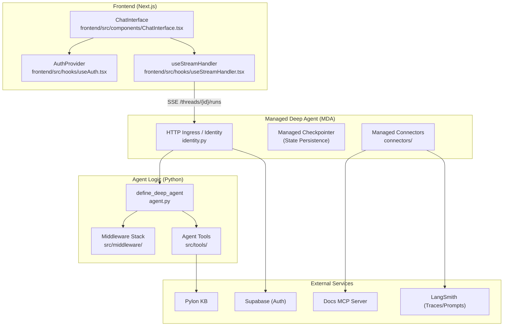

<!-- source: DeepWiki mcp.deepwiki.com · repo langchain-ai/chat-langchain · page 1 Overview · fetched 2026-10-26 -->

# Overview

<details>
<summary>Relevant source files</summary>

The following files were used as context for generating this wiki page:

- [.gitignore](.gitignore)
- [README.md](README.md)
- [agent.py](agent.py)
- [pyproject.toml](pyproject.toml)

</details>


## Purpose and Scope

This document provides a high-level introduction to the **chat-langchain** repository, a production-ready documentation assistant designed to answer questions about the LangChain ecosystem (LangChain, LangGraph, and LangSmith). The system is built on the **Managed Deep Agent (MDA)** framework, which provides managed deployment, identity, and connectors.

For detailed information about specific subsystems:
- Architectural components and MDA runtime: see [System Architecture](#1.1)
- Dependencies and directory structure: see [Dependencies and Project Structure](#1.2)
- Domain-specific terms and concepts: see [Key Concepts and Terminology](#1.3)

Sources: [README.md:1-18](), [pyproject.toml:1-4]()

## What is Chat LangChain?

Chat LangChain is a specialized AI agent that implements a "docs-first" research strategy to provide accurate answers derived from official documentation and support knowledge bases.

**Key Characteristics:**

| Aspect | Description |
|--------|-------------|
| **Domain** | Answers questions specifically about LangChain, LangSmith, and LangGraph. |
| **Framework** | Built using `managed-deepagents` for deployment and `langgraph` for orchestration. |
| **Identity** | Managed multi-region Supabase authentication and guest token issuance. |
| **Connectors** | Uses Managed MCP for documentation search and LangSmith for trace proxying. |
| **Guardrails** | Integrated topic classification to prevent off-topic interactions. |

Sources: [README.md:9-25](), [agent.py:31-64](), [pyproject.toml:24-24]()

## Core System Architecture

The system consists of a Next.js frontend and a Python-based agent deployed as a Managed Deep Agent. Unlike previous iterations using LangGraph Cloud and Weaviate, this architecture leverages MDA to own identity, ingress, and tool connectors.

### Component Overview



**System Responsibilities:**

| Layer | Technology | Primary Responsibility |
|-------|-----------|------------------------|
| **Frontend** | Next.js, LangGraph SDK | UI rendering, SSE streaming, and thread lifecycle management. |
| **MDA Runtime** | `managed-deepagents` | Handles Auth, guest tokens, tool lifecycle, and state persistence. |
| **Agent Logic** | LangGraph, Python | Orchestrates the docs-first research flow and applies guardrails. |
| **Connectors** | MCP, LangSmith | Provides secure access to documentation and observability tools. |

Sources: [agent.py:1-64](), [README.md:129-145](), [identity.py:1-20]()

## Data Flow: Docs-First Research

The agent follows a structured workflow to ensure responses are grounded in official documentation and verified links.

### The Agent Workflow

```mermaid
sequenceDiagram
    participant User
    participant Middleware["Middleware Stack<br/>(Guardrails/Ingress)"]
    participant Agent["Agent Entrypoint<br/>agent.py"]
    participant MCP["MCP Connector<br/>connectors/mcp.py"]
    participant Tools["Support Tools<br/>src/tools/"]
    
    User->>Agent: "How do I use LangGraph?"
    Agent->>Middleware: "Validate Input & Guardrails"
    Middleware-->>Agent: "Topic: LangChain (Allowed)"
    
    rect secondary
    Note over Agent, MCP: Research Phase
    Agent->>MCP: "search_docs(query)"
    MCP-->>Agent: "Documentation Chunks"
    Agent->>Tools: "search_support_articles()"
    Tools-->>Agent: "Pylon KB Results"
    end
    
    rect secondary
    Note over Agent, Tools: Validation Phase
    Agent->>Tools: "check_links(urls)"
    Tools-->>Agent: "Validated URL Status"
    end
    
    Agent->>User: "Final Response (Streamed)"
```

**Key Code Entities:**
- **Entrypoint:** `define_deep_agent` in [agent.py:53-64]().
- **Guardrails:** `GuardrailsMiddleware` in [src/middleware/guardrails_middleware.py]().
- **Docs Search:** `connectors/mcp.py` attaches LangChain docs via Managed MCP [agent.py:22-29]().
- **Link Validation:** `check_links` tool in [src/tools/link_check_tools.py]().

Sources: [README.md:117-126](), [agent.py:31-51]()

## Key Features

### 1. Managed Identity and Auth
The system uses `identity.py` to define an authentication contract. It supports multi-region Supabase providers and a custom guest token issuance via `POST /identity/guest`, allowing users to interact with the agent without a full account.
For details, see [System Architecture](#1.1).

Sources: [identity.py:1-20](), [README.md:136-138]()

### 2. Advanced Middleware Pipeline
The agent processes every request through an ordered stack:
- **IngressGuards:** Caps oversized input.
- **Guardrails:** Classifies topics and blocks off-topic queries.
- **Summarization:** Compresses long conversation history once a token threshold (e.g., 130k tokens) is reached.
- **Retries/Fallbacks:** Handles model and tool failures gracefully.
For details, see [Backend System](#2).

Sources: [agent.py:31-51](), [src/agent/config.py:5-12]()

### 3. Managed Connectors
Connectors allow the agent to interact with external services securely:
- **MCP Connector:** Dynamically attaches documentation search tools.
- **LangSmith Connector:** Proxies feedback and trace sharing so the browser never handles the `LANGSMITH_API_KEY`.
For details, see [Backend System](#2).

Sources: [connectors/mcp.py:1-10](), [connectors/langsmith.py:1-10](), [README.md:140-142]()

## Project Structure Overview

The repository is organized as a Python/Next.js monorepo:

- `agent.py`: The MDA entrypoint defining the agent, tools, and middleware.
- `identity.py`: The authentication and identity contract.
- `connectors/`: Managed connectors for MCP and LangSmith.
- `src/`: Core agent logic, including `middleware/`, `tools/`, and `prompts/`.
- `frontend/`: The Next.js application for the chat interface.

For a full directory breakdown, see [Dependencies and Project Structure](#1.2).

Sources: [README.md:89-115]()

---

