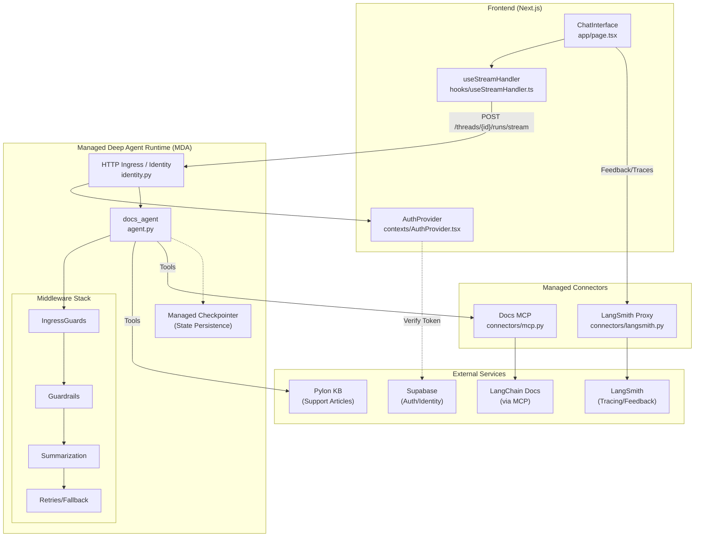
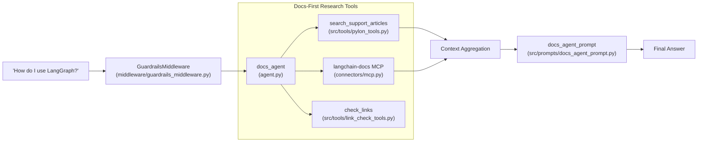
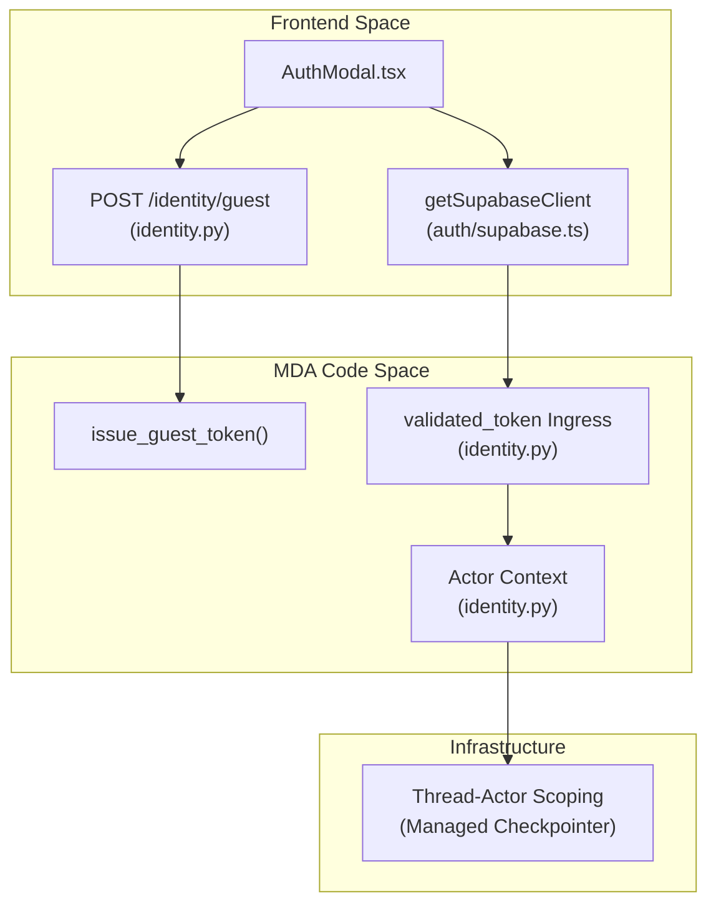

<!-- source: DeepWiki mcp.deepwiki.com · repo langchain-ai/chat-langchain · page 1.1 System Architecture · fetched 2026-10-26 -->

# System Architecture

Relevant source files

The following files were used as context for generating this wiki page:

- [.gitignore](.gitignore)
- [README.md](README.md)
- [agent.py](agent.py)
- [connectors/langsmith.py](connectors/langsmith.py)
- [connectors/mcp.py](connectors/mcp.py)

## Purpose and Scope

This document describes the overall system architecture of the `chat-langchain` repository. The system has been migrated from a legacy LangGraph Cloud + Weaviate architecture to a **Managed Deep Agent (MDA)** runtime. This architecture leverages a "docs-first" research strategy, where a central agent orchestrates specialized tools and managed connectors to answer questions about the LangChain ecosystem.

For detailed information about:
- Backend implementation, middleware, and tools, see [Backend System]() (Section 2).
- Frontend components and streaming state, see [Frontend System]() (Section 3).
- Deployment workflows and MDA ownership, see [Deployment and Operations]() (Section 4).

---

## System Overview

The `chat-langchain` system consists of a Next.js frontend and a Python-based Managed Deep Agent backend. Unlike traditional deployments, the MDA runtime natively owns identity, HTTP ingress, and long-term memory (checkpointer).

### High-Level Architecture

**Sources:** [README.md:9-25](), [agent.py:1-64](), [identity.py:1-20](), [connectors/mcp.py:1-13]()

---

## Key Components and Data Flow

### 1. Managed Deep Agent (MDA) Runtime
The core of the backend is defined in `agent.py` using `define_deep_agent`. The MDA framework replaces the previous manual FastAPI/LangGraph Cloud setup by providing:
- **Identity & Auth:** `identity.py` defines the contract for Supabase multi-region authentication and guest token issuance [identity.py:1-20]().
- **Managed Ingress:** The MDA owns the HTTP surface, removing the need for custom route definitions for the agent [README.md:139]().
- **Checkpointer:** Conversation state is automatically persisted by the runtime, enabling `thread_id` persistence across sessions [README.md:144]().

### 2. The Middleware Stack
Before the agent logic executes, requests pass through an ordered pipeline of middleware defined in `agent.py` [agent.py:31-51]():
*   **`IngressGuardsMiddleware`**: Caps oversized user inputs to prevent prompt injection or token overflow [src/middleware/ingress_guards_middleware.py]().
*   **`GuardrailsMiddleware`**: Uses a dedicated `GUARDRAILS_MODEL` to classify if a query is LangChain-related, blocking off-topic requests [src/middleware/guardrails_middleware.py]().
*   **`CustomSummarizationMiddleware`**: Triggers when context exceeds 130,000 tokens, compressing the history to 30,000 tokens using `context_summary_prompt` [agent.py:40-47]().
*   **Retry & Fallback**: A chain of `tool_retry_middleware`, `model_retry_middleware`, and `model_fallback_middleware` ensures resilience (e.g., falling back from Gemini to GPT-4 if needed) [src/agent/config.py]().

### 3. Managed Connectors
Connectors allow the agent and browser to interact with external services securely:
*   **Docs MCP (`connectors/mcp.py`)**: Attaches the LangChain documentation search tools via the Model Context Protocol (MCP) [connectors/mcp.py:5-13]().
*   **LangSmith Connector (`connectors/langsmith.py`)**: Acts as a browser proxy for feedback (thumbs up/down) and trace viewing. This ensures the `LANGSMITH_API_KEY` is never exposed to the frontend [connectors/langsmith.py:4-16]().

---

## Natural Language to Code Entity Mapping

The following diagrams map conceptual system behaviors to specific code entities (classes, functions, and files).

### Research Pipeline Mapping
This diagram shows how a user's natural language request is transformed by specific code functions.

**Sources:** [agent.py:24-29](), [src/prompts/docs_agent_prompt.py:1-20](), [connectors/mcp.py:5-13]()

### Identity and Ingress Mapping
This diagram maps the authentication flow from the browser to the backend identity contract.

**Sources:** [identity.py:1-20](), [README.md:137-138]()

---

## Contrast with Previous Architecture

The current MDA-based system differs significantly from the previous LangGraph Cloud + Weaviate approach:

| Feature | Previous Architecture | Managed Deep Agent (MDA) Architecture |
| :--- | :--- | :--- |
| **Ingress** | Custom FastAPI / LangGraph Cloud API | Managed Ingress via MDA Runtime |
| **Identity** | Manual JWT verification in middleware | Declarative `identity.py` contract |
| **Retrieval** | Weaviate Vector DB (Manual Ingestion) | Docs-first via MCP (Live Docs) & Pylon KB |
| **Trace Proxy** | Custom `langsmith_routes.py` | Managed `connectors/langsmith.py` |
| **State** | External Postgres Record Manager | Native MDA Checkpointer |
| **Tooling** | Hardcoded tool functions | Mix of local tools and managed MCP servers |

**Sources:** [README.md:13-25](), [README.md:135-145](), [agent.py:22-29]()

---

