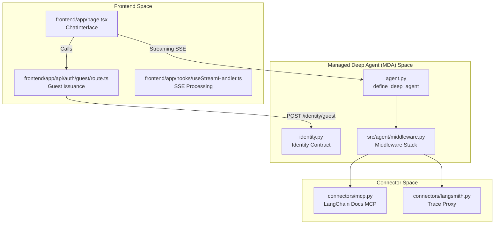
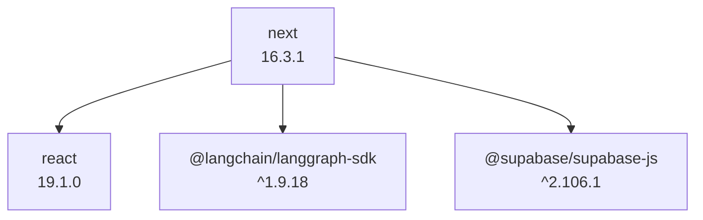
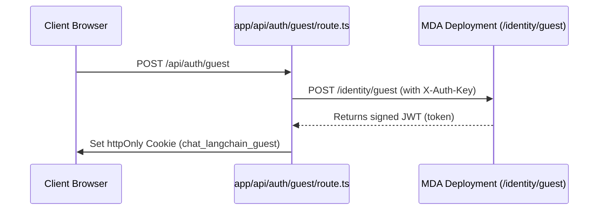

<!-- source: DeepWiki mcp.deepwiki.com · repo langchain-ai/chat-langchain · page 1.2 Dependencies and Project Structure · fetched 2026-10-26 -->

# Dependencies and Project Structure

Relevant source files

The following files were used as context for generating this wiki page:

- [.env.example](.env.example)
- [frontend/.env.local.example](frontend/.env.local.example)
- [frontend/app/api/auth/guest/route.ts](frontend/app/api/auth/guest/route.ts)
- [frontend/package-lock.json](frontend/package-lock.json)
- [frontend/package.json](frontend/package.json)
- [pyproject.toml](pyproject.toml)

This page documents the dependency requirements and organizational structure of the chat-langchain codebase. The project is built on the **Managed Deep Agent (MDA)** framework, providing a unified architecture for identity, connectors, and agentic workflows.

---

## Repository Structure

The chat-langchain repository follows a **monorepo** pattern with clear separation between the agent logic (backend) and the Next.js application (frontend).

### Directory Layout

| Directory | Purpose | Primary Languages |
|-----------|---------|------------------|
| `src/agent/` | Core agent logic including the MDA entrypoint, middleware, and tools. | Python 3.11+ |
| `connectors/` | Managed connectors for external services (MCP, LangSmith). | Python |
| `frontend/` | Next.js React application for the chat interface. | TypeScript |
| `scripts/` | Utilities for prompt management and deployment tasks. | Python |
| `tests/` | Unit and evaluation test suites. | Python |

**Sources:** [pyproject.toml:35-39](), [frontend/package.json:1-13]()

### High-Level Component Mapping

The following diagram bridges the natural language concepts of the system to their specific code entities.

**Sources:** [frontend/app/api/auth/guest/route.ts:8-62](), [pyproject.toml:35-39]()

---

## Backend Dependencies (Python)

The backend uses **Python 3.11 to 3.14** and is managed via `pyproject.toml`. It relies on the `managed-deepagents` runtime to provide the agent container.

### Core Dependencies

| Package | Version | Purpose |
|---------|---------|---------|
| `managed-deepagents` | `0.3.0` | The MDA runtime providing identity and connector hosting. |
| `langgraph` | `>=1.0.0a4` | Orchestration framework for agentic state machines. |
| `langchain` | `>=1.0.2` | Core LLM abstractions and tool definitions. |
| `langsmith` | `>=0.8.3` | Tracing, evaluation, and prompt hub integration. |

**Sources:** [pyproject.toml:10-25]()

### LLM & Provider Integrations

The system is designed for high availability using a fallback chain across multiple providers:
- **Anthropic**: `langchain-anthropic >=0.1.23` (Claude 3.5 Sonnet)
- **OpenAI**: `langchain-openai >=0.3.0` (GPT-4o)
- **Google**: `langchain-google-genai >=4.0.0` (Gemini 1.5 Pro)
- **Baseten**: `langchain-baseten >=0.2.0` (Local/Private models)

**Sources:** [pyproject.toml:14-19]()

---

## Frontend Dependencies (JavaScript/TypeScript)

The frontend is a **Next.js 16.3.1** application utilizing **React 19**.

### Core Framework

**Sources:** [frontend/package.json:16-62]()

### Key Libraries

- **State & Routing**: `nuqs` (URL-based state), `zod` (validation).
- **UI Components**: Radix UI primitives (Accordion, Dialog, Popover), Tailwind CSS 4.0.
- **Content Rendering**: `react-markdown`, `react-syntax-highlighter` (for code snippets).
- **Identity**: `@supabase/ssr` for multi-region authentication handling.

**Sources:** [frontend/package.json:15-75]()

---

## Configuration and Environment

The project uses `.env` files to manage secrets across the MDA deployment and the Next.js frontend.

### Environment Variable Categories

| Category | Variables | Purpose |
|----------|-----------|---------|
| **LLM Keys** | `ANTHROPIC_API_KEY`, `OPENAI_API_KEY` | Provider authentication. |
| **Knowledge Base** | `PYLON_API_KEY`, `PYLON_KB_ID` | Access to support articles. |
| **Observability** | `LANGSMITH_API_KEY`, `LANGSMITH_PROJECT` | Tracing and monitoring. |
| **Identity** | `SUPABASE_URL`, `MDA_GUEST_SIGNING_KEY` | Auth provider config and guest token signing. |
| **Connectivity** | `NEXT_PUBLIC_LANGGRAPH_API_URL` | Frontend link to the MDA deployment. |

**Sources:** [.env.example:6-66](), [frontend/.env.local.example:6-13]()

### Guest Identity Flow

The frontend does not sign its own guest tokens. Instead, it proxies the request through a local API route to the MDA deployment.

**Sources:** [frontend/app/api/auth/guest/route.ts:40-104]()

---

## Development Tooling

The repository includes a robust development and testing setup:

- **Linting/Formatting**: `ruff` and `mypy` for Python; `next lint` for TypeScript.
- **Testing**: `pytest` for backend unit and evaluation tests.
- **Scripts**: 
    - `dev:local`: Connects frontend to a local MDA instance (`http://127.0.0.1:2024`).
    - `dev:remote`: Connects frontend to a production MDA deployment.

**Sources:** [pyproject.toml:69-77](), [frontend/package.json:5-12]()

---

