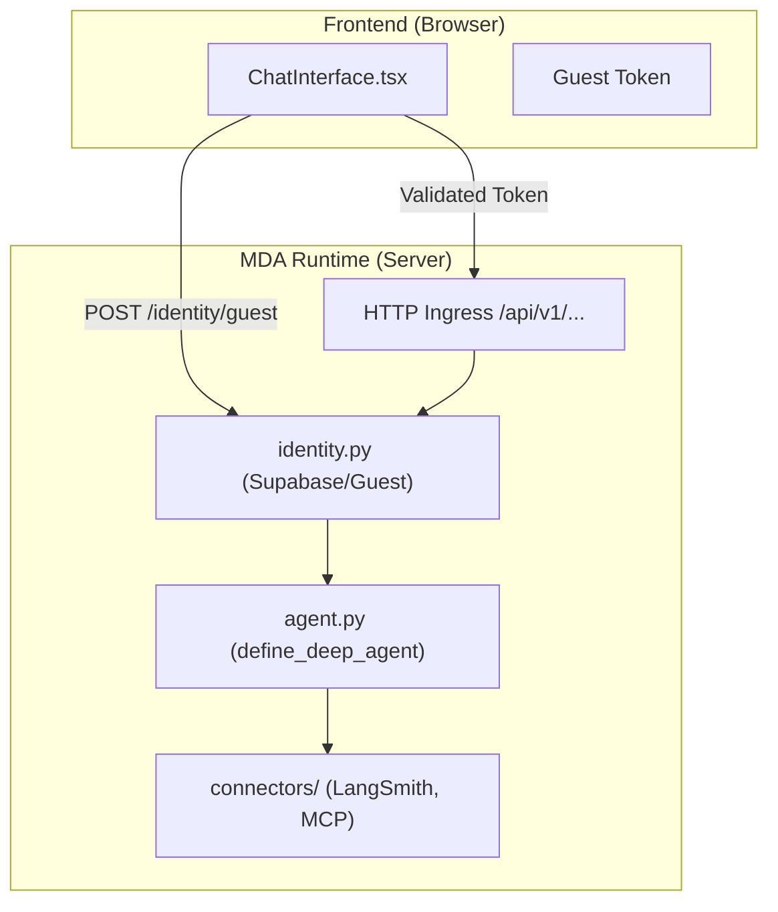
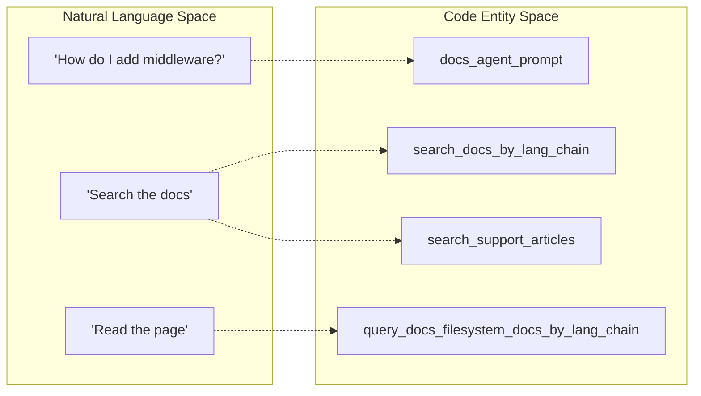
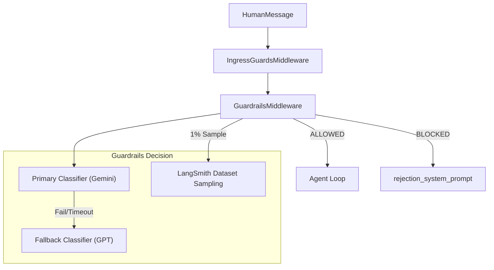

<!-- source: DeepWiki mcp.deepwiki.com · repo langchain-ai/chat-langchain · page 1.3 Key Concepts and Terminology · fetched 2026-10-26 -->

# Key Concepts and Terminology

Relevant source files

The following files were used as context for generating this wiki page:

- [.gitignore](.gitignore)
- [README.md](README.md)
- [instructions.md](instructions.md)
- [src/middleware/guardrails_middleware.py](src/middleware/guardrails_middleware.py)
- [src/prompts/docs_agent_prompt.py](src/prompts/docs_agent_prompt.py)
- [tests/evals/test_repeated_searches.py](tests/evals/test_repeated_searches.py)

This page defines the core technical concepts and domain-specific terminology used in the Chat LangChain codebase. The system has evolved from a traditional LangGraph Cloud + Weaviate architecture to a **Managed Deep Agent (MDA)** framework, which centralizes identity, connectors, and deployment.

## Managed Deep Agent (MDA) Framework

The **Managed Deep Agent (MDA)** is the foundational runtime and deployment framework for the current system. Unlike standard LangGraph deployments, an MDA "owns" the identity contract, HTTP ingress, and external resource connectors.

### Core MDA Components

| Term | Definition | Implementation / File |
| :--- | :--- | :--- |
| **Managed Deep Agent (MDA)** | A managed deployment wrapper that provides identity, checkpointers, and connectors. | `agent.py` |
| **Identity Contract** | A specification for how the agent verifies users (via Supabase) and issues guest tokens. | [identity.py:1-62]() |
| **Managed Connector** | A server-side proxy for external APIs (like LangSmith or MCP) that prevents leaking sensitive keys to the browser. | `connectors/` |
| **Checkpointer** | A persistence layer managed by the MDA runtime to save thread state. | Managed by MDA runtime |

### MDA Data Flow

**Sources:** [README.md:129-145](), [identity.py:1-62](), [agent.py:1-40]()

---

## Retrieval and Research Strategy

The agent employs a **docs-first research strategy**, prioritizing official documentation and support articles over model memory.

### Key Terms

*   **Docs-first Research Strategy**: A behavioral pattern where the agent is strictly instructed to search and read documentation before answering technical questions [src/prompts/docs_agent_prompt.py:12-16]().
*   **MCP Connector**: The Model Context Protocol (MCP) connector (`connectors/mcp.py`) provides the agent with tools to search and read the official LangChain documentation filesystem [connectors/mcp.py:1-13]().
*   **Pylon KB**: A knowledge base of support articles used to answer questions about known issues and account-specific queries [src/tools/pylon_tools.py:1-60]().
*   **Link Validation**: A safety step where the agent uses `check_links` to verify URLs exist before including them in a response to prevent hallucinations [src/tools/link_check_tools.py:1-45]().

### Research Tooling Association

**Sources:** [src/prompts/docs_agent_prompt.py:32-126](), [instructions.md:31-125]()

---

## Guardrails and Middleware

The system uses an ordered **Middleware Stack** to process inputs and outputs, ensuring safety, efficiency, and reliability.

### Middleware Definitions

*   **Guardrails**: A classification step that determines if a query is within the LangChain ecosystem. It uses a dual-model fallback (e.g., Gemini to GPT) [src/middleware/guardrails_middleware.py:100-133]().
*   **Ingress Guards**: Limits the size of input messages to prevent prompt injection or resource exhaustion [src/middleware/ingress_guards_middleware.py:1-30]().
*   **Custom Summarization**: Compresses conversation history based on token thresholds to maintain context within model limits [src/middleware/summarization_middleware.py:1-50]().
*   **Model Fallback/Retry**: Automatically switches models (e.g., Anthropic to OpenAI) or retries requests if the primary provider fails [src/agent/config.py:1-40]().

### Guardrails Logic Flow

**Sources:** [src/middleware/guardrails_middleware.py:100-191](), [src/agent/config.py:1-40]()

---

## Authentication and Identity

The system implements a multi-region authentication contract via Supabase and a guest token system.

### Terminology

*   **AuthRegion**: A configuration setting (US, EU, APAC, AWS) that determines which Supabase instance handles authentication [identity.py:15-30]().
*   **Guest Token**: A short-lived JWT issued to unauthenticated users, allowing them to interact with the agent within specific limits [identity.py:60-62]().
*   **Validated Token**: The pattern where the MDA runtime injects a `validated_token` into the request context after verifying the `Authorization` header [identity.py:40-55]().

**Sources:** [identity.py:1-62](), [README.md:137-138]()

---

## Prompt Management

Prompts are managed through a "Docs-First" approach, with a flag to toggle between local files and the LangSmith Prompt Hub.

*   **USE_LOCAL_PROMPTS**: An environment variable that, when `true`, forces the system to load prompts from `src/prompts/` instead of pulling from LangSmith [src/middleware/guardrails_middleware.py:34-38]().
*   **Prompt Hub**: The LangSmith repository where production-grade prompts are versioned (e.g., `public-chat-langchain-guardrails-test:production`) [src/middleware/guardrails_middleware.py:43-47]().

**Sources:** [src/middleware/guardrails_middleware.py:72-98](), [README.md:63]()

---

