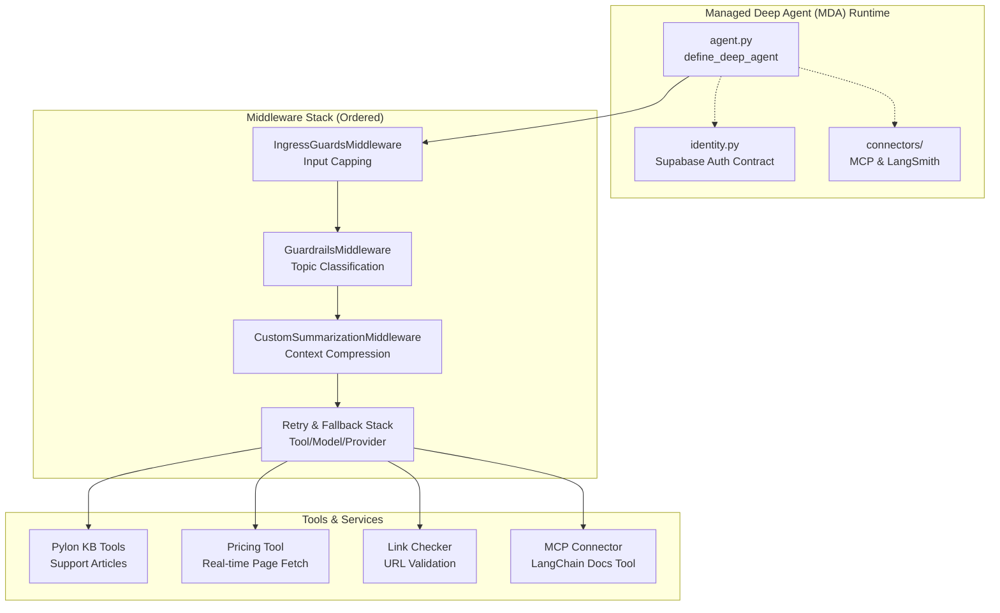
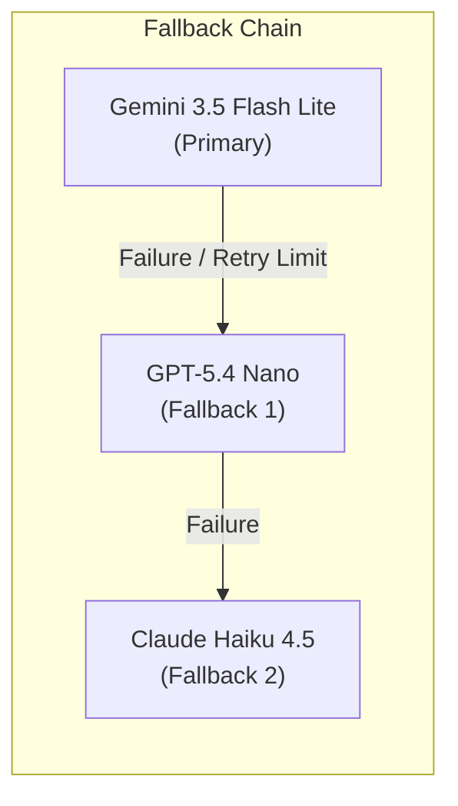

<!-- source: DeepWiki mcp.deepwiki.com · repo langchain-ai/chat-langchain · page 2 Backend System · fetched 2026-10-26 -->

# Backend System

<details>
<summary>Relevant source files</summary>

The following files were used as context for generating this wiki page:

- [agent.py](agent.py)
- [connectors/langsmith.py](connectors/langsmith.py)
- [connectors/mcp.py](connectors/mcp.py)
- [src/agent/config.py](src/agent/config.py)
- [tests/unit/test_summarization_middleware_wiring.py](tests/unit/test_summarization_middleware_wiring.py)

</details>


## Purpose and Scope

The backend of `chat-langchain` is built on the **Managed Deep Agent (MDA)** framework. It serves as a documentation assistant that processes user queries through a sophisticated middleware stack and a tool-enabled agent. Unlike traditional monolithic backends, this system uses MDA to handle identity, HTTP ingress, and managed connectors (such as MCP and LangSmith) while the core logic is defined in `agent.py`.

**Scope of this document:**
- Entrypoint configuration via `define_deep_agent`.
- The ordered middleware pipeline for safety, summarization, and reliability.
- Tool definitions for knowledge retrieval and pricing.
- Model registry and the retry/fallback strategy.

**Related documentation:**
- For details on the entrypoint and connectors, see [Agent Entrypoint and Connectors](#2.1).
- For authentication and actor scoping, see [Identity and Authentication Contract](#2.2).
- For the execution pipeline, see [Middleware Stack](#2.3).
- For documentation and pricing tools, see [Agent Tools](#2.4).
- For model configuration and prompt loading, see [Prompts and Model Configuration](#2.5).

---

## Architecture Overview

The backend architecture is centered around the `agent.py` entrypoint, which wires together tools, middleware, and identity contracts.

### System Architecture Diagram



**Sources:** [agent.py:24-64](), [src/agent/config.py:135-140](), [connectors/mcp.py:5-13]()

### Component Responsibilities

| Component | Code Entity | Responsibility |
|-----------|-------------|----------------|
| **Agent Entrypoint** | `define_deep_agent` | Registers the agent name, primary model, tools, and middleware stack. [agent.py:53-64]() |
| **Identity Provider** | `identity.py` | Configures Supabase regions and guest token issuance. |
| **Managed Connectors** | `connectors/` | Defines external service integrations like MCP for docs and LangSmith for feedback. [connectors/langsmith.py:20-53]() |
| **Middleware** | `docs_agent_middleware` | Intercepts requests for safety, summarization, and error handling. [agent.py:31-51]() |
| **Tools** | `docs_agent_tools` | Provides functions for KB search, pricing, and link validation. [agent.py:24-29]() |

---

## Managed Deep Agent Configuration

The backend leverages `define_deep_agent` to declare its capabilities. The MDA runtime auto-discovers `identity.py` and files within the `connectors/` directory to build the final API surface.

### Model and Tool Registration

The primary model is currently hardcoded to `gemini-3.5-flash-lite` for cost-effective reasoning. Tools are grouped into the `docs_agent_tools` list, which includes internal Python functions and tools dynamically attached via the MCP connector.

```python
docs_agent_tools = [
    search_support_articles,
    get_support_article_content,
    fetch_langchain_pricing,
    check_links,
]
```
**Sources:** [agent.py:24-29](), [agent.py:57-58]()

### Managed Connectors

The system uses two key connectors:
1.  **MCP (Model Context Protocol)**: Connects to `https://docs.langchain.com/mcp` to provide specialized documentation tools. [connectors/mcp.py:8-11]()
2.  **LangSmith**: Acts as a secure proxy for the browser to submit feedback and view traces without exposing the `LANGSMITH_API_KEY`. [connectors/langsmith.py:3-8]()

For details, see [Agent Entrypoint and Connectors](#2.1).

---

## Middleware Pipeline

The middleware stack is an ordered list of classes that process the request before it reaches the agent logic and before the response returns to the user.

| Order | Middleware | Purpose |
|-------|------------|---------|
| 1 | `IngressGuardsMiddleware` | Enforces input limits (e.g., max characters). [agent.py:34]() |
| 2 | `GuardrailsMiddleware` | Classifies if a query is on-topic using a fast model (`gpt-5.4-nano`). [agent.py:35-39]() |
| 3 | `CustomSummarizationMiddleware` | Triggers at 130k tokens to compress context down to 30k tokens. [agent.py:40-47]() |
| 4 | `ToolRetryMiddleware` | Retries failed tool calls up to 3 times. [src/agent/config.py:136]() |
| 5 | `ModelRetryMiddleware` | Retries LLM calls on malformed responses or specific finish reasons. [src/agent/config.py:135]() |
| 6 | `ModelFallbackMiddleware` | Switches providers (e.g., Gemini → GPT → Claude) if the primary fails. [src/agent/config.py:138]() |

For details, see [Middleware Stack](#2.3).

---

## Model Registry and Fallback Strategy

The backend maintains a registry of supported models to ensure high availability and cost optimization.

### Model Hierarchy

The system follows a strict fallback chain defined in `src/agent/config.py`. If the primary model fails or returns a retryable error (like a malformed response), the system rotates through the `FALLBACK_MODELS`.



**Sources:** [src/agent/config.py:68-75](), [src/agent/config.py:120-126]()

### Retry Logic
The `MAX_RETRIES` setting (defaulting to 2) governs how many times a single model is attempted before moving to the next in the fallback chain. This is wired via `init_retry_fallback_model`.

**Sources:** [src/agent/config.py:98](), [src/agent/config.py:120-127](), [tests/unit/test_summarization_middleware_wiring.py:30-35]()

---

## Agent Tools

The agent has access to a set of specialized tools to ground its responses in factual LangChain data.

1.  **Pylon Knowledge Base**: `search_support_articles` and `get_support_article_content` provide access to support documentation. [agent.py:25-26]()
2.  **Pricing**: `fetch_langchain_pricing` retrieves real-time data from the LangChain pricing page. [agent.py:27]()
3.  **Link Validation**: `check_links` is a utility tool used to verify URLs before they are presented to the user. [agent.py:28]()

For details, see [Agent Tools](#2.4).

---

