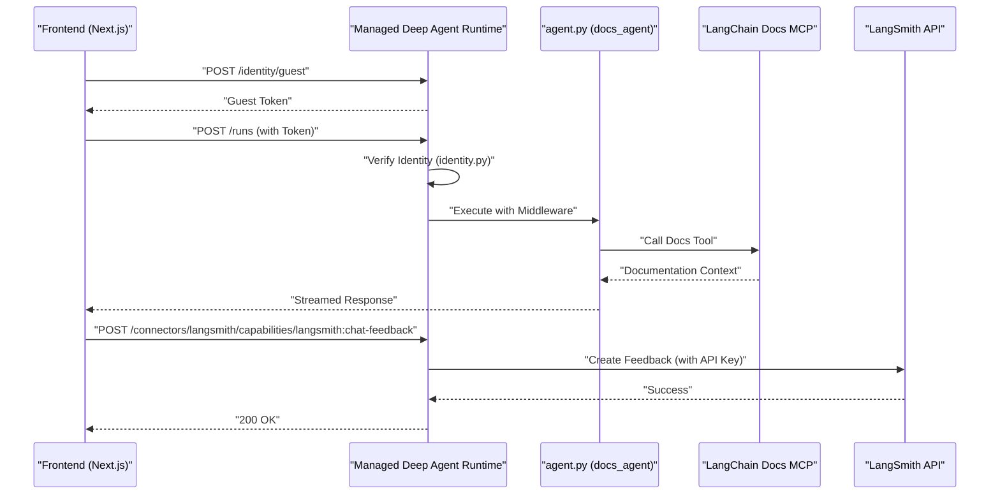

<!-- source: DeepWiki mcp.deepwiki.com · repo langchain-ai/chat-langchain · page 2.1 Agent Entrypoint and Connectors · fetched 2026-10-26 -->

# Agent Entrypoint and Connectors

<details>
<summary>Relevant source files</summary>

The following files were used as context for generating this wiki page:

- [agent.py](agent.py)
- [connectors/langsmith.py](connectors/langsmith.py)
- [connectors/mcp.py](connectors/mcp.py)
- [identity.py](identity.py)

</details>


## Purpose and Scope

This document describes the entrypoint and connector architecture for the Chat LangChain backend, built on the Managed Deep Agent (MDA) framework. It covers the `agent.py` definition, the middleware pipeline, and the managed connectors for documentation retrieval and observability.

## Agent Entrypoint

The primary entrypoint for the backend is `agent.py`, which uses `define_deep_agent` to configure the `docs_agent`. Unlike traditional LangGraph implementations, the MDA framework auto-discovers configuration files like `identity.py` and those within the `connectors/` directory at compile time.

### docs_agent Definition

The agent is defined with a specific model, a set of tools, and a sequenced middleware stack.

| Component | Code Entity | Role |
| :--- | :--- | :--- |
| **Name** | `docs_agent` | Identifier for the agent deployment. |
| **Primary Model** | `google_genai:gemini-3.5-flash-lite` | The core LLM for general reasoning. |
| **Tools** | `docs_agent_tools` | List of Python functions available for the agent to call. |
| **Middleware** | `docs_agent_middleware` | An ordered stack of logic for input processing and safety. |
| **Metadata** | `build_docs_agent_trace_metadata` | Tags runs for LangSmith filtering and analysis. |

Sources: [agent.py:24-29](), [agent.py:53-64]()

### Middleware Stack Wiring

The middleware stack in `agent.py` processes every request in a specific order to ensure safety, efficiency, and reliability.

```mermaid
graph TD
    "User Input" --> IngressGuardsMiddleware["IngressGuardsMiddleware"]
    IngressGuardsMiddleware --> GuardrailsMiddleware["GuardrailsMiddleware"]
    GuardrailsMiddleware --> CustomSummarizationMiddleware["CustomSummarizationMiddleware"]
    CustomSummarizationMiddleware --> ToolRetryMiddleware["ToolRetryMiddleware"]
    ToolRetryMiddleware --> ModelRetryMiddleware["ModelRetryMiddleware"]
    ModelRetryMiddleware --> ModelFallbackMiddleware["ModelFallbackMiddleware"]
    ModelFallbackMiddleware --> "Agent Core"
```
**Title:** docs_agent Middleware Pipeline

Sources: [agent.py:31-51]()

## Managed Connectors

Connectors in MDA allow the agent to interact with external services while keeping credentials secure and offloading lifecycle management to the runtime.

### LangChain Docs MCP (`connectors/mcp.py`)

The system uses the Model Context Protocol (MCP) to access LangChain documentation. The managed runtime handles the HTTP client lifecycle for the MCP server.

*   **Server Name:** `langchain-docs`
*   **Transport:** `http`
*   **URL:** `https://docs.langchain.com/mcp`

The tools provided by this MCP server are automatically appended to the agent's toolset during compilation.

Sources: [connectors/mcp.py:5-13]()

### LangSmith Proxy (`connectors/langsmith.py`)

The LangSmith connector acts as a secure proxy for the frontend. The browser calls the MDA deployment using its own identity token, and MDA performs LangSmith operations server-side using the `LANGSMITH_API_KEY`.

| Capability | ID | Actions | Description |
| :--- | :--- | :--- | :--- |
| **Feedback** | `langsmith:chat-feedback` | create, update, delete | Thumbs up/down on runs; limited to 1 per actor. |
| **Trace Viewer** | `langsmith:trace-viewer` | read, share | Provides redacted run summaries and public share links. |

Sources: [connectors/langsmith.py:20-53]()

## Identity and Discovery

The MDA compiler automatically discovers `identity.py` to establish the authentication contract.

### Identity Contract (`identity.py`)

The identity configuration replaces hand-rolled authentication logic with a `validated_token` ingress pattern.

*   **Multi-Region Supabase:** Supports `us`, `eu`, `apac`, and `aws` regions by introspecting tokens against region-specific Supabase URLs.
*   **Guest Access:** MDA issues and verifies signed guest tokens via `POST /identity/guest`.
*   **Scoping:** Threads are scoped to the `actor` (the user's email or guest ID), ensuring data isolation.

Sources: [identity.py:26-31](), [identity.py:42-48](), [identity.py:58-62]()

## Agent Tools

The `docs_agent_tools` list includes specialized functions for knowledge retrieval and output validation.

| Tool Function | Source File | Purpose |
| :--- | :--- | :--- |
| `search_support_articles` | `src/tools/pylon_tools.py` | Search the Pylon knowledge base. |
| `get_support_article_content` | `src/tools/pylon_tools.py` | Retrieve full content for a specific article. |
| `fetch_langchain_pricing` | `src/tools/pricing_tools.py` | Scrape real-time pricing information. |
| `check_links` | `src/tools/link_check_tools.py` | Validate URLs in the response before finalizing. |

Sources: [agent.py:24-29]()

## Data Flow: Browser to Agent

This diagram illustrates how the frontend interacts with the MDA entrypoint and connectors.


**Title:** Request Flow and Connector Interaction

Sources: [identity.py:58-62](), [agent.py:53-64](), [connectors/langsmith.py:20-30](), [connectors/mcp.py:5-13]()

---

