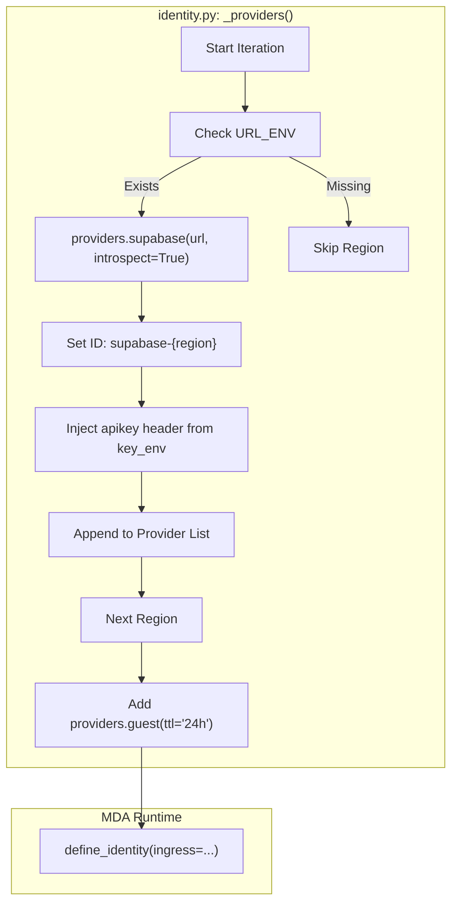
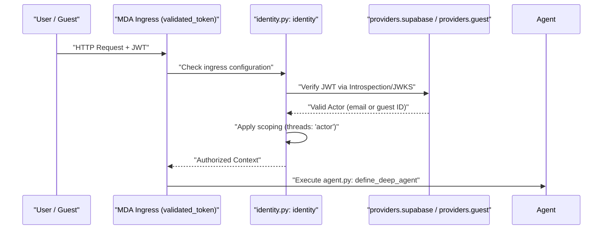

<!-- source: DeepWiki mcp.deepwiki.com · repo langchain-ai/chat-langchain · page 2.2 Identity and Authentication Contract · fetched 2026-10-26 -->

# Identity and Authentication Contract

Relevant source files

The following files were used as context for generating this wiki page:

- [.github/workflows/deploy-production.yml](.github/workflows/deploy-production.yml)
- [identity.py](identity.py)
- [src/utils/__init__.py](src/utils/__init__.py)

## Purpose and Scope

The Identity and Authentication Contract defines how the Managed Deep Agent (MDA) handles user identification, multi-region provider routing, and resource scoping. In this architecture, `identity.py` serves as the primary contract auto-discovered by the MDA compiler. It replaces traditional hand-rolled authentication handlers with a declarative configuration that supports multi-region Supabase instances and guest access.

This page covers the multi-region configuration, the `validated_token` ingress pattern, guest token issuance, and how threads are cryptographically scoped to specific actors.

## Multi-Region Supabase Configuration

The system supports global deployments by mapping frontend-provided region labels to specific Supabase projects. This is critical for data residency and latency optimization.

### Region Mapping and Environment Variables

The `_REGION_ENV` dictionary maps region keys (sent via `x-supabase-region` headers) to the corresponding environment variables for the Supabase URL and Anonymous Key.

| Region Key | URL Environment Variable | Key Environment Variable |
| :--- | :--- | :--- |
| `us` | `SUPABASE_URL` | `SUPABASE_ANON_KEY` |
| `eu` | `SUPABASE_EU_URL` | `SUPABASE_EU_ANON_KEY` |
| `apac` | `SUPABASE_APAC_URL` | `SUPABASE_APAC_ANON_KEY` |
| `aws` | `SUPABASE_AWS_URL` | `SUPABASE_AWS_ANON_KEY` |

**Sources:** [identity.py:26-31](), [.github/workflows/deploy-production.yml:78-85]()

### Provider Discovery Logic

The `_providers()` function dynamically constructs the list of identity providers based on available environment variables. It uses `providers.supabase` with `introspect=True` to handle legacy Supabase regions that mint HS256 tokens with empty JWKS.

**Sources:** [identity.py:34-55]()

## Ingress and Scoping Contract

The identity contract is defined using `define_identity`, which specifies the HTTP ingress mode and how the MDA should scope data and credentials.

### Ingress Pattern: `validated_token`

The system utilizes the `validated_token` ingress mode. In this pattern, the browser communicates directly with the MDA deployment using its own Supabase access token or an MDA-issued guest token. The MDA platform is responsible for verifying the token against the configured providers before the request reaches the agent logic.

**Sources:** [identity.py:6-7](), [identity.py:59]()

### Scoping and Tenancy

The contract enforces strict scoping rules to ensure data isolation between users:

*   **Tenancy**: Set to `single`, indicating the agent operates within a single tenant context per deployment.
*   **Thread Scoping**: Set to `actor`. This replaces manual owner tagging. The MDA automatically scopes threads to the user's email (for Supabase users) or the guest actor ID.
*   **Memory Scoping**: Set to `none`, as long-term cross-thread memory is not currently utilized by this contract.
*   **Credentials Scoping**: Set to `agent`, meaning credentials are shared across the agent instance rather than per-user.

**Sources:** [identity.py:13-15](), [identity.py:60-61]()

## Guest Access Flow

For anonymous visitors, the MDA provides a built-in guest identity provider. This replaces the need for a custom frontend route to generate guest sessions.

### Guest Token Issuance

The MDA exposes a `POST /identity/guest` endpoint. When called, it issues a signed JWT with a 24-hour TTL. Guest IDs are prefixed with `guest:` to distinguish them from authenticated Supabase users in the database and LangSmith traces.

| Parameter | Configuration Value |
| :--- | :--- |
| **TTL** | `24h` |
| **Actor Prefix** | `guest:` |
| **Signing Key** | `MDA_GUEST_SIGNING_KEY` |

**Sources:** [identity.py:46-48](), [.github/workflows/deploy-production.yml:74]()

### Identity Data Flow

The following diagram bridges the "Natural Language Space" of user roles to the "Code Entity Space" of the `identity.py` contract.

**Sources:** [identity.py:58-62](), [identity.py:42-48]()

## Deployment and Environment Integration

The identity contract relies on secrets managed during the deployment process. The GitHub Actions workflow ensures these keys are written to the `.env` file before the `mda deploy` command is executed.

*   **Supabase Secrets**: `SUPABASE_*_URL` and `SUPABASE_*_ANON_KEY` are required for each active region to enable introspection.
*   **Guest Secrets**: `MDA_GUEST_SIGNING_KEY` and `GUEST_AUTH_SECRET` are used for signing and verifying guest tokens.
*   **Legacy Support**: `ALLOW_LEGACY_USER_ID_AUTH` can be toggled to support older authentication formats if necessary.

**Sources:** [.github/workflows/deploy-production.yml:105-134](), [identity.py:44]()

---

