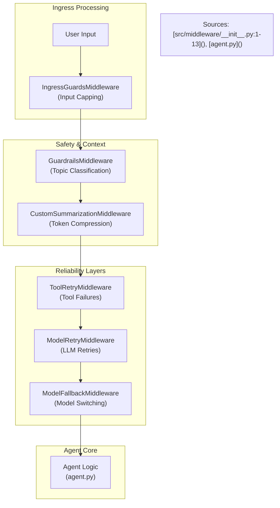

<!-- source: DeepWiki mcp.deepwiki.com · repo langchain-ai/chat-langchain · page 2.3 Middleware Stack · fetched 2026-10-26 -->

# Middleware Stack

<details>
<summary>Relevant source files</summary>

The following files were used as context for generating this wiki page:

- [src/middleware/__init__.py](src/middleware/__init__.py)
- [src/middleware/guardrails_middleware.py](src/middleware/guardrails_middleware.py)
- [src/middleware/ingress_guards_middleware.py](src/middleware/ingress_guards_middleware.py)
- [src/middleware/retry_middleware.py](src/middleware/retry_middleware.py)
- [src/middleware/summarization_middleware.py](src/middleware/summarization_middleware.py)
- [src/tools/pylon_tools.py](src/tools/pylon_tools.py)
- [tests/unit/test_guardrails_fallback.py](tests/unit/test_guardrails_fallback.py)
- [tests/unit/test_pylon_pagination.py](tests/unit/test_pylon_pagination.py)

</details>


## Purpose and Scope

The Middleware Stack in Chat-LangChain manages the request-response lifecycle between the user and the core agent logic. Built on the Managed Deep Agent (MDA) framework, this pipeline handles input validation, safety guardrails, context management, and reliability through retries and fallbacks. The stack ensures that the agent remains performant, secure, and resilient to model failures or malformed outputs.

---

## Middleware Pipeline Architecture

The middleware stack is an ordered pipeline where each component wraps the next. It is wired into the agent entrypoint via the `define_deep_agent` function.

**Middleware Data Flow**



---

## Input Capping: IngressGuardsMiddleware

The `IngressGuardsMiddleware` is the first line of defense, responsible for truncating oversized user inputs to prevent context window overflows and excessive token costs.

- **Size Limit**: Enforces a maximum of 50,000 characters per message, defined by `MAX_MESSAGE_CHARS` [src/middleware/ingress_guards_middleware.py:23]().
- **Logic**: It iterates through the state's messages in reverse order to find the latest `human` message and truncates its content if it exceeds the cap [src/middleware/ingress_guards_middleware.py:34-42]().
- **Structure Preservation**: The `_truncate_content` method handles both raw strings and complex message content lists (e.g., text blocks mixed with other media), ensuring only text components are trimmed while maintaining the overall structure [src/middleware/ingress_guards_middleware.py:44-72]().

**Sources:** [src/middleware/ingress_guards_middleware.py:1-75]()

---

## Topic Classification: GuardrailsMiddleware

The `GuardrailsMiddleware` performs lenient filtering to ensure queries are related to LangChain and its ecosystem. It uses a dual-model approach for high reliability.

### Classification Logic
1. **Primary Classifier**: Uses a dedicated LLM (configured via `GUARDRAILS_MODEL`) to determine if a query is "ALLOWED" or "BLOCKED" [src/middleware/guardrails_middleware.py:113-123]().
2. **Dual-Model Fallback**: If the primary classifier fails, it falls back to the `DEFAULT_MODEL` [src/middleware/guardrails_middleware.py:125-128]().
3. **Fail-Open Behavior**: If all classification attempts fail (e.g., due to API outages), the middleware defaults to `off_topic_query: False` to allow the main agent to proceed rather than blocking the user [tests/unit/test_guardrails_fallback.py:82-98]().

### LangSmith Dataset Sampling
To improve future guardrail performance, the middleware samples production data:
- **Sampling Rate**: 1% of allowed queries and all blocked queries are added to a LangSmith dataset named `Chat-LangChain-Guardrails-Samples` [src/middleware/guardrails_middleware.py:30-31]().
- **Async Logging**: Uses `ls.AsyncClient` to add examples without blocking the request latency [src/middleware/guardrails_middleware.py:135-166]().

### Prompt Resolution
The middleware attempts to pull the guardrails system prompt from the LangSmith Prompt Hub (`public-chat-langchain-guardrails-test`). If the Hub is unreachable or `USE_LOCAL_PROMPTS` is enabled, it falls back to a local definition in `src/prompts/guardrails_prompts.py` [src/middleware/guardrails_middleware.py:72-98]().

**Sources:** [src/middleware/guardrails_middleware.py:1-190](), [tests/unit/test_guardrails_fallback.py:1-98]()

---

## Context Management: CustomSummarizationMiddleware

As conversations grow, `CustomSummarizationMiddleware` prevents the context window from filling up by compressing old history into a concise summary.

- **Token-Based Trigger**: Inherits from the standard LangChain `SummarizationMiddleware` to trigger when history exceeds a specific token threshold.
- **Custom Runnable**: Uses a `summary_model` (typically a cheaper, faster model) to generate the summary [src/middleware/summarization_middleware.py:14-17]().
- **Resilience**: If summarization fails, it returns an error string instead of crashing the agent, allowing the conversation to continue with raw history if possible [src/middleware/summarization_middleware.py:36-38]().

**Sources:** [src/middleware/summarization_middleware.py:1-60]()

---

## Reliability Stack: Retries and Fallbacks

The final layers of the stack handle execution errors from tools and models.

### ModelRetryMiddleware
Handles transient LLM failures using exponential backoff.
- **Retryable Reasons**: Specifically targets `MALFORMED_FUNCTION_CALL` (common in Gemini models when tool syntax is slightly off) [src/middleware/retry_middleware.py:16-18]().
- **Backoff**: Configurable `max_retries` (default 2) with an `initial_delay` (default 0.5s) and `backoff_factor` (default 2.0) [src/middleware/retry_middleware.py:28-37]().

### ToolRetryMiddleware
Wraps tool execution to handle intermittent network issues or API timeouts during tool calls (e.g., Pylon KB searches or MCP doc fetches).

### ModelFallbackMiddleware
The final safety net. If a model consistently fails (e.g., OpenAI rate limits or Google Vertex AI outages), this middleware switches the request to a different provider (e.g., GPT-4o → Claude 3.5 Sonnet) based on the `ModelConfig` registry.

**Sources:** [src/middleware/retry_middleware.py:1-97](), [src/middleware/__init__.py:1-13]()

---

## Code Entity Mapping

The following diagram maps the logical middleware pipeline to the specific Python classes and functions implemented in the codebase.

```mermaid
classDiagram
    class AgentMiddleware {
        <<interface>>
        +abefore_agent()
        +awrap_model_call()
    }

    class IngressGuardsMiddleware {
        +before_agent()
        -_truncate_content()
    }

    class GuardrailsMiddleware {
        +abefore_agent()
        -_classify_query()
        -_add_to_dataset()
    }

    class CustomSummarizationMiddleware {
        +summary_model: Runnable
        -_acreate_summary()
    }

    class ModelRetryMiddleware {
        +max_retries: int
        +awrap_model_call()
        -_get_finish_reason()
    }

    AgentMiddleware <|-- IngressGuardsMiddleware
    AgentMiddleware <|-- GuardrailsMiddleware
    AgentMiddleware <|-- CustomSummarizationMiddleware
    AgentMiddleware <|-- ModelRetryMiddleware

    Sources["Sources: [src/middleware/ingress_guards_middleware.py](), [src/middleware/guardrails_middleware.py](), [src/middleware/summarization_middleware.py](), [src/middleware/retry_middleware.py]()"]
```

**Sources:** [src/middleware/ingress_guards_middleware.py:26](), [src/middleware/guardrails_middleware.py:100](), [src/middleware/summarization_middleware.py:11](), [src/middleware/retry_middleware.py:27]()

---

