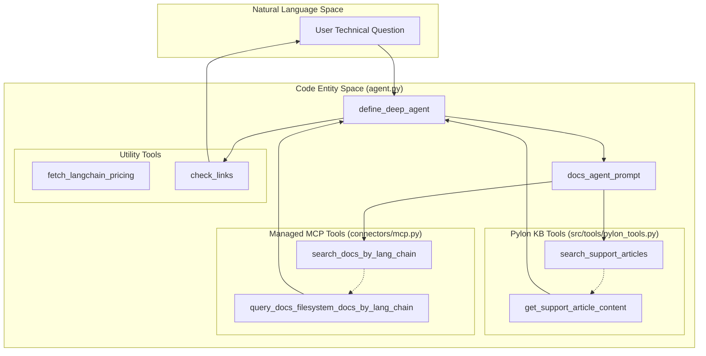
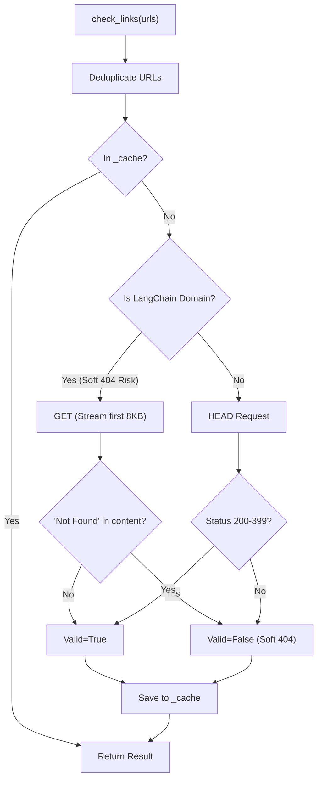

<!-- source: DeepWiki mcp.deepwiki.com · repo langchain-ai/chat-langchain · page 2.4 Agent Tools · fetched 2026-10-26 -->

# Agent Tools

Relevant source files

The following files were used as context for generating this wiki page:

- [instructions.md](instructions.md)
- [src/middleware/retry_middleware.py](src/middleware/retry_middleware.py)
- [src/prompts/docs_agent_prompt.py](src/prompts/docs_agent_prompt.py)
- [src/tools/link_check_tools.py](src/tools/link_check_tools.py)
- [src/tools/pylon_tools.py](src/tools/pylon_tools.py)
- [tests/evals/test_repeated_searches.py](tests/evals/test_repeated_searches.py)
- [tests/unit/test_check_links_async.py](tests/unit/test_check_links_async.py)
- [tests/unit/test_pylon_pagination.py](tests/unit/test_pylon_pagination.py)

The Chat LangChain agent utilizes a specialized suite of tools to research the LangChain ecosystem, validate findings, and provide real-time pricing information. These tools are designed for parallel execution and strict grounding in official documentation to ensure accuracy and reduce hallucinations.

## Tool Execution Architecture

The agent follows a "search-then-read" pattern. Search tools identify relevant locations, while separate "read" tools extract the actual content. This architecture optimizes token usage and allows the agent to verify multiple sources before formulating a response.

### Parallel Execution Flow

The system prompt explicitly instructs the agent to call search and read tools in parallel to minimize latency [src/prompts/docs_agent_prompt.py:14-16]().

Title: **Agent Tool Interaction Flow**

**Sources:** [src/prompts/docs_agent_prompt.py:14-16](), [src/tools/pylon_tools.py:130-131](), [src/tools/link_check_tools.py:183-184]()

## Pylon Knowledge Base Tools

The Pylon tools interface with the LangChain support knowledge base. They implement a caching layer and handle complex pagination to manage large article sets.

### `search_support_articles`
Returns article titles and metadata filtered by collection names (e.g., "LangSmith Deployment", "Troubleshooting") [src/tools/pylon_tools.py:131-155](). It does not return article content; it provides IDs for the follow-up read tool.

### `get_support_article_content`
Retrieves the full text of specific articles using identifiers obtained from the search tool [src/tools/pylon_tools.py:228-238]().

### Pagination and Caching
The underlying `_fetch_all_articles` function handles Pylon's REST pagination by following `next` cursors [src/tools/pylon_tools.py:108-114](). It includes a safety cap of 10 pages (~1000 articles) to prevent infinite loops [src/tools/pylon_tools.py:95-99](). Results are stored in a global `_articles_cache` to speed up subsequent tool calls within the same process [src/tools/pylon_tools.py:85-88]().

**Sources:** [src/tools/pylon_tools.py:85-122](), [src/tools/pylon_tools.py:131-155](), [src/tools/pylon_tools.py:228-238]()

## Link Validation Tool (`check_links`)

The `check_links` tool is a critical guardrail that validates URLs before they are presented to the user. It prevents the agent from outputting broken links or "soft 404s".

### Implementation Details
- **Async Concurrency**: Uses `httpx.AsyncClient` and `asyncio.gather` to check multiple URLs in parallel [src/tools/link_check_tools.py:150-156]().
- **Soft 404 Detection**: For LangChain domains (e.g., `docs.langchain.com`), it reads the first 8KB of the response to detect "Page Not Found" messages even if the server returns a 200 OK status [src/tools/link_check_tools.py:17-25](), [src/tools/link_check_tools.py:90-109]().
- **Performance**: Uses `HEAD` requests for non-LangChain domains to minimize bandwidth [src/tools/link_check_tools.py:116-117]().
- **Deduplication**: Automatically deduplicates the input URL list to avoid redundant network calls [src/tools/link_check_tools.py:198-199]().

Title: **Link Validation Logic**

**Sources:** [src/tools/link_check_tools.py:17-25](), [src/tools/link_check_tools.py:90-109](), [src/tools/link_check_tools.py:150-156](), [src/tools/link_check_tools.py:198-199]()

## Managed MCP Documentation Tools

Official documentation search is handled via a Model Context Protocol (MCP) managed connector. These tools are attached to the agent via the `mcp` connector configuration.

### `search_docs_by_lang_chain`
A specialized search tool for the official LangChain filesystem. The agent is strictly instructed to extract only the **core noun/concept** (e.g., "middleware" instead of "how to add middleware") to maximize cache efficiency [src/prompts/docs_agent_prompt.py:39-49]().

### `query_docs_filesystem_docs_by_lang_chain`
The corresponding "read" tool that retrieves the full `.mdx` content for the paths identified by the search tool [src/prompts/docs_agent_prompt.py:122-126]().

**Sources:** [src/prompts/docs_agent_prompt.py:32-49](), [src/prompts/docs_agent_prompt.py:122-126]()

## Real-Time Pricing Tool

### `fetch_langchain_pricing`
This tool retrieves current pricing information for LangSmith and other LangChain products. It is used specifically when users ask about costs, quotas, or tier differences. By fetching this in real-time, the agent avoids providing stale information from its training data or static documentation.

**Sources:** [src/prompts/docs_agent_prompt.py:228-232]() (Referenced in prompt instructions)

## Testing and Validation

The tools are covered by unit and evaluation tests to ensure reliability:
- **`test_check_links_async`**: Verifies that the link checker works correctly in both synchronous and asynchronous event loops, preventing `RuntimeError` during agent execution [tests/unit/test_check_links_async.py:78-85]().
- **`test_pylon_pagination`**: Mocks Pylon API responses to verify that `_fetch_all_articles` correctly combines multiple pages and respects the 10-page safety limit [tests/unit/test_pylon_pagination.py:81-96](), [tests/unit/test_pylon_pagination.py:143-154]().
- **`test_repeated_searches`**: A LangSmith evaluation test ensuring the system prompt contains instructions to check conversation history before calling tools to avoid context overflow [tests/evals/test_repeated_searches.py:7-32]().

**Sources:** [tests/unit/test_check_links_async.py:78-85](), [tests/unit/test_pylon_pagination.py:81-96](), [tests/evals/test_repeated_searches.py:7-32]()

---

