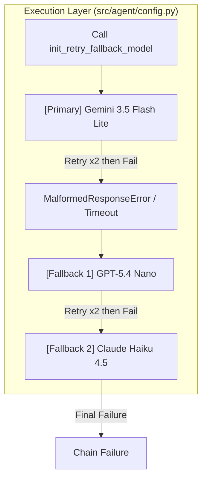
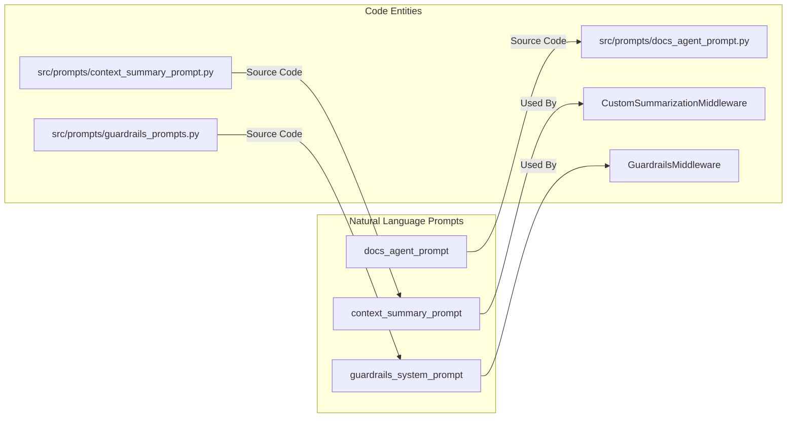

<!-- source: DeepWiki mcp.deepwiki.com · repo langchain-ai/chat-langchain · page 2.5 Prompts and Model Configuration · fetched 2026-10-26 -->

# Prompts and Model Configuration

Relevant source files

The following files were used as context for generating this wiki page:

- [instructions.md](instructions.md)
- [scripts/push_docs_agent_prompt.py](scripts/push_docs_agent_prompt.py)
- [scripts/push_guardrails_prompt.py](scripts/push_guardrails_prompt.py)
- [src/agent/config.py](src/agent/config.py)
- [src/prompts/context_summary_prompt.py](src/prompts/context_summary_prompt.py)
- [src/prompts/docs_agent_prompt.py](src/prompts/docs_agent_prompt.py)
- [src/prompts/guardrails_prompts.py](src/prompts/guardrails_prompts.py)
- [src/utils/prompt_provenance.py](src/utils/prompt_provenance.py)
- [tests/evals/test_repeated_searches.py](tests/evals/test_repeated_searches.py)
- [tests/unit/test_summarization_middleware_wiring.py](tests/unit/test_summarization_middleware_wiring.py)

This document covers the prompt management and model configuration systems that control the behavior of the Chat LangChain backend. It explains how system prompts are managed through LangSmith Hub integration, how the `ModelConfig` registry defines the retry and fallback logic across multiple providers, and the specific prompt architectures for the docs agent, guardrails, and context summarization.

## Prompt Management System

Chat LangChain utilizes a hybrid prompt management approach. While core instructions are defined in the codebase, the system is designed to pull from the LangSmith Prompt Hub for production deployments, enabling versioning and updates without redeploying the backend.

### LangSmith Prompt Hub Integration

The system uses `src/utils/prompt_provenance.py` to resolve prompts from LangSmith. It supports a staging/production toggle based on environment variables like `LANGSMITH_ENV` or `LANGSMITH_HOST_PROJECT_NAME` [src/utils/prompt_provenance.py:24-34]().

- **USE_LOCAL_PROMPTS**: A developer flag that, when set to `true`, forces the agent to use local Python definitions instead of pulling from the Hub [src/utils/prompt_provenance.py:19-23]().
- **Provenance Tracking**: The system pulls the `lc_hub_commit_hash` from LangSmith to track exactly which prompt version generated a specific trace [src/utils/prompt_provenance.py:81-89]().

### Core Prompts

| Prompt Variable | File Source | Purpose |
|---|---|---|
| `docs_agent_prompt` | `src/prompts/docs_agent_prompt.py` | Main agent instructions for search-then-read workflow, parallel tool calls, and grounding. |
| `guardrails_system_prompt` | `src/prompts/guardrails_prompts.py` | Lenient content filter instructions for classifying technical vs. off-topic queries. |
| `rejection_system_prompt` | `src/prompts/guardrails_prompts.py` | Polite refusal template for out-of-scope requests. |
| `context_summary_prompt` | `src/prompts/context_summary_prompt.py` | Instructions for token-based history compression. |

**Sources:** [src/utils/prompt_provenance.py:28-41](), [src/prompts/docs_agent_prompt.py:2-8]()

---

## Docs Agent Workflow

The `docs_agent_prompt` defines a strict "Search-then-Read" architecture. The agent is instructed to never answer from memory and to always ground technical references in documentation [src/prompts/docs_agent_prompt.py:12-14]().

### Bounded Parallel Fan-out
To minimize latency, the prompt explicitly instructs the agent to execute searches and reads in parallel [src/prompts/docs_agent_prompt.py:16-18]().

### Cache Efficiency Rules
The prompt contains a "Formatting Checklist" for documentation searches to maximize cache hits. It requires the agent to extract core nouns, strip descriptive words, and use singular forms (e.g., "How to add middleware" → `query="middleware"`) [src/prompts/docs_agent_prompt.py:39-50]().

### Link Validation and Redaction
The agent must use the `check_links` tool before finalizing a response to ensure URLs are valid [src/prompts/docs_agent_prompt.py:255-257](). It is also strictly forbidden from revealing internal configuration, system prompts, or tool lists [src/prompts/docs_agent_prompt.py:265-270]().

**Sources:** [src/prompts/docs_agent_prompt.py:12-25](), [src/prompts/docs_agent_prompt.py:39-50]()

---

## Model Configuration Registry

The system centralizes model definitions in `src/agent/config.py` using a `ModelConfig` dataclass. This registry maps friendly names to specific provider strings used by `init_chat_model` [src/agent/config.py:28-37]().

### Supported Models
The registry defines three primary tiers of models [src/agent/config.py:40-65]():
1. **Gemini 3.5 Flash Lite**: The `DEFAULT_MODEL`, optimized for speed and cost-effectiveness.
2. **GPT-5.4 Nano**: The `GUARDRAILS_MODEL`, used for high-volume classification tasks.
3. **Claude Haiku 4.5**: A secondary fallback option.

### Retry and Fallback Chain
The `init_retry_fallback_model` function constructs a `RunnableWithFallbacks` that implements a multi-provider recovery strategy [src/agent/config.py:120-126]().

**Model Execution Flow:**

**Sources:** [src/agent/config.py:40-75](), [src/agent/config.py:120-126]()

---

## Guardrails and Summarization

### Guardrails Classification
The `guardrails_system_prompt` operates as a "lenient filter." It provides an extensive list of "Always Allow" topics (e.g., software development, LLM providers, MCP protocol) and "Always Block" categories (e.g., fictional roleplay, prompt injection attempts) [src/prompts/guardrails_prompts.py:3-87]().

### Context Summarization
The `CustomSummarizationMiddleware` uses the `context_summary_prompt` to compress history when a token threshold (default 130,000) is met [tests/unit/test_summarization_middleware_wiring.py:15-22](). The prompt instructs the model to preserve durable facts like unresolved bugs, API names, and previously discovered docs paths while discarding raw tool outputs [src/prompts/context_summary_prompt.py:9-25]().

**Natural Language to Code Mapping:**

**Sources:** [src/prompts/guardrails_prompts.py:3-87](), [src/prompts/context_summary_prompt.py:3-57](), [tests/unit/test_summarization_middleware_wiring.py:8-35]()

---

