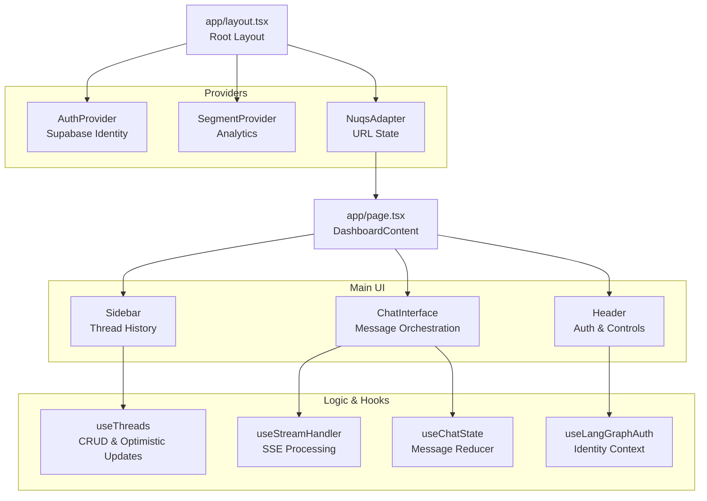
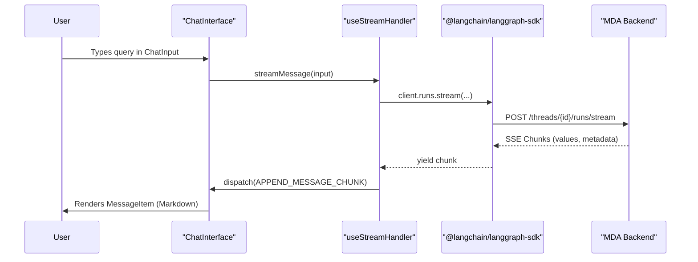

<!-- source: DeepWiki mcp.deepwiki.com · repo langchain-ai/chat-langchain · page 3 Frontend System · fetched 2026-10-26 -->

# Frontend System

Relevant source files

The following files were used as context for generating this wiki page:

- [frontend/.gitignore](frontend/.gitignore)
- [frontend/app/api/auth/guest/route.ts](frontend/app/api/auth/guest/route.ts)
- [frontend/app/layout.tsx](frontend/app/layout.tsx)
- [frontend/app/page.tsx](frontend/app/page.tsx)
- [frontend/package-lock.json](frontend/package-lock.json)
- [frontend/package.json](frontend/package.json)

## Purpose and Scope

The Frontend System is a Next.js-based React application that provides the user interface for the LangChain documentation assistant. It orchestrates the end-to-end chat experience, including multi-region authentication, thread management, and real-time streaming of agentic workflows. The frontend interacts exclusively with the Managed Deep Agent (MDA) backend, which provides identity services, LangSmith trace proxying, and the LangGraph runtime.

For details on the backend agent logic, see [Backend System](#2). For infrastructure details, see [Deployment and Operations](#4).

## Architecture Overview

The frontend is built with Next.js 16 and React 19 [frontend/package.json:59-62](). It uses a modular component architecture centered around the `DashboardContent` entry point, which coordinates the sidebar, header, and chat interface [frontend/app/page.tsx:20-21]().

### Component Hierarchy and State Flow

**Sources:** [frontend/app/layout.tsx:62-68](), [frontend/app/page.tsx:5-7](), [frontend/app/page.tsx:20-42]()

## Core Subsystems

The frontend is divided into several specialized subsystems that handle specific aspects of the application lifecycle.

### Application Structure and Entry Points
The application uses the Next.js App Router. The root `layout.tsx` wraps the application in `AuthProvider`, `SegmentProvider`, and `NuqsAdapter` [frontend/app/layout.tsx:62-68](). The primary entry point is `DashboardContent` in `app/page.tsx`, which manages high-level UI state like sidebar collapse and orchestrates thread selection via the `threadId` URL query parameter [frontend/app/page.tsx:21-29]().
For details, see [Application Structure and Entry Points](#3.1).

### Chat Interface and Streaming
The `ChatInterface` is the central component for user interaction [frontend/app/page.tsx:7](). It utilizes the `useStreamHandler` hook to process Server-Sent Events (SSE) from the MDA backend, visualizing "thinking" steps, tool calls, and subagent tracking [frontend/package.json:16](). The message state is managed via a `useChatState` reducer to handle complex transitions like message editing and regeneration.
For details, see [Chat Interface Components](#3.2) and [Streaming and State Management](#3.3).

### Authentication and Identity
Identity is managed through a multi-region Supabase integration. The `AuthProvider` handles OAuth and email sign-in, while the frontend can also request guest tokens from the MDA backend via `POST /api/auth/guest` [frontend/app/api/auth/guest/route.ts:64-77](). This allows for a seamless transition from guest to authenticated user sessions.
For details, see [Authentication and Identity](#3.4).

### Thread Management
Threads represent individual conversation sessions. The `useThreads` hook provides CRUD operations, utilizing optimistic updates for a responsive UI [frontend/app/page.tsx:57-66](). For guest users, thread IDs are persisted in `localStorage` via `guest-thread-storage.ts` [frontend/app/page.tsx:10-14]().
For details, see [Thread Management](#3.5).

### LangSmith and Analytics
The frontend integrates with LangSmith for tracing and feedback, but it never calls the LangSmith API directly. Instead, it uses a managed connector in the MDA backend to proxy feedback (thumbs up/down) and fetch trace metadata [frontend/package.json:57](). User behavior is tracked using Segment [frontend/app/layout.tsx:43-56]().
For details, see [LangSmith Integration and Feedback](#3.6).

## Technical Stack

| Category | Technology | Purpose |
| :--- | :--- | :--- |
| **Framework** | Next.js 16 (App Router) | Core application framework |
| **State Management** | `nuqs`, React Context, Reducers | URL-sync and local component state |
| **Styling** | Tailwind CSS, Lucide React | UI components and iconography |
| **Auth** | Supabase, Managed Guest Tokens | Multi-region identity and access |
| **SDKs** | `@langchain/langgraph-sdk` | Communication with MDA backend |
| **Analytics** | Segment, Vercel Analytics | Usage tracking and performance |

**Sources:** [frontend/package.json:16-75](), [frontend/app/layout.tsx:6-7]()

## Data Flow: User Query to UI Update

The following diagram bridges the "Natural Language Space" (User Input) to the "Code Entity Space" (Frontend Hooks and Components).

**Sources:** [frontend/app/page.tsx:7](), [frontend/package.json:16](), [frontend/app/api/auth/guest/route.ts:49-52]()

---

