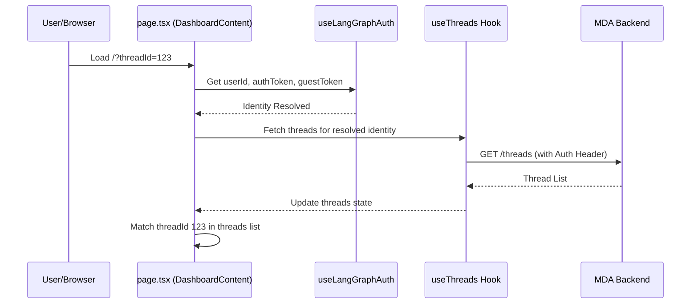

<!-- source: DeepWiki mcp.deepwiki.com · repo langchain-ai/chat-langchain · page 3.1 Application Structure and Entry Points · fetched 2026-10-26 -->

# Application Structure and Entry Points

<details>
<summary>Relevant source files</summary>

The following files were used as context for generating this wiki page:

- [frontend/.gitignore](frontend/.gitignore)
- [frontend/app/layout.tsx](frontend/app/layout.tsx)
- [frontend/app/page.tsx](frontend/app/page.tsx)
- [frontend/components/chat/features/welcome-screen.tsx](frontend/components/chat/features/welcome-screen.tsx)
- [frontend/components/layout/header.tsx](frontend/components/layout/header.tsx)
- [frontend/hooks/useKeyboardShortcuts.ts](frontend/hooks/useKeyboardShortcuts.ts)

</details>


## Purpose and Scope

This document describes the Next.js application structure, entry points, and bootstrap process for the `chat-langchain` frontend. It covers the root page component, directory organization, and how context providers like `AuthProvider` and `NuqsAdapter` are initialized at application startup. The application is built using the Next.js App Router and integrates with a Managed Deep Agent (MDA) backend.

## Next.js App Router Structure

The frontend follows the standard Next.js 14+ App Router directory conventions. The application is a single-page chat interface where routing and state are heavily driven by URL query parameters.

```
frontend/
├── app/
│   ├── page.tsx                    # Root page component (entry point)
│   ├── layout.tsx                  # Root layout wrapper with providers
│   ├── globals.css                 # Global styles
│   └── ...
├── components/                     # React components
│   ├── chat/                       # Chat interface and features
│   ├── layout/                     # Sidebar, Header, etc.
│   └── providers/                  # Context providers (Segment, etc.)
├── hooks/                          # Custom React hooks
├── lib/                            # Core logic and utilities
│   ├── auth/                       # Auth logic and AuthProvider
│   ├── hooks/                      # Data fetching hooks (threads, etc.)
│   └── utils/                      # String and UI utilities
└── public/                         # Static assets (logos, icons)
```

The application uses a single root route defined in [frontend/app/page.tsx](). Thread selection and initial queries are handled via URL parameters rather than separate path segments.

**Sources:** [frontend/app/page.tsx:1-18](), [frontend/app/layout.tsx:1-72]()

## Root Layout and Providers

The `RootLayout` in [frontend/app/layout.tsx]() serves as the global wrapper for the entire application. It bootstraps the application by wrapping the component tree in several critical providers:

1.  **AuthProvider**: Manages multi-region Supabase authentication and identity.
2.  **SegmentProvider**: Initializes Segment analytics for user tracking.
3.  **NuqsAdapter**: Enables type-safe URL query parameter state management (used for `threadId` and `q`).

```mermaid
graph TD
    "html"["html (layout.tsx)"]
    "body"["body"]
    "AuthProvider"["AuthProvider (lib/auth)"]
    "SegmentProvider"["SegmentProvider (components/providers)"]
    "NuqsAdapter"["NuqsAdapter (nuqs/adapters/next/app)"]
    "Children"["{children} (page.tsx)"]

    "html" --> "body"
    "body" --> "AuthProvider"
    "AuthProvider" --> "SegmentProvider"
    "SegmentProvider" --> "NuqsAdapter"
    "NuqsAdapter" --> "Children"

    subgraph "Natural Language to Code Mapping"
        "Auth Provider" -- "Manages" --> "AuthProvider"
        "URL State" -- "Manages" --> "NuqsAdapter"
    end
```

**Sources:** [frontend/app/layout.tsx:62-69](), [frontend/app/layout.tsx:3-7]()

## Root Page Component: DashboardContent

The entry point for the chat UI is the `DashboardContent` component within [frontend/app/page.tsx](). It orchestrates the main layout including the `Sidebar`, `Header`, and `ChatInterface`.

### Routing via Query Parameters

The application utilizes `nuqs` to synchronize the UI state with the browser URL:
*   `threadId`: The unique identifier for the current conversation [frontend/app/page.tsx:29]().
*   `q`: An initial prompt passed via URL to auto-start a conversation [frontend/app/page.tsx:32]().

### Identity and Thread Ownership

The `DashboardContent` component resolves the current user's identity via `useLangGraphAuth` [frontend/app/page.tsx:35-42](). It handles three distinct identity states:
1.  **Authenticated User**: Logged in via Supabase.
2.  **Guest User**: Using a local `guestToken` issued by the MDA backend.
3.  **Cross-Identity Access**: Loading guest threads for a newly authenticated user [frontend/app/page.tsx:43-45]().



**Sources:** [frontend/app/page.tsx:29-50](), [frontend/app/page.tsx:57-77]()

## Application Bootstrap Process

### Initialization Sequence

When the application loads, it follows a specific sequence to ensure authentication is ready before fetching data:

1.  **Layout Mount**: `AuthProvider` initializes and checks for existing Supabase sessions or guest tokens.
2.  **Page Mount**: `DashboardContent` reads `threadId` from the URL via `useQueryState` [frontend/app/page.tsx:29]().
3.  **Thread Loading**: The `useThreads` hook is invoked twice: once for the primary `userId` and once for `guestUserId` if applicable [frontend/app/page.tsx:57-77]().
4.  **UI Orchestration**: The `threads` are merged and sorted by `updated_at` or `created_at` [frontend/app/page.tsx:79-94]().
5.  **Thread Selection**: If no `threadId` exists, or if a user switches accounts, a new `threadId` is generated using `crypto.randomUUID()` [frontend/app/page.tsx:144-162]().

### UI Layout Components

| Component | File Path | Responsibility |
| :--- | :--- | :--- |
| `Sidebar` | `components/layout/sidebar.tsx` | Displays thread history and "New Chat" button [frontend/app/page.tsx:5](). |
| `Header` | `components/layout/header.tsx` | Contains the logo, Auth button/menu, and "New Chat" action [frontend/app/page.tsx:6](). |
| `ChatInterface` | `components/chat/chat-interface.tsx` | The main interaction area handling message streaming and input [frontend/app/page.tsx:7](). |
| `WelcomeScreen` | `components/chat/features/welcome-screen.tsx` | The initial view for a new thread with a centered input [frontend/components/chat/features/welcome-screen.tsx:57](). |

**Sources:** [frontend/app/page.tsx:20-200](), [frontend/components/layout/header.tsx:25-135]()

## Keyboard Shortcuts

The application bootstraps global keyboard shortcuts via the `useKeyboardShortcuts` hook [frontend/app/page.tsx:18](). These shortcuts allow for rapid navigation without mouse interaction:
*   `Cmd/Ctrl + /`: Toggle shortcuts dialog.
*   `Cmd/Ctrl + B`: Toggle sidebar visibility.
*   `Cmd/Ctrl + I`: Create a new chat.

**Sources:** [frontend/hooks/useKeyboardShortcuts.ts:143-164]()

---

