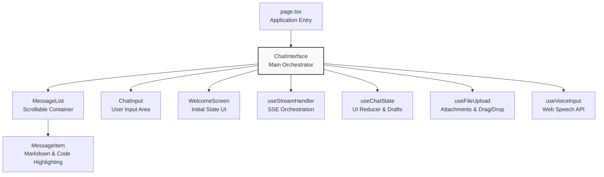
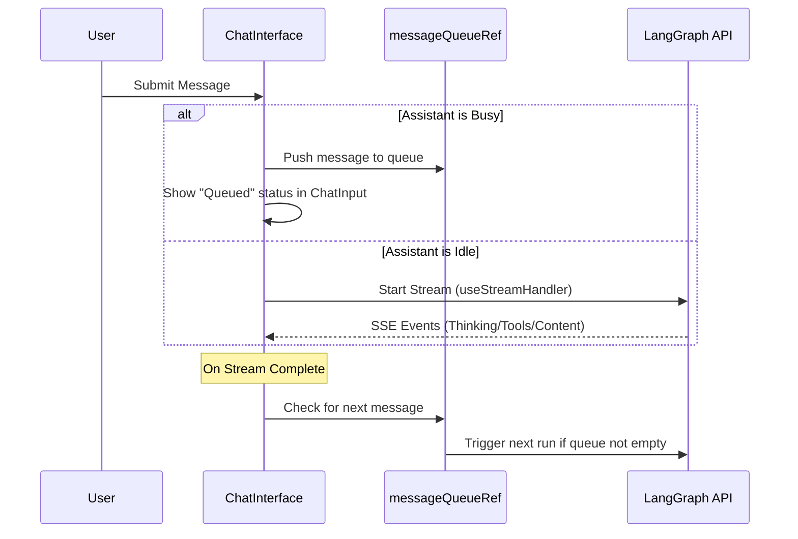
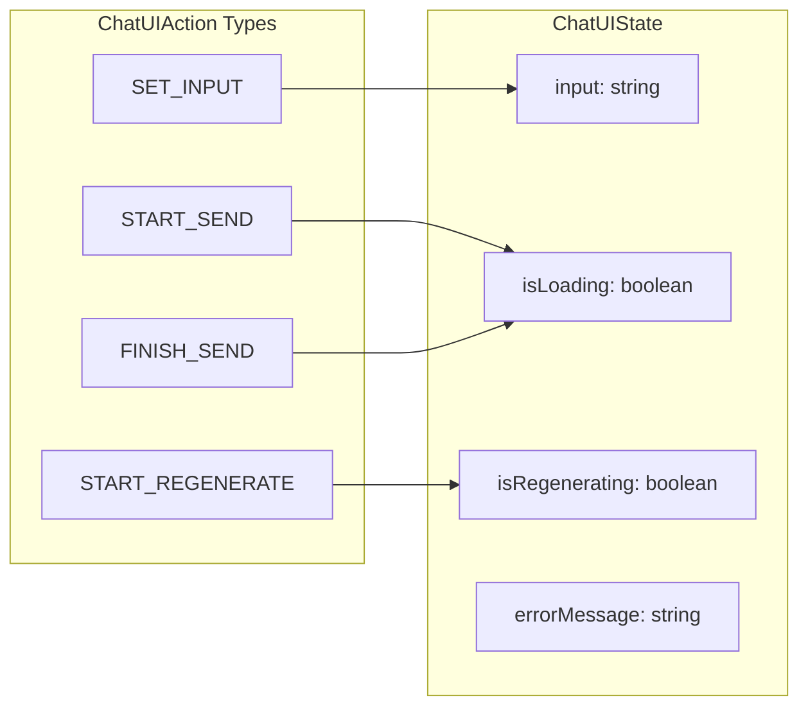

<!-- source: DeepWiki mcp.deepwiki.com · repo langchain-ai/chat-langchain · page 3.2 Chat Interface Components · fetched 2026-10-26 -->

# Chat Interface Components

Relevant source files

The following files were used as context for generating this wiki page:

- [frontend/components/chat/chat-input.tsx](frontend/components/chat/chat-input.tsx)
- [frontend/components/chat/chat-interface.tsx](frontend/components/chat/chat-interface.tsx)
- [frontend/components/chat/message-item.tsx](frontend/components/chat/message-item.tsx)
- [frontend/lib/hooks/chat/use-chat-state.ts](frontend/lib/hooks/chat/use-chat-state.ts)
- [frontend/lib/hooks/files/use-file-upload.ts](frontend/lib/hooks/files/use-file-upload.ts)
- [frontend/lib/types/images.ts](frontend/lib/types/images.ts)

This document describes the core UI components that implement the conversational chat interface in the frontend application. These components handle message display, user input, real-time streaming of assistant responses, file attachments, and voice input. The interface is built using a custom state management system centered around the `ChatInterface` component.

## Component Architecture Overview

The chat interface is composed of several modular components orchestrated by the `ChatInterface`. It manages the thread lifecycle, message queueing, and interaction with the LangGraph SDK.

**Sources:** [frontend/components/chat/chat-interface.tsx:79-92](), [frontend/components/chat/chat-input.tsx:55-83]()

## ChatInterface Component

The `ChatInterface` component serves as the central hub for the chat experience. It handles the message queue, streaming lifecycle, and coordination between input methods and the display.

### Key Responsibilities

| Feature | Implementation | Code Location |
|---------|----------------|---------------|
| **State Management** | `useChatState` reducer for loading, errors, and input | [frontend/components/chat/chat-interface.tsx:100]() |
| **Streaming** | `useStreamHandler` for processing LangGraph SSE events | [frontend/components/chat/chat-interface.tsx:219]() |
| **Message Queue** | `messageQueueRef` to buffer messages sent while AI is busy | [frontend/components/chat/chat-interface.tsx:127-129]() |
| **Draft Persistence** | LocalStorage persistence via `STORAGE_KEYS.DRAFT_PREFIX` | [frontend/lib/hooks/chat/use-chat-state.ts:159-171]() |
| **Interruption** | `shouldInterruptRef` to signal the stream handler to stop | [frontend/components/chat/chat-interface.tsx:198]() |

### Message Submission and Queueing

The component supports "queued messages," allowing users to type and "send" messages even while the assistant is still generating a response.

**Sources:** [frontend/components/chat/chat-interface.tsx:127-130](), [frontend/components/chat/chat-interface.tsx:285-310]()

## ChatInput Component

The `ChatInput` is a sophisticated entry field supporting multi-modal inputs, including text, file attachments, and voice.

### Multi-modal Input Handling

- **File Attachments**: Managed by `useFileUpload`. It supports images (converted to base64) and text-based files (code, logs, markdown) which are appended to the context. [frontend/lib/hooks/files/use-file-upload.ts:80-128]()
- **Voice Input**: Uses the Web Speech API via `useVoiceInput`. It appends transcripts to the `baseInputRef` while maintaining the character limit. [frontend/components/chat/chat-interface.tsx:147-165]()
- **Character Limits**: Enforced by `MAX_INPUT_CHARS` (typically 25,000). The limit is shared between typed text and the character count of attached text files (`textLength`). [frontend/components/chat/chat-interface.tsx:134-144]()

### UI Elements
- **FilePreviewGrid**: Renders thumbnails for images and icons for code files. [frontend/components/chat/chat-input.tsx:92]()
- **VoiceInputButton**: Visual feedback for microphone state and interim transcripts. [frontend/components/chat/chat-input.tsx:189]()
- **Queued Display**: Shows a list of messages waiting to be processed. [frontend/components/chat/chat-input.tsx:109-131]()

**Sources:** [frontend/components/chat/chat-input.tsx:55-217](), [frontend/lib/types/images.ts:10-18]()

## MessageItem Component

`MessageItem` is responsible for rendering individual messages, including complex AI responses with "thinking" steps, tool calls, and formatted content.

### Content Rendering Pipeline

1. **Thinking Steps**: If the AI is "thinking," `AnimatedThinking` and `ThinkingTimer` are displayed to show progress and tool execution. [frontend/components/chat/message-item.tsx:265-275]()
2. **Markdown**: Content is parsed via `ReactMarkdown` with `remarkGfm` support. [frontend/components/chat/message-item.tsx:392-402]()
3. **Code Highlighting**: A custom `CodeBlock` component uses `react-syntax-highlighter` with a custom `vscDarkPlus` theme. It includes a "Copy" button that uses `navigator.clipboard`. [frontend/components/chat/message-item.tsx:133-188]()
4. **Attachments**: Renders any images or files associated with the message. [frontend/components/chat/message-item.tsx:310-330]()

### Interaction Features
- **Edit and Rerun**: Users can edit their previous messages, triggering a new run from that point in the graph. [frontend/components/chat/message-item.tsx:243-259]()
- **Feedback**: Integrated thumbs up/down buttons that link to the LangSmith feedback API. [frontend/components/chat/message-item.tsx:419-446]()
- **Regeneration**: Allows re-triggering the assistant response for the last turn. [frontend/components/chat/message-item.tsx:455-467]()

**Sources:** [frontend/components/chat/message-item.tsx:1-470]()

## Welcome Screen

The `WelcomeScreen` is displayed when a thread is empty. It provides context and quick-start actions for the user.

- **Suggested Prompts**: A grid of common questions to help users get started.
- **Brand Identity**: Displays the LangChain logo and a brief description of the assistant's capabilities (e.g., searching documentation, pricing, and GitHub).
- **Integration**: Disappears as soon as the first message is sent or queued.

**Sources:** [frontend/components/chat/features/welcome-screen.tsx](), [frontend/components/chat/chat-interface.tsx:367-376]()

## State and Data Flow

The `useChatState` hook uses a reducer pattern to ensure predictable state transitions for the UI.

**Sources:** [frontend/lib/hooks/chat/use-chat-state.ts:32-113]()

### Implementation Citations

- **ChatInterface Definition**: [frontend/components/chat/chat-interface.tsx:79-92]()
- **Message Queue Processing**: [frontend/components/chat/chat-interface.tsx:285-310]()
- **Input Limit Logic**: [frontend/components/chat/chat-interface.tsx:134-144]()
- **Code Highlighting Theme**: [frontend/components/chat/message-item.tsx:51-105]()
- **File Upload Processing**: [frontend/lib/hooks/files/use-file-upload.ts:80-128]()
- **Chat State Reducer**: [frontend/lib/hooks/chat/use-chat-state.ts:54-113]()

---

