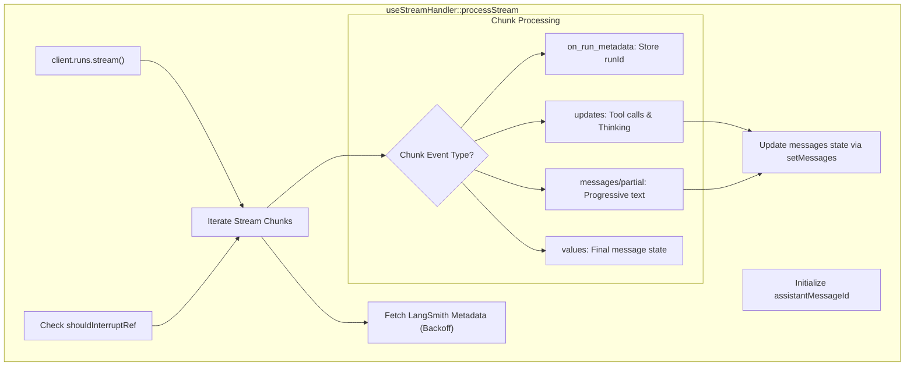
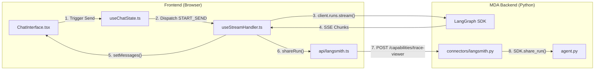

<!-- source: DeepWiki mcp.deepwiki.com · repo langchain-ai/chat-langchain · page 3.3 Streaming and State Management · fetched 2026-10-26 -->

# Streaming and State Management

Relevant source files

The following files were used as context for generating this wiki page:

- [frontend/lib/api/langsmith.ts](frontend/lib/api/langsmith.ts)
- [frontend/lib/hooks/chat/use-chat-state.ts](frontend/lib/hooks/chat/use-chat-state.ts)
- [frontend/lib/hooks/chat/use-feedback.ts](frontend/lib/hooks/chat/use-feedback.ts)
- [frontend/lib/hooks/chat/use-stream-handler.ts](frontend/lib/hooks/chat/use-stream-handler.ts)

This document details the frontend streaming architecture and state management patterns in the Chat LangChain application. It focuses on the orchestration of Server-Sent Events (SSE) from the LangGraph agent, real-time UI updates for thinking steps and tool calls, and the robust state synchronization between the React frontend and the Managed Deep Agent (MDA) backend.

## Overview

Streaming and state management are primarily handled by two custom hooks: `useStreamHandler` for processing agent outputs and `useChatState` for managing local UI interactions. The system integrates with the LangGraph SDK to consume multi-modal streams and uses LangSmith for metadata and feedback tracking.

## Streaming Orchestration: useStreamHandler

The `useStreamHandler` hook manages the complete lifecycle of agent streaming. It processes multiple stream modes including `values`, `updates`, `messages`, and `messages/partial` to provide progressive token display and tool visualization [frontend/lib/hooks/chat/use-stream-handler.ts:4-22]().

### Stream Processing Logic

The `processStream` function initiates a stream via the LangGraph `client.runs.stream` method [frontend/lib/hooks/chat/use-stream-handler.ts:127-131](). It uses `streamMode: ["messages", "updates"]` and `streamSubgraphs: true` to capture both top-level agent responses and internal subagent executions [frontend/lib/hooks/chat/use-stream-handler.ts:245-249]().

**Sources:** [frontend/lib/hooks/chat/use-stream-handler.ts:127-310](), [frontend/lib/hooks/chat/use-stream-handler.ts:240-260]()

### Thinking Steps and Tool Visualization
The hook tracks "thinking steps" by monitoring tool calls and subgraph events. The `describeToolStep` function maps internal tool names to human-readable descriptions for the UI [frontend/lib/hooks/chat/use-stream-handler.ts:80-102]().

| Tool Name | UI Description |
| :--- | :--- |
| `search_docs_by_lang_chain` | "Searching documentation for [query]" |
| `query_docs_filesystem_docs_by_lang_chain` | "Reading documentation" |
| `search_support_articles` | "Searching support articles ([collections])" |
| `check_links` | "Checking documentation links" |

**Sources:** [frontend/lib/hooks/chat/use-stream-handler.ts:80-102]()

## LangSmith Integration and Metadata

The frontend interacts with LangSmith exclusively through the MDA LangSmith connector, ensuring `LANGSMITH_API_KEY` is never exposed to the browser [frontend/lib/api/langsmith.ts:1-13]().

### Metadata Fetching with Exponential Backoff
Since LangSmith indexing may lag behind stream completion, `useStreamHandler` implements an exponential backoff strategy to fetch usage metadata (tokens, costs) and generate share links [frontend/lib/hooks/chat/use-stream-handler.ts:46-51]().

*   **Initial Delay:** 1000ms [frontend/lib/hooks/chat/use-stream-handler.ts:50]()
*   **Max Retries:** 8 attempts [frontend/lib/hooks/chat/use-stream-handler.ts:48]()
*   **Backoff Formula:** `baseDelay * 2^attempt` [frontend/lib/hooks/chat/use-stream-handler.ts:76-78]()

### Feedback Management
The `useFeedback` hook manages user ratings (thumbs up/down) and comments. It uses optimistic updates to provide immediate UI feedback while calling the `createOrUpdateFeedback` API [frontend/lib/hooks/chat/use-feedback.ts:24-58]().

**Sources:** [frontend/lib/hooks/chat/use-stream-handler.ts:183-238](), [frontend/lib/api/langsmith.ts:96-127](), [frontend/lib/hooks/chat/use-feedback.ts:122-140]()

## UI State Management: useChatState

The `useChatState` hook consolidates UI-specific state using a `useReducer` pattern. This ensures predictable state transitions for complex interactions like regeneration and stream interruption [frontend/lib/hooks/chat/use-chat-state.ts:4-8]().

### State Reducer and Actions
The `chatUIReducer` handles transitions between loading, sending, and error states [frontend/lib/hooks/chat/use-chat-state.ts:54-113]().

| Action Type | State Change |
| :--- | :--- |
| `START_SEND` | Clears input, sets `isLoading: true` |
| `FINISH_SEND` | Sets `isLoading: false`, `isStopping: false` |
| `SET_INPUT` | Updates input and persists to `localStorage` |
| `SET_ERROR` | Updates `errorMessage` for UI display |

### Persistence
The hook automatically persists draft messages to `localStorage` using a thread-specific key (`DRAFT_PREFIX + threadId`), allowing users to navigate between threads without losing un-sent input [frontend/lib/hooks/chat/use-chat-state.ts:159-171]().

**Sources:** [frontend/lib/hooks/chat/use-chat-state.ts:32-46](), [frontend/lib/hooks/chat/use-chat-state.ts:141-154]()

## Data Flow: Code Entity Space

The following diagram maps the logical streaming flow to specific code entities within the repository.

**Sources:** [frontend/lib/hooks/chat/use-stream-handler.ts:127-131](), [frontend/lib/api/langsmith.ts:171-178](), [frontend/lib/hooks/chat/use-chat-state.ts:83-89]()

---

