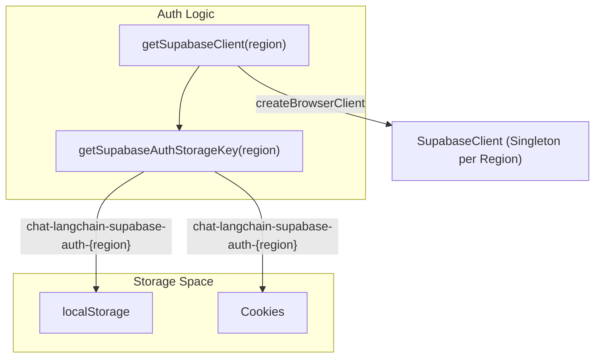
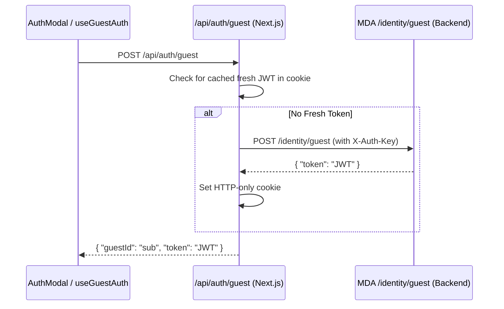

<!-- source: DeepWiki mcp.deepwiki.com · repo langchain-ai/chat-langchain · page 3.4 Authentication and Identity · fetched 2026-10-26 -->

# Authentication and Identity

Relevant source files

The following files were used as context for generating this wiki page:

- [frontend/__tests__/sign-in-tracking.test.mts](frontend/__tests__/sign-in-tracking.test.mts)
- [frontend/app/api/auth/guest/route.ts](frontend/app/api/auth/guest/route.ts)
- [frontend/app/auth/callback/route.ts](frontend/app/auth/callback/route.ts)
- [frontend/components/auth/AuthModal.tsx](frontend/components/auth/AuthModal.tsx)
- [frontend/lib/api/langgraph-client.ts](frontend/lib/api/langgraph-client.ts)
- [frontend/lib/auth/AuthProvider.tsx](frontend/lib/auth/AuthProvider.tsx)
- [frontend/lib/auth/index.ts](frontend/lib/auth/index.ts)
- [frontend/lib/auth/sign-in-tracking.ts](frontend/lib/auth/sign-in-tracking.ts)
- [frontend/lib/auth/supabase.ts](frontend/lib/auth/supabase.ts)
- [frontend/lib/hooks/auth/use-user-id.ts](frontend/lib/hooks/auth/use-user-id.ts)
- [frontend/package-lock.json](frontend/package-lock.json)
- [frontend/package.json](frontend/package.json)

The Chat-LangChain authentication system is built on a multi-region Supabase architecture, providing global low-latency identity management. It supports OAuth (Google, GitHub, Discord), email/password sign-in, and a "guest" mode for anonymous users. The system is designed to scope threads and LangSmith traces to specific actors while maintaining session persistence across browser reloads.

## Multi-Region Supabase Architecture

The application supports multiple Supabase projects mapped to different geographical regions (`us`, `eu`, `apac`, `aws`). This allows users to choose where their data resides, adhering to data residency requirements.

### AuthRegion Configuration
The `AuthRegion` type defines the supported regions [frontend/lib/auth/supabase.ts:6-6](). Configuration for these regions is pulled from environment variables [frontend/lib/auth/supabase.ts:18-35]().

| Region Key | Label | Environment Variables |
| :--- | :--- | :--- |
| `us` | US | `NEXT_PUBLIC_SUPABASE_URL`, `NEXT_PUBLIC_SUPABASE_ANON_KEY` |
| `eu` | EU | `NEXT_PUBLIC_SUPABASE_EU_URL`, `NEXT_PUBLIC_SUPABASE_EU_ANON_KEY` |
| `apac` | APAC | `NEXT_PUBLIC_SUPABASE_APAC_URL`, `NEXT_PUBLIC_SUPABASE_APAC_ANON_KEY` |
| `aws` | AWS US | `NEXT_PUBLIC_SUPABASE_AWS_URL`, `NEXT_PUBLIC_SUPABASE_AWS_ANON_KEY` |

**Sources:** [frontend/lib/auth/supabase.ts:6-35]()

### Namespaced Storage and Client Management
To prevent session collisions between regions, the system uses region-namespaced storage keys for localStorage and cookies [frontend/lib/auth/supabase.ts:95-96](). The `getSupabaseClient` function initializes a singleton-like client for each region with a specific `storageKey` [frontend/lib/auth/supabase.ts:120-140]().

**Sources:** [frontend/lib/auth/supabase.ts:95-140]()

## Authentication Flow

### OAuth and Email Sign-In
The `AuthProvider` manages the authentication state using the `useAuth` hook [frontend/lib/auth/AuthProvider.tsx:30-41](). 

1.  **OAuth Initiation**: The `signIn` function calls `signInWithOAuth` and sets a `redirectTo` URL pointing to the `/auth/callback` route, appending the selected `region` as a query parameter [frontend/lib/auth/AuthProvider.tsx:206-223]().
2.  **Callback Processing**: The server-side route `app/auth/callback/route.ts` handles the code exchange. It retrieves the region from the URL, initializes a `createServerClient` with the correct region credentials, and exchanges the code for a session [frontend/app/auth/callback/route.ts:51-119]().
3.  **Client-Side Hydration**: Upon successful redirection back to the frontend, the `AuthProvider` detects the `auth_success` marker and hydrates the user session [frontend/lib/auth/AuthProvider.tsx:47-66]().

**Sources:** [frontend/lib/auth/AuthProvider.tsx:206-223](), [frontend/app/auth/callback/route.ts:51-119]()

### Guest Token Issuance
For users who are not signed in, the system issues a managed guest token via a dedicated API route.

The guest token is a JWT containing a `sub` (subject) claim used as the `guestId`. The frontend caches this token in an HTTP-only cookie named `chat_langchain_guest` to maintain identity across reloads [frontend/app/api/auth/guest/route.ts:64-105]().

**Sources:** [frontend/app/api/auth/guest/route.ts:64-105](), [frontend/lib/hooks/auth/use-user-id.ts:111-175]()

## Identity Resolution

The application uses the `useLangGraphAuth` hook to resolve the current active identity for API requests [frontend/lib/hooks/auth/use-user-id.ts:177-191]().

| Identity Type | `userId` Source | `authToken` Source |
| :--- | :--- | :--- |
| **Authenticated** | `user.email` | Supabase `access_token` |
| **Guest** | JWT `sub` claim | Guest JWT |
| **Legacy Guest** | `localStorage` UUID | `localStorage` UUID |

The `createLangGraphClient` function uses these resolved values to populate the `Authorization` and `X-Supabase-Region` headers for the LangGraph SDK [frontend/lib/api/langgraph-client.ts:25-53]().

**Sources:** [frontend/lib/hooks/auth/use-user-id.ts:177-191](), [frontend/lib/api/langgraph-client.ts:25-53]()

## Sign-In Tracking and Analytics

To prevent duplicate "Signed In" events in analytics (Segment), the system implements a deduplication mechanism using a fingerprint of the user ID and the `last_sign_in_at` timestamp [frontend/lib/auth/sign-in-tracking.ts:14-19]().

1.  **Fingerprinting**: `getSignInFingerprint` creates a unique string: `region:userId:timestamp`.
2.  **Locking**: The system uses the `navigator.locks` API (where available) to ensure that concurrent tabs do not track the same sign-in event simultaneously [frontend/lib/auth/sign-in-tracking.ts:53-68]().
3.  **Storage**: A successful claim is recorded in `localStorage` with the prefix `chat-langchain:last-tracked-sign-in` [frontend/lib/auth/sign-in-tracking.ts:11-11]().

**Sources:** [frontend/lib/auth/sign-in-tracking.ts:11-68](), [frontend/lib/auth/AuthProvider.tsx:163-184]()

## UI Components

### AuthModal
The `AuthModal` component provides the interface for region selection and sign-in methods.
*   **Region Selection**: Displays a dropdown of `availableAuthRegions`. If a region is not configured in environment variables, it is disabled in the UI [frontend/components/auth/AuthModal.tsx:170-191]().
*   **Sign-In Options**: Provides buttons for Google, GitHub, and Discord (depending on region support), as well as an email/password form [frontend/components/auth/AuthModal.tsx:100-139]().
*   **LangSmith Links**: Dynamically generates links to LangSmith sign-up/password reset pages based on the selected `authRegion` [frontend/components/auth/AuthModal.tsx:42-45]().

**Sources:** [frontend/components/auth/AuthModal.tsx:42-191]()

---

