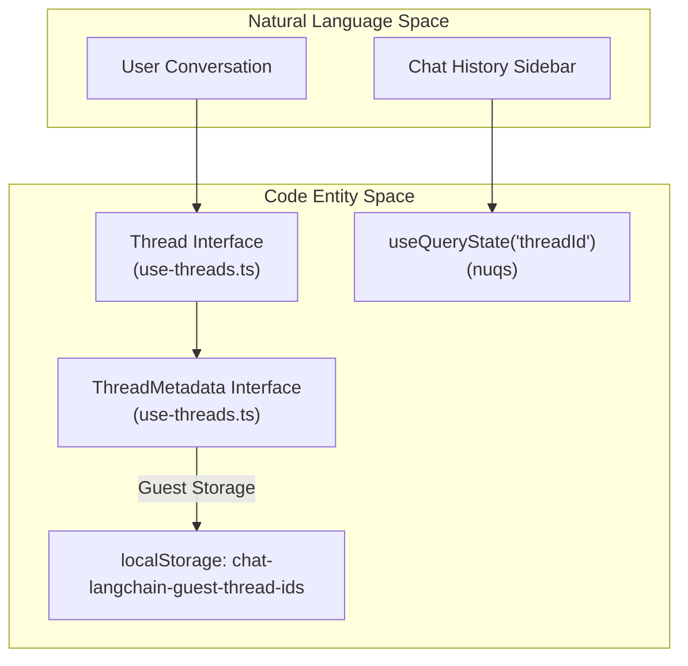
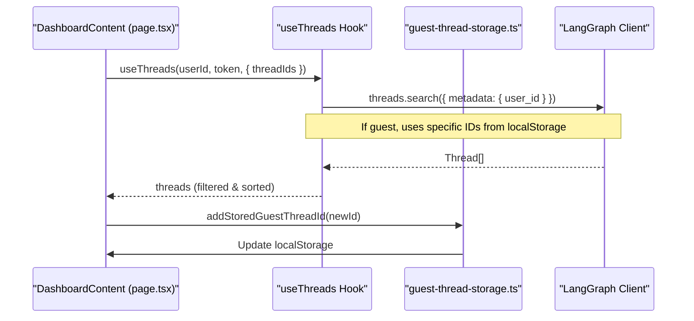

<!-- source: DeepWiki mcp.deepwiki.com · repo langchain-ai/chat-langchain · page 3.5 Thread Management · fetched 2026-10-26 -->

# Thread Management

Relevant source files

The following files were used as context for generating this wiki page:

- [frontend/app/page.tsx](frontend/app/page.tsx)
- [frontend/lib/hooks/threads/guest-thread-storage.ts](frontend/lib/hooks/threads/guest-thread-storage.ts)
- [frontend/lib/hooks/threads/use-threads.ts](frontend/lib/hooks/threads/use-threads.ts)

## Purpose and Scope

This document explains how conversation threads are created, stored, retrieved, and deleted in the `chat-langchain` frontend. It covers the `useThreads` hook that provides thread CRUD operations, guest thread storage in `localStorage`, URL-based thread selection via `nuqs`, and deterministic thread title generation.

For information about overall state management and the GraphContext, see **3.3 Streaming and State Management**. For the chat interface components that display thread messages, see **3.2 Chat Interface Components**.

---

## Thread Lifecycle Overview

Threads represent individual conversation sessions. Each thread:
- Has a unique `thread_id` assigned by the LangGraph backend or generated as a UUID by the client [frontend/app/page.tsx:177]().
- Contains conversation state including messages and research steps.
- Is associated with a `user_id` via metadata [frontend/lib/hooks/threads/use-threads.ts:71]().
- Persists in the backend checkpointer until explicitly deleted.

**Thread Entity Mapping**

Sources: [frontend/lib/hooks/threads/use-threads.ts:60-88](), [frontend/lib/hooks/threads/guest-thread-storage.ts:3-38](), [frontend/app/page.tsx:29]()

---

## useThreads Hook Architecture

The `useThreads` hook [frontend/lib/hooks/threads/use-threads.ts:112]() is the primary interface for thread management. It supports both authenticated users and guests by fetching threads based on `userId` or specific `threadIds`.

### Key Features
- **Optimistic Updates**: Provides instant UI feedback for metadata changes and deletions [frontend/lib/hooks/threads/use-threads.ts:225-235]().
- **Automatic Filtering**: Filters out threads that have no state (empty values) to keep history clean [frontend/lib/hooks/threads/use-threads.ts:174]().
- **Multi-Region Support**: Uses `authRegion` to route requests to the correct Supabase/MDA instance [frontend/lib/hooks/threads/use-threads.ts:148]().

### Data Flow and Storage

Sources: [frontend/lib/hooks/threads/use-threads.ts:143-183](), [frontend/app/page.tsx:57-94](), [frontend/lib/hooks/threads/guest-thread-storage.ts:28-32]()

---

## Guest Thread Management

For unauthenticated users, thread IDs are stored in the browser's `localStorage` using `guest-thread-storage.ts`.

- **Storage Key**: `chat-langchain-guest-thread-ids` [frontend/lib/hooks/threads/guest-thread-storage.ts:3]().
- **Retrieval**: `getStoredGuestThreadIds()` parses the JSON array from storage [frontend/lib/hooks/threads/guest-thread-storage.ts:24]().
- **Persistence**: When a guest sends a message, the `threadId` is added to this list to ensure it appears in their history across sessions [frontend/app/page.tsx:51-53]().

---

## URL-Based Thread Selection

Thread selection is synchronized with the browser URL using `nuqs`.

- **threadId**: Managed via `useQueryState("threadId")` [frontend/app/page.tsx:29](). This allows users to bookmark specific conversations or share links to traces.
- **Initial Prompt**: The `q` query parameter allows auto-sending a prompt on page load [frontend/app/page.tsx:32]().
- **Navigation**: Changing the `threadId` in the URL triggers a state update in `DashboardContent`, which updates the `selectedThreadOwner` and loads the corresponding message history [frontend/app/page.tsx:98-111]().

---

## Thread Title Generation

Titles are generated deterministically in the browser to provide immediate context in the sidebar.

- **Quick Title**: `generateQuickTitle(input)` creates a short preview title from the user's first message [frontend/app/page.tsx:17]().
- **Full Title**: `generateThreadTitle(messages)` can be used to derive a more descriptive title from the conversation context [frontend/app/page.tsx:17]().
- **Metadata Storage**: Once generated, the title is saved in the thread's metadata via `updateThreadMetadata` [frontend/lib/hooks/threads/use-threads.ts:218-245]().

---

## Thread Deletion

The deletion process handles both the backend record and the local guest storage:

1. **Backend**: Calls `client.threads.delete(threadId)` [frontend/lib/hooks/threads/use-threads.ts:258]().
2. **Local Storage**: If the user is a guest, `removeStoredGuestThreadId(threadId)` is called to clean up `localStorage` [frontend/app/page.tsx:210]().
3. **State Sync**: If the deleted thread was the active one, the UI redirects the user to a new chat [frontend/app/page.tsx:215-220]().

Sources: [frontend/lib/hooks/threads/use-threads.ts:250-278](), [frontend/app/page.tsx:199-224](), [frontend/lib/hooks/threads/guest-thread-storage.ts:34-38]()

---

