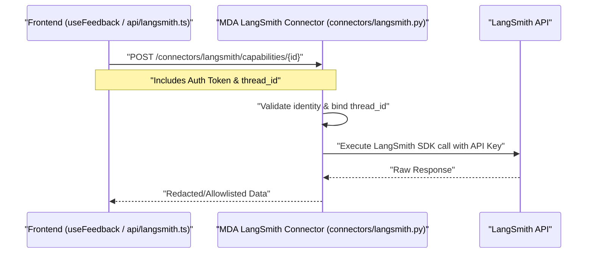
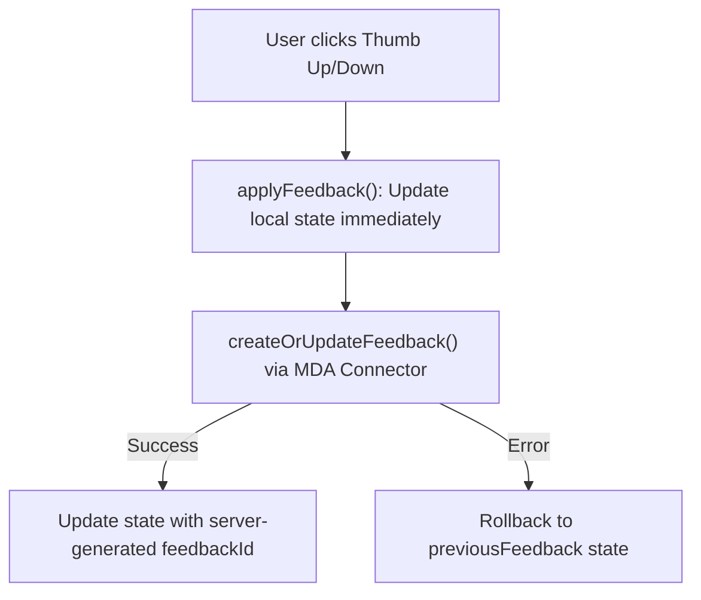

<!-- source: DeepWiki mcp.deepwiki.com · repo langchain-ai/chat-langchain · page 3.6 LangSmith Integration and Feedback · fetched 2026-10-26 -->

# LangSmith Integration and Feedback

Relevant source files

The following files were used as context for generating this wiki page:

- [frontend/components/providers/segment-provider.tsx](frontend/components/providers/segment-provider.tsx)
- [frontend/lib/api/langsmith.ts](frontend/lib/api/langsmith.ts)
- [frontend/lib/constants/features.ts](frontend/lib/constants/features.ts)
- [frontend/lib/hooks/chat/use-feedback.ts](frontend/lib/hooks/chat/use-feedback.ts)

## Purpose and Scope

This document describes the integration between the `chat-langchain` frontend and LangSmith for observability, trace management, and user feedback. The frontend interacts with LangSmith exclusively through a Managed Deep Agent (MDA) connector to ensure API keys remain secure. The system provides mechanisms for thumbs up/down feedback, generating public trace URLs, and tracking user behavior via Segment analytics.

---

## Architecture and Data Flow

The frontend never calls the LangSmith API directly. Instead, it routes all requests through the MDA LangSmith connector. This proxy architecture allows the backend to inject the `LANGSMITH_API_KEY` and perform allowlisted operations while the browser only provides its own identity token (Supabase access token or MDA guest token).

**Sources:** [frontend/lib/api/langsmith.ts:1-13]()

---

## LangSmith Connector API

The frontend interacts with two primary capability IDs declared in the backend connector: `langsmith:chat-feedback` and `langsmith:trace-viewer` [frontend/lib/api/langsmith.ts:20-21]().

### Capability Methods

| Function | Capability ID | Action | Description |
|----------|---------------|--------|-------------|
| `createOrUpdateFeedback` | `langsmith:chat-feedback` | `create` / `update` | Submits thumb score and optional comments [frontend/lib/api/langsmith.ts:96-127](). |
| `deleteFeedback` | `langsmith:chat-feedback` | `delete` | Removes feedback record from LangSmith [frontend/lib/api/langsmith.ts:132-142](). |
| `readRun` | `langsmith:trace-viewer` | `read` | Fetches a redacted summary of a specific trace [frontend/lib/api/langsmith.ts:147-162](). |
| `shareRun` | `langsmith:trace-viewer` | `share` | Generates a public URL for sharing the trace [frontend/lib/api/langsmith.ts:167-178](). |

### Authentication and Headers
Requests to the connector require a `LangSmithAuth` object containing a token and region [frontend/lib/api/langsmith.ts:30-33](). The `authHeaders` utility injects these into the request as `Authorization`, `X-Supabase-Region`, and optionally `X-Auth-Key` [frontend/lib/api/langsmith.ts:44-62]().

**Sources:** [frontend/lib/api/langsmith.ts:1-178]()

---

## Feedback Management

User feedback is managed via the `useFeedback` hook, which provides optimistic UI updates and handles the lifecycle of thumbs-up/down interactions.

### Feedback Lifecycle

### Key Logic
- **Optimistic Updates**: The hook immediately updates the `messages` state to show the selected thumb before the network request completes [frontend/lib/hooks/chat/use-feedback.ts:123]().
- **Toggle Behavior**: Clicking the same thumb twice triggers a `deleteFeedback` call to remove the rating [frontend/lib/hooks/chat/use-feedback.ts:82-120]().
- **Comments**: Supports adding text comments to feedback. If no comment is provided, default strings like "User rated this as helpful" are used [frontend/lib/hooks/chat/use-feedback.ts:16-17](), [frontend/lib/hooks/chat/use-feedback.ts:70-74]().
- **Scoring**: Feedback is mapped to numeric scores: `positive` = 1, `negative` = 0 [frontend/lib/api/langsmith.ts:25-28]().

**Sources:** [frontend/lib/hooks/chat/use-feedback.ts:1-205](), [frontend/lib/api/langsmith.ts:25-28](), [frontend/lib/constants/features.ts:24]()

---

## Analytics with Segment

The `SegmentProvider` manages user identification and event tracking, ensuring that analytics data is correctly attributed to authenticated users or anonymous visitors.

### Identity Management
- **Authenticated Users**: When a user signs in, the provider calls `window.analytics.identify` using the Supabase `user.id` [frontend/components/providers/segment-provider.tsx:26-38]().
- **Session Reset**: Upon logout, the provider calls `window.analytics.reset()` to clear persisted identity in `localStorage`, preventing cross-user data contamination [frontend/components/providers/segment-provider.tsx:55-74]().
- **Page Views**: Automatically tracks page views on initial load and route changes [frontend/components/providers/segment-provider.tsx:77-83]().

### Custom Event Tracking
The `trackEvent` utility is used throughout the application to log specific user actions (e.g., starting a chat, using a tool) to Segment [frontend/components/providers/segment-provider.tsx:91-100]().

**Sources:** [frontend/components/providers/segment-provider.tsx:1-100]()

---

## Configuration and Constants

| Constant | Value | Description |
|----------|-------|-------------|
| `FEEDBACK_KEY` | `"ux.thumb_vote"` | The key used in LangSmith for feedback metadata [frontend/lib/constants/features.ts:24](). |
| `CAPABILITY_FEEDBACK` | `"langsmith:chat-feedback"` | Internal ID for feedback capability [frontend/lib/api/langsmith.ts:20](). |
| `CAPABILITY_TRACE_VIEWER` | `"langsmith:trace-viewer"` | Internal ID for trace viewing capability [frontend/lib/api/langsmith.ts:21](). |

**Sources:** [frontend/lib/constants/features.ts:24](), [frontend/lib/api/langsmith.ts:20-21]()

---

