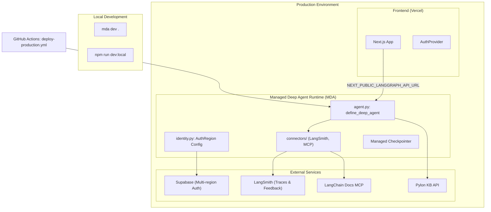

<!-- source: DeepWiki mcp.deepwiki.com · repo langchain-ai/chat-langchain · page 4 Deployment and Operations · fetched 2026-10-26 -->

# Deployment and Operations

Relevant source files

The following files were used as context for generating this wiki page:

- [.github/workflows/deploy-production.yml](.github/workflows/deploy-production.yml)
- [.gitignore](.gitignore)
- [README.md](README.md)
- [src/utils/__init__.py](src/utils/__init__.py)

This document provides a high-level overview of the deployment infrastructure and operational procedures for Chat LangChain. The system has transitioned from a custom Cloud Run + Weaviate architecture to a **Managed Deep Agent (MDA)** framework, which simplifies identity management, tool connectivity, and backend hosting.

For details on the backend deployment model, see [Managed Deep Agent Deployment](#4.1). For details on the web interface deployment, see [Frontend Deployment](#4.2).

## Infrastructure Overview

The Chat LangChain architecture is divided into a managed backend runtime and a frontend web application. The backend is defined as a Managed Deep Agent, which encapsulates the logic, tools, and identity providers.

### System Deployment Map

Sources: [README.md:127-145](), [agent.py:64](), [identity.py:1-40]()

## Managed Deep Agent (MDA) Model

The backend is deployed using the `mda` CLI. Unlike traditional deployments requiring manual FastAPI or Docker configuration, the MDA runtime owns the HTTP surface and managed components.

### Managed Components
*   **Identity**: Defined in `identity.py`, managing multi-region Supabase authentication and guest token issuance via `POST /identity/guest` [identity.py:1-60]().
*   **Connectors**: Managed interfaces for external systems. `connectors/langsmith.py` proxies sensitive operations so API keys never reach the browser [connectors/langsmith.py:1-25]().
*   **Checkpointer**: State persistence for threads is handled automatically by the MDA runtime [README.md:144-145]().
*   **Ingress**: The MDA runtime provides a managed HTTP surface, removing the need for custom server code [README.md:139-140]().

For details, see [Managed Deep Agent Deployment](#4.1).

## Deployment Pipelines

Operations are driven by GitHub Actions and the `mda` CLI.

### CI/CD Workflows
*   **Production Deployment**: The `.github/workflows/deploy-production.yml` workflow automates the deployment to LangSmith. It handles secret injection from GitHub Actions to the MDA environment [ .github/workflows/deploy-production.yml:23-143]().
*   **Local Development**: Developers use `mda dev .` to simulate the production environment locally, including managed connectors and identity providers [README.md:69-75]().

### Secret Management
Secrets are managed via a `.env` file locally and GitHub Secrets in production. Key secrets include:
*   `MDA_GUEST_SIGNING_KEY`: For signing guest session tokens [.github/workflows/deploy-production.yml:74]().
*   `SUPABASE_*`: Regional URLs and keys for user authentication [.github/workflows/deploy-production.yml:78-85]().
*   `PYLON_API_KEY`: For support knowledge base access [.github/workflows/deploy-production.yml:72]().

Sources: [.github/workflows/deploy-production.yml:63-86](), [README.md:56-64]()

## Frontend Operations

The frontend is a Next.js application typically hosted on Vercel. It interacts with the backend via the LangGraph SDK.

*   **Connection**: The frontend connects to the backend using the `NEXT_PUBLIC_LANGGRAPH_API_URL` environment variable [README.md:85-87]().
*   **Authentication**: The `AuthProvider` coordinates with the MDA identity surface to handle login flows and guest sessions [identity.py:10-35]().

For details, see [Frontend Deployment](#4.2).

## Operational Procedures

| Task | Procedure | Tools |
| :--- | :--- | :--- |
| **Deploy Backend** | `mda deploy . --name <deployment_name>` | `mda` CLI / GitHub Actions |
| **Local Backend** | `mda dev .` | `mda` CLI |
| **Local Frontend** | `npm run dev:local` | `npm` |
| **Monitor Traces** | View traces in LangSmith via the managed connector | LangSmith UI |
| **Update Prompts** | Use `scripts/push_docs_agent_prompt.py` | Python |

Sources: [README.md:65-88](), [README.md:131-133](), [.github/workflows/deploy-production.yml:138-142]()

---

