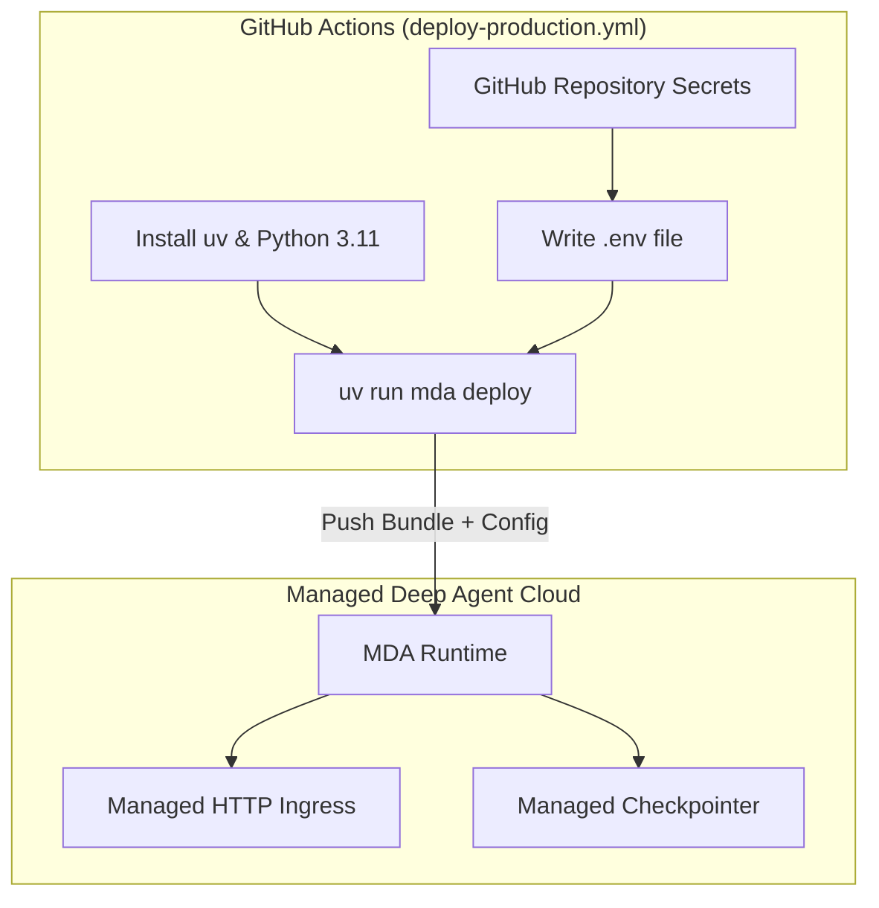
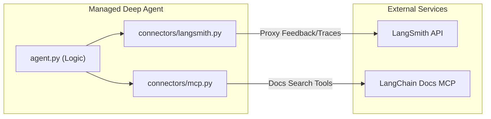

<!-- source: DeepWiki mcp.deepwiki.com · repo langchain-ai/chat-langchain · page 4.1 Managed Deep Agent Deployment · fetched 2026-10-26 -->

# Managed Deep Agent Deployment

Relevant source files

The following files were used as context for generating this wiki page:

- [.env.example](.env.example)
- [.github/workflows/deploy-production.yml](.github/workflows/deploy-production.yml)
- [.gitignore](.gitignore)
- [README.md](README.md)
- [src/utils/__init__.py](src/utils/__init__.py)

Managed Deep Agent (MDA) is the deployment framework used to run the Chat LangChain backend. It provides a managed runtime that handles identity, HTTP ingress, tool connectors, and state persistence (checkpointer), allowing the agent logic to remain decoupled from infrastructure concerns.

## MDA Deployment Model

The deployment workflow uses the `mda` CLI tool to manage the lifecycle of the agent. Unlike traditional deployments that require manual FastAPI or Docker configuration, MDA abstracts the server layer.

### Development and Production Commands

| Command | Environment | Description |
| :--- | :--- | :--- |
| `mda dev .` | Local | Starts a local development server with hot-reloading. Uses local environment variables from `.env`. [README.md:71-74]() |
| `mda deploy .` | Production | Bundles the agent code and pushes it to the LangGraph production environment. [README.md:131-133]() |

### Managed Infrastructure Components
In this model, the MDA runtime "owns" several critical services that were previously managed manually:
*   **Identity & Auth**: Managed via `identity.py`. It handles multi-region Supabase token verification and guest token issuance. [README.md:137-138]()
*   **HTTP Surface**: Managed ingress; the codebase does not contain a `FastAPI` app instance. [README.md:139]()
*   **Connectors**: Managed proxies for external services (LangSmith, MCP) to keep sensitive keys (like `LANGSMITH_API_KEY`) on the backend. [README.md:140-142]()
*   **Checkpointer**: State persistence for threads is handled by the MDA runtime. [README.md:144]()

Sources: [README.md:129-145](), [identity.py:1-50]()

## Deployment Pipeline (GitHub Actions)

Production deployments are automated via the `deploy-production.yml` workflow. This workflow synchronizes secrets from GitHub to the MDA environment.

### Workflow Data Flow

**Workflow Steps:**
1.  **Environment Setup**: Installs `uv` and Python 3.11. [.github/workflows/deploy-production.yml:50-59]()
2.  **Secret Injection**: The workflow explicitly maps GitHub secrets to a temporary `.env` file. This file includes provider keys (OpenAI, Anthropic, Google), Pylon keys, and Supabase credentials for all regions (US, EU, APAC, AWS). [.github/workflows/deploy-production.yml:64-85]()
3.  **Deployment**: Executes `mda deploy .` using the provided `--name` and `--deployment-type prod` flags. [.github/workflows/deploy-production.yml:138-142]()

Sources: [.github/workflows/deploy-production.yml:1-142]()

## Multi-Region Supabase Configuration

The deployment supports a multi-region authentication strategy to reduce latency and comply with regional data requirements. This is configured in `identity.py` and provided via environment variables.

### Region Mapping

| Region Key | Environment Variables |
| :--- | :--- |
| **Default (US)** | `SUPABASE_URL`, `SUPABASE_ANON_KEY` |
| **EU** | `SUPABASE_EU_URL`, `SUPABASE_EU_ANON_KEY` |
| **APAC** | `SUPABASE_APAC_URL`, `SUPABASE_APAC_ANON_KEY` |
| **AWS** | `SUPABASE_AWS_URL`, `SUPABASE_AWS_ANON_KEY` |

These values are required for the `identity.py` contract to validate incoming Supabase access tokens across different geographic clusters. [.env.example:49-57]()

Sources: [.env.example:49-57](), [.github/workflows/deploy-production.yml:78-85]()

## Secret Management

Secrets are managed at two levels: local development and production deployment.

### Local Configuration (`.env`)
Developers use a `.env` file based on `.env.example`. Key variables include:
*   **LLM Keys**: `ANTHROPIC_API_KEY`, `OPENAI_API_KEY`, `GOOGLE_API_KEY`. [.env.example:6-9]()
*   **Pylon**: `PYLON_API_KEY` and `PYLON_KB_ID` for support article retrieval. [.env.example:14-15]()
*   **Guest Auth**: `MDA_GUEST_SIGNING_KEY` (HS256) used by the managed `/identity/guest` endpoint to sign guest tokens. [.env.example:62]()

### Production Configuration
Secrets are stored in GitHub and written to the environment during the `deploy` job. The `mda deploy` command forwards these secrets to the hosted environment, where they are injected into the agent's execution context.

Sources: [.env.example:1-66](), [.github/workflows/deploy-production.yml:64-136]()

## Managed Connectors

MDA uses managed connectors to interface with external systems securely.

### Connector Architecture

*   **LangSmith Connector**: Proxies feedback and trace operations so that the `LANGSMITH_API_KEY` is never exposed to the frontend. [README.md:140-142]()
*   **MCP Connector**: Attaches the LangChain documentation Model Context Protocol (MCP) tools to the agent, providing the primary search capability for the docs-first strategy. [README.md:143]()

Sources: [README.md:95-97](), [README.md:140-143]()

---

