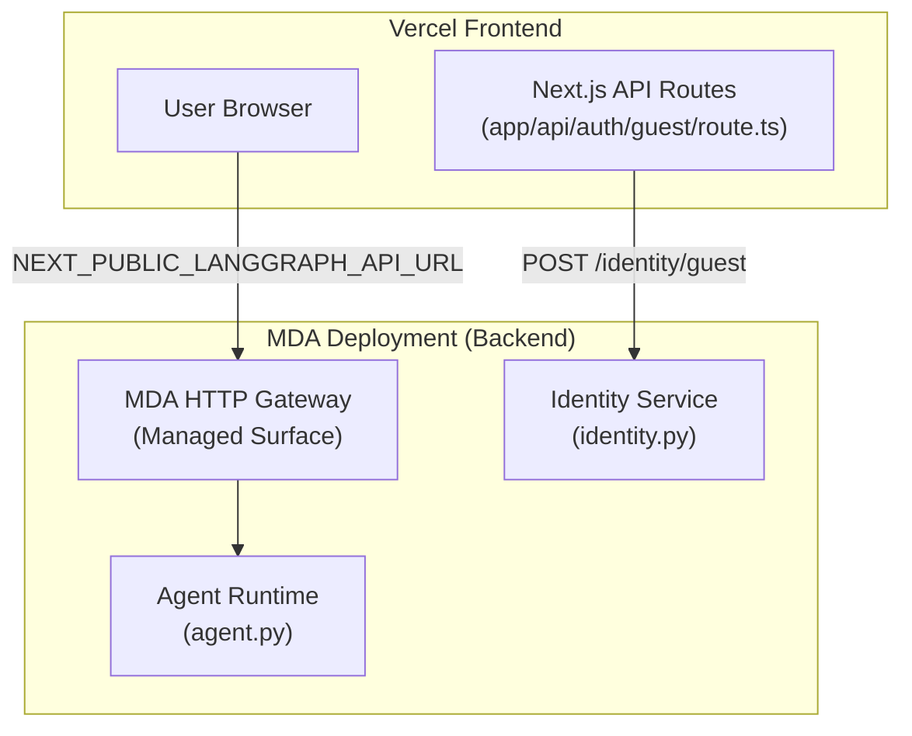
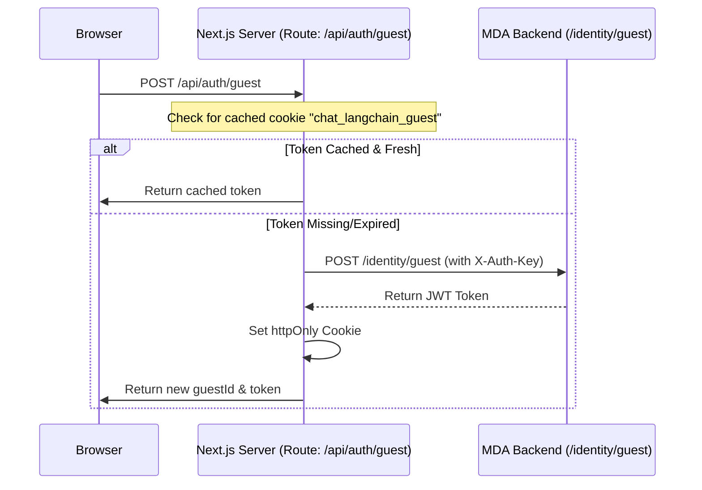

<!-- source: DeepWiki mcp.deepwiki.com · repo langchain-ai/chat-langchain · page 4.2 Frontend Deployment · fetched 2026-10-26 -->

# Frontend Deployment

Relevant source files

The following files were used as context for generating this wiki page:

- [frontend/.env.local.example](frontend/.env.local.example)
- [frontend/app/api/auth/guest/route.ts](frontend/app/api/auth/guest/route.ts)
- [frontend/package-lock.json](frontend/package-lock.json)
- [frontend/package.json](frontend/package.json)
- [frontend/tsconfig.json](frontend/tsconfig.json)

This page details the deployment process for the Chat-LangChain Next.js frontend, specifically focusing on its hosting on Vercel, environment configuration, and its connection to the Managed Deep Agent (MDA) backend.

## Deployment Architecture

The frontend is a Next.js application [frontend/package.json:59]() deployed to Vercel. It acts as a thin client that communicates with a Managed Deep Agent (MDA) deployment for all agentic reasoning, document retrieval, and identity management.

**Frontend to MDA Connection Flow**

Sources: [frontend/app/api/auth/guest/route.ts:8-11](), [frontend/package.json:7]()

## Environment Configuration

Frontend configuration is managed via environment variables. A template for these variables is provided in `frontend/.env.local.example`.

### Core Connectivity
The primary variable for connecting the frontend to the backend is `NEXT_PUBLIC_LANGGRAPH_API_URL`. This URL points to the MDA deployment's HTTP surface.

### Multi-Region Supabase Auth
The frontend supports optional authentication via Supabase, configured for multiple regions (US, EU, APAC, AWS) to match the MDA identity contract.

| Variable | Purpose |
|----------|---------|
| `NEXT_PUBLIC_SUPABASE_URL` | Default (US) Supabase project URL |
| `NEXT_PUBLIC_SUPABASE_ANON_KEY` | Default (US) Supabase anonymous key |
| `NEXT_PUBLIC_SUPABASE_EU_URL` | EU region Supabase project URL |
| `NEXT_PUBLIC_SUPABASE_APAC_URL` | APAC region Supabase project URL |
| `NEXT_PUBLIC_SUPABASE_AWS_URL` | AWS-specific region Supabase project URL |

Sources: [frontend/.env.local.example:1-13](), [frontend/app/api/auth/guest/route.ts:8-11]()

## Development Scripts

The `package.json` defines specific scripts to handle different backend connectivity scenarios during development.

| Script | Command | Purpose |
|--------|---------|---------|
| `dev` | `next dev` | Standard Next.js development server. |
| `dev:local` | `cross-env NEXT_PUBLIC_LANGGRAPH_API_URL=http://127.0.0.1:2024 next dev` | Connects the frontend to a locally running MDA instance (started via `mda dev .`). |
| `dev:remote` | `next dev -p 3001` | Runs the frontend on port 3001, typically used when testing against a deployed MDA staging/prod instance. |

Sources: [frontend/package.json:5-8]()

## Identity and Guest Token Issuance

The frontend implements a managed guest identity flow. Instead of managing guest users locally, it calls the MDA backend to issue a guest JWT.

**Guest Token Data Flow**

### Implementation Details
*   **Route Handler**: The logic resides in `frontend/app/api/auth/guest/route.ts` [frontend/app/api/auth/guest/route.ts:64-105]().
*   **Managed Endpoint**: The frontend calls `issueManagedGuestToken`, which targets the `${DEPLOYMENT_URL}/identity/guest` endpoint [frontend/app/api/auth/guest/route.ts:40-62]().
*   **Token Persistence**: Tokens are stored in a `httpOnly` cookie named `chat_langchain_guest` [frontend/app/api/auth/guest/route.ts:4-97]().
*   **JWT Handling**: The frontend decodes claims (like `sub` and `exp`) using `decodeJwtClaims` to determine if a token is still fresh [frontend/app/api/auth/guest/route.ts:20-38]().

Sources: [frontend/app/api/auth/guest/route.ts:4-105]()

## Build and Deployment Steps

1.  **Build**: The project uses `next build` to create a production-optimized bundle [frontend/package.json:9]().
2.  **Vercel Deployment**:
    *   The repository is linked to a Vercel project.
    *   Environment variables from `.env.local.example` must be configured in the Vercel Dashboard.
    *   Vercel automatically handles the deployment of Next.js API routes (like the guest auth route) as serverless functions.

Sources: [frontend/package.json:9-12]()

---

