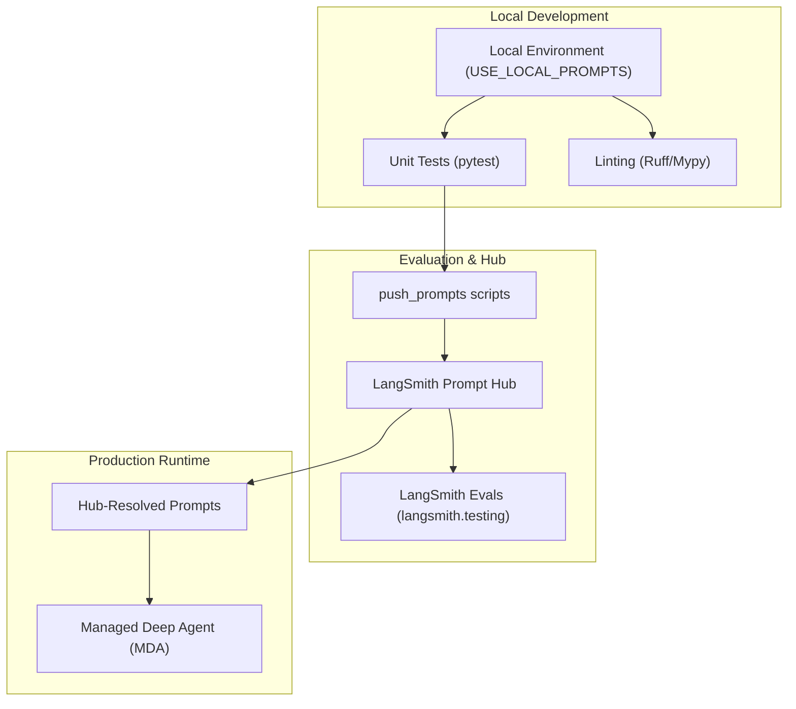
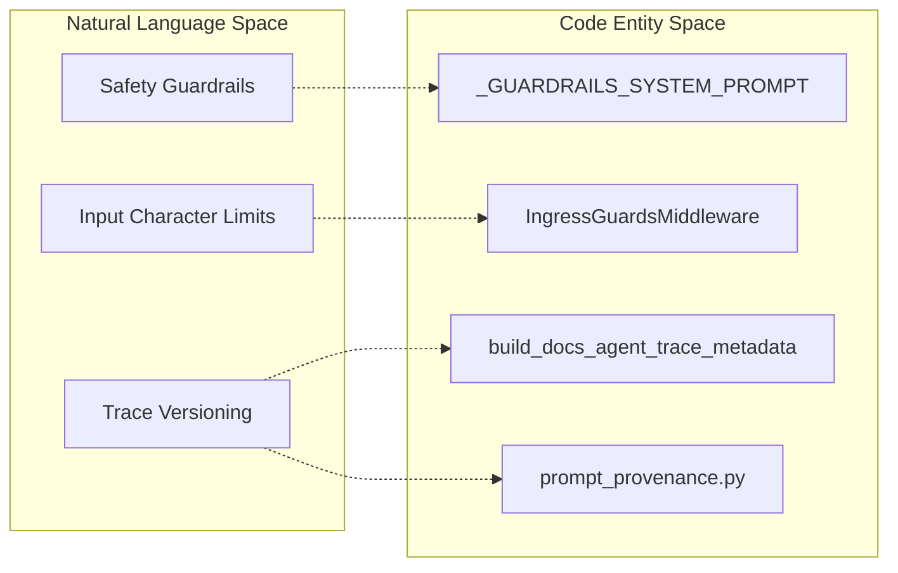

<!-- source: DeepWiki mcp.deepwiki.com · repo langchain-ai/chat-langchain · page 5 Development and Testing · fetched 2026-10-26 -->

# Development and Testing

Relevant source files

The following files were used as context for generating this wiki page:

- [pyproject.toml](pyproject.toml)
- [tests/__init__.py](tests/__init__.py)
- [tests/evals/__init__.py](tests/evals/__init__.py)
- [tests/evals/test_guardrails_scope.py](tests/evals/test_guardrails_scope.py)
- [tests/unit/test_ingress_guards_middleware.py](tests/unit/test_ingress_guards_middleware.py)

This document provides an overview of the testing strategy, evaluation frameworks, and development utilities for the Chat LangChain system. The project utilizes the Managed Deep Agent (MDA) framework, integrating automated unit testing, LangSmith-driven evaluations, and specialized scripts for prompt management.

For details on specific testing areas, see the following child pages:
- [Unit Tests](#5.1) — Detailed documentation of the unit test suite covering link validation, guardrails, and middleware.
- [Evaluation Tests](#5.2) — Documentation for LangSmith-integrated evaluations focusing on classification accuracy and agent behavior.
- [Development Utilities and Scripts](#5.3) — Guide to prompt management scripts, trace metadata utilities, and code quality standards.

## Testing Strategy Overview

The testing strategy is divided into local unit tests for functional verification and remote evaluation tests for LLM performance and safety. The environment is configured via `pyproject.toml`, which defines development dependencies such as `pytest`, `ruff`, and `mypy` [pyproject.toml:69-77]().

### Development to Production Flow

Sources: [pyproject.toml:45-77](), [tests/unit/test_ingress_guards_middleware.py:10-16]()

## Unit Testing

The unit test suite ensures the reliability of the agent's infrastructure components. Key areas include input capping via `IngressGuardsMiddleware`, which truncates messages exceeding `MAX_MESSAGE_CHARS` [tests/unit/test_ingress_guards_middleware.py:12-30](), and prompt provenance tracking.

The `build_docs_agent_trace_metadata` utility is tested to ensure that LangSmith traces correctly identify whether prompts were loaded from the local filesystem or the LangSmith Hub [tests/unit/test_ingress_guards_middleware.py:39-56]().

For details, see [Unit Tests](#5.1).

## Evaluation Framework

Evaluation tests utilize `langsmith.testing` to verify the agent's reasoning and safety guardrails. A primary focus is the `GuardrailsMiddleware`, which uses `_GUARDRAILS_SYSTEM_PROMPT` to classify and block out-of-scope queries, such as pure data science questions (e.g., pandas, numpy) that lack LangChain context [tests/evals/test_guardrails_scope.py:22-61]().

### Evaluation Mapping

| Component | Test File | Target Entity |
| :--- | :--- | :--- |
| **Guardrails** | `test_guardrails_scope.py` | `_GUARDRAILS_SYSTEM_PROMPT` |
| **Retry Logic** | `test_retry_middleware_wiring.py` | `ToolRetryMiddleware`, `ModelRetryMiddleware` |
| **Agent Logic** | `test_repeated_searches.py` | `docs_agent_prompt` |

For details, see [Evaluation Tests](#5.2).

## Development Utilities

The codebase includes several utilities to streamline development:
- **Prompt Management**: Scripts in `scripts/` (e.g., `push_docs_agent_prompt.py`) allow developers to publish local prompt changes to the LangSmith Hub.
- **Trace Metadata**: `trace_root_metadata.py` attaches versioning information (e.g., `LANGCHAIN_REVISION_ID`) to LangSmith runs [tests/unit/test_ingress_guards_middleware.py:39-63]().
- **Local Development Flag**: The `USE_LOCAL_PROMPTS` environment variable allows bypassing the Hub to test prompt changes locally [tests/unit/test_ingress_guards_middleware.py:10]().

For details, see [Development Utilities and Scripts](#5.3).

## System Entity Bridge

This diagram maps high-level development concepts to the specific code entities that implement them.

Sources: [tests/evals/test_guardrails_scope.py:15-16](), [tests/unit/test_ingress_guards_middleware.py:12-16]()

---

