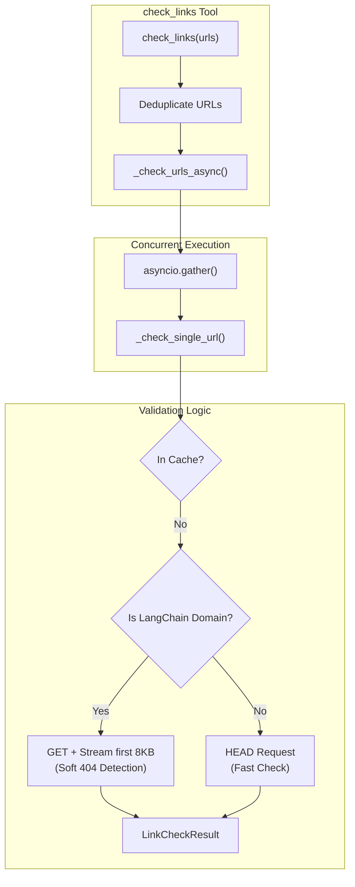
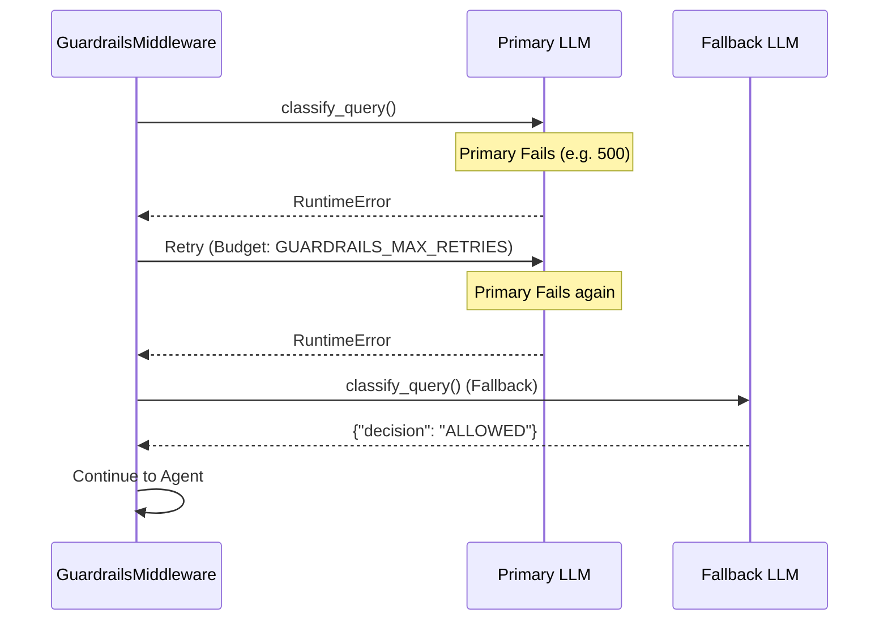

<!-- source: DeepWiki mcp.deepwiki.com · repo langchain-ai/chat-langchain · page 5.1 Unit Tests · fetched 2026-10-26 -->

# Unit Tests

Relevant source files

The following files were used as context for generating this wiki page:

- [src/middleware/retry_middleware.py](src/middleware/retry_middleware.py)
- [src/middleware/summarization_middleware.py](src/middleware/summarization_middleware.py)
- [src/tools/link_check_tools.py](src/tools/link_check_tools.py)
- [src/tools/pylon_tools.py](src/tools/pylon_tools.py)
- [tests/unit/__init__.py](tests/unit/__init__.py)
- [tests/unit/test_check_links_async.py](tests/unit/test_check_links_async.py)
- [tests/unit/test_guardrails_fallback.py](tests/unit/test_guardrails_fallback.py)
- [tests/unit/test_ingress_guards_middleware.py](tests/unit/test_ingress_guards_middleware.py)
- [tests/unit/test_prompt_provenance.py](tests/unit/test_prompt_provenance.py)
- [tests/unit/test_pylon_pagination.py](tests/unit/test_pylon_pagination.py)

This page documents the unit test suite for the Chat-LangChain backend. These tests focus on validating core logic, middleware behavior, tool reliability, and prompt resolution without requiring live network access or full agent execution.

## Overview

The unit tests are located in the `tests/unit/` directory and use `pytest` as the primary runner. They extensively use `unittest.mock` to patch external dependencies such as HTTP clients (HTTpx, Requests) and LangSmith Hub clients.

| Test File | Primary Focus | Key Entities Tested |
|:---|:---|:---|
| `test_check_links_async.py` | URL validation tool | `check_links`, `_check_urls_async` |
| `test_guardrails_fallback.py` | Guardrails reliability | `GuardrailsMiddleware`, `_classify_query` |
| `test_ingress_guards_middleware.py` | Input capping & metadata | `IngressGuardsMiddleware`, `build_docs_agent_trace_metadata` |
| `test_prompt_provenance.py` | Hub vs Local prompt loading | `get_prompt_provenance`, `_resolve_hub_provenance` |
| `test_pylon_pagination.py` | Knowledge Base pagination | `_fetch_all_articles` |

**Sources:** [tests/unit/test_check_links_async.py:1-9](), [tests/unit/test_guardrails_fallback.py:1-2]()

---

## Link Validation (`check_links`)

The `check_links` tool validates URLs before they are presented to the user. A critical requirement is that it must function correctly in both synchronous contexts (like simple scripts) and asynchronous contexts (like LangGraph agent nodes).

### Implementation Details
The tool was transitioned to an `async def` to prevent `RuntimeError: This event loop is already running` when invoked inside an existing `asyncio` loop [tests/unit/test_check_links_async.py:3-5]().

### Data Flow: Link Checking

**Key Tests:**
- **Async Context:** Verifies `check_links.acall` does not raise `RuntimeError` when awaited [tests/unit/test_check_links_async.py:78-102]().
- **Sync Context:** Verifies `check_links.invoke` works in standard synchronous environments [tests/unit/test_check_links_async.py:134-154]().
- **Soft 404 Detection:** Validates that pages returning HTTP 200 but containing "Page Not Found" text are marked invalid [src/tools/link_check_tools.py:59-70]().

**Sources:** [src/tools/link_check_tools.py:183-202](), [src/tools/link_check_tools.py:72-145](), [tests/unit/test_check_links_async.py:105-126]()

---

## Guardrails & Fallback Behavior

The `GuardrailsMiddleware` performs topic classification. To ensure high availability, it implements a multi-model fallback strategy with individual retry budgets.

### Fallback Logic
If the primary classifier (e.g., Gemini) fails or returns a malformed response, the middleware falls back to a secondary model (e.g., GPT-4o).

**Key Tests:**
- **Retry Exhaustion:** Confirms the fallback model receives its own fresh retry budget after the primary model fails [tests/unit/test_guardrails_fallback.py:44-61]().
- **Fail-Open Mechanism:** If all classification models fail (e.g., global API outage), the middleware defaults to `off_topic_query: False` to avoid blocking the user [tests/unit/test_guardrails_fallback.py:82-98]().

**Sources:** [src/middleware/guardrails_middleware.py:1-20](), [tests/unit/test_guardrails_fallback.py:63-80]()

---

## Ingress Guards & Metadata

The `IngressGuardsMiddleware` acts as the first line of defense, enforcing hard limits on user input size to prevent context window overflow or excessive costs.

### Input Truncation
The middleware checks the `HumanMessage` in the state. If the content exceeds `MAX_MESSAGE_CHARS` (currently 30,000), it truncates the text and updates the message [tests/unit/test_ingress_guards_middleware.py:12-30]().

### Trace Metadata
The `build_docs_agent_trace_metadata` function aggregates environment variables (like `LANGCHAIN_REVISION_ID`) and prompt sources to tag LangSmith traces correctly [tests/unit/test_ingress_guards_middleware.py:39-56]().

**Sources:** [src/middleware/ingress_guards_middleware.py:1-20](), [src/utils/trace_root_metadata.py:1-20]()

---

## Pylon KB Pagination

The `search_support_articles` tool fetches data from the Pylon API. Because Pylon limits results per page, the `_fetch_all_articles` function implements recursive pagination.

### Pagination Logic
- **Cursors:** The function checks for cursors in `body["next"]`, `body["meta"]["next"]`, or `body["links"]["next"]` [src/tools/pylon_tools.py:109-114]().
- **Safety Cap:** To prevent infinite loops in case of API errors, the fetcher is hard-capped at 10 pages (~1000 articles) [src/tools/pylon_tools.py:95-99]().

**Key Tests:**
- **Multi-page Collection:** Mocks a sequence of HTTP responses to ensure articles from Page 1 and Page 2 are combined into a single list [tests/unit/test_pylon_pagination.py:81-96]().
- **Cache Integrity:** Verifies that once articles are fetched, subsequent calls return the cached list without making new HTTP requests [tests/unit/test_pylon_pagination.py:161-175]().

**Sources:** [src/tools/pylon_tools.py:79-122](), [tests/unit/test_pylon_pagination.py:143-155]()

---

## Prompt Provenance

The system supports loading prompts from either the **LangSmith Hub** (production) or **local files** (development). The `get_prompt_provenance` utility identifies the source and version of the prompts currently in use.

### Resolution Logic
If `USE_LOCAL_PROMPTS` is set to `"1"`, the system ignores the Hub and loads from `instructions.md`. Otherwise, it attempts to pull from the Hub and extract the `lc_hub_commit_hash` [src/utils/prompt_provenance.py:1-40]().

**Key Tests:**
- **Local Mode:** Asserts that when `_USE_LOCAL_PROMPTS` is True, the source is reported as `local:instructions.md` [tests/unit/test_prompt_provenance.py:13-22]().
- **Hub Resolution:** Mocks the `langsmith.Client` to verify that the `workspace_id` and `api_key` are correctly passed when pulling production prompts [tests/unit/test_prompt_provenance.py:24-59]().

**Sources:** [src/utils/prompt_provenance.py:45-80](), [tests/unit/test_prompt_provenance.py:61-84]()

---

