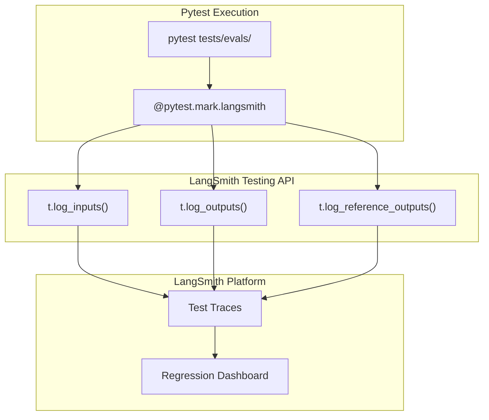
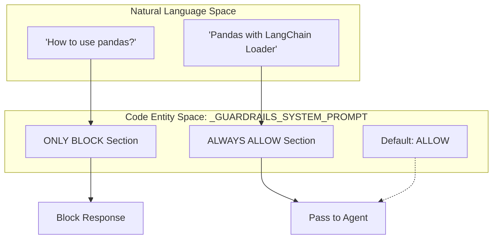
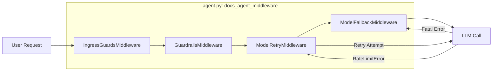

<!-- source: DeepWiki mcp.deepwiki.com · repo langchain-ai/chat-langchain · page 5.2 Evaluation Tests · fetched 2026-10-26 -->

# Evaluation Tests

Relevant source files

The following files were used as context for generating this wiki page:

- [instructions.md](instructions.md)
- [src/prompts/docs_agent_prompt.py](src/prompts/docs_agent_prompt.py)
- [tests/__init__.py](tests/__init__.py)
- [tests/evals/__init__.py](tests/evals/__init__.py)
- [tests/evals/test_guardrails_scope.py](tests/evals/test_guardrails_scope.py)
- [tests/evals/test_repeated_searches.py](tests/evals/test_repeated_searches.py)
- [tests/evals/test_retry_middleware_wiring.py](tests/evals/test_retry_middleware_wiring.py)

The evaluation test suite provides automated quality assessment for the Chat LangChain system, focusing on guardrail accuracy, tool usage efficiency, and middleware configuration. These tests leverage `langsmith.testing` to log inputs, outputs, and reference expectations directly to LangSmith for experiment tracking and regression monitoring.

## Overview

The evaluation framework shifted from testing simple RAG chains to validating the behavior of the **Managed Deep Agent (MDA)**. The tests are located in `tests/evals/` and primarily target the system's ability to remain in-scope, avoid redundant operations, and maintain a robust retry/fallback architecture.

| Test File | Target | Purpose |
| :--- | :--- | :--- |
| `test_guardrails_scope.py` | `GuardrailsMiddleware` | Verifies classification logic for blocking out-of-scope (e.g., pure Data Science) queries. |
| `test_repeated_searches.py` | `docs_agent_prompt` | Ensures the agent is instructed to check history and avoid duplicate tool calls. |
| `test_retry_middleware_wiring.py` | `ModelRetryMiddleware` | Validates the wiring of the retry stack in the MDA entrypoint. |

## LangSmith Integration

The evaluation suite uses the `@pytest.mark.langsmith` decorator to automatically sync test results with the LangSmith platform. Key utilities from `langsmith.testing` (aliased as `t`) are used to record execution metadata.

Sources: [tests/evals/test_retry_middleware_wiring.py:3-10](), [tests/evals/test_repeated_searches.py:1-6]()

## Guardrails Scope Evaluation

The `test_guardrails_scope.py` suite validates that the `GuardrailsMiddleware` correctly identifies and blocks queries related to general data science libraries (e.g., `pandas`, `numpy`, `pytorch`) unless they are explicitly linked to a LangChain integration context.

### Classification Logic Validation
The tests inspect the `_GUARDRAILS_SYSTEM_PROMPT` to ensure specific criteria are met:
1.  **Mention of Restrictions**: The prompt must explicitly contain "pandas" or "data science" to inform the LLM classifier of the restricted domain [tests/evals/test_guardrails_scope.py:43-61]().
2.  **Explicit Block Criterion**: The `ONLY BLOCK` section of the prompt must include a list of pure DS libraries [tests/evals/test_guardrails_scope.py:69-93]().
3.  **Contextual Allowance**: The prompt must clarify that these libraries are allowed *only* when the query involves LangChain integration (e.g., using pandas for a Document Loader) [tests/evals/test_guardrails_scope.py:101-126]().

### Guardrails Prompt Structure

Sources: [src/middleware/guardrails_middleware.py:15-15](), [tests/evals/test_guardrails_scope.py:15-16](), [tests/evals/test_guardrails_scope.py:149-164]()

## Repeated Search Evaluation

Efficiency is managed via the `docs_agent_prompt`, which contains instructions to prevent the agent from performing redundant tool calls that lead to context overflow and increased latency.

### Instruction Verification
The `test_repeated_searches.py` suite performs string analysis on the `docs_agent_prompt` to ensure the presence of anti-repetition guidance:
*   **Avoid Repeat Searches**: Checks for keywords like "do not re-search", "avoid repeat", or "already retrieved" [tests/evals/test_repeated_searches.py:7-32]().
*   **Check History First**: Ensures the agent is explicitly told to look at the conversation history before invoking search tools [tests/evals/test_repeated_searches.py:36-64]().

### Search Workflow Control
The `docs_agent_prompt` enforces a "Search-then-Read" pattern while maintaining cache efficiency through query extraction rules [src/prompts/docs_agent_prompt.py:39-50]().

| Instruction Type | Code Implementation | Purpose |
| :--- | :--- | :--- |
| **Parallel Execution** | `docs_agent_prompt` lines 15-16 | Search and Read tools must be called in parallel for speed. |
| **Cache Efficiency** | `docs_agent_prompt` lines 43-49 | Extract core nouns only (singular, lowercase) to maximize cache hits. |
| **History Awareness** | `docs_agent_prompt` lines 20-20 | Read the current page first if the user is viewing one. |

Sources: [src/prompts/docs_agent_prompt.py:12-20](), [tests/evals/test_repeated_searches.py:3-3]()

## Middleware Wiring Evaluation

The `test_retry_middleware_wiring.py` suite ensures that the reliability components are correctly instantiated and ordered within the MDA stack.

### Wiring Verification
1.  **Stack Inclusion**: `test_retry_middleware_is_in_agent_middleware_list` verifies that `ModelRetryMiddleware` is present in the `docs_agent_middleware` list defined in `agent.py` [tests/evals/test_retry_middleware_wiring.py:11-23]().
2.  **Config Export**: `test_retry_middleware_config_is_exported` ensures the singleton instance is correctly exported from `src.agent.config` [tests/evals/test_retry_middleware_wiring.py:26-35]().

### Middleware Data Flow

Sources: [agent.py:5-5](), [src/middleware/retry_middleware.py:7-7](), [tests/evals/test_retry_middleware_wiring.py:16-20]()

---

