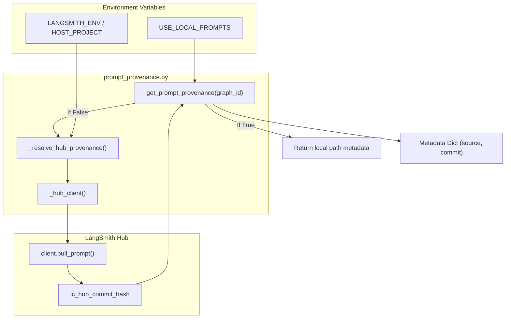
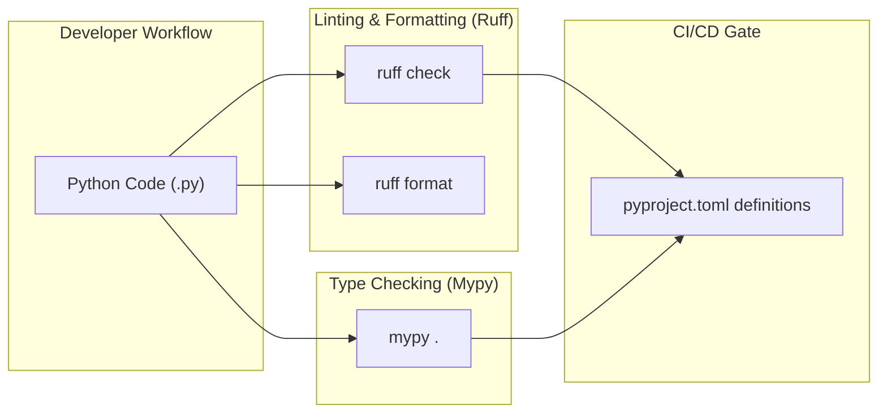

<!-- source: DeepWiki mcp.deepwiki.com · repo langchain-ai/chat-langchain · page 5.3 Development Utilities and Scripts · fetched 2026-10-26 -->

# Development Utilities and Scripts

Relevant source files

The following files were used as context for generating this wiki page:

- [pyproject.toml](pyproject.toml)
- [scripts/push_docs_agent_prompt.py](scripts/push_docs_agent_prompt.py)
- [scripts/push_guardrails_prompt.py](scripts/push_guardrails_prompt.py)
- [src/utils/prompt_provenance.py](src/utils/prompt_provenance.py)
- [src/utils/trace_root_metadata.py](src/utils/trace_root_metadata.py)

This page documents the utility scripts, internal tools, and code quality standards used to maintain the `chat-langchain` codebase. These utilities facilitate prompt management via the LangSmith Hub, metadata tagging for observability, and automated code linting.

## Prompt Management Scripts

The system manages its primary instructions and guardrails through the LangSmith Prompt Hub. Two dedicated scripts in the `scripts/` directory allow developers to push local prompt changes to the Hub for versioning and staging.

### Docs Agent Prompt Publisher
The script `scripts/push_docs_agent_prompt.py` takes the local string definition of the main agent instructions and publishes it to the `public-chat-langchain-test` repository on LangSmith.

- **Implementation**: It wraps the raw string from `src.prompts.docs_agent_prompt` into a `ChatPromptTemplate` containing a single `SystemMessage` [scripts/push_docs_agent_prompt.py:10-17]().
- **Output**: Upon successful push, it writes the LangSmith Hub URL to stdout [scripts/push_docs_agent_prompt.py:18-18]().

### Guardrails Prompt Publisher
The script `scripts/push_guardrails_prompt.py` performs an identical operation for the guardrails system.

- **Implementation**: It pulls the `guardrails_system_prompt` from `src.prompts.guardrails_prompts` and pushes it to the `public-chat-langchain-guardrails-test` repository [scripts/push_guardrails_prompt.py:10-21]().

**Sources**: [scripts/push_docs_agent_prompt.py:1-22](), [scripts/push_guardrails_prompt.py:1-26]()

---

## Prompt Provenance and Resolution

The `src/utils/prompt_provenance.py` module manages the resolution of prompts between local development files and the LangSmith Hub. It also tracks "provenance" (version metadata) for LangSmith traces.

### Resolution Logic
The system determines which prompt source to use based on the `USE_LOCAL_PROMPTS` environment flag and the current deployment environment.

| Feature | Local Resolution (`USE_LOCAL_PROMPTS=true`) | Remote Resolution (Default) |
| :--- | :--- | :--- |
| **Source** | `local:instructions.md` [src/utils/prompt_provenance.py:105-105]() | `hub:public-chat-langchain-test` [src/utils/prompt_provenance.py:89-89]() |
| **Environment** | N/A | Switches between `:staging` and `:production` tags [src/utils/prompt_provenance.py:28-41]() |

### Data Flow: Prompt Metadata Resolution

**Sources**: [src/utils/prompt_provenance.py:19-41](), [src/utils/prompt_provenance.py:101-129]()

---

## Trace Metadata and Observability

To ensure high-quality observability in LangSmith, the `src/utils/trace_root_metadata.py` module aggregates deployment and prompt metadata to be attached to the root of every agent execution.

### `build_docs_agent_trace_metadata`
This function constructs a dictionary that identifies the agent version and the specific prompts used.

- **System Identification**: Sets `source_type` to `"Chat-LangChain"` [src/utils/trace_root_metadata.py:23-23]().
- **Version Tracking**: Captures `LANGCHAIN_REVISION_ID` or `LANGSMITH_HOST_REVISION_ID` to tag the specific deployment version [src/utils/trace_root_metadata.py:26-30]().
- **Prompt Linkage**: Calls `get_prompt_provenance` to include the Hub commit hashes in the trace metadata [src/utils/trace_root_metadata.py:24-24]().

**Sources**: [src/utils/trace_root_metadata.py:1-34](), [src/utils/prompt_provenance.py:101-127]()

---

## Code Quality Standards

The project enforces strict linting and type-checking standards via `ruff` and `mypy`, as defined in `pyproject.toml`.

### Ruff Configuration
Ruff is used for both linting and import sorting.
- **Rules**: Includes `E` (pycodestyle), `F` (pyflakes), `I` (isort), and `D` (pydocstyle) [pyproject.toml:46-54]().
- **Docstrings**: Enforces the **Google** docstring convention [pyproject.toml:66-67]().
- **Ignores**: Relaxes requirements for type-hinting imports (`UP035`) and documentation for every single function parameter (`D417`) [pyproject.toml:55-63]().

### Mypy Configuration
Static type checking is required for all `src/` files. The project depends on `mypy>=1.11.1` [pyproject.toml:29-29]().

### Code Quality Interaction

**Sources**: [pyproject.toml:45-77]()

---

## Development Flags Summary

| Flag | Purpose | Implementation Detail |
| :--- | :--- | :--- |
| `USE_LOCAL_PROMPTS` | Forces the agent to use local `.md` or `.py` files instead of fetching from LangSmith Hub. | Checked in `prompt_provenance.py` [src/utils/prompt_provenance.py:19-23](). |
| `LANGSMITH_ENV` | When set to `"dev"`, the system targets `:staging` prompt tags instead of `:production`. | Logic in `_USE_STAGING` [src/utils/prompt_provenance.py:24-27](). |
| `LANGSMITH_PROMPT_API_KEY` | Allows the agent to pull prompts from a different LangSmith workspace than the one used for tracing. | Used in `_hub_client` [src/utils/prompt_provenance.py:50-65](). |

**Sources**: [src/utils/prompt_provenance.py:12-27](), [src/utils/prompt_provenance.py:50-65]()

---

