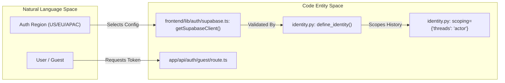
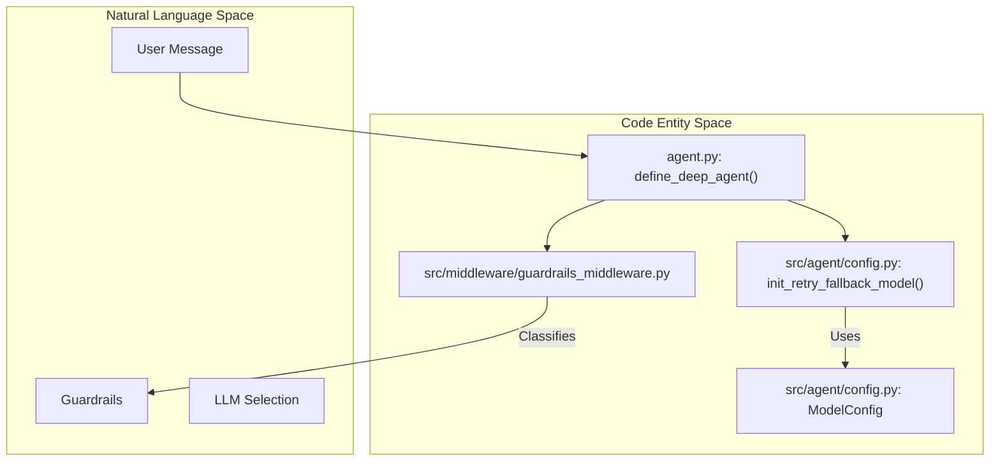

<!-- source: DeepWiki mcp.deepwiki.com · repo langchain-ai/chat-langchain · page 6 Glossary · fetched 2026-10-26 -->

# Glossary

Relevant source files

The following files were used as context for generating this wiki page:

- [.gitignore](.gitignore)
- [README.md](README.md)
- [frontend/app/api/auth/guest/route.ts](frontend/app/api/auth/guest/route.ts)
- [frontend/lib/auth/supabase.ts](frontend/lib/auth/supabase.ts)
- [frontend/package-lock.json](frontend/package-lock.json)
- [frontend/package.json](frontend/package.json)
- [identity.py](identity.py)
- [instructions.md](instructions.md)
- [src/agent/config.py](src/agent/config.py)
- [src/middleware/guardrails_middleware.py](src/middleware/guardrails_middleware.py)
- [src/prompts/docs_agent_prompt.py](src/prompts/docs_agent_prompt.py)
- [tests/evals/test_repeated_searches.py](tests/evals/test_repeated_searches.py)
- [tests/unit/test_summarization_middleware_wiring.py](tests/unit/test_summarization_middleware_wiring.py)

This glossary defines codebase-specific terms, jargon, and domain concepts for the `chat-langchain` repository. The system has transitioned to a **Managed Deep Agent (MDA)** architecture, which significantly changes how identity, connectors, and deployment are handled compared to standard LangGraph applications.

## Managed Deep Agent (MDA) Concepts

### Managed Deep Agent (MDA)
A deployment framework where the runtime owns the HTTP surface, identity verification, and infrastructure (checkpointers, connectors). In this codebase, the agent is defined via `define_deep_agent` in `agent.py` rather than a raw FastAPI or LangGraph Cloud setup.
**Sources:** [agent.py:64](), [README.md:129-145]()

### MDA Identity Contract
Defined in `identity.py`, this contract specifies how the agent identifies users. It supports multi-region Supabase authentication and a custom guest token system. The MDA runtime auto-discovers this file to handle ingress security.
**Sources:** [identity.py:1-62]()

### Guest Token
A short-lived JWT (default 24h) issued by the MDA runtime via the `POST /identity/guest` endpoint. It allows anonymous users to interact with the agent while maintaining thread persistence.
**Sources:** [identity.py:46-48](), [frontend/app/api/auth/guest/route.ts:1-20]()

### Managed Connector
A specialized integration pattern where the MDA runtime manages the lifecycle and credentials of external services.
*   **LangSmith Connector**: Proxies feedback and trace requests so `LANGSMITH_API_KEY` is never exposed to the browser.
*   **MCP Connector**: Attaches Model Context Protocol tools (e.g., documentation search) to the agent.
**Sources:** [connectors/langsmith.py:1-40](), [connectors/mcp.py:1-13](), [README.md:95-97]()

## Agent Logic & Middleware

### Middleware Stack
A sequence of `AgentMiddleware` classes that process the `AgentState` before and after the LLM logic. The order is critical for safety and performance.
**Sources:** [agent.py:64]()

| Middleware | Role | File |
| :--- | :--- | :--- |
| `IngressGuardsMiddleware` | Enforces input character limits. | [src/middleware/ingress_guards_middleware.py:1-30]() |
| `GuardrailsMiddleware` | Classifies queries as `ALLOWED` or `BLOCKED`. | [src/middleware/guardrails_middleware.py:100-134]() |
| `CustomSummarizationMiddleware` | Compresses history when token limits are hit. | [src/middleware/summarization_middleware.py:1-50]() |
| `ToolRetryMiddleware` | Automatically retries failed tool calls. | [src/middleware/tool_retry_middleware.py:1-25]() |
| `ModelFallbackMiddleware` | Switches models (e.g., Gemini to GPT) on failure. | [src/agent/config.py:138-139]() |

### Docs-First Research Strategy
The core behavioral loop where the agent is strictly instructed to search and read official documentation before answering technical questions, rather than relying on internal model knowledge.
**Sources:** [src/prompts/docs_agent_prompt.py:11-26](), [instructions.md:11-26]()

### Link Validation
The process of verifying that URLs generated by the LLM are actually reachable and valid before the final response is sent to the user, performed by the `check_links` tool.
**Sources:** [src/tools/link_check_tools.py:1-40](), [agent.py:64]()

## System Entity Mapping

The following diagrams bridge the gap between Natural Language concepts and the specific Code Entities used in the implementation.

### Identity & Auth Mapping
"How the system maps user identity to code entities."

**Sources:** [identity.py:58-62](), [frontend/lib/auth/supabase.ts:120-140](), [frontend/app/api/auth/guest/route.ts:1-10]()

### Middleware & Execution Flow
"How a query traverses the backend components."

**Sources:** [agent.py:64](), [src/middleware/guardrails_middleware.py:100-134](), [src/agent/config.py:28-65](), [src/agent/config.py:120-127]()

## Domain Specific Terms

*   **Pylon KB**: A knowledge base of support articles accessed via `search_support_articles`. Used to complement official documentation with community-solved issues.
    *   **Sources:** [src/tools/pylon_tools.py:1-50]()
*   **Prompt Hub**: The LangSmith feature used to host and version prompts. The agent pulls prompts like `public-chat-langchain-guardrails-test` at runtime unless `USE_LOCAL_PROMPTS` is set.
    *   **Sources:** [src/middleware/guardrails_middleware.py:72-98](), [src/prompts/docs_agent_prompt.py:1-5]()
*   **AuthRegion**: A type representing the geographic deployment of Supabase (`us`, `eu`, `apac`, `aws`).
    *   **Sources:** [frontend/lib/auth/supabase.ts:6-13]()
*   **Thread Scoping**: The mechanism in MDA where `threads` are tied to an `actor` (user ID or guest ID), ensuring users can only see their own chat history.
    *   **Sources:** [identity.py:61-62]()