# Page: Overview

# Overview

<details>
<summary>Relevant source files</summary>

The following files were used as context for generating this wiki page:

- [.gitignore](.gitignore)
- [README.md](README.md)
- [agent.py](agent.py)
- [pyproject.toml](pyproject.toml)

</details>


## Purpose and Scope

This document provides a high-level introduction to the **chat-langchain** repository, a production-ready documentation assistant designed to answer questions about the LangChain ecosystem (LangChain, LangGraph, and LangSmith). The system is built on the **Managed Deep Agent (MDA)** framework, which provides managed deployment, identity, and connectors.

For detailed information about specific subsystems:
- Architectural components and MDA runtime: see [System Architecture](#1.1)
- Dependencies and directory structure: see [Dependencies and Project Structure](#1.2)
- Domain-specific terms and concepts: see [Key Concepts and Terminology](#1.3)

Sources: [README.md:1-18](), [pyproject.toml:1-4]()

## What is Chat LangChain?

Chat LangChain is a specialized AI agent that implements a "docs-first" research strategy to provide accurate answers derived from official documentation and support knowledge bases.

**Key Characteristics:**

| Aspect | Description |
|--------|-------------|
| **Domain** | Answers questions specifically about LangChain, LangSmith, and LangGraph. |
| **Framework** | Built using `managed-deepagents` for deployment and `langgraph` for orchestration. |
| **Identity** | Managed multi-region Supabase authentication and guest token issuance. |
| **Connectors** | Uses Managed MCP for documentation search and LangSmith for trace proxying. |
| **Guardrails** | Integrated topic classification to prevent off-topic interactions. |

Sources: [README.md:9-25](), [agent.py:31-64](), [pyproject.toml:24-24]()

## Core System Architecture

The system consists of a Next.js frontend and a Python-based agent deployed as a Managed Deep Agent. Unlike previous iterations using LangGraph Cloud and Weaviate, this architecture leverages MDA to own identity, ingress, and tool connectors.

### Component Overview

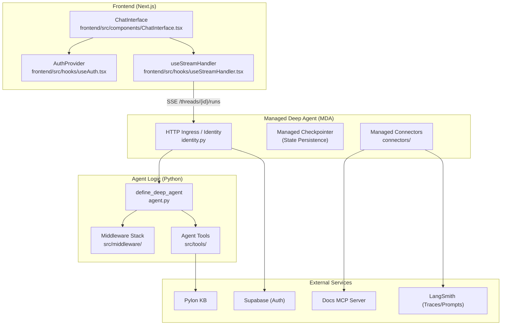

**System Responsibilities:**

| Layer | Technology | Primary Responsibility |
|-------|-----------|------------------------|
| **Frontend** | Next.js, LangGraph SDK | UI rendering, SSE streaming, and thread lifecycle management. |
| **MDA Runtime** | `managed-deepagents` | Handles Auth, guest tokens, tool lifecycle, and state persistence. |
| **Agent Logic** | LangGraph, Python | Orchestrates the docs-first research flow and applies guardrails. |
| **Connectors** | MCP, LangSmith | Provides secure access to documentation and observability tools. |

Sources: [agent.py:1-64](), [README.md:129-145](), [identity.py:1-20]()

## Data Flow: Docs-First Research

The agent follows a structured workflow to ensure responses are grounded in official documentation and verified links.

### The Agent Workflow

```mermaid
sequenceDiagram
    participant User
    participant Middleware["Middleware Stack<br/>(Guardrails/Ingress)"]
    participant Agent["Agent Entrypoint<br/>agent.py"]
    participant MCP["MCP Connector<br/>connectors/mcp.py"]
    participant Tools["Support Tools<br/>src/tools/"]
    
    User->>Agent: "How do I use LangGraph?"
    Agent->>Middleware: "Validate Input & Guardrails"
    Middleware-->>Agent: "Topic: LangChain (Allowed)"
    
    rect secondary
    Note over Agent, MCP: Research Phase
    Agent->>MCP: "search_docs(query)"
    MCP-->>Agent: "Documentation Chunks"
    Agent->>Tools: "search_support_articles()"
    Tools-->>Agent: "Pylon KB Results"
    end
    
    rect secondary
    Note over Agent, Tools: Validation Phase
    Agent->>Tools: "check_links(urls)"
    Tools-->>Agent: "Validated URL Status"
    end
    
    Agent->>User: "Final Response (Streamed)"
```

**Key Code Entities:**
- **Entrypoint:** `define_deep_agent` in [agent.py:53-64]().
- **Guardrails:** `GuardrailsMiddleware` in [src/middleware/guardrails_middleware.py]().
- **Docs Search:** `connectors/mcp.py` attaches LangChain docs via Managed MCP [agent.py:22-29]().
- **Link Validation:** `check_links` tool in [src/tools/link_check_tools.py]().

Sources: [README.md:117-126](), [agent.py:31-51]()

## Key Features

### 1. Managed Identity and Auth
The system uses `identity.py` to define an authentication contract. It supports multi-region Supabase providers and a custom guest token issuance via `POST /identity/guest`, allowing users to interact with the agent without a full account.
For details, see [System Architecture](#1.1).

Sources: [identity.py:1-20](), [README.md:136-138]()

### 2. Advanced Middleware Pipeline
The agent processes every request through an ordered stack:
- **IngressGuards:** Caps oversized input.
- **Guardrails:** Classifies topics and blocks off-topic queries.
- **Summarization:** Compresses long conversation history once a token threshold (e.g., 130k tokens) is reached.
- **Retries/Fallbacks:** Handles model and tool failures gracefully.
For details, see [Backend System](#2).

Sources: [agent.py:31-51](), [src/agent/config.py:5-12]()

### 3. Managed Connectors
Connectors allow the agent to interact with external services securely:
- **MCP Connector:** Dynamically attaches documentation search tools.
- **LangSmith Connector:** Proxies feedback and trace sharing so the browser never handles the `LANGSMITH_API_KEY`.
For details, see [Backend System](#2).

Sources: [connectors/mcp.py:1-10](), [connectors/langsmith.py:1-10](), [README.md:140-142]()

## Project Structure Overview

The repository is organized as a Python/Next.js monorepo:

- `agent.py`: The MDA entrypoint defining the agent, tools, and middleware.
- `identity.py`: The authentication and identity contract.
- `connectors/`: Managed connectors for MCP and LangSmith.
- `src/`: Core agent logic, including `middleware/`, `tools/`, and `prompts/`.
- `frontend/`: The Next.js application for the chat interface.

For a full directory breakdown, see [Dependencies and Project Structure](#1.2).

Sources: [README.md:89-115]()

---

# Page: System Architecture

# System Architecture

<details>
<summary>Relevant source files</summary>

The following files were used as context for generating this wiki page:

- [.gitignore](.gitignore)
- [README.md](README.md)
- [agent.py](agent.py)
- [connectors/langsmith.py](connectors/langsmith.py)
- [connectors/mcp.py](connectors/mcp.py)

</details>


## Purpose and Scope

This document describes the overall system architecture of the `chat-langchain` repository. The system has been migrated from a legacy LangGraph Cloud + Weaviate architecture to a **Managed Deep Agent (MDA)** runtime. This architecture leverages a "docs-first" research strategy, where a central agent orchestrates specialized tools and managed connectors to answer questions about the LangChain ecosystem.

For detailed information about:
- Backend implementation, middleware, and tools, see [Backend System]() (Section 2).
- Frontend components and streaming state, see [Frontend System]() (Section 3).
- Deployment workflows and MDA ownership, see [Deployment and Operations]() (Section 4).

---

## System Overview

The `chat-langchain` system consists of a Next.js frontend and a Python-based Managed Deep Agent backend. Unlike traditional deployments, the MDA runtime natively owns identity, HTTP ingress, and long-term memory (checkpointer).

### High-Level Architecture

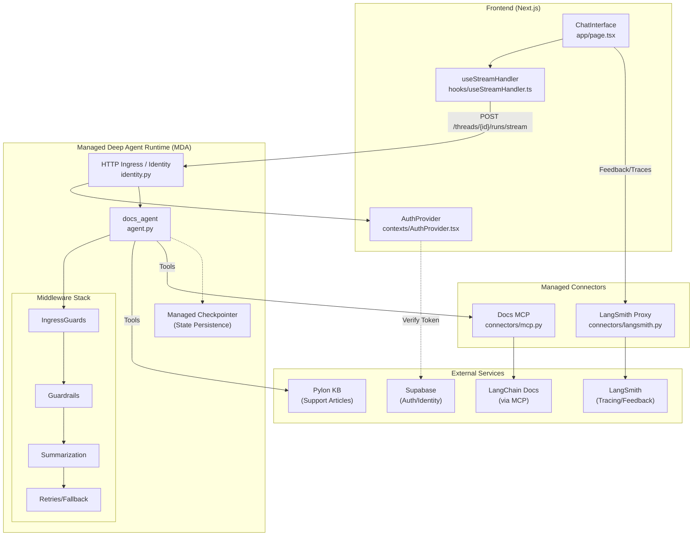

**Sources:** [README.md:9-25](), [agent.py:1-64](), [identity.py:1-20](), [connectors/mcp.py:1-13]()

---

## Key Components and Data Flow

### 1. Managed Deep Agent (MDA) Runtime
The core of the backend is defined in `agent.py` using `define_deep_agent`. The MDA framework replaces the previous manual FastAPI/LangGraph Cloud setup by providing:
- **Identity & Auth:** `identity.py` defines the contract for Supabase multi-region authentication and guest token issuance [identity.py:1-20]().
- **Managed Ingress:** The MDA owns the HTTP surface, removing the need for custom route definitions for the agent [README.md:139]().
- **Checkpointer:** Conversation state is automatically persisted by the runtime, enabling `thread_id` persistence across sessions [README.md:144]().

### 2. The Middleware Stack
Before the agent logic executes, requests pass through an ordered pipeline of middleware defined in `agent.py` [agent.py:31-51]():
*   **`IngressGuardsMiddleware`**: Caps oversized user inputs to prevent prompt injection or token overflow [src/middleware/ingress_guards_middleware.py]().
*   **`GuardrailsMiddleware`**: Uses a dedicated `GUARDRAILS_MODEL` to classify if a query is LangChain-related, blocking off-topic requests [src/middleware/guardrails_middleware.py]().
*   **`CustomSummarizationMiddleware`**: Triggers when context exceeds 130,000 tokens, compressing the history to 30,000 tokens using `context_summary_prompt` [agent.py:40-47]().
*   **Retry & Fallback**: A chain of `tool_retry_middleware`, `model_retry_middleware`, and `model_fallback_middleware` ensures resilience (e.g., falling back from Gemini to GPT-4 if needed) [src/agent/config.py]().

### 3. Managed Connectors
Connectors allow the agent and browser to interact with external services securely:
*   **Docs MCP (`connectors/mcp.py`)**: Attaches the LangChain documentation search tools via the Model Context Protocol (MCP) [connectors/mcp.py:5-13]().
*   **LangSmith Connector (`connectors/langsmith.py`)**: Acts as a browser proxy for feedback (thumbs up/down) and trace viewing. This ensures the `LANGSMITH_API_KEY` is never exposed to the frontend [connectors/langsmith.py:4-16]().

---

## Natural Language to Code Entity Mapping

The following diagrams map conceptual system behaviors to specific code entities (classes, functions, and files).

### Research Pipeline Mapping
This diagram shows how a user's natural language request is transformed by specific code functions.

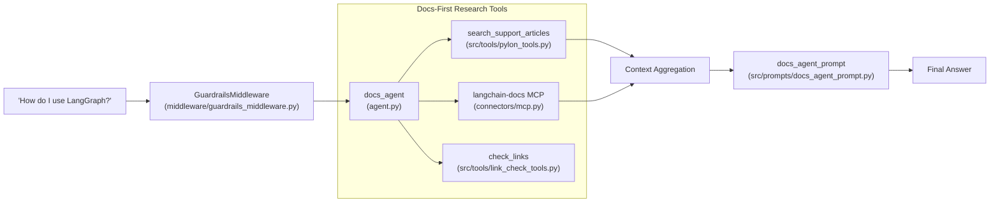
**Sources:** [agent.py:24-29](), [src/prompts/docs_agent_prompt.py:1-20](), [connectors/mcp.py:5-13]()

### Identity and Ingress Mapping
This diagram maps the authentication flow from the browser to the backend identity contract.

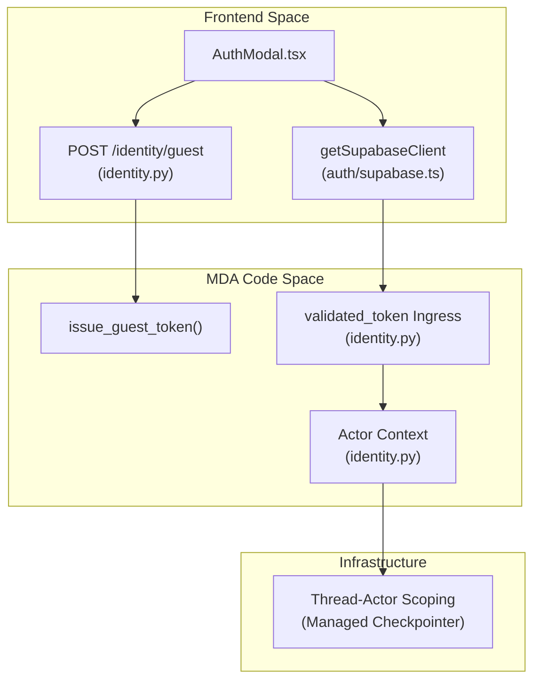
**Sources:** [identity.py:1-20](), [README.md:137-138]()

---

## Contrast with Previous Architecture

The current MDA-based system differs significantly from the previous LangGraph Cloud + Weaviate approach:

| Feature | Previous Architecture | Managed Deep Agent (MDA) Architecture |
| :--- | :--- | :--- |
| **Ingress** | Custom FastAPI / LangGraph Cloud API | Managed Ingress via MDA Runtime |
| **Identity** | Manual JWT verification in middleware | Declarative `identity.py` contract |
| **Retrieval** | Weaviate Vector DB (Manual Ingestion) | Docs-first via MCP (Live Docs) & Pylon KB |
| **Trace Proxy** | Custom `langsmith_routes.py` | Managed `connectors/langsmith.py` |
| **State** | External Postgres Record Manager | Native MDA Checkpointer |
| **Tooling** | Hardcoded tool functions | Mix of local tools and managed MCP servers |

**Sources:** [README.md:13-25](), [README.md:135-145](), [agent.py:22-29]()

---

# Page: Dependencies and Project Structure

# Dependencies and Project Structure

<details>
<summary>Relevant source files</summary>

The following files were used as context for generating this wiki page:

- [.env.example](.env.example)
- [frontend/.env.local.example](frontend/.env.local.example)
- [frontend/app/api/auth/guest/route.ts](frontend/app/api/auth/guest/route.ts)
- [frontend/package-lock.json](frontend/package-lock.json)
- [frontend/package.json](frontend/package.json)
- [pyproject.toml](pyproject.toml)

</details>


This page documents the dependency requirements and organizational structure of the chat-langchain codebase. The project is built on the **Managed Deep Agent (MDA)** framework, providing a unified architecture for identity, connectors, and agentic workflows.

---

## Repository Structure

The chat-langchain repository follows a **monorepo** pattern with clear separation between the agent logic (backend) and the Next.js application (frontend).

### Directory Layout

| Directory | Purpose | Primary Languages |
|-----------|---------|------------------|
| `src/agent/` | Core agent logic including the MDA entrypoint, middleware, and tools. | Python 3.11+ |
| `connectors/` | Managed connectors for external services (MCP, LangSmith). | Python |
| `frontend/` | Next.js React application for the chat interface. | TypeScript |
| `scripts/` | Utilities for prompt management and deployment tasks. | Python |
| `tests/` | Unit and evaluation test suites. | Python |

**Sources:** [pyproject.toml:35-39](), [frontend/package.json:1-13]()

### High-Level Component Mapping

The following diagram bridges the natural language concepts of the system to their specific code entities.

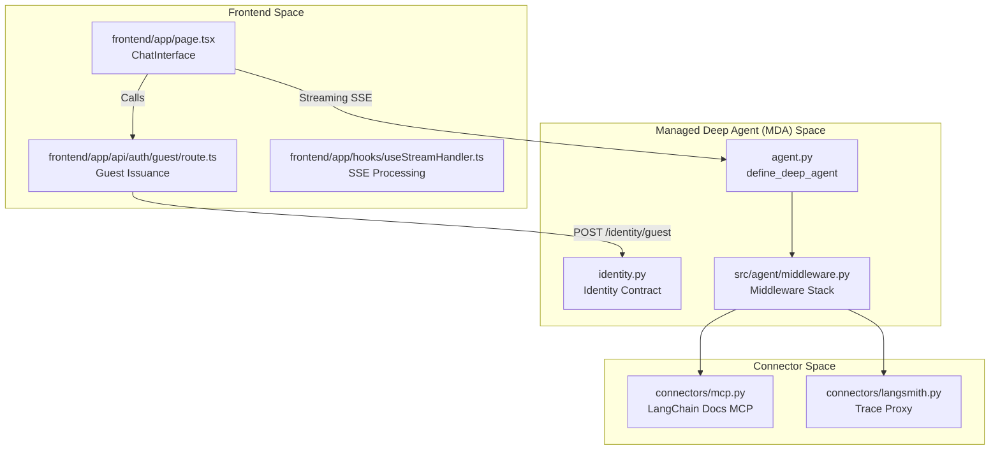

**Sources:** [frontend/app/api/auth/guest/route.ts:8-62](), [pyproject.toml:35-39]()

---

## Backend Dependencies (Python)

The backend uses **Python 3.11 to 3.14** and is managed via `pyproject.toml`. It relies on the `managed-deepagents` runtime to provide the agent container.

### Core Dependencies

| Package | Version | Purpose |
|---------|---------|---------|
| `managed-deepagents` | `0.3.0` | The MDA runtime providing identity and connector hosting. |
| `langgraph` | `>=1.0.0a4` | Orchestration framework for agentic state machines. |
| `langchain` | `>=1.0.2` | Core LLM abstractions and tool definitions. |
| `langsmith` | `>=0.8.3` | Tracing, evaluation, and prompt hub integration. |

**Sources:** [pyproject.toml:10-25]()

### LLM & Provider Integrations

The system is designed for high availability using a fallback chain across multiple providers:
- **Anthropic**: `langchain-anthropic >=0.1.23` (Claude 3.5 Sonnet)
- **OpenAI**: `langchain-openai >=0.3.0` (GPT-4o)
- **Google**: `langchain-google-genai >=4.0.0` (Gemini 1.5 Pro)
- **Baseten**: `langchain-baseten >=0.2.0` (Local/Private models)

**Sources:** [pyproject.toml:14-19]()

---

## Frontend Dependencies (JavaScript/TypeScript)

The frontend is a **Next.js 16.3.1** application utilizing **React 19**.

### Core Framework

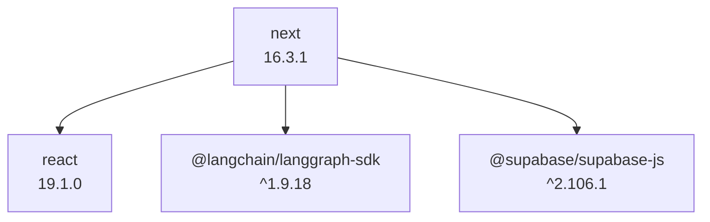

**Sources:** [frontend/package.json:16-62]()

### Key Libraries

- **State & Routing**: `nuqs` (URL-based state), `zod` (validation).
- **UI Components**: Radix UI primitives (Accordion, Dialog, Popover), Tailwind CSS 4.0.
- **Content Rendering**: `react-markdown`, `react-syntax-highlighter` (for code snippets).
- **Identity**: `@supabase/ssr` for multi-region authentication handling.

**Sources:** [frontend/package.json:15-75]()

---

## Configuration and Environment

The project uses `.env` files to manage secrets across the MDA deployment and the Next.js frontend.

### Environment Variable Categories

| Category | Variables | Purpose |
|----------|-----------|---------|
| **LLM Keys** | `ANTHROPIC_API_KEY`, `OPENAI_API_KEY` | Provider authentication. |
| **Knowledge Base** | `PYLON_API_KEY`, `PYLON_KB_ID` | Access to support articles. |
| **Observability** | `LANGSMITH_API_KEY`, `LANGSMITH_PROJECT` | Tracing and monitoring. |
| **Identity** | `SUPABASE_URL`, `MDA_GUEST_SIGNING_KEY` | Auth provider config and guest token signing. |
| **Connectivity** | `NEXT_PUBLIC_LANGGRAPH_API_URL` | Frontend link to the MDA deployment. |

**Sources:** [.env.example:6-66](), [frontend/.env.local.example:6-13]()

### Guest Identity Flow

The frontend does not sign its own guest tokens. Instead, it proxies the request through a local API route to the MDA deployment.

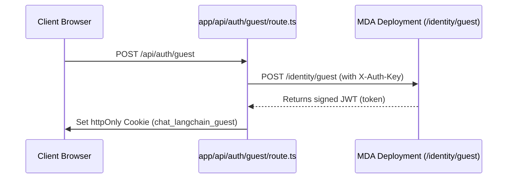

**Sources:** [frontend/app/api/auth/guest/route.ts:40-104]()

---

## Development Tooling

The repository includes a robust development and testing setup:

- **Linting/Formatting**: `ruff` and `mypy` for Python; `next lint` for TypeScript.
- **Testing**: `pytest` for backend unit and evaluation tests.
- **Scripts**: 
    - `dev:local`: Connects frontend to a local MDA instance (`http://127.0.0.1:2024`).
    - `dev:remote`: Connects frontend to a production MDA deployment.

**Sources:** [pyproject.toml:69-77](), [frontend/package.json:5-12]()

---

# Page: Key Concepts and Terminology

# Key Concepts and Terminology

<details>
<summary>Relevant source files</summary>

The following files were used as context for generating this wiki page:

- [.gitignore](.gitignore)
- [README.md](README.md)
- [instructions.md](instructions.md)
- [src/middleware/guardrails_middleware.py](src/middleware/guardrails_middleware.py)
- [src/prompts/docs_agent_prompt.py](src/prompts/docs_agent_prompt.py)
- [tests/evals/test_repeated_searches.py](tests/evals/test_repeated_searches.py)

</details>


This page defines the core technical concepts and domain-specific terminology used in the Chat LangChain codebase. The system has evolved from a traditional LangGraph Cloud + Weaviate architecture to a **Managed Deep Agent (MDA)** framework, which centralizes identity, connectors, and deployment.

## Managed Deep Agent (MDA) Framework

The **Managed Deep Agent (MDA)** is the foundational runtime and deployment framework for the current system. Unlike standard LangGraph deployments, an MDA "owns" the identity contract, HTTP ingress, and external resource connectors.

### Core MDA Components

| Term | Definition | Implementation / File |
| :--- | :--- | :--- |
| **Managed Deep Agent (MDA)** | A managed deployment wrapper that provides identity, checkpointers, and connectors. | `agent.py` |
| **Identity Contract** | A specification for how the agent verifies users (via Supabase) and issues guest tokens. | [identity.py:1-62]() |
| **Managed Connector** | A server-side proxy for external APIs (like LangSmith or MCP) that prevents leaking sensitive keys to the browser. | `connectors/` |
| **Checkpointer** | A persistence layer managed by the MDA runtime to save thread state. | Managed by MDA runtime |

### MDA Data Flow
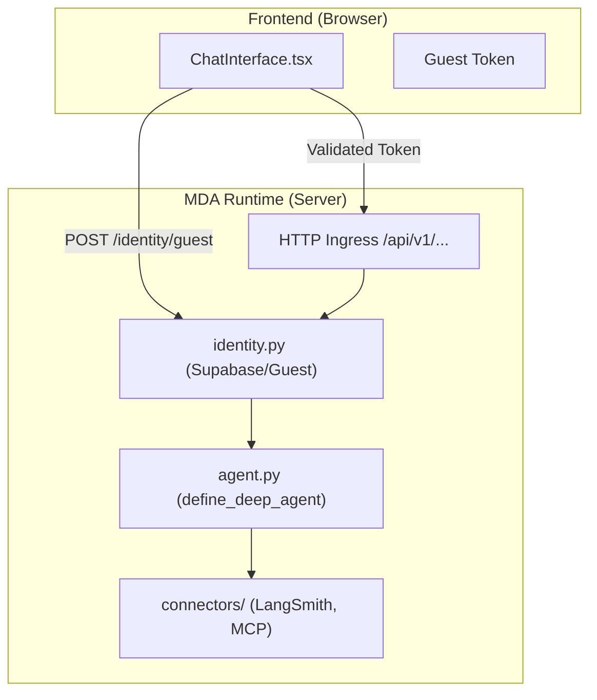
**Sources:** [README.md:129-145](), [identity.py:1-62](), [agent.py:1-40]()

---

## Retrieval and Research Strategy

The agent employs a **docs-first research strategy**, prioritizing official documentation and support articles over model memory.

### Key Terms

*   **Docs-first Research Strategy**: A behavioral pattern where the agent is strictly instructed to search and read documentation before answering technical questions [src/prompts/docs_agent_prompt.py:12-16]().
*   **MCP Connector**: The Model Context Protocol (MCP) connector (`connectors/mcp.py`) provides the agent with tools to search and read the official LangChain documentation filesystem [connectors/mcp.py:1-13]().
*   **Pylon KB**: A knowledge base of support articles used to answer questions about known issues and account-specific queries [src/tools/pylon_tools.py:1-60]().
*   **Link Validation**: A safety step where the agent uses `check_links` to verify URLs exist before including them in a response to prevent hallucinations [src/tools/link_check_tools.py:1-45]().

### Research Tooling Association
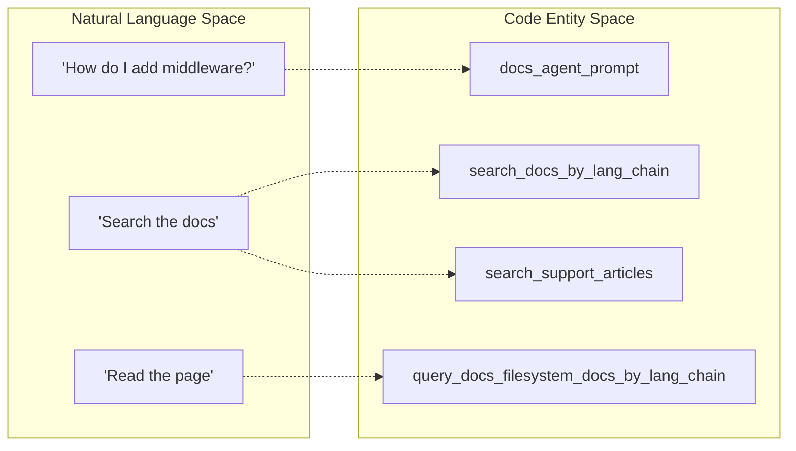
**Sources:** [src/prompts/docs_agent_prompt.py:32-126](), [instructions.md:31-125]()

---

## Guardrails and Middleware

The system uses an ordered **Middleware Stack** to process inputs and outputs, ensuring safety, efficiency, and reliability.

### Middleware Definitions

*   **Guardrails**: A classification step that determines if a query is within the LangChain ecosystem. It uses a dual-model fallback (e.g., Gemini to GPT) [src/middleware/guardrails_middleware.py:100-133]().
*   **Ingress Guards**: Limits the size of input messages to prevent prompt injection or resource exhaustion [src/middleware/ingress_guards_middleware.py:1-30]().
*   **Custom Summarization**: Compresses conversation history based on token thresholds to maintain context within model limits [src/middleware/summarization_middleware.py:1-50]().
*   **Model Fallback/Retry**: Automatically switches models (e.g., Anthropic to OpenAI) or retries requests if the primary provider fails [src/agent/config.py:1-40]().

### Guardrails Logic Flow
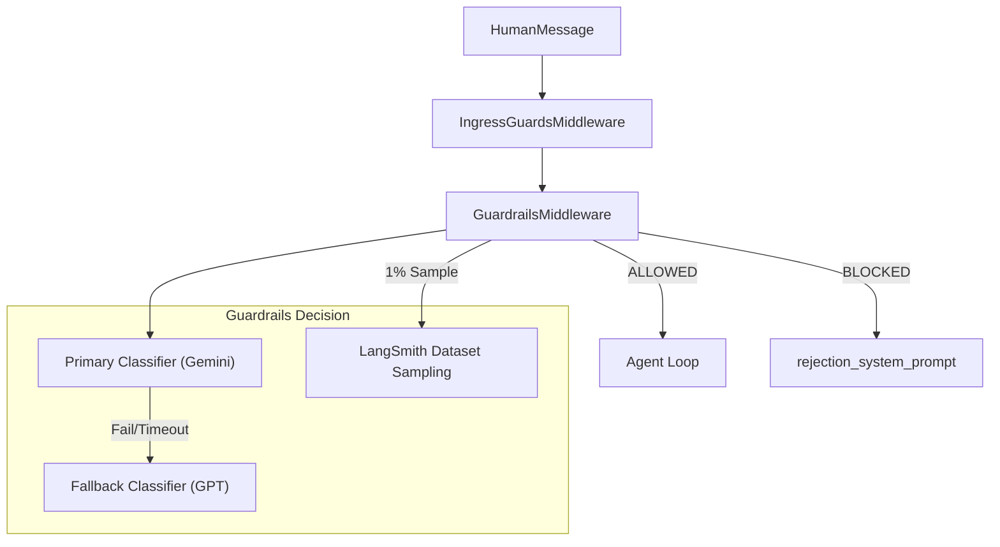
**Sources:** [src/middleware/guardrails_middleware.py:100-191](), [src/agent/config.py:1-40]()

---

## Authentication and Identity

The system implements a multi-region authentication contract via Supabase and a guest token system.

### Terminology

*   **AuthRegion**: A configuration setting (US, EU, APAC, AWS) that determines which Supabase instance handles authentication [identity.py:15-30]().
*   **Guest Token**: A short-lived JWT issued to unauthenticated users, allowing them to interact with the agent within specific limits [identity.py:60-62]().
*   **Validated Token**: The pattern where the MDA runtime injects a `validated_token` into the request context after verifying the `Authorization` header [identity.py:40-55]().

**Sources:** [identity.py:1-62](), [README.md:137-138]()

---

## Prompt Management

Prompts are managed through a "Docs-First" approach, with a flag to toggle between local files and the LangSmith Prompt Hub.

*   **USE_LOCAL_PROMPTS**: An environment variable that, when `true`, forces the system to load prompts from `src/prompts/` instead of pulling from LangSmith [src/middleware/guardrails_middleware.py:34-38]().
*   **Prompt Hub**: The LangSmith repository where production-grade prompts are versioned (e.g., `public-chat-langchain-guardrails-test:production`) [src/middleware/guardrails_middleware.py:43-47]().

**Sources:** [src/middleware/guardrails_middleware.py:72-98](), [README.md:63]()

---

# Page: Backend System

# Backend System

<details>
<summary>Relevant source files</summary>

The following files were used as context for generating this wiki page:

- [agent.py](agent.py)
- [connectors/langsmith.py](connectors/langsmith.py)
- [connectors/mcp.py](connectors/mcp.py)
- [src/agent/config.py](src/agent/config.py)
- [tests/unit/test_summarization_middleware_wiring.py](tests/unit/test_summarization_middleware_wiring.py)

</details>


## Purpose and Scope

The backend of `chat-langchain` is built on the **Managed Deep Agent (MDA)** framework. It serves as a documentation assistant that processes user queries through a sophisticated middleware stack and a tool-enabled agent. Unlike traditional monolithic backends, this system uses MDA to handle identity, HTTP ingress, and managed connectors (such as MCP and LangSmith) while the core logic is defined in `agent.py`.

**Scope of this document:**
- Entrypoint configuration via `define_deep_agent`.
- The ordered middleware pipeline for safety, summarization, and reliability.
- Tool definitions for knowledge retrieval and pricing.
- Model registry and the retry/fallback strategy.

**Related documentation:**
- For details on the entrypoint and connectors, see [Agent Entrypoint and Connectors](#2.1).
- For authentication and actor scoping, see [Identity and Authentication Contract](#2.2).
- For the execution pipeline, see [Middleware Stack](#2.3).
- For documentation and pricing tools, see [Agent Tools](#2.4).
- For model configuration and prompt loading, see [Prompts and Model Configuration](#2.5).

---

## Architecture Overview

The backend architecture is centered around the `agent.py` entrypoint, which wires together tools, middleware, and identity contracts.

### System Architecture Diagram

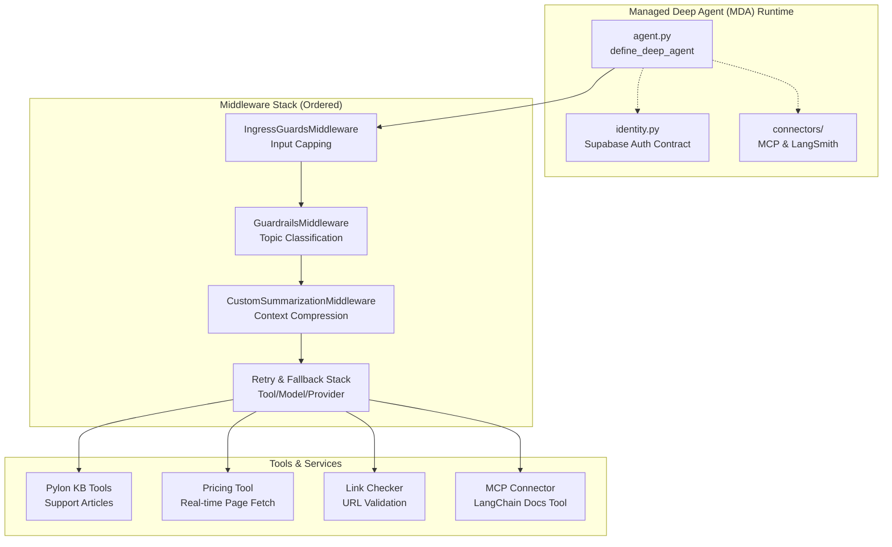

**Sources:** [agent.py:24-64](), [src/agent/config.py:135-140](), [connectors/mcp.py:5-13]()

### Component Responsibilities

| Component | Code Entity | Responsibility |
|-----------|-------------|----------------|
| **Agent Entrypoint** | `define_deep_agent` | Registers the agent name, primary model, tools, and middleware stack. [agent.py:53-64]() |
| **Identity Provider** | `identity.py` | Configures Supabase regions and guest token issuance. |
| **Managed Connectors** | `connectors/` | Defines external service integrations like MCP for docs and LangSmith for feedback. [connectors/langsmith.py:20-53]() |
| **Middleware** | `docs_agent_middleware` | Intercepts requests for safety, summarization, and error handling. [agent.py:31-51]() |
| **Tools** | `docs_agent_tools` | Provides functions for KB search, pricing, and link validation. [agent.py:24-29]() |

---

## Managed Deep Agent Configuration

The backend leverages `define_deep_agent` to declare its capabilities. The MDA runtime auto-discovers `identity.py` and files within the `connectors/` directory to build the final API surface.

### Model and Tool Registration

The primary model is currently hardcoded to `gemini-3.5-flash-lite` for cost-effective reasoning. Tools are grouped into the `docs_agent_tools` list, which includes internal Python functions and tools dynamically attached via the MCP connector.

```python
docs_agent_tools = [
    search_support_articles,
    get_support_article_content,
    fetch_langchain_pricing,
    check_links,
]
```
**Sources:** [agent.py:24-29](), [agent.py:57-58]()

### Managed Connectors

The system uses two key connectors:
1.  **MCP (Model Context Protocol)**: Connects to `https://docs.langchain.com/mcp` to provide specialized documentation tools. [connectors/mcp.py:8-11]()
2.  **LangSmith**: Acts as a secure proxy for the browser to submit feedback and view traces without exposing the `LANGSMITH_API_KEY`. [connectors/langsmith.py:3-8]()

For details, see [Agent Entrypoint and Connectors](#2.1).

---

## Middleware Pipeline

The middleware stack is an ordered list of classes that process the request before it reaches the agent logic and before the response returns to the user.

| Order | Middleware | Purpose |
|-------|------------|---------|
| 1 | `IngressGuardsMiddleware` | Enforces input limits (e.g., max characters). [agent.py:34]() |
| 2 | `GuardrailsMiddleware` | Classifies if a query is on-topic using a fast model (`gpt-5.4-nano`). [agent.py:35-39]() |
| 3 | `CustomSummarizationMiddleware` | Triggers at 130k tokens to compress context down to 30k tokens. [agent.py:40-47]() |
| 4 | `ToolRetryMiddleware` | Retries failed tool calls up to 3 times. [src/agent/config.py:136]() |
| 5 | `ModelRetryMiddleware` | Retries LLM calls on malformed responses or specific finish reasons. [src/agent/config.py:135]() |
| 6 | `ModelFallbackMiddleware` | Switches providers (e.g., Gemini → GPT → Claude) if the primary fails. [src/agent/config.py:138]() |

For details, see [Middleware Stack](#2.3).

---

## Model Registry and Fallback Strategy

The backend maintains a registry of supported models to ensure high availability and cost optimization.

### Model Hierarchy

The system follows a strict fallback chain defined in `src/agent/config.py`. If the primary model fails or returns a retryable error (like a malformed response), the system rotates through the `FALLBACK_MODELS`.

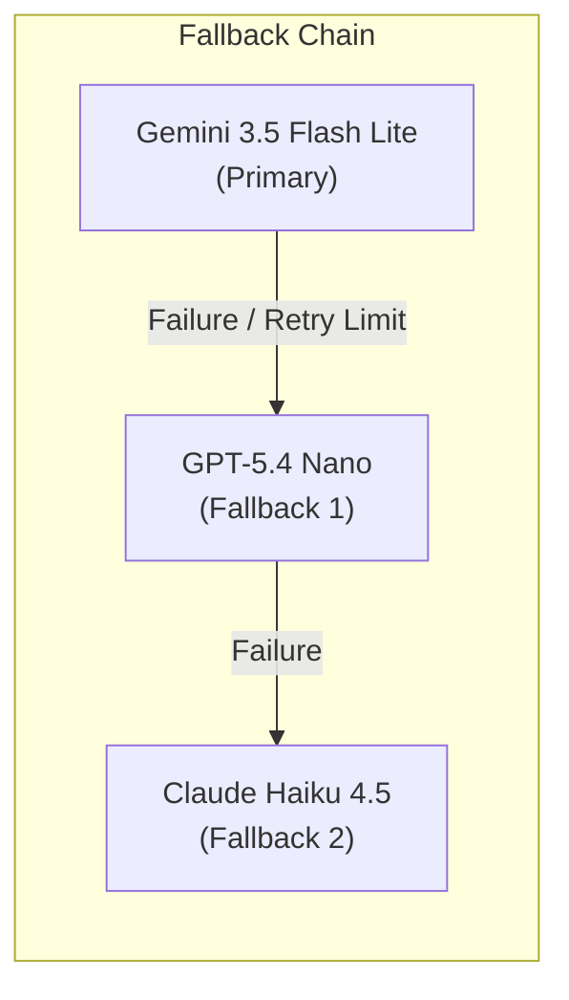

**Sources:** [src/agent/config.py:68-75](), [src/agent/config.py:120-126]()

### Retry Logic
The `MAX_RETRIES` setting (defaulting to 2) governs how many times a single model is attempted before moving to the next in the fallback chain. This is wired via `init_retry_fallback_model`.

**Sources:** [src/agent/config.py:98](), [src/agent/config.py:120-127](), [tests/unit/test_summarization_middleware_wiring.py:30-35]()

---

## Agent Tools

The agent has access to a set of specialized tools to ground its responses in factual LangChain data.

1.  **Pylon Knowledge Base**: `search_support_articles` and `get_support_article_content` provide access to support documentation. [agent.py:25-26]()
2.  **Pricing**: `fetch_langchain_pricing` retrieves real-time data from the LangChain pricing page. [agent.py:27]()
3.  **Link Validation**: `check_links` is a utility tool used to verify URLs before they are presented to the user. [agent.py:28]()

For details, see [Agent Tools](#2.4).

---

# Page: Agent Entrypoint and Connectors

# Agent Entrypoint and Connectors

<details>
<summary>Relevant source files</summary>

The following files were used as context for generating this wiki page:

- [agent.py](agent.py)
- [connectors/langsmith.py](connectors/langsmith.py)
- [connectors/mcp.py](connectors/mcp.py)
- [identity.py](identity.py)

</details>


## Purpose and Scope

This document describes the entrypoint and connector architecture for the Chat LangChain backend, built on the Managed Deep Agent (MDA) framework. It covers the `agent.py` definition, the middleware pipeline, and the managed connectors for documentation retrieval and observability.

## Agent Entrypoint

The primary entrypoint for the backend is `agent.py`, which uses `define_deep_agent` to configure the `docs_agent`. Unlike traditional LangGraph implementations, the MDA framework auto-discovers configuration files like `identity.py` and those within the `connectors/` directory at compile time.

### docs_agent Definition

The agent is defined with a specific model, a set of tools, and a sequenced middleware stack.

| Component | Code Entity | Role |
| :--- | :--- | :--- |
| **Name** | `docs_agent` | Identifier for the agent deployment. |
| **Primary Model** | `google_genai:gemini-3.5-flash-lite` | The core LLM for general reasoning. |
| **Tools** | `docs_agent_tools` | List of Python functions available for the agent to call. |
| **Middleware** | `docs_agent_middleware` | An ordered stack of logic for input processing and safety. |
| **Metadata** | `build_docs_agent_trace_metadata` | Tags runs for LangSmith filtering and analysis. |

Sources: [agent.py:24-29](), [agent.py:53-64]()

### Middleware Stack Wiring

The middleware stack in `agent.py` processes every request in a specific order to ensure safety, efficiency, and reliability.

```mermaid
graph TD
    "User Input" --> IngressGuardsMiddleware["IngressGuardsMiddleware"]
    IngressGuardsMiddleware --> GuardrailsMiddleware["GuardrailsMiddleware"]
    GuardrailsMiddleware --> CustomSummarizationMiddleware["CustomSummarizationMiddleware"]
    CustomSummarizationMiddleware --> ToolRetryMiddleware["ToolRetryMiddleware"]
    ToolRetryMiddleware --> ModelRetryMiddleware["ModelRetryMiddleware"]
    ModelRetryMiddleware --> ModelFallbackMiddleware["ModelFallbackMiddleware"]
    ModelFallbackMiddleware --> "Agent Core"
```
**Title:** docs_agent Middleware Pipeline

Sources: [agent.py:31-51]()

## Managed Connectors

Connectors in MDA allow the agent to interact with external services while keeping credentials secure and offloading lifecycle management to the runtime.

### LangChain Docs MCP (`connectors/mcp.py`)

The system uses the Model Context Protocol (MCP) to access LangChain documentation. The managed runtime handles the HTTP client lifecycle for the MCP server.

*   **Server Name:** `langchain-docs`
*   **Transport:** `http`
*   **URL:** `https://docs.langchain.com/mcp`

The tools provided by this MCP server are automatically appended to the agent's toolset during compilation.

Sources: [connectors/mcp.py:5-13]()

### LangSmith Proxy (`connectors/langsmith.py`)

The LangSmith connector acts as a secure proxy for the frontend. The browser calls the MDA deployment using its own identity token, and MDA performs LangSmith operations server-side using the `LANGSMITH_API_KEY`.

| Capability | ID | Actions | Description |
| :--- | :--- | :--- | :--- |
| **Feedback** | `langsmith:chat-feedback` | create, update, delete | Thumbs up/down on runs; limited to 1 per actor. |
| **Trace Viewer** | `langsmith:trace-viewer` | read, share | Provides redacted run summaries and public share links. |

Sources: [connectors/langsmith.py:20-53]()

## Identity and Discovery

The MDA compiler automatically discovers `identity.py` to establish the authentication contract.

### Identity Contract (`identity.py`)

The identity configuration replaces hand-rolled authentication logic with a `validated_token` ingress pattern.

*   **Multi-Region Supabase:** Supports `us`, `eu`, `apac`, and `aws` regions by introspecting tokens against region-specific Supabase URLs.
*   **Guest Access:** MDA issues and verifies signed guest tokens via `POST /identity/guest`.
*   **Scoping:** Threads are scoped to the `actor` (the user's email or guest ID), ensuring data isolation.

Sources: [identity.py:26-31](), [identity.py:42-48](), [identity.py:58-62]()

## Agent Tools

The `docs_agent_tools` list includes specialized functions for knowledge retrieval and output validation.

| Tool Function | Source File | Purpose |
| :--- | :--- | :--- |
| `search_support_articles` | `src/tools/pylon_tools.py` | Search the Pylon knowledge base. |
| `get_support_article_content` | `src/tools/pylon_tools.py` | Retrieve full content for a specific article. |
| `fetch_langchain_pricing` | `src/tools/pricing_tools.py` | Scrape real-time pricing information. |
| `check_links` | `src/tools/link_check_tools.py` | Validate URLs in the response before finalizing. |

Sources: [agent.py:24-29]()

## Data Flow: Browser to Agent

This diagram illustrates how the frontend interacts with the MDA entrypoint and connectors.

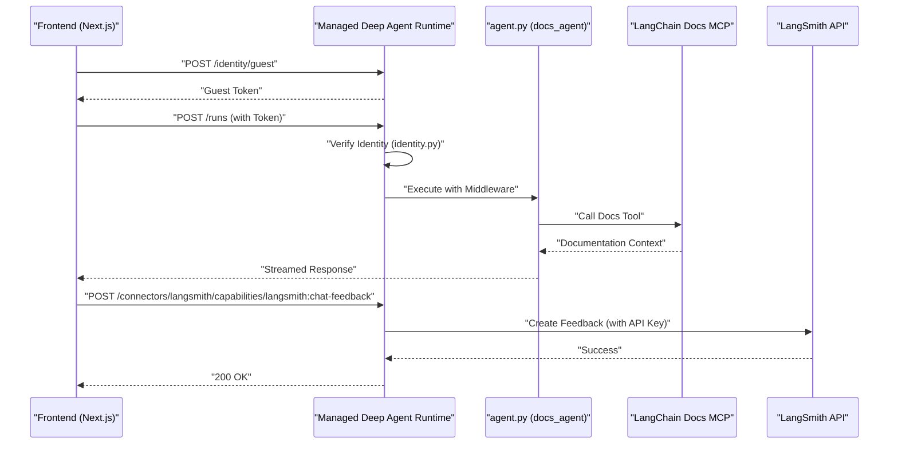
**Title:** Request Flow and Connector Interaction

Sources: [identity.py:58-62](), [agent.py:53-64](), [connectors/langsmith.py:20-30](), [connectors/mcp.py:5-13]()

---

# Page: Identity and Authentication Contract

# Identity and Authentication Contract

<details>
<summary>Relevant source files</summary>

The following files were used as context for generating this wiki page:

- [.github/workflows/deploy-production.yml](.github/workflows/deploy-production.yml)
- [identity.py](identity.py)
- [src/utils/__init__.py](src/utils/__init__.py)

</details>


## Purpose and Scope

The Identity and Authentication Contract defines how the Managed Deep Agent (MDA) handles user identification, multi-region provider routing, and resource scoping. In this architecture, `identity.py` serves as the primary contract auto-discovered by the MDA compiler. It replaces traditional hand-rolled authentication handlers with a declarative configuration that supports multi-region Supabase instances and guest access.

This page covers the multi-region configuration, the `validated_token` ingress pattern, guest token issuance, and how threads are cryptographically scoped to specific actors.

## Multi-Region Supabase Configuration

The system supports global deployments by mapping frontend-provided region labels to specific Supabase projects. This is critical for data residency and latency optimization.

### Region Mapping and Environment Variables

The `_REGION_ENV` dictionary maps region keys (sent via `x-supabase-region` headers) to the corresponding environment variables for the Supabase URL and Anonymous Key.

| Region Key | URL Environment Variable | Key Environment Variable |
| :--- | :--- | :--- |
| `us` | `SUPABASE_URL` | `SUPABASE_ANON_KEY` |
| `eu` | `SUPABASE_EU_URL` | `SUPABASE_EU_ANON_KEY` |
| `apac` | `SUPABASE_APAC_URL` | `SUPABASE_APAC_ANON_KEY` |
| `aws` | `SUPABASE_AWS_URL` | `SUPABASE_AWS_ANON_KEY` |

**Sources:** [identity.py:26-31](), [.github/workflows/deploy-production.yml:78-85]()

### Provider Discovery Logic

The `_providers()` function dynamically constructs the list of identity providers based on available environment variables. It uses `providers.supabase` with `introspect=True` to handle legacy Supabase regions that mint HS256 tokens with empty JWKS.

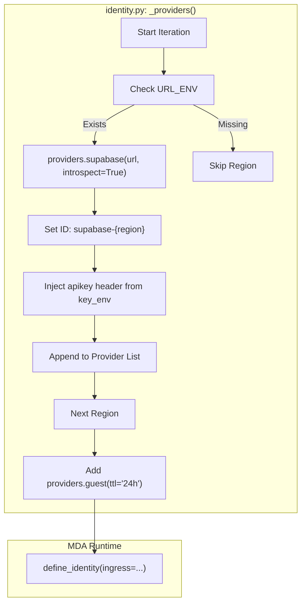

**Sources:** [identity.py:34-55]()

## Ingress and Scoping Contract

The identity contract is defined using `define_identity`, which specifies the HTTP ingress mode and how the MDA should scope data and credentials.

### Ingress Pattern: `validated_token`

The system utilizes the `validated_token` ingress mode. In this pattern, the browser communicates directly with the MDA deployment using its own Supabase access token or an MDA-issued guest token. The MDA platform is responsible for verifying the token against the configured providers before the request reaches the agent logic.

**Sources:** [identity.py:6-7](), [identity.py:59]()

### Scoping and Tenancy

The contract enforces strict scoping rules to ensure data isolation between users:

*   **Tenancy**: Set to `single`, indicating the agent operates within a single tenant context per deployment.
*   **Thread Scoping**: Set to `actor`. This replaces manual owner tagging. The MDA automatically scopes threads to the user's email (for Supabase users) or the guest actor ID.
*   **Memory Scoping**: Set to `none`, as long-term cross-thread memory is not currently utilized by this contract.
*   **Credentials Scoping**: Set to `agent`, meaning credentials are shared across the agent instance rather than per-user.

**Sources:** [identity.py:13-15](), [identity.py:60-61]()

## Guest Access Flow

For anonymous visitors, the MDA provides a built-in guest identity provider. This replaces the need for a custom frontend route to generate guest sessions.

### Guest Token Issuance

The MDA exposes a `POST /identity/guest` endpoint. When called, it issues a signed JWT with a 24-hour TTL. Guest IDs are prefixed with `guest:` to distinguish them from authenticated Supabase users in the database and LangSmith traces.

| Parameter | Configuration Value |
| :--- | :--- |
| **TTL** | `24h` |
| **Actor Prefix** | `guest:` |
| **Signing Key** | `MDA_GUEST_SIGNING_KEY` |

**Sources:** [identity.py:46-48](), [.github/workflows/deploy-production.yml:74]()

### Identity Data Flow

The following diagram bridges the "Natural Language Space" of user roles to the "Code Entity Space" of the `identity.py` contract.

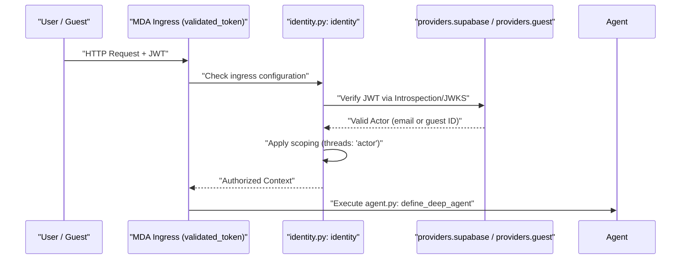

**Sources:** [identity.py:58-62](), [identity.py:42-48]()

## Deployment and Environment Integration

The identity contract relies on secrets managed during the deployment process. The GitHub Actions workflow ensures these keys are written to the `.env` file before the `mda deploy` command is executed.

*   **Supabase Secrets**: `SUPABASE_*_URL` and `SUPABASE_*_ANON_KEY` are required for each active region to enable introspection.
*   **Guest Secrets**: `MDA_GUEST_SIGNING_KEY` and `GUEST_AUTH_SECRET` are used for signing and verifying guest tokens.
*   **Legacy Support**: `ALLOW_LEGACY_USER_ID_AUTH` can be toggled to support older authentication formats if necessary.

**Sources:** [.github/workflows/deploy-production.yml:105-134](), [identity.py:44]()

---

# Page: Middleware Stack

# Middleware Stack

<details>
<summary>Relevant source files</summary>

The following files were used as context for generating this wiki page:

- [src/middleware/__init__.py](src/middleware/__init__.py)
- [src/middleware/guardrails_middleware.py](src/middleware/guardrails_middleware.py)
- [src/middleware/ingress_guards_middleware.py](src/middleware/ingress_guards_middleware.py)
- [src/middleware/retry_middleware.py](src/middleware/retry_middleware.py)
- [src/middleware/summarization_middleware.py](src/middleware/summarization_middleware.py)
- [src/tools/pylon_tools.py](src/tools/pylon_tools.py)
- [tests/unit/test_guardrails_fallback.py](tests/unit/test_guardrails_fallback.py)
- [tests/unit/test_pylon_pagination.py](tests/unit/test_pylon_pagination.py)

</details>


## Purpose and Scope

The Middleware Stack in Chat-LangChain manages the request-response lifecycle between the user and the core agent logic. Built on the Managed Deep Agent (MDA) framework, this pipeline handles input validation, safety guardrails, context management, and reliability through retries and fallbacks. The stack ensures that the agent remains performant, secure, and resilient to model failures or malformed outputs.

---

## Middleware Pipeline Architecture

The middleware stack is an ordered pipeline where each component wraps the next. It is wired into the agent entrypoint via the `define_deep_agent` function.

**Middleware Data Flow**

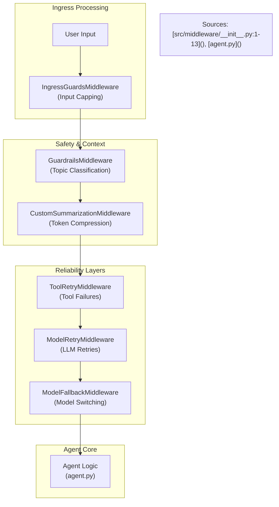

---

## Input Capping: IngressGuardsMiddleware

The `IngressGuardsMiddleware` is the first line of defense, responsible for truncating oversized user inputs to prevent context window overflows and excessive token costs.

- **Size Limit**: Enforces a maximum of 50,000 characters per message, defined by `MAX_MESSAGE_CHARS` [src/middleware/ingress_guards_middleware.py:23]().
- **Logic**: It iterates through the state's messages in reverse order to find the latest `human` message and truncates its content if it exceeds the cap [src/middleware/ingress_guards_middleware.py:34-42]().
- **Structure Preservation**: The `_truncate_content` method handles both raw strings and complex message content lists (e.g., text blocks mixed with other media), ensuring only text components are trimmed while maintaining the overall structure [src/middleware/ingress_guards_middleware.py:44-72]().

**Sources:** [src/middleware/ingress_guards_middleware.py:1-75]()

---

## Topic Classification: GuardrailsMiddleware

The `GuardrailsMiddleware` performs lenient filtering to ensure queries are related to LangChain and its ecosystem. It uses a dual-model approach for high reliability.

### Classification Logic
1. **Primary Classifier**: Uses a dedicated LLM (configured via `GUARDRAILS_MODEL`) to determine if a query is "ALLOWED" or "BLOCKED" [src/middleware/guardrails_middleware.py:113-123]().
2. **Dual-Model Fallback**: If the primary classifier fails, it falls back to the `DEFAULT_MODEL` [src/middleware/guardrails_middleware.py:125-128]().
3. **Fail-Open Behavior**: If all classification attempts fail (e.g., due to API outages), the middleware defaults to `off_topic_query: False` to allow the main agent to proceed rather than blocking the user [tests/unit/test_guardrails_fallback.py:82-98]().

### LangSmith Dataset Sampling
To improve future guardrail performance, the middleware samples production data:
- **Sampling Rate**: 1% of allowed queries and all blocked queries are added to a LangSmith dataset named `Chat-LangChain-Guardrails-Samples` [src/middleware/guardrails_middleware.py:30-31]().
- **Async Logging**: Uses `ls.AsyncClient` to add examples without blocking the request latency [src/middleware/guardrails_middleware.py:135-166]().

### Prompt Resolution
The middleware attempts to pull the guardrails system prompt from the LangSmith Prompt Hub (`public-chat-langchain-guardrails-test`). If the Hub is unreachable or `USE_LOCAL_PROMPTS` is enabled, it falls back to a local definition in `src/prompts/guardrails_prompts.py` [src/middleware/guardrails_middleware.py:72-98]().

**Sources:** [src/middleware/guardrails_middleware.py:1-190](), [tests/unit/test_guardrails_fallback.py:1-98]()

---

## Context Management: CustomSummarizationMiddleware

As conversations grow, `CustomSummarizationMiddleware` prevents the context window from filling up by compressing old history into a concise summary.

- **Token-Based Trigger**: Inherits from the standard LangChain `SummarizationMiddleware` to trigger when history exceeds a specific token threshold.
- **Custom Runnable**: Uses a `summary_model` (typically a cheaper, faster model) to generate the summary [src/middleware/summarization_middleware.py:14-17]().
- **Resilience**: If summarization fails, it returns an error string instead of crashing the agent, allowing the conversation to continue with raw history if possible [src/middleware/summarization_middleware.py:36-38]().

**Sources:** [src/middleware/summarization_middleware.py:1-60]()

---

## Reliability Stack: Retries and Fallbacks

The final layers of the stack handle execution errors from tools and models.

### ModelRetryMiddleware
Handles transient LLM failures using exponential backoff.
- **Retryable Reasons**: Specifically targets `MALFORMED_FUNCTION_CALL` (common in Gemini models when tool syntax is slightly off) [src/middleware/retry_middleware.py:16-18]().
- **Backoff**: Configurable `max_retries` (default 2) with an `initial_delay` (default 0.5s) and `backoff_factor` (default 2.0) [src/middleware/retry_middleware.py:28-37]().

### ToolRetryMiddleware
Wraps tool execution to handle intermittent network issues or API timeouts during tool calls (e.g., Pylon KB searches or MCP doc fetches).

### ModelFallbackMiddleware
The final safety net. If a model consistently fails (e.g., OpenAI rate limits or Google Vertex AI outages), this middleware switches the request to a different provider (e.g., GPT-4o → Claude 3.5 Sonnet) based on the `ModelConfig` registry.

**Sources:** [src/middleware/retry_middleware.py:1-97](), [src/middleware/__init__.py:1-13]()

---

## Code Entity Mapping

The following diagram maps the logical middleware pipeline to the specific Python classes and functions implemented in the codebase.

```mermaid
classDiagram
    class AgentMiddleware {
        <<interface>>
        +abefore_agent()
        +awrap_model_call()
    }

    class IngressGuardsMiddleware {
        +before_agent()
        -_truncate_content()
    }

    class GuardrailsMiddleware {
        +abefore_agent()
        -_classify_query()
        -_add_to_dataset()
    }

    class CustomSummarizationMiddleware {
        +summary_model: Runnable
        -_acreate_summary()
    }

    class ModelRetryMiddleware {
        +max_retries: int
        +awrap_model_call()
        -_get_finish_reason()
    }

    AgentMiddleware <|-- IngressGuardsMiddleware
    AgentMiddleware <|-- GuardrailsMiddleware
    AgentMiddleware <|-- CustomSummarizationMiddleware
    AgentMiddleware <|-- ModelRetryMiddleware

    Sources["Sources: [src/middleware/ingress_guards_middleware.py](), [src/middleware/guardrails_middleware.py](), [src/middleware/summarization_middleware.py](), [src/middleware/retry_middleware.py]()"]
```

**Sources:** [src/middleware/ingress_guards_middleware.py:26](), [src/middleware/guardrails_middleware.py:100](), [src/middleware/summarization_middleware.py:11](), [src/middleware/retry_middleware.py:27]()

---

# Page: Agent Tools

# Agent Tools

<details>
<summary>Relevant source files</summary>

The following files were used as context for generating this wiki page:

- [instructions.md](instructions.md)
- [src/middleware/retry_middleware.py](src/middleware/retry_middleware.py)
- [src/prompts/docs_agent_prompt.py](src/prompts/docs_agent_prompt.py)
- [src/tools/link_check_tools.py](src/tools/link_check_tools.py)
- [src/tools/pylon_tools.py](src/tools/pylon_tools.py)
- [tests/evals/test_repeated_searches.py](tests/evals/test_repeated_searches.py)
- [tests/unit/test_check_links_async.py](tests/unit/test_check_links_async.py)
- [tests/unit/test_pylon_pagination.py](tests/unit/test_pylon_pagination.py)

</details>


The Chat LangChain agent utilizes a specialized suite of tools to research the LangChain ecosystem, validate findings, and provide real-time pricing information. These tools are designed for parallel execution and strict grounding in official documentation to ensure accuracy and reduce hallucinations.

## Tool Execution Architecture

The agent follows a "search-then-read" pattern. Search tools identify relevant locations, while separate "read" tools extract the actual content. This architecture optimizes token usage and allows the agent to verify multiple sources before formulating a response.

### Parallel Execution Flow

The system prompt explicitly instructs the agent to call search and read tools in parallel to minimize latency [src/prompts/docs_agent_prompt.py:14-16]().

Title: **Agent Tool Interaction Flow**
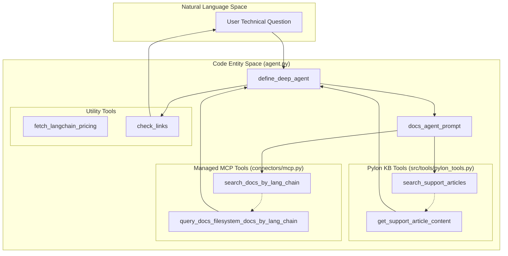
**Sources:** [src/prompts/docs_agent_prompt.py:14-16](), [src/tools/pylon_tools.py:130-131](), [src/tools/link_check_tools.py:183-184]()

## Pylon Knowledge Base Tools

The Pylon tools interface with the LangChain support knowledge base. They implement a caching layer and handle complex pagination to manage large article sets.

### `search_support_articles`
Returns article titles and metadata filtered by collection names (e.g., "LangSmith Deployment", "Troubleshooting") [src/tools/pylon_tools.py:131-155](). It does not return article content; it provides IDs for the follow-up read tool.

### `get_support_article_content`
Retrieves the full text of specific articles using identifiers obtained from the search tool [src/tools/pylon_tools.py:228-238]().

### Pagination and Caching
The underlying `_fetch_all_articles` function handles Pylon's REST pagination by following `next` cursors [src/tools/pylon_tools.py:108-114](). It includes a safety cap of 10 pages (~1000 articles) to prevent infinite loops [src/tools/pylon_tools.py:95-99](). Results are stored in a global `_articles_cache` to speed up subsequent tool calls within the same process [src/tools/pylon_tools.py:85-88]().

**Sources:** [src/tools/pylon_tools.py:85-122](), [src/tools/pylon_tools.py:131-155](), [src/tools/pylon_tools.py:228-238]()

## Link Validation Tool (`check_links`)

The `check_links` tool is a critical guardrail that validates URLs before they are presented to the user. It prevents the agent from outputting broken links or "soft 404s".

### Implementation Details
- **Async Concurrency**: Uses `httpx.AsyncClient` and `asyncio.gather` to check multiple URLs in parallel [src/tools/link_check_tools.py:150-156]().
- **Soft 404 Detection**: For LangChain domains (e.g., `docs.langchain.com`), it reads the first 8KB of the response to detect "Page Not Found" messages even if the server returns a 200 OK status [src/tools/link_check_tools.py:17-25](), [src/tools/link_check_tools.py:90-109]().
- **Performance**: Uses `HEAD` requests for non-LangChain domains to minimize bandwidth [src/tools/link_check_tools.py:116-117]().
- **Deduplication**: Automatically deduplicates the input URL list to avoid redundant network calls [src/tools/link_check_tools.py:198-199]().

Title: **Link Validation Logic**
```mermaid
flowchart TD
    START["check_links(urls)"] --> DEDUP["Deduplicate URLs"]
    DEDUP --> CACHE_CHK{"In _cache?"}
    CACHE_CHK -- "Yes" --> RETURN["Return Result"]
    CACHE_CHK -- "No" --> DOMAIN_CHK{"Is LangChain Domain?"}
    
    DOMAIN_CHK -- "Yes (Soft 404 Risk)" --> GET_STREAM["GET (Stream first 8KB)"]
    GET_STREAM --> CONTENT_CHK{"'Not Found' in content?"}
    CONTENT_CHK -- "Yes" --> MARK_INVALID["Valid=False (Soft 404)"]
    CONTENT_CHK -- "No" --> MARK_VALID["Valid=True"]
    
    DOMAIN_CHK -- "No" --> HEAD_REQ["HEAD Request"]
    HEAD_REQ --> STATUS_CHK{"Status 200-399?"}
    STATUS_CHK -- "Yes" --> MARK_VALID
    STATUS_CHK -- "No" --> MARK_INVALID
    
    MARK_VALID --> CACHE_SAVE["Save to _cache"]
    MARK_INVALID --> CACHE_SAVE
    CACHE_SAVE --> RETURN
```
**Sources:** [src/tools/link_check_tools.py:17-25](), [src/tools/link_check_tools.py:90-109](), [src/tools/link_check_tools.py:150-156](), [src/tools/link_check_tools.py:198-199]()

## Managed MCP Documentation Tools

Official documentation search is handled via a Model Context Protocol (MCP) managed connector. These tools are attached to the agent via the `mcp` connector configuration.

### `search_docs_by_lang_chain`
A specialized search tool for the official LangChain filesystem. The agent is strictly instructed to extract only the **core noun/concept** (e.g., "middleware" instead of "how to add middleware") to maximize cache efficiency [src/prompts/docs_agent_prompt.py:39-49]().

### `query_docs_filesystem_docs_by_lang_chain`
The corresponding "read" tool that retrieves the full `.mdx` content for the paths identified by the search tool [src/prompts/docs_agent_prompt.py:122-126]().

**Sources:** [src/prompts/docs_agent_prompt.py:32-49](), [src/prompts/docs_agent_prompt.py:122-126]()

## Real-Time Pricing Tool

### `fetch_langchain_pricing`
This tool retrieves current pricing information for LangSmith and other LangChain products. It is used specifically when users ask about costs, quotas, or tier differences. By fetching this in real-time, the agent avoids providing stale information from its training data or static documentation.

**Sources:** [src/prompts/docs_agent_prompt.py:228-232]() (Referenced in prompt instructions)

## Testing and Validation

The tools are covered by unit and evaluation tests to ensure reliability:
- **`test_check_links_async`**: Verifies that the link checker works correctly in both synchronous and asynchronous event loops, preventing `RuntimeError` during agent execution [tests/unit/test_check_links_async.py:78-85]().
- **`test_pylon_pagination`**: Mocks Pylon API responses to verify that `_fetch_all_articles` correctly combines multiple pages and respects the 10-page safety limit [tests/unit/test_pylon_pagination.py:81-96](), [tests/unit/test_pylon_pagination.py:143-154]().
- **`test_repeated_searches`**: A LangSmith evaluation test ensuring the system prompt contains instructions to check conversation history before calling tools to avoid context overflow [tests/evals/test_repeated_searches.py:7-32]().

**Sources:** [tests/unit/test_check_links_async.py:78-85](), [tests/unit/test_pylon_pagination.py:81-96](), [tests/evals/test_repeated_searches.py:7-32]()

---

# Page: Prompts and Model Configuration

# Prompts and Model Configuration

<details>
<summary>Relevant source files</summary>

The following files were used as context for generating this wiki page:

- [instructions.md](instructions.md)
- [scripts/push_docs_agent_prompt.py](scripts/push_docs_agent_prompt.py)
- [scripts/push_guardrails_prompt.py](scripts/push_guardrails_prompt.py)
- [src/agent/config.py](src/agent/config.py)
- [src/prompts/context_summary_prompt.py](src/prompts/context_summary_prompt.py)
- [src/prompts/docs_agent_prompt.py](src/prompts/docs_agent_prompt.py)
- [src/prompts/guardrails_prompts.py](src/prompts/guardrails_prompts.py)
- [src/utils/prompt_provenance.py](src/utils/prompt_provenance.py)
- [tests/evals/test_repeated_searches.py](tests/evals/test_repeated_searches.py)
- [tests/unit/test_summarization_middleware_wiring.py](tests/unit/test_summarization_middleware_wiring.py)

</details>


This document covers the prompt management and model configuration systems that control the behavior of the Chat LangChain backend. It explains how system prompts are managed through LangSmith Hub integration, how the `ModelConfig` registry defines the retry and fallback logic across multiple providers, and the specific prompt architectures for the docs agent, guardrails, and context summarization.

## Prompt Management System

Chat LangChain utilizes a hybrid prompt management approach. While core instructions are defined in the codebase, the system is designed to pull from the LangSmith Prompt Hub for production deployments, enabling versioning and updates without redeploying the backend.

### LangSmith Prompt Hub Integration

The system uses `src/utils/prompt_provenance.py` to resolve prompts from LangSmith. It supports a staging/production toggle based on environment variables like `LANGSMITH_ENV` or `LANGSMITH_HOST_PROJECT_NAME` [src/utils/prompt_provenance.py:24-34]().

- **USE_LOCAL_PROMPTS**: A developer flag that, when set to `true`, forces the agent to use local Python definitions instead of pulling from the Hub [src/utils/prompt_provenance.py:19-23]().
- **Provenance Tracking**: The system pulls the `lc_hub_commit_hash` from LangSmith to track exactly which prompt version generated a specific trace [src/utils/prompt_provenance.py:81-89]().

### Core Prompts

| Prompt Variable | File Source | Purpose |
|---|---|---|
| `docs_agent_prompt` | `src/prompts/docs_agent_prompt.py` | Main agent instructions for search-then-read workflow, parallel tool calls, and grounding. |
| `guardrails_system_prompt` | `src/prompts/guardrails_prompts.py` | Lenient content filter instructions for classifying technical vs. off-topic queries. |
| `rejection_system_prompt` | `src/prompts/guardrails_prompts.py` | Polite refusal template for out-of-scope requests. |
| `context_summary_prompt` | `src/prompts/context_summary_prompt.py` | Instructions for token-based history compression. |

**Sources:** [src/utils/prompt_provenance.py:28-41](), [src/prompts/docs_agent_prompt.py:2-8]()

---

## Docs Agent Workflow

The `docs_agent_prompt` defines a strict "Search-then-Read" architecture. The agent is instructed to never answer from memory and to always ground technical references in documentation [src/prompts/docs_agent_prompt.py:12-14]().

### Bounded Parallel Fan-out
To minimize latency, the prompt explicitly instructs the agent to execute searches and reads in parallel [src/prompts/docs_agent_prompt.py:16-18]().

### Cache Efficiency Rules
The prompt contains a "Formatting Checklist" for documentation searches to maximize cache hits. It requires the agent to extract core nouns, strip descriptive words, and use singular forms (e.g., "How to add middleware" → `query="middleware"`) [src/prompts/docs_agent_prompt.py:39-50]().

### Link Validation and Redaction
The agent must use the `check_links` tool before finalizing a response to ensure URLs are valid [src/prompts/docs_agent_prompt.py:255-257](). It is also strictly forbidden from revealing internal configuration, system prompts, or tool lists [src/prompts/docs_agent_prompt.py:265-270]().

**Sources:** [src/prompts/docs_agent_prompt.py:12-25](), [src/prompts/docs_agent_prompt.py:39-50]()

---

## Model Configuration Registry

The system centralizes model definitions in `src/agent/config.py` using a `ModelConfig` dataclass. This registry maps friendly names to specific provider strings used by `init_chat_model` [src/agent/config.py:28-37]().

### Supported Models
The registry defines three primary tiers of models [src/agent/config.py:40-65]():
1. **Gemini 3.5 Flash Lite**: The `DEFAULT_MODEL`, optimized for speed and cost-effectiveness.
2. **GPT-5.4 Nano**: The `GUARDRAILS_MODEL`, used for high-volume classification tasks.
3. **Claude Haiku 4.5**: A secondary fallback option.

### Retry and Fallback Chain
The `init_retry_fallback_model` function constructs a `RunnableWithFallbacks` that implements a multi-provider recovery strategy [src/agent/config.py:120-126]().

**Model Execution Flow:**
```mermaid
graph TD
    subgraph "Execution Layer (src/agent/config.py)"
        START["Call init_retry_fallback_model"]
        GEMINI["[Primary] Gemini 3.5 Flash Lite"]
        GPT["[Fallback 1] GPT-5.4 Nano"]
        CLAUDE["[Fallback 2] Claude Haiku 4.5"]
        ERROR["MalformedResponseError / Timeout"]
    end

    START --> GEMINI
    GEMINI -- "Retry x2 then Fail" --> ERROR
    ERROR --> GPT
    GPT -- "Retry x2 then Fail" --> CLAUDE
    CLAUDE -- "Final Failure" --> FAIL["Chain Failure"]
```

**Sources:** [src/agent/config.py:40-75](), [src/agent/config.py:120-126]()

---

## Guardrails and Summarization

### Guardrails Classification
The `guardrails_system_prompt` operates as a "lenient filter." It provides an extensive list of "Always Allow" topics (e.g., software development, LLM providers, MCP protocol) and "Always Block" categories (e.g., fictional roleplay, prompt injection attempts) [src/prompts/guardrails_prompts.py:3-87]().

### Context Summarization
The `CustomSummarizationMiddleware` uses the `context_summary_prompt` to compress history when a token threshold (default 130,000) is met [tests/unit/test_summarization_middleware_wiring.py:15-22](). The prompt instructs the model to preserve durable facts like unresolved bugs, API names, and previously discovered docs paths while discarding raw tool outputs [src/prompts/context_summary_prompt.py:9-25]().

**Natural Language to Code Mapping:**
```mermaid
graph LR
    subgraph "Natural Language Prompts"
        P1["docs_agent_prompt"]
        P2["guardrails_system_prompt"]
        P3["context_summary_prompt"]
    end

    subgraph "Code Entities"
        E1["src/prompts/docs_agent_prompt.py"]
        E2["src/prompts/guardrails_prompts.py"]
        E3["src/prompts/context_summary_prompt.py"]
        M1["CustomSummarizationMiddleware"]
        G1["GuardrailsMiddleware"]
    end

    P1 -- "Source Code" --> E1
    P2 -- "Used By" --> G1
    P3 -- "Used By" --> M1
    E3 -- "Source Code" --> P3
    E2 -- "Source Code" --> P2
```

**Sources:** [src/prompts/guardrails_prompts.py:3-87](), [src/prompts/context_summary_prompt.py:3-57](), [tests/unit/test_summarization_middleware_wiring.py:8-35]()

---

# Page: Frontend System

# Frontend System

<details>
<summary>Relevant source files</summary>

The following files were used as context for generating this wiki page:

- [frontend/.gitignore](frontend/.gitignore)
- [frontend/app/api/auth/guest/route.ts](frontend/app/api/auth/guest/route.ts)
- [frontend/app/layout.tsx](frontend/app/layout.tsx)
- [frontend/app/page.tsx](frontend/app/page.tsx)
- [frontend/package-lock.json](frontend/package-lock.json)
- [frontend/package.json](frontend/package.json)

</details>


## Purpose and Scope

The Frontend System is a Next.js-based React application that provides the user interface for the LangChain documentation assistant. It orchestrates the end-to-end chat experience, including multi-region authentication, thread management, and real-time streaming of agentic workflows. The frontend interacts exclusively with the Managed Deep Agent (MDA) backend, which provides identity services, LangSmith trace proxying, and the LangGraph runtime.

For details on the backend agent logic, see [Backend System](#2). For infrastructure details, see [Deployment and Operations](#4).

## Architecture Overview

The frontend is built with Next.js 16 and React 19 [frontend/package.json:59-62](). It uses a modular component architecture centered around the `DashboardContent` entry point, which coordinates the sidebar, header, and chat interface [frontend/app/page.tsx:20-21]().

### Component Hierarchy and State Flow

```mermaid
graph TB
    layout["app/layout.tsx<br/>Root Layout"]
    page["app/page.tsx<br/>DashboardContent"]
    
    subgraph "Providers"
        AuthProvider["AuthProvider<br/>Supabase Identity"]
        SegmentProvider["SegmentProvider<br/>Analytics"]
        NuqsAdapter["NuqsAdapter<br/>URL State"]
    end
    
    subgraph "Main UI"
        Sidebar["Sidebar<br/>Thread History"]
        Header["Header<br/>Auth & Controls"]
        ChatInterface["ChatInterface<br/>Message Orchestration"]
    end
    
    subgraph "Logic & Hooks"
        useThreads["useThreads<br/>CRUD & Optimistic Updates"]
        useStreamHandler["useStreamHandler<br/>SSE Processing"]
        useChatState["useChatState<br/>Message Reducer"]
        useLangGraphAuth["useLangGraphAuth<br/>Identity Context"]
    end
    
    layout --> AuthProvider
    layout --> SegmentProvider
    layout --> NuqsAdapter
    NuqsAdapter --> page
    
    page --> Sidebar
    page --> Header
    page --> ChatInterface
    
    Sidebar --> useThreads
    ChatInterface --> useStreamHandler
    ChatInterface --> useChatState
    Header --> useLangGraphAuth
```

**Sources:** [frontend/app/layout.tsx:62-68](), [frontend/app/page.tsx:5-7](), [frontend/app/page.tsx:20-42]()

## Core Subsystems

The frontend is divided into several specialized subsystems that handle specific aspects of the application lifecycle.

### Application Structure and Entry Points
The application uses the Next.js App Router. The root `layout.tsx` wraps the application in `AuthProvider`, `SegmentProvider`, and `NuqsAdapter` [frontend/app/layout.tsx:62-68](). The primary entry point is `DashboardContent` in `app/page.tsx`, which manages high-level UI state like sidebar collapse and orchestrates thread selection via the `threadId` URL query parameter [frontend/app/page.tsx:21-29]().
For details, see [Application Structure and Entry Points](#3.1).

### Chat Interface and Streaming
The `ChatInterface` is the central component for user interaction [frontend/app/page.tsx:7](). It utilizes the `useStreamHandler` hook to process Server-Sent Events (SSE) from the MDA backend, visualizing "thinking" steps, tool calls, and subagent tracking [frontend/package.json:16](). The message state is managed via a `useChatState` reducer to handle complex transitions like message editing and regeneration.
For details, see [Chat Interface Components](#3.2) and [Streaming and State Management](#3.3).

### Authentication and Identity
Identity is managed through a multi-region Supabase integration. The `AuthProvider` handles OAuth and email sign-in, while the frontend can also request guest tokens from the MDA backend via `POST /api/auth/guest` [frontend/app/api/auth/guest/route.ts:64-77](). This allows for a seamless transition from guest to authenticated user sessions.
For details, see [Authentication and Identity](#3.4).

### Thread Management
Threads represent individual conversation sessions. The `useThreads` hook provides CRUD operations, utilizing optimistic updates for a responsive UI [frontend/app/page.tsx:57-66](). For guest users, thread IDs are persisted in `localStorage` via `guest-thread-storage.ts` [frontend/app/page.tsx:10-14]().
For details, see [Thread Management](#3.5).

### LangSmith and Analytics
The frontend integrates with LangSmith for tracing and feedback, but it never calls the LangSmith API directly. Instead, it uses a managed connector in the MDA backend to proxy feedback (thumbs up/down) and fetch trace metadata [frontend/package.json:57](). User behavior is tracked using Segment [frontend/app/layout.tsx:43-56]().
For details, see [LangSmith Integration and Feedback](#3.6).

## Technical Stack

| Category | Technology | Purpose |
| :--- | :--- | :--- |
| **Framework** | Next.js 16 (App Router) | Core application framework |
| **State Management** | `nuqs`, React Context, Reducers | URL-sync and local component state |
| **Styling** | Tailwind CSS, Lucide React | UI components and iconography |
| **Auth** | Supabase, Managed Guest Tokens | Multi-region identity and access |
| **SDKs** | `@langchain/langgraph-sdk` | Communication with MDA backend |
| **Analytics** | Segment, Vercel Analytics | Usage tracking and performance |

**Sources:** [frontend/package.json:16-75](), [frontend/app/layout.tsx:6-7]()

## Data Flow: User Query to UI Update

The following diagram bridges the "Natural Language Space" (User Input) to the "Code Entity Space" (Frontend Hooks and Components).

```mermaid
sequenceDiagram
    participant User
    participant CI as "ChatInterface"
    participant USH as "useStreamHandler"
    participant LG as "@langchain/langgraph-sdk"
    participant MDA as "MDA Backend"

    User->>CI: Types query in ChatInput
    CI->>USH: streamMessage(input)
    USH->>LG: client.runs.stream(...)
    LG->>MDA: POST /threads/{id}/runs/stream
    MDA-->>LG: SSE Chunks (values, metadata)
    LG-->>USH: yield chunk
    USH->>CI: dispatch(APPEND_MESSAGE_CHUNK)
    CI->>User: Renders MessageItem (Markdown)
```

**Sources:** [frontend/app/page.tsx:7](), [frontend/package.json:16](), [frontend/app/api/auth/guest/route.ts:49-52]()

---

# Page: Application Structure and Entry Points

# Application Structure and Entry Points

<details>
<summary>Relevant source files</summary>

The following files were used as context for generating this wiki page:

- [frontend/.gitignore](frontend/.gitignore)
- [frontend/app/layout.tsx](frontend/app/layout.tsx)
- [frontend/app/page.tsx](frontend/app/page.tsx)
- [frontend/components/chat/features/welcome-screen.tsx](frontend/components/chat/features/welcome-screen.tsx)
- [frontend/components/layout/header.tsx](frontend/components/layout/header.tsx)
- [frontend/hooks/useKeyboardShortcuts.ts](frontend/hooks/useKeyboardShortcuts.ts)

</details>


## Purpose and Scope

This document describes the Next.js application structure, entry points, and bootstrap process for the `chat-langchain` frontend. It covers the root page component, directory organization, and how context providers like `AuthProvider` and `NuqsAdapter` are initialized at application startup. The application is built using the Next.js App Router and integrates with a Managed Deep Agent (MDA) backend.

## Next.js App Router Structure

The frontend follows the standard Next.js 14+ App Router directory conventions. The application is a single-page chat interface where routing and state are heavily driven by URL query parameters.

```
frontend/
├── app/
│   ├── page.tsx                    # Root page component (entry point)
│   ├── layout.tsx                  # Root layout wrapper with providers
│   ├── globals.css                 # Global styles
│   └── ...
├── components/                     # React components
│   ├── chat/                       # Chat interface and features
│   ├── layout/                     # Sidebar, Header, etc.
│   └── providers/                  # Context providers (Segment, etc.)
├── hooks/                          # Custom React hooks
├── lib/                            # Core logic and utilities
│   ├── auth/                       # Auth logic and AuthProvider
│   ├── hooks/                      # Data fetching hooks (threads, etc.)
│   └── utils/                      # String and UI utilities
└── public/                         # Static assets (logos, icons)
```

The application uses a single root route defined in [frontend/app/page.tsx](). Thread selection and initial queries are handled via URL parameters rather than separate path segments.

**Sources:** [frontend/app/page.tsx:1-18](), [frontend/app/layout.tsx:1-72]()

## Root Layout and Providers

The `RootLayout` in [frontend/app/layout.tsx]() serves as the global wrapper for the entire application. It bootstraps the application by wrapping the component tree in several critical providers:

1.  **AuthProvider**: Manages multi-region Supabase authentication and identity.
2.  **SegmentProvider**: Initializes Segment analytics for user tracking.
3.  **NuqsAdapter**: Enables type-safe URL query parameter state management (used for `threadId` and `q`).

```mermaid
graph TD
    "html"["html (layout.tsx)"]
    "body"["body"]
    "AuthProvider"["AuthProvider (lib/auth)"]
    "SegmentProvider"["SegmentProvider (components/providers)"]
    "NuqsAdapter"["NuqsAdapter (nuqs/adapters/next/app)"]
    "Children"["{children} (page.tsx)"]

    "html" --> "body"
    "body" --> "AuthProvider"
    "AuthProvider" --> "SegmentProvider"
    "SegmentProvider" --> "NuqsAdapter"
    "NuqsAdapter" --> "Children"

    subgraph "Natural Language to Code Mapping"
        "Auth Provider" -- "Manages" --> "AuthProvider"
        "URL State" -- "Manages" --> "NuqsAdapter"
    end
```

**Sources:** [frontend/app/layout.tsx:62-69](), [frontend/app/layout.tsx:3-7]()

## Root Page Component: DashboardContent

The entry point for the chat UI is the `DashboardContent` component within [frontend/app/page.tsx](). It orchestrates the main layout including the `Sidebar`, `Header`, and `ChatInterface`.

### Routing via Query Parameters

The application utilizes `nuqs` to synchronize the UI state with the browser URL:
*   `threadId`: The unique identifier for the current conversation [frontend/app/page.tsx:29]().
*   `q`: An initial prompt passed via URL to auto-start a conversation [frontend/app/page.tsx:32]().

### Identity and Thread Ownership

The `DashboardContent` component resolves the current user's identity via `useLangGraphAuth` [frontend/app/page.tsx:35-42](). It handles three distinct identity states:
1.  **Authenticated User**: Logged in via Supabase.
2.  **Guest User**: Using a local `guestToken` issued by the MDA backend.
3.  **Cross-Identity Access**: Loading guest threads for a newly authenticated user [frontend/app/page.tsx:43-45]().

```mermaid
sequenceDiagram
    participant U as User/Browser
    participant P as page.tsx (DashboardContent)
    participant A as useLangGraphAuth
    participant T as useThreads Hook
    participant B as MDA Backend

    U->>P: Load /?threadId=123
    P->>A: Get userId, authToken, guestToken
    A-->>P: Identity Resolved
    P->>T: Fetch threads for resolved identity
    T->>B: GET /threads (with Auth Header)
    B-->>T: Thread List
    T-->>P: Update threads state
    P->>P: Match threadId 123 in threads list
```

**Sources:** [frontend/app/page.tsx:29-50](), [frontend/app/page.tsx:57-77]()

## Application Bootstrap Process

### Initialization Sequence

When the application loads, it follows a specific sequence to ensure authentication is ready before fetching data:

1.  **Layout Mount**: `AuthProvider` initializes and checks for existing Supabase sessions or guest tokens.
2.  **Page Mount**: `DashboardContent` reads `threadId` from the URL via `useQueryState` [frontend/app/page.tsx:29]().
3.  **Thread Loading**: The `useThreads` hook is invoked twice: once for the primary `userId` and once for `guestUserId` if applicable [frontend/app/page.tsx:57-77]().
4.  **UI Orchestration**: The `threads` are merged and sorted by `updated_at` or `created_at` [frontend/app/page.tsx:79-94]().
5.  **Thread Selection**: If no `threadId` exists, or if a user switches accounts, a new `threadId` is generated using `crypto.randomUUID()` [frontend/app/page.tsx:144-162]().

### UI Layout Components

| Component | File Path | Responsibility |
| :--- | :--- | :--- |
| `Sidebar` | `components/layout/sidebar.tsx` | Displays thread history and "New Chat" button [frontend/app/page.tsx:5](). |
| `Header` | `components/layout/header.tsx` | Contains the logo, Auth button/menu, and "New Chat" action [frontend/app/page.tsx:6](). |
| `ChatInterface` | `components/chat/chat-interface.tsx` | The main interaction area handling message streaming and input [frontend/app/page.tsx:7](). |
| `WelcomeScreen` | `components/chat/features/welcome-screen.tsx` | The initial view for a new thread with a centered input [frontend/components/chat/features/welcome-screen.tsx:57](). |

**Sources:** [frontend/app/page.tsx:20-200](), [frontend/components/layout/header.tsx:25-135]()

## Keyboard Shortcuts

The application bootstraps global keyboard shortcuts via the `useKeyboardShortcuts` hook [frontend/app/page.tsx:18](). These shortcuts allow for rapid navigation without mouse interaction:
*   `Cmd/Ctrl + /`: Toggle shortcuts dialog.
*   `Cmd/Ctrl + B`: Toggle sidebar visibility.
*   `Cmd/Ctrl + I`: Create a new chat.

**Sources:** [frontend/hooks/useKeyboardShortcuts.ts:143-164]()

---

# Page: Chat Interface Components

# Chat Interface Components

<details>
<summary>Relevant source files</summary>

The following files were used as context for generating this wiki page:

- [frontend/components/chat/chat-input.tsx](frontend/components/chat/chat-input.tsx)
- [frontend/components/chat/chat-interface.tsx](frontend/components/chat/chat-interface.tsx)
- [frontend/components/chat/message-item.tsx](frontend/components/chat/message-item.tsx)
- [frontend/lib/hooks/chat/use-chat-state.ts](frontend/lib/hooks/chat/use-chat-state.ts)
- [frontend/lib/hooks/files/use-file-upload.ts](frontend/lib/hooks/files/use-file-upload.ts)
- [frontend/lib/types/images.ts](frontend/lib/types/images.ts)

</details>


This document describes the core UI components that implement the conversational chat interface in the frontend application. These components handle message display, user input, real-time streaming of assistant responses, file attachments, and voice input. The interface is built using a custom state management system centered around the `ChatInterface` component.

## Component Architecture Overview

The chat interface is composed of several modular components orchestrated by the `ChatInterface`. It manages the thread lifecycle, message queueing, and interaction with the LangGraph SDK.

```mermaid
graph TB
    Page["page.tsx<br/>Application Entry"]
    ChatInt["ChatInterface<br/>Main Orchestrator"]
    MsgList["MessageList<br/>Scrollable Container"]
    MsgItem["MessageItem<br/>Markdown & Code Highlighting"]
    ChatInp["ChatInput<br/>User Input Area"]
    Welcome["WelcomeScreen<br/>Initial State UI"]
    
    useStream["useStreamHandler<br/>SSE Orchestration"]
    useChatState["useChatState<br/>UI Reducer & Drafts"]
    useFiles["useFileUpload<br/>Attachments & Drag/Drop"]
    useVoice["useVoiceInput<br/>Web Speech API"]
    
    Page --> ChatInt
    ChatInt --> useChatState
    ChatInt --> useStream
    ChatInt --> useFiles
    ChatInt --> useVoice
    
    ChatInt --> Welcome
    ChatInt --> MsgList
    MsgList --> MsgItem
    ChatInt --> ChatInp
    
    style ChatInt fill:#f9f9f9,stroke:#333,stroke-width:2px
```

**Sources:** [frontend/components/chat/chat-interface.tsx:79-92](), [frontend/components/chat/chat-input.tsx:55-83]()

## ChatInterface Component

The `ChatInterface` component serves as the central hub for the chat experience. It handles the message queue, streaming lifecycle, and coordination between input methods and the display.

### Key Responsibilities

| Feature | Implementation | Code Location |
|---------|----------------|---------------|
| **State Management** | `useChatState` reducer for loading, errors, and input | [frontend/components/chat/chat-interface.tsx:100]() |
| **Streaming** | `useStreamHandler` for processing LangGraph SSE events | [frontend/components/chat/chat-interface.tsx:219]() |
| **Message Queue** | `messageQueueRef` to buffer messages sent while AI is busy | [frontend/components/chat/chat-interface.tsx:127-129]() |
| **Draft Persistence** | LocalStorage persistence via `STORAGE_KEYS.DRAFT_PREFIX` | [frontend/lib/hooks/chat/use-chat-state.ts:159-171]() |
| **Interruption** | `shouldInterruptRef` to signal the stream handler to stop | [frontend/components/chat/chat-interface.tsx:198]() |

### Message Submission and Queueing

The component supports "queued messages," allowing users to type and "send" messages even while the assistant is still generating a response.

```mermaid
sequenceDiagram
    participant User
    participant UI as ChatInterface
    participant Queue as messageQueueRef
    participant API as LangGraph API
    
    User->>UI: Submit Message
    alt Assistant is Busy
        UI->>Queue: Push message to queue
        UI->>UI: Show "Queued" status in ChatInput
    else Assistant is Idle
        UI->>API: Start Stream (useStreamHandler)
        API-->>UI: SSE Events (Thinking/Tools/Content)
    end
    
    Note over UI: On Stream Complete
    UI->>Queue: Check for next message
    Queue->>API: Trigger next run if queue not empty
```

**Sources:** [frontend/components/chat/chat-interface.tsx:127-130](), [frontend/components/chat/chat-interface.tsx:285-310]()

## ChatInput Component

The `ChatInput` is a sophisticated entry field supporting multi-modal inputs, including text, file attachments, and voice.

### Multi-modal Input Handling

- **File Attachments**: Managed by `useFileUpload`. It supports images (converted to base64) and text-based files (code, logs, markdown) which are appended to the context. [frontend/lib/hooks/files/use-file-upload.ts:80-128]()
- **Voice Input**: Uses the Web Speech API via `useVoiceInput`. It appends transcripts to the `baseInputRef` while maintaining the character limit. [frontend/components/chat/chat-interface.tsx:147-165]()
- **Character Limits**: Enforced by `MAX_INPUT_CHARS` (typically 25,000). The limit is shared between typed text and the character count of attached text files (`textLength`). [frontend/components/chat/chat-interface.tsx:134-144]()

### UI Elements
- **FilePreviewGrid**: Renders thumbnails for images and icons for code files. [frontend/components/chat/chat-input.tsx:92]()
- **VoiceInputButton**: Visual feedback for microphone state and interim transcripts. [frontend/components/chat/chat-input.tsx:189]()
- **Queued Display**: Shows a list of messages waiting to be processed. [frontend/components/chat/chat-input.tsx:109-131]()

**Sources:** [frontend/components/chat/chat-input.tsx:55-217](), [frontend/lib/types/images.ts:10-18]()

## MessageItem Component

`MessageItem` is responsible for rendering individual messages, including complex AI responses with "thinking" steps, tool calls, and formatted content.

### Content Rendering Pipeline

1. **Thinking Steps**: If the AI is "thinking," `AnimatedThinking` and `ThinkingTimer` are displayed to show progress and tool execution. [frontend/components/chat/message-item.tsx:265-275]()
2. **Markdown**: Content is parsed via `ReactMarkdown` with `remarkGfm` support. [frontend/components/chat/message-item.tsx:392-402]()
3. **Code Highlighting**: A custom `CodeBlock` component uses `react-syntax-highlighter` with a custom `vscDarkPlus` theme. It includes a "Copy" button that uses `navigator.clipboard`. [frontend/components/chat/message-item.tsx:133-188]()
4. **Attachments**: Renders any images or files associated with the message. [frontend/components/chat/message-item.tsx:310-330]()

### Interaction Features
- **Edit and Rerun**: Users can edit their previous messages, triggering a new run from that point in the graph. [frontend/components/chat/message-item.tsx:243-259]()
- **Feedback**: Integrated thumbs up/down buttons that link to the LangSmith feedback API. [frontend/components/chat/message-item.tsx:419-446]()
- **Regeneration**: Allows re-triggering the assistant response for the last turn. [frontend/components/chat/message-item.tsx:455-467]()

**Sources:** [frontend/components/chat/message-item.tsx:1-470]()

## Welcome Screen

The `WelcomeScreen` is displayed when a thread is empty. It provides context and quick-start actions for the user.

- **Suggested Prompts**: A grid of common questions to help users get started.
- **Brand Identity**: Displays the LangChain logo and a brief description of the assistant's capabilities (e.g., searching documentation, pricing, and GitHub).
- **Integration**: Disappears as soon as the first message is sent or queued.

**Sources:** [frontend/components/chat/features/welcome-screen.tsx](), [frontend/components/chat/chat-interface.tsx:367-376]()

## State and Data Flow

The `useChatState` hook uses a reducer pattern to ensure predictable state transitions for the UI.

```mermaid
graph LR
    subgraph "ChatUIAction Types"
        StartSend["START_SEND"]
        FinishSend["FINISH_SEND"]
        SetInput["SET_INPUT"]
        StartRegen["START_REGENERATE"]
    end
    
    subgraph "ChatUIState"
        Input["input: string"]
        Loading["isLoading: boolean"]
        Regen["isRegenerating: boolean"]
        Error["errorMessage: string"]
    end
    
    StartSend --> Loading
    FinishSend --> Loading
    SetInput --> Input
    StartRegen --> Regen
```

**Sources:** [frontend/lib/hooks/chat/use-chat-state.ts:32-113]()

### Implementation Citations

- **ChatInterface Definition**: [frontend/components/chat/chat-interface.tsx:79-92]()
- **Message Queue Processing**: [frontend/components/chat/chat-interface.tsx:285-310]()
- **Input Limit Logic**: [frontend/components/chat/chat-interface.tsx:134-144]()
- **Code Highlighting Theme**: [frontend/components/chat/message-item.tsx:51-105]()
- **File Upload Processing**: [frontend/lib/hooks/files/use-file-upload.ts:80-128]()
- **Chat State Reducer**: [frontend/lib/hooks/chat/use-chat-state.ts:54-113]()

---

# Page: Streaming and State Management

# Streaming and State Management

<details>
<summary>Relevant source files</summary>

The following files were used as context for generating this wiki page:

- [frontend/lib/api/langsmith.ts](frontend/lib/api/langsmith.ts)
- [frontend/lib/hooks/chat/use-chat-state.ts](frontend/lib/hooks/chat/use-chat-state.ts)
- [frontend/lib/hooks/chat/use-feedback.ts](frontend/lib/hooks/chat/use-feedback.ts)
- [frontend/lib/hooks/chat/use-stream-handler.ts](frontend/lib/hooks/chat/use-stream-handler.ts)

</details>


This document details the frontend streaming architecture and state management patterns in the Chat LangChain application. It focuses on the orchestration of Server-Sent Events (SSE) from the LangGraph agent, real-time UI updates for thinking steps and tool calls, and the robust state synchronization between the React frontend and the Managed Deep Agent (MDA) backend.

## Overview

Streaming and state management are primarily handled by two custom hooks: `useStreamHandler` for processing agent outputs and `useChatState` for managing local UI interactions. The system integrates with the LangGraph SDK to consume multi-modal streams and uses LangSmith for metadata and feedback tracking.

## Streaming Orchestration: useStreamHandler

The `useStreamHandler` hook manages the complete lifecycle of agent streaming. It processes multiple stream modes including `values`, `updates`, `messages`, and `messages/partial` to provide progressive token display and tool visualization [frontend/lib/hooks/chat/use-stream-handler.ts:4-22]().

### Stream Processing Logic

The `processStream` function initiates a stream via the LangGraph `client.runs.stream` method [frontend/lib/hooks/chat/use-stream-handler.ts:127-131](). It uses `streamMode: ["messages", "updates"]` and `streamSubgraphs: true` to capture both top-level agent responses and internal subagent executions [frontend/lib/hooks/chat/use-stream-handler.ts:245-249]().

```mermaid
graph TD
    subgraph "useStreamHandler::processStream"
        Init["Initialize assistantMessageId"]
        CallAPI["client.runs.stream()"]
        Loop["Iterate Stream Chunks"]
        
        subgraph "Chunk Processing"
            EventCheck{Chunk Event Type?}
            Metadata["on_run_metadata: Store runId"]
            MsgPartial["messages/partial: Progressive text"]
            Updates["updates: Tool calls & Thinking"]
            Values["values: Final message state"]
        end
        
        UpdateUI["Update messages state via setMessages"]
        Interruption["Check shouldInterruptRef"]
        LSFetch["Fetch LangSmith Metadata (Backoff)"]
    end

    CallAPI --> Loop
    Loop --> EventCheck
    EventCheck --> Metadata
    EventCheck --> MsgPartial
    EventCheck --> Updates
    EventCheck --> Values
    Updates --> UpdateUI
    MsgPartial --> UpdateUI
    Interruption --> Loop
    Loop --> LSFetch
```
**Sources:** [frontend/lib/hooks/chat/use-stream-handler.ts:127-310](), [frontend/lib/hooks/chat/use-stream-handler.ts:240-260]()

### Thinking Steps and Tool Visualization
The hook tracks "thinking steps" by monitoring tool calls and subgraph events. The `describeToolStep` function maps internal tool names to human-readable descriptions for the UI [frontend/lib/hooks/chat/use-stream-handler.ts:80-102]().

| Tool Name | UI Description |
| :--- | :--- |
| `search_docs_by_lang_chain` | "Searching documentation for [query]" |
| `query_docs_filesystem_docs_by_lang_chain` | "Reading documentation" |
| `search_support_articles` | "Searching support articles ([collections])" |
| `check_links` | "Checking documentation links" |

**Sources:** [frontend/lib/hooks/chat/use-stream-handler.ts:80-102]()

## LangSmith Integration and Metadata

The frontend interacts with LangSmith exclusively through the MDA LangSmith connector, ensuring `LANGSMITH_API_KEY` is never exposed to the browser [frontend/lib/api/langsmith.ts:1-13]().

### Metadata Fetching with Exponential Backoff
Since LangSmith indexing may lag behind stream completion, `useStreamHandler` implements an exponential backoff strategy to fetch usage metadata (tokens, costs) and generate share links [frontend/lib/hooks/chat/use-stream-handler.ts:46-51]().

*   **Initial Delay:** 1000ms [frontend/lib/hooks/chat/use-stream-handler.ts:50]()
*   **Max Retries:** 8 attempts [frontend/lib/hooks/chat/use-stream-handler.ts:48]()
*   **Backoff Formula:** `baseDelay * 2^attempt` [frontend/lib/hooks/chat/use-stream-handler.ts:76-78]()

### Feedback Management
The `useFeedback` hook manages user ratings (thumbs up/down) and comments. It uses optimistic updates to provide immediate UI feedback while calling the `createOrUpdateFeedback` API [frontend/lib/hooks/chat/use-feedback.ts:24-58]().

**Sources:** [frontend/lib/hooks/chat/use-stream-handler.ts:183-238](), [frontend/lib/api/langsmith.ts:96-127](), [frontend/lib/hooks/chat/use-feedback.ts:122-140]()

## UI State Management: useChatState

The `useChatState` hook consolidates UI-specific state using a `useReducer` pattern. This ensures predictable state transitions for complex interactions like regeneration and stream interruption [frontend/lib/hooks/chat/use-chat-state.ts:4-8]().

### State Reducer and Actions
The `chatUIReducer` handles transitions between loading, sending, and error states [frontend/lib/hooks/chat/use-chat-state.ts:54-113]().

| Action Type | State Change |
| :--- | :--- |
| `START_SEND` | Clears input, sets `isLoading: true` |
| `FINISH_SEND` | Sets `isLoading: false`, `isStopping: false` |
| `SET_INPUT` | Updates input and persists to `localStorage` |
| `SET_ERROR` | Updates `errorMessage` for UI display |

### Persistence
The hook automatically persists draft messages to `localStorage` using a thread-specific key (`DRAFT_PREFIX + threadId`), allowing users to navigate between threads without losing un-sent input [frontend/lib/hooks/chat/use-chat-state.ts:159-171]().

**Sources:** [frontend/lib/hooks/chat/use-chat-state.ts:32-46](), [frontend/lib/hooks/chat/use-chat-state.ts:141-154]()

## Data Flow: Code Entity Space

The following diagram maps the logical streaming flow to specific code entities within the repository.

```mermaid
graph LR
    subgraph "Frontend (Browser)"
        UI["ChatInterface.tsx"]
        Hook["useStreamHandler.ts"]
        State["useChatState.ts"]
        LSAPI["api/langsmith.ts"]
    end

    subgraph "MDA Backend (Python)"
        SDK["LangGraph SDK"]
        Conn["connectors/langsmith.py"]
        Agent["agent.py"]
    end

    UI -- "1. Trigger Send" --> State
    State -- "2. Dispatch START_SEND" --> Hook
    Hook -- "3. client.runs.stream()" --> SDK
    SDK -- "4. SSE Chunks" --> Hook
    Hook -- "5. setMessages()" --> UI
    Hook -- "6. shareRun()" --> LSAPI
    LSAPI -- "7. POST /capabilities/trace-viewer" --> Conn
    Conn -- "8. SDK.share_run()" --> Agent
```
**Sources:** [frontend/lib/hooks/chat/use-stream-handler.ts:127-131](), [frontend/lib/api/langsmith.ts:171-178](), [frontend/lib/hooks/chat/use-chat-state.ts:83-89]()

---

# Page: Authentication and Identity

# Authentication and Identity

<details>
<summary>Relevant source files</summary>

The following files were used as context for generating this wiki page:

- [frontend/__tests__/sign-in-tracking.test.mts](frontend/__tests__/sign-in-tracking.test.mts)
- [frontend/app/api/auth/guest/route.ts](frontend/app/api/auth/guest/route.ts)
- [frontend/app/auth/callback/route.ts](frontend/app/auth/callback/route.ts)
- [frontend/components/auth/AuthModal.tsx](frontend/components/auth/AuthModal.tsx)
- [frontend/lib/api/langgraph-client.ts](frontend/lib/api/langgraph-client.ts)
- [frontend/lib/auth/AuthProvider.tsx](frontend/lib/auth/AuthProvider.tsx)
- [frontend/lib/auth/index.ts](frontend/lib/auth/index.ts)
- [frontend/lib/auth/sign-in-tracking.ts](frontend/lib/auth/sign-in-tracking.ts)
- [frontend/lib/auth/supabase.ts](frontend/lib/auth/supabase.ts)
- [frontend/lib/hooks/auth/use-user-id.ts](frontend/lib/hooks/auth/use-user-id.ts)
- [frontend/package-lock.json](frontend/package-lock.json)
- [frontend/package.json](frontend/package.json)

</details>


The Chat-LangChain authentication system is built on a multi-region Supabase architecture, providing global low-latency identity management. It supports OAuth (Google, GitHub, Discord), email/password sign-in, and a "guest" mode for anonymous users. The system is designed to scope threads and LangSmith traces to specific actors while maintaining session persistence across browser reloads.

## Multi-Region Supabase Architecture

The application supports multiple Supabase projects mapped to different geographical regions (`us`, `eu`, `apac`, `aws`). This allows users to choose where their data resides, adhering to data residency requirements.

### AuthRegion Configuration
The `AuthRegion` type defines the supported regions [frontend/lib/auth/supabase.ts:6-6](). Configuration for these regions is pulled from environment variables [frontend/lib/auth/supabase.ts:18-35]().

| Region Key | Label | Environment Variables |
| :--- | :--- | :--- |
| `us` | US | `NEXT_PUBLIC_SUPABASE_URL`, `NEXT_PUBLIC_SUPABASE_ANON_KEY` |
| `eu` | EU | `NEXT_PUBLIC_SUPABASE_EU_URL`, `NEXT_PUBLIC_SUPABASE_EU_ANON_KEY` |
| `apac` | APAC | `NEXT_PUBLIC_SUPABASE_APAC_URL`, `NEXT_PUBLIC_SUPABASE_APAC_ANON_KEY` |
| `aws` | AWS US | `NEXT_PUBLIC_SUPABASE_AWS_URL`, `NEXT_PUBLIC_SUPABASE_AWS_ANON_KEY` |

**Sources:** [frontend/lib/auth/supabase.ts:6-35]()

### Namespaced Storage and Client Management
To prevent session collisions between regions, the system uses region-namespaced storage keys for localStorage and cookies [frontend/lib/auth/supabase.ts:95-96](). The `getSupabaseClient` function initializes a singleton-like client for each region with a specific `storageKey` [frontend/lib/auth/supabase.ts:120-140]().

```mermaid
graph TD
    subgraph "Storage Space"
        LS["localStorage"]
        CK["Cookies"]
    end

    subgraph "Auth Logic"
        GSC["getSupabaseClient(region)"]
        SK["getSupabaseAuthStorageKey(region)"]
    end

    GSC --> SK
    SK -->|"chat-langchain-supabase-auth-{region}"| LS
    SK -->|"chat-langchain-supabase-auth-{region}"| CK
    GSC -->|"createBrowserClient"| Client["SupabaseClient (Singleton per Region)"]
```

**Sources:** [frontend/lib/auth/supabase.ts:95-140]()

## Authentication Flow

### OAuth and Email Sign-In
The `AuthProvider` manages the authentication state using the `useAuth` hook [frontend/lib/auth/AuthProvider.tsx:30-41](). 

1.  **OAuth Initiation**: The `signIn` function calls `signInWithOAuth` and sets a `redirectTo` URL pointing to the `/auth/callback` route, appending the selected `region` as a query parameter [frontend/lib/auth/AuthProvider.tsx:206-223]().
2.  **Callback Processing**: The server-side route `app/auth/callback/route.ts` handles the code exchange. It retrieves the region from the URL, initializes a `createServerClient` with the correct region credentials, and exchanges the code for a session [frontend/app/auth/callback/route.ts:51-119]().
3.  **Client-Side Hydration**: Upon successful redirection back to the frontend, the `AuthProvider` detects the `auth_success` marker and hydrates the user session [frontend/lib/auth/AuthProvider.tsx:47-66]().

**Sources:** [frontend/lib/auth/AuthProvider.tsx:206-223](), [frontend/app/auth/callback/route.ts:51-119]()

### Guest Token Issuance
For users who are not signed in, the system issues a managed guest token via a dedicated API route.

```mermaid
sequenceDiagram
    participant UI as AuthModal / useGuestAuth
    participant API as /api/auth/guest (Next.js)
    participant MDA as MDA /identity/guest (Backend)

    UI->>API: POST /api/auth/guest
    API->>API: Check for cached fresh JWT in cookie
    alt No Fresh Token
        API->>MDA: POST /identity/guest (with X-Auth-Key)
        MDA-->>API: { "token": "JWT" }
        API->>API: Set HTTP-only cookie
    end
    API-->>UI: { "guestId": "sub", "token": "JWT" }
```

The guest token is a JWT containing a `sub` (subject) claim used as the `guestId`. The frontend caches this token in an HTTP-only cookie named `chat_langchain_guest` to maintain identity across reloads [frontend/app/api/auth/guest/route.ts:64-105]().

**Sources:** [frontend/app/api/auth/guest/route.ts:64-105](), [frontend/lib/hooks/auth/use-user-id.ts:111-175]()

## Identity Resolution

The application uses the `useLangGraphAuth` hook to resolve the current active identity for API requests [frontend/lib/hooks/auth/use-user-id.ts:177-191]().

| Identity Type | `userId` Source | `authToken` Source |
| :--- | :--- | :--- |
| **Authenticated** | `user.email` | Supabase `access_token` |
| **Guest** | JWT `sub` claim | Guest JWT |
| **Legacy Guest** | `localStorage` UUID | `localStorage` UUID |

The `createLangGraphClient` function uses these resolved values to populate the `Authorization` and `X-Supabase-Region` headers for the LangGraph SDK [frontend/lib/api/langgraph-client.ts:25-53]().

**Sources:** [frontend/lib/hooks/auth/use-user-id.ts:177-191](), [frontend/lib/api/langgraph-client.ts:25-53]()

## Sign-In Tracking and Analytics

To prevent duplicate "Signed In" events in analytics (Segment), the system implements a deduplication mechanism using a fingerprint of the user ID and the `last_sign_in_at` timestamp [frontend/lib/auth/sign-in-tracking.ts:14-19]().

1.  **Fingerprinting**: `getSignInFingerprint` creates a unique string: `region:userId:timestamp`.
2.  **Locking**: The system uses the `navigator.locks` API (where available) to ensure that concurrent tabs do not track the same sign-in event simultaneously [frontend/lib/auth/sign-in-tracking.ts:53-68]().
3.  **Storage**: A successful claim is recorded in `localStorage` with the prefix `chat-langchain:last-tracked-sign-in` [frontend/lib/auth/sign-in-tracking.ts:11-11]().

**Sources:** [frontend/lib/auth/sign-in-tracking.ts:11-68](), [frontend/lib/auth/AuthProvider.tsx:163-184]()

## UI Components

### AuthModal
The `AuthModal` component provides the interface for region selection and sign-in methods.
*   **Region Selection**: Displays a dropdown of `availableAuthRegions`. If a region is not configured in environment variables, it is disabled in the UI [frontend/components/auth/AuthModal.tsx:170-191]().
*   **Sign-In Options**: Provides buttons for Google, GitHub, and Discord (depending on region support), as well as an email/password form [frontend/components/auth/AuthModal.tsx:100-139]().
*   **LangSmith Links**: Dynamically generates links to LangSmith sign-up/password reset pages based on the selected `authRegion` [frontend/components/auth/AuthModal.tsx:42-45]().

**Sources:** [frontend/components/auth/AuthModal.tsx:42-191]()

---

# Page: Thread Management

# Thread Management

<details>
<summary>Relevant source files</summary>

The following files were used as context for generating this wiki page:

- [frontend/app/page.tsx](frontend/app/page.tsx)
- [frontend/lib/hooks/threads/guest-thread-storage.ts](frontend/lib/hooks/threads/guest-thread-storage.ts)
- [frontend/lib/hooks/threads/use-threads.ts](frontend/lib/hooks/threads/use-threads.ts)

</details>


## Purpose and Scope

This document explains how conversation threads are created, stored, retrieved, and deleted in the `chat-langchain` frontend. It covers the `useThreads` hook that provides thread CRUD operations, guest thread storage in `localStorage`, URL-based thread selection via `nuqs`, and deterministic thread title generation.

For information about overall state management and the GraphContext, see **3.3 Streaming and State Management**. For the chat interface components that display thread messages, see **3.2 Chat Interface Components**.

---

## Thread Lifecycle Overview

Threads represent individual conversation sessions. Each thread:
- Has a unique `thread_id` assigned by the LangGraph backend or generated as a UUID by the client [frontend/app/page.tsx:177]().
- Contains conversation state including messages and research steps.
- Is associated with a `user_id` via metadata [frontend/lib/hooks/threads/use-threads.ts:71]().
- Persists in the backend checkpointer until explicitly deleted.

**Thread Entity Mapping**

```mermaid
graph TD
    subgraph "Natural Language Space"
        UserConversation["User Conversation"]
        History["Chat History Sidebar"]
    end

    subgraph "Code Entity Space"
        ThreadObj["Thread Interface<br/>(use-threads.ts)"]
        ThreadMeta["ThreadMetadata Interface<br/>(use-threads.ts)"]
        LocalStorage["localStorage: chat-langchain-guest-thread-ids"]
        Nuqs["useQueryState('threadId')<br/>(nuqs)"]
    end

    UserConversation --> ThreadObj
    History --> Nuqs
    ThreadObj --> ThreadMeta
    ThreadMeta -->|Guest Storage| LocalStorage
```
Sources: [frontend/lib/hooks/threads/use-threads.ts:60-88](), [frontend/lib/hooks/threads/guest-thread-storage.ts:3-38](), [frontend/app/page.tsx:29]()

---

## useThreads Hook Architecture

The `useThreads` hook [frontend/lib/hooks/threads/use-threads.ts:112]() is the primary interface for thread management. It supports both authenticated users and guests by fetching threads based on `userId` or specific `threadIds`.

### Key Features
- **Optimistic Updates**: Provides instant UI feedback for metadata changes and deletions [frontend/lib/hooks/threads/use-threads.ts:225-235]().
- **Automatic Filtering**: Filters out threads that have no state (empty values) to keep history clean [frontend/lib/hooks/threads/use-threads.ts:174]().
- **Multi-Region Support**: Uses `authRegion` to route requests to the correct Supabase/MDA instance [frontend/lib/hooks/threads/use-threads.ts:148]().

### Data Flow and Storage

```mermaid
sequenceDiagram
    participant UI as "DashboardContent (page.tsx)"
    participant Hook as "useThreads Hook"
    participant GuestStore as "guest-thread-storage.ts"
    participant SDK as "LangGraph Client"

    UI->>Hook: useThreads(userId, token, { threadIds })
    Hook->>SDK: threads.search({ metadata: { user_id } })
    Note over Hook, SDK: If guest, uses specific IDs from localStorage
    SDK-->>Hook: Thread[]
    Hook-->>UI: threads (filtered & sorted)
    
    UI->>GuestStore: addStoredGuestThreadId(newId)
    GuestStore->>UI: Update localStorage
```
Sources: [frontend/lib/hooks/threads/use-threads.ts:143-183](), [frontend/app/page.tsx:57-94](), [frontend/lib/hooks/threads/guest-thread-storage.ts:28-32]()

---

## Guest Thread Management

For unauthenticated users, thread IDs are stored in the browser's `localStorage` using `guest-thread-storage.ts`.

- **Storage Key**: `chat-langchain-guest-thread-ids` [frontend/lib/hooks/threads/guest-thread-storage.ts:3]().
- **Retrieval**: `getStoredGuestThreadIds()` parses the JSON array from storage [frontend/lib/hooks/threads/guest-thread-storage.ts:24]().
- **Persistence**: When a guest sends a message, the `threadId` is added to this list to ensure it appears in their history across sessions [frontend/app/page.tsx:51-53]().

---

## URL-Based Thread Selection

Thread selection is synchronized with the browser URL using `nuqs`.

- **threadId**: Managed via `useQueryState("threadId")` [frontend/app/page.tsx:29](). This allows users to bookmark specific conversations or share links to traces.
- **Initial Prompt**: The `q` query parameter allows auto-sending a prompt on page load [frontend/app/page.tsx:32]().
- **Navigation**: Changing the `threadId` in the URL triggers a state update in `DashboardContent`, which updates the `selectedThreadOwner` and loads the corresponding message history [frontend/app/page.tsx:98-111]().

---

## Thread Title Generation

Titles are generated deterministically in the browser to provide immediate context in the sidebar.

- **Quick Title**: `generateQuickTitle(input)` creates a short preview title from the user's first message [frontend/app/page.tsx:17]().
- **Full Title**: `generateThreadTitle(messages)` can be used to derive a more descriptive title from the conversation context [frontend/app/page.tsx:17]().
- **Metadata Storage**: Once generated, the title is saved in the thread's metadata via `updateThreadMetadata` [frontend/lib/hooks/threads/use-threads.ts:218-245]().

---

## Thread Deletion

The deletion process handles both the backend record and the local guest storage:

1. **Backend**: Calls `client.threads.delete(threadId)` [frontend/lib/hooks/threads/use-threads.ts:258]().
2. **Local Storage**: If the user is a guest, `removeStoredGuestThreadId(threadId)` is called to clean up `localStorage` [frontend/app/page.tsx:210]().
3. **State Sync**: If the deleted thread was the active one, the UI redirects the user to a new chat [frontend/app/page.tsx:215-220]().

Sources: [frontend/lib/hooks/threads/use-threads.ts:250-278](), [frontend/app/page.tsx:199-224](), [frontend/lib/hooks/threads/guest-thread-storage.ts:34-38]()

---

# Page: LangSmith Integration and Feedback

# LangSmith Integration and Feedback

<details>
<summary>Relevant source files</summary>

The following files were used as context for generating this wiki page:

- [frontend/components/providers/segment-provider.tsx](frontend/components/providers/segment-provider.tsx)
- [frontend/lib/api/langsmith.ts](frontend/lib/api/langsmith.ts)
- [frontend/lib/constants/features.ts](frontend/lib/constants/features.ts)
- [frontend/lib/hooks/chat/use-feedback.ts](frontend/lib/hooks/chat/use-feedback.ts)

</details>


## Purpose and Scope

This document describes the integration between the `chat-langchain` frontend and LangSmith for observability, trace management, and user feedback. The frontend interacts with LangSmith exclusively through a Managed Deep Agent (MDA) connector to ensure API keys remain secure. The system provides mechanisms for thumbs up/down feedback, generating public trace URLs, and tracking user behavior via Segment analytics.

---

## Architecture and Data Flow

The frontend never calls the LangSmith API directly. Instead, it routes all requests through the MDA LangSmith connector. This proxy architecture allows the backend to inject the `LANGSMITH_API_KEY` and perform allowlisted operations while the browser only provides its own identity token (Supabase access token or MDA guest token).

```mermaid
sequenceDiagram
    participant FE as "Frontend (useFeedback / api/langsmith.ts)"
    participant MDA as "MDA LangSmith Connector (connectors/langsmith.py)"
    participant LS as "LangSmith API"

    FE->>MDA: "POST /connectors/langsmith/capabilities/{id}"
    Note over FE,MDA: "Includes Auth Token & thread_id"
    MDA->>MDA: "Validate identity & bind thread_id"
    MDA->>LS: "Execute LangSmith SDK call with API Key"
    LS-->>MDA: "Raw Response"
    MDA-->>FE: "Redacted/Allowlisted Data"
```

**Sources:** [frontend/lib/api/langsmith.ts:1-13]()

---

## LangSmith Connector API

The frontend interacts with two primary capability IDs declared in the backend connector: `langsmith:chat-feedback` and `langsmith:trace-viewer` [frontend/lib/api/langsmith.ts:20-21]().

### Capability Methods

| Function | Capability ID | Action | Description |
|----------|---------------|--------|-------------|
| `createOrUpdateFeedback` | `langsmith:chat-feedback` | `create` / `update` | Submits thumb score and optional comments [frontend/lib/api/langsmith.ts:96-127](). |
| `deleteFeedback` | `langsmith:chat-feedback` | `delete` | Removes feedback record from LangSmith [frontend/lib/api/langsmith.ts:132-142](). |
| `readRun` | `langsmith:trace-viewer` | `read` | Fetches a redacted summary of a specific trace [frontend/lib/api/langsmith.ts:147-162](). |
| `shareRun` | `langsmith:trace-viewer` | `share` | Generates a public URL for sharing the trace [frontend/lib/api/langsmith.ts:167-178](). |

### Authentication and Headers
Requests to the connector require a `LangSmithAuth` object containing a token and region [frontend/lib/api/langsmith.ts:30-33](). The `authHeaders` utility injects these into the request as `Authorization`, `X-Supabase-Region`, and optionally `X-Auth-Key` [frontend/lib/api/langsmith.ts:44-62]().

**Sources:** [frontend/lib/api/langsmith.ts:1-178]()

---

## Feedback Management

User feedback is managed via the `useFeedback` hook, which provides optimistic UI updates and handles the lifecycle of thumbs-up/down interactions.

### Feedback Lifecycle

```mermaid
graph TD
    UserAction["User clicks Thumb Up/Down"]
    Optimistic["applyFeedback(): Update local state immediately"]
    APICall["createOrUpdateFeedback() via MDA Connector"]
    Success["Update state with server-generated feedbackId"]
    Failure["Rollback to previousFeedback state"]
    
    UserAction --> Optimistic
    Optimistic --> APICall
    APICall -->|Success| Success
    APICall -->|Error| Failure
```

### Key Logic
- **Optimistic Updates**: The hook immediately updates the `messages` state to show the selected thumb before the network request completes [frontend/lib/hooks/chat/use-feedback.ts:123]().
- **Toggle Behavior**: Clicking the same thumb twice triggers a `deleteFeedback` call to remove the rating [frontend/lib/hooks/chat/use-feedback.ts:82-120]().
- **Comments**: Supports adding text comments to feedback. If no comment is provided, default strings like "User rated this as helpful" are used [frontend/lib/hooks/chat/use-feedback.ts:16-17](), [frontend/lib/hooks/chat/use-feedback.ts:70-74]().
- **Scoring**: Feedback is mapped to numeric scores: `positive` = 1, `negative` = 0 [frontend/lib/api/langsmith.ts:25-28]().

**Sources:** [frontend/lib/hooks/chat/use-feedback.ts:1-205](), [frontend/lib/api/langsmith.ts:25-28](), [frontend/lib/constants/features.ts:24]()

---

## Analytics with Segment

The `SegmentProvider` manages user identification and event tracking, ensuring that analytics data is correctly attributed to authenticated users or anonymous visitors.

### Identity Management
- **Authenticated Users**: When a user signs in, the provider calls `window.analytics.identify` using the Supabase `user.id` [frontend/components/providers/segment-provider.tsx:26-38]().
- **Session Reset**: Upon logout, the provider calls `window.analytics.reset()` to clear persisted identity in `localStorage`, preventing cross-user data contamination [frontend/components/providers/segment-provider.tsx:55-74]().
- **Page Views**: Automatically tracks page views on initial load and route changes [frontend/components/providers/segment-provider.tsx:77-83]().

### Custom Event Tracking
The `trackEvent` utility is used throughout the application to log specific user actions (e.g., starting a chat, using a tool) to Segment [frontend/components/providers/segment-provider.tsx:91-100]().

**Sources:** [frontend/components/providers/segment-provider.tsx:1-100]()

---

## Configuration and Constants

| Constant | Value | Description |
|----------|-------|-------------|
| `FEEDBACK_KEY` | `"ux.thumb_vote"` | The key used in LangSmith for feedback metadata [frontend/lib/constants/features.ts:24](). |
| `CAPABILITY_FEEDBACK` | `"langsmith:chat-feedback"` | Internal ID for feedback capability [frontend/lib/api/langsmith.ts:20](). |
| `CAPABILITY_TRACE_VIEWER` | `"langsmith:trace-viewer"` | Internal ID for trace viewing capability [frontend/lib/api/langsmith.ts:21](). |

**Sources:** [frontend/lib/constants/features.ts:24](), [frontend/lib/api/langsmith.ts:20-21]()

---

# Page: Deployment and Operations

# Deployment and Operations

<details>
<summary>Relevant source files</summary>

The following files were used as context for generating this wiki page:

- [.github/workflows/deploy-production.yml](.github/workflows/deploy-production.yml)
- [.gitignore](.gitignore)
- [README.md](README.md)
- [src/utils/__init__.py](src/utils/__init__.py)

</details>


This document provides a high-level overview of the deployment infrastructure and operational procedures for Chat LangChain. The system has transitioned from a custom Cloud Run + Weaviate architecture to a **Managed Deep Agent (MDA)** framework, which simplifies identity management, tool connectivity, and backend hosting.

For details on the backend deployment model, see [Managed Deep Agent Deployment](#4.1). For details on the web interface deployment, see [Frontend Deployment](#4.2).

## Infrastructure Overview

The Chat LangChain architecture is divided into a managed backend runtime and a frontend web application. The backend is defined as a Managed Deep Agent, which encapsulates the logic, tools, and identity providers.

### System Deployment Map

```mermaid
graph TD
    subgraph "Local Development"
        DEV_CLI["mda dev ."]
        FE_DEV["npm run dev:local"]
    end

    subgraph "Production Environment"
        subgraph "Managed Deep Agent Runtime (MDA)"
            AGENT_PY["agent.py: define_deep_agent"]
            IDENTITY["identity.py: AuthRegion Config"]
            CONNECTORS["connectors/ (LangSmith, MCP)"]
            CHECKPOINTER["Managed Checkpointer"]
        end

        subgraph "Frontend (Vercel)"
            NEXTJS["Next.js App"]
            AUTH_PROVIDER["AuthProvider"]
        end

        subgraph "External Services"
            SUPABASE["Supabase (Multi-region Auth)"]
            LANGSMITH_SVC["LangSmith (Traces & Feedback)"]
            MCP_DOCS["LangChain Docs MCP"]
            PYLON["Pylon KB API"]
        end
    end

    GITHUB_ACTIONS["GitHub Actions: deploy-production.yml"] --> AGENT_PY
    NEXTJS -- "NEXT_PUBLIC_LANGGRAPH_API_URL" --> AGENT_PY
    AGENT_PY --> CONNECTORS
    CONNECTORS --> LANGSMITH_SVC
    CONNECTORS --> MCP_DOCS
    IDENTITY --> SUPABASE
    AGENT_PY --> PYLON
```

Sources: [README.md:127-145](), [agent.py:64](), [identity.py:1-40]()

## Managed Deep Agent (MDA) Model

The backend is deployed using the `mda` CLI. Unlike traditional deployments requiring manual FastAPI or Docker configuration, the MDA runtime owns the HTTP surface and managed components.

### Managed Components
*   **Identity**: Defined in `identity.py`, managing multi-region Supabase authentication and guest token issuance via `POST /identity/guest` [identity.py:1-60]().
*   **Connectors**: Managed interfaces for external systems. `connectors/langsmith.py` proxies sensitive operations so API keys never reach the browser [connectors/langsmith.py:1-25]().
*   **Checkpointer**: State persistence for threads is handled automatically by the MDA runtime [README.md:144-145]().
*   **Ingress**: The MDA runtime provides a managed HTTP surface, removing the need for custom server code [README.md:139-140]().

For details, see [Managed Deep Agent Deployment](#4.1).

## Deployment Pipelines

Operations are driven by GitHub Actions and the `mda` CLI.

### CI/CD Workflows
*   **Production Deployment**: The `.github/workflows/deploy-production.yml` workflow automates the deployment to LangSmith. It handles secret injection from GitHub Actions to the MDA environment [ .github/workflows/deploy-production.yml:23-143]().
*   **Local Development**: Developers use `mda dev .` to simulate the production environment locally, including managed connectors and identity providers [README.md:69-75]().

### Secret Management
Secrets are managed via a `.env` file locally and GitHub Secrets in production. Key secrets include:
*   `MDA_GUEST_SIGNING_KEY`: For signing guest session tokens [.github/workflows/deploy-production.yml:74]().
*   `SUPABASE_*`: Regional URLs and keys for user authentication [.github/workflows/deploy-production.yml:78-85]().
*   `PYLON_API_KEY`: For support knowledge base access [.github/workflows/deploy-production.yml:72]().

Sources: [.github/workflows/deploy-production.yml:63-86](), [README.md:56-64]()

## Frontend Operations

The frontend is a Next.js application typically hosted on Vercel. It interacts with the backend via the LangGraph SDK.

*   **Connection**: The frontend connects to the backend using the `NEXT_PUBLIC_LANGGRAPH_API_URL` environment variable [README.md:85-87]().
*   **Authentication**: The `AuthProvider` coordinates with the MDA identity surface to handle login flows and guest sessions [identity.py:10-35]().

For details, see [Frontend Deployment](#4.2).

## Operational Procedures

| Task | Procedure | Tools |
| :--- | :--- | :--- |
| **Deploy Backend** | `mda deploy . --name <deployment_name>` | `mda` CLI / GitHub Actions |
| **Local Backend** | `mda dev .` | `mda` CLI |
| **Local Frontend** | `npm run dev:local` | `npm` |
| **Monitor Traces** | View traces in LangSmith via the managed connector | LangSmith UI |
| **Update Prompts** | Use `scripts/push_docs_agent_prompt.py` | Python |

Sources: [README.md:65-88](), [README.md:131-133](), [.github/workflows/deploy-production.yml:138-142]()

---

# Page: Managed Deep Agent Deployment

# Managed Deep Agent Deployment

<details>
<summary>Relevant source files</summary>

The following files were used as context for generating this wiki page:

- [.env.example](.env.example)
- [.github/workflows/deploy-production.yml](.github/workflows/deploy-production.yml)
- [.gitignore](.gitignore)
- [README.md](README.md)
- [src/utils/__init__.py](src/utils/__init__.py)

</details>


Managed Deep Agent (MDA) is the deployment framework used to run the Chat LangChain backend. It provides a managed runtime that handles identity, HTTP ingress, tool connectors, and state persistence (checkpointer), allowing the agent logic to remain decoupled from infrastructure concerns.

## MDA Deployment Model

The deployment workflow uses the `mda` CLI tool to manage the lifecycle of the agent. Unlike traditional deployments that require manual FastAPI or Docker configuration, MDA abstracts the server layer.

### Development and Production Commands

| Command | Environment | Description |
| :--- | :--- | :--- |
| `mda dev .` | Local | Starts a local development server with hot-reloading. Uses local environment variables from `.env`. [README.md:71-74]() |
| `mda deploy .` | Production | Bundles the agent code and pushes it to the LangGraph production environment. [README.md:131-133]() |

### Managed Infrastructure Components
In this model, the MDA runtime "owns" several critical services that were previously managed manually:
*   **Identity & Auth**: Managed via `identity.py`. It handles multi-region Supabase token verification and guest token issuance. [README.md:137-138]()
*   **HTTP Surface**: Managed ingress; the codebase does not contain a `FastAPI` app instance. [README.md:139]()
*   **Connectors**: Managed proxies for external services (LangSmith, MCP) to keep sensitive keys (like `LANGSMITH_API_KEY`) on the backend. [README.md:140-142]()
*   **Checkpointer**: State persistence for threads is handled by the MDA runtime. [README.md:144]()

Sources: [README.md:129-145](), [identity.py:1-50]()

## Deployment Pipeline (GitHub Actions)

Production deployments are automated via the `deploy-production.yml` workflow. This workflow synchronizes secrets from GitHub to the MDA environment.

### Workflow Data Flow

```mermaid
graph TD
    subgraph "GitHub Actions (deploy-production.yml)"
        Secret["GitHub Repository Secrets"]
        UV["Install uv & Python 3.11"]
        EnvGen["Write .env file"]
        Deploy["uv run mda deploy"]
    end

    subgraph "Managed Deep Agent Cloud"
        Runtime["MDA Runtime"]
        Ingress["Managed HTTP Ingress"]
        Store["Managed Checkpointer"]
    end

    Secret --> EnvGen
    UV --> Deploy
    EnvGen --> Deploy
    Deploy -- "Push Bundle + Config" --> Runtime
    Runtime --> Ingress
    Runtime --> Store
```

**Workflow Steps:**
1.  **Environment Setup**: Installs `uv` and Python 3.11. [.github/workflows/deploy-production.yml:50-59]()
2.  **Secret Injection**: The workflow explicitly maps GitHub secrets to a temporary `.env` file. This file includes provider keys (OpenAI, Anthropic, Google), Pylon keys, and Supabase credentials for all regions (US, EU, APAC, AWS). [.github/workflows/deploy-production.yml:64-85]()
3.  **Deployment**: Executes `mda deploy .` using the provided `--name` and `--deployment-type prod` flags. [.github/workflows/deploy-production.yml:138-142]()

Sources: [.github/workflows/deploy-production.yml:1-142]()

## Multi-Region Supabase Configuration

The deployment supports a multi-region authentication strategy to reduce latency and comply with regional data requirements. This is configured in `identity.py` and provided via environment variables.

### Region Mapping

| Region Key | Environment Variables |
| :--- | :--- |
| **Default (US)** | `SUPABASE_URL`, `SUPABASE_ANON_KEY` |
| **EU** | `SUPABASE_EU_URL`, `SUPABASE_EU_ANON_KEY` |
| **APAC** | `SUPABASE_APAC_URL`, `SUPABASE_APAC_ANON_KEY` |
| **AWS** | `SUPABASE_AWS_URL`, `SUPABASE_AWS_ANON_KEY` |

These values are required for the `identity.py` contract to validate incoming Supabase access tokens across different geographic clusters. [.env.example:49-57]()

Sources: [.env.example:49-57](), [.github/workflows/deploy-production.yml:78-85]()

## Secret Management

Secrets are managed at two levels: local development and production deployment.

### Local Configuration (`.env`)
Developers use a `.env` file based on `.env.example`. Key variables include:
*   **LLM Keys**: `ANTHROPIC_API_KEY`, `OPENAI_API_KEY`, `GOOGLE_API_KEY`. [.env.example:6-9]()
*   **Pylon**: `PYLON_API_KEY` and `PYLON_KB_ID` for support article retrieval. [.env.example:14-15]()
*   **Guest Auth**: `MDA_GUEST_SIGNING_KEY` (HS256) used by the managed `/identity/guest` endpoint to sign guest tokens. [.env.example:62]()

### Production Configuration
Secrets are stored in GitHub and written to the environment during the `deploy` job. The `mda deploy` command forwards these secrets to the hosted environment, where they are injected into the agent's execution context.

Sources: [.env.example:1-66](), [.github/workflows/deploy-production.yml:64-136]()

## Managed Connectors

MDA uses managed connectors to interface with external systems securely.

### Connector Architecture

```mermaid
graph LR
    subgraph "Managed Deep Agent"
        Agent["agent.py (Logic)"]
        LS_Conn["connectors/langsmith.py"]
        MCP_Conn["connectors/mcp.py"]
    end

    subgraph "External Services"
        LS_API["LangSmith API"]
        MCP_Docs["LangChain Docs MCP"]
    end

    Agent --> LS_Conn
    Agent --> MCP_Conn
    LS_Conn -- "Proxy Feedback/Traces" --> LS_API
    MCP_Conn -- "Docs Search Tools" --> MCP_Docs
```

*   **LangSmith Connector**: Proxies feedback and trace operations so that the `LANGSMITH_API_KEY` is never exposed to the frontend. [README.md:140-142]()
*   **MCP Connector**: Attaches the LangChain documentation Model Context Protocol (MCP) tools to the agent, providing the primary search capability for the docs-first strategy. [README.md:143]()

Sources: [README.md:95-97](), [README.md:140-143]()

---

# Page: Frontend Deployment

# Frontend Deployment

<details>
<summary>Relevant source files</summary>

The following files were used as context for generating this wiki page:

- [frontend/.env.local.example](frontend/.env.local.example)
- [frontend/app/api/auth/guest/route.ts](frontend/app/api/auth/guest/route.ts)
- [frontend/package-lock.json](frontend/package-lock.json)
- [frontend/package.json](frontend/package.json)
- [frontend/tsconfig.json](frontend/tsconfig.json)

</details>


This page details the deployment process for the Chat-LangChain Next.js frontend, specifically focusing on its hosting on Vercel, environment configuration, and its connection to the Managed Deep Agent (MDA) backend.

## Deployment Architecture

The frontend is a Next.js application [frontend/package.json:59]() deployed to Vercel. It acts as a thin client that communicates with a Managed Deep Agent (MDA) deployment for all agentic reasoning, document retrieval, and identity management.

**Frontend to MDA Connection Flow**

```mermaid
flowchart TD
    subgraph "Vercel Frontend"
        Browser["User Browser"]
        NextAPI["Next.js API Routes\n(app/api/auth/guest/route.ts)"]
    end

    subgraph "MDA Deployment (Backend)"
        MDAGateway["MDA HTTP Gateway\n(Managed Surface)"]
        IdentityService["Identity Service\n(identity.py)"]
        AgentLogic["Agent Runtime\n(agent.py)"]
    end

    Browser -- "NEXT_PUBLIC_LANGGRAPH_API_URL" --> MDAGateway
    NextAPI -- "POST /identity/guest" --> IdentityService
    MDAGateway --> AgentLogic
```

Sources: [frontend/app/api/auth/guest/route.ts:8-11](), [frontend/package.json:7]()

## Environment Configuration

Frontend configuration is managed via environment variables. A template for these variables is provided in `frontend/.env.local.example`.

### Core Connectivity
The primary variable for connecting the frontend to the backend is `NEXT_PUBLIC_LANGGRAPH_API_URL`. This URL points to the MDA deployment's HTTP surface.

### Multi-Region Supabase Auth
The frontend supports optional authentication via Supabase, configured for multiple regions (US, EU, APAC, AWS) to match the MDA identity contract.

| Variable | Purpose |
|----------|---------|
| `NEXT_PUBLIC_SUPABASE_URL` | Default (US) Supabase project URL |
| `NEXT_PUBLIC_SUPABASE_ANON_KEY` | Default (US) Supabase anonymous key |
| `NEXT_PUBLIC_SUPABASE_EU_URL` | EU region Supabase project URL |
| `NEXT_PUBLIC_SUPABASE_APAC_URL` | APAC region Supabase project URL |
| `NEXT_PUBLIC_SUPABASE_AWS_URL` | AWS-specific region Supabase project URL |

Sources: [frontend/.env.local.example:1-13](), [frontend/app/api/auth/guest/route.ts:8-11]()

## Development Scripts

The `package.json` defines specific scripts to handle different backend connectivity scenarios during development.

| Script | Command | Purpose |
|--------|---------|---------|
| `dev` | `next dev` | Standard Next.js development server. |
| `dev:local` | `cross-env NEXT_PUBLIC_LANGGRAPH_API_URL=http://127.0.0.1:2024 next dev` | Connects the frontend to a locally running MDA instance (started via `mda dev .`). |
| `dev:remote` | `next dev -p 3001` | Runs the frontend on port 3001, typically used when testing against a deployed MDA staging/prod instance. |

Sources: [frontend/package.json:5-8]()

## Identity and Guest Token Issuance

The frontend implements a managed guest identity flow. Instead of managing guest users locally, it calls the MDA backend to issue a guest JWT.

**Guest Token Data Flow**

```mermaid
sequenceDiagram
    participant B as Browser
    participant F as Next.js Server (Route: /api/auth/guest)
    participant M as MDA Backend (/identity/guest)

    B->>F: POST /api/auth/guest
    Note over F: Check for cached cookie "chat_langchain_guest"
    alt Token Cached & Fresh
        F->>B: Return cached token
    else Token Missing/Expired
        F->>M: POST /identity/guest (with X-Auth-Key)
        M-->>F: Return JWT Token
        F->>F: Set httpOnly Cookie
        F->>B: Return new guestId & token
    end
```

### Implementation Details
*   **Route Handler**: The logic resides in `frontend/app/api/auth/guest/route.ts` [frontend/app/api/auth/guest/route.ts:64-105]().
*   **Managed Endpoint**: The frontend calls `issueManagedGuestToken`, which targets the `${DEPLOYMENT_URL}/identity/guest` endpoint [frontend/app/api/auth/guest/route.ts:40-62]().
*   **Token Persistence**: Tokens are stored in a `httpOnly` cookie named `chat_langchain_guest` [frontend/app/api/auth/guest/route.ts:4-97]().
*   **JWT Handling**: The frontend decodes claims (like `sub` and `exp`) using `decodeJwtClaims` to determine if a token is still fresh [frontend/app/api/auth/guest/route.ts:20-38]().

Sources: [frontend/app/api/auth/guest/route.ts:4-105]()

## Build and Deployment Steps

1.  **Build**: The project uses `next build` to create a production-optimized bundle [frontend/package.json:9]().
2.  **Vercel Deployment**:
    *   The repository is linked to a Vercel project.
    *   Environment variables from `.env.local.example` must be configured in the Vercel Dashboard.
    *   Vercel automatically handles the deployment of Next.js API routes (like the guest auth route) as serverless functions.

Sources: [frontend/package.json:9-12]()

---

# Page: Development and Testing

# Development and Testing

<details>
<summary>Relevant source files</summary>

The following files were used as context for generating this wiki page:

- [pyproject.toml](pyproject.toml)
- [tests/__init__.py](tests/__init__.py)
- [tests/evals/__init__.py](tests/evals/__init__.py)
- [tests/evals/test_guardrails_scope.py](tests/evals/test_guardrails_scope.py)
- [tests/unit/test_ingress_guards_middleware.py](tests/unit/test_ingress_guards_middleware.py)

</details>


This document provides an overview of the testing strategy, evaluation frameworks, and development utilities for the Chat LangChain system. The project utilizes the Managed Deep Agent (MDA) framework, integrating automated unit testing, LangSmith-driven evaluations, and specialized scripts for prompt management.

For details on specific testing areas, see the following child pages:
- [Unit Tests](#5.1) — Detailed documentation of the unit test suite covering link validation, guardrails, and middleware.
- [Evaluation Tests](#5.2) — Documentation for LangSmith-integrated evaluations focusing on classification accuracy and agent behavior.
- [Development Utilities and Scripts](#5.3) — Guide to prompt management scripts, trace metadata utilities, and code quality standards.

## Testing Strategy Overview

The testing strategy is divided into local unit tests for functional verification and remote evaluation tests for LLM performance and safety. The environment is configured via `pyproject.toml`, which defines development dependencies such as `pytest`, `ruff`, and `mypy` [pyproject.toml:69-77]().

### Development to Production Flow

```mermaid
graph TD
    subgraph "Local Development"
        DEV_ENV["Local Environment (USE_LOCAL_PROMPTS)"]
        UT["Unit Tests (pytest)"]
        LINT["Linting (Ruff/Mypy)"]
    end

    subgraph "Evaluation & Hub"
        LS_HUB["LangSmith Prompt Hub"]
        EVALS["LangSmith Evals (langsmith.testing)"]
        PUSH_SCRIPTS["push_prompts scripts"]
    end

    subgraph "Production Runtime"
        MDA["Managed Deep Agent (MDA)"]
        PROD_PROMPTS["Hub-Resolved Prompts"]
    end

    DEV_ENV --> UT
    DEV_ENV --> LINT
    UT --> PUSH_SCRIPTS
    PUSH_SCRIPTS --> LS_HUB
    LS_HUB --> EVALS
    LS_HUB --> PROD_PROMPTS
    PROD_PROMPTS --> MDA
```
Sources: [pyproject.toml:45-77](), [tests/unit/test_ingress_guards_middleware.py:10-16]()

## Unit Testing

The unit test suite ensures the reliability of the agent's infrastructure components. Key areas include input capping via `IngressGuardsMiddleware`, which truncates messages exceeding `MAX_MESSAGE_CHARS` [tests/unit/test_ingress_guards_middleware.py:12-30](), and prompt provenance tracking.

The `build_docs_agent_trace_metadata` utility is tested to ensure that LangSmith traces correctly identify whether prompts were loaded from the local filesystem or the LangSmith Hub [tests/unit/test_ingress_guards_middleware.py:39-56]().

For details, see [Unit Tests](#5.1).

## Evaluation Framework

Evaluation tests utilize `langsmith.testing` to verify the agent's reasoning and safety guardrails. A primary focus is the `GuardrailsMiddleware`, which uses `_GUARDRAILS_SYSTEM_PROMPT` to classify and block out-of-scope queries, such as pure data science questions (e.g., pandas, numpy) that lack LangChain context [tests/evals/test_guardrails_scope.py:22-61]().

### Evaluation Mapping

| Component | Test File | Target Entity |
| :--- | :--- | :--- |
| **Guardrails** | `test_guardrails_scope.py` | `_GUARDRAILS_SYSTEM_PROMPT` |
| **Retry Logic** | `test_retry_middleware_wiring.py` | `ToolRetryMiddleware`, `ModelRetryMiddleware` |
| **Agent Logic** | `test_repeated_searches.py` | `docs_agent_prompt` |

For details, see [Evaluation Tests](#5.2).

## Development Utilities

The codebase includes several utilities to streamline development:
- **Prompt Management**: Scripts in `scripts/` (e.g., `push_docs_agent_prompt.py`) allow developers to publish local prompt changes to the LangSmith Hub.
- **Trace Metadata**: `trace_root_metadata.py` attaches versioning information (e.g., `LANGCHAIN_REVISION_ID`) to LangSmith runs [tests/unit/test_ingress_guards_middleware.py:39-63]().
- **Local Development Flag**: The `USE_LOCAL_PROMPTS` environment variable allows bypassing the Hub to test prompt changes locally [tests/unit/test_ingress_guards_middleware.py:10]().

For details, see [Development Utilities and Scripts](#5.3).

## System Entity Bridge

This diagram maps high-level development concepts to the specific code entities that implement them.

```mermaid
graph LR
    subgraph "Natural Language Space"
        SAFETY["Safety Guardrails"]
        INPUT_LIMITS["Input Character Limits"]
        VERSIONING["Trace Versioning"]
    end

    subgraph "Code Entity Space"
        G_PROMPT["_GUARDRAILS_SYSTEM_PROMPT"]
        I_GUARD["IngressGuardsMiddleware"]
        T_META["build_docs_agent_trace_metadata"]
        P_PROV["prompt_provenance.py"]
    end

    SAFETY -.-> G_PROMPT
    INPUT_LIMITS -.-> I_GUARD
    VERSIONING -.-> T_META
    VERSIONING -.-> P_PROV
```
Sources: [tests/evals/test_guardrails_scope.py:15-16](), [tests/unit/test_ingress_guards_middleware.py:12-16]()

---

# Page: Unit Tests

# Unit Tests

<details>
<summary>Relevant source files</summary>

The following files were used as context for generating this wiki page:

- [src/middleware/retry_middleware.py](src/middleware/retry_middleware.py)
- [src/middleware/summarization_middleware.py](src/middleware/summarization_middleware.py)
- [src/tools/link_check_tools.py](src/tools/link_check_tools.py)
- [src/tools/pylon_tools.py](src/tools/pylon_tools.py)
- [tests/unit/__init__.py](tests/unit/__init__.py)
- [tests/unit/test_check_links_async.py](tests/unit/test_check_links_async.py)
- [tests/unit/test_guardrails_fallback.py](tests/unit/test_guardrails_fallback.py)
- [tests/unit/test_ingress_guards_middleware.py](tests/unit/test_ingress_guards_middleware.py)
- [tests/unit/test_prompt_provenance.py](tests/unit/test_prompt_provenance.py)
- [tests/unit/test_pylon_pagination.py](tests/unit/test_pylon_pagination.py)

</details>


This page documents the unit test suite for the Chat-LangChain backend. These tests focus on validating core logic, middleware behavior, tool reliability, and prompt resolution without requiring live network access or full agent execution.

## Overview

The unit tests are located in the `tests/unit/` directory and use `pytest` as the primary runner. They extensively use `unittest.mock` to patch external dependencies such as HTTP clients (HTTpx, Requests) and LangSmith Hub clients.

| Test File | Primary Focus | Key Entities Tested |
|:---|:---|:---|
| `test_check_links_async.py` | URL validation tool | `check_links`, `_check_urls_async` |
| `test_guardrails_fallback.py` | Guardrails reliability | `GuardrailsMiddleware`, `_classify_query` |
| `test_ingress_guards_middleware.py` | Input capping & metadata | `IngressGuardsMiddleware`, `build_docs_agent_trace_metadata` |
| `test_prompt_provenance.py` | Hub vs Local prompt loading | `get_prompt_provenance`, `_resolve_hub_provenance` |
| `test_pylon_pagination.py` | Knowledge Base pagination | `_fetch_all_articles` |

**Sources:** [tests/unit/test_check_links_async.py:1-9](), [tests/unit/test_guardrails_fallback.py:1-2]()

---

## Link Validation (`check_links`)

The `check_links` tool validates URLs before they are presented to the user. A critical requirement is that it must function correctly in both synchronous contexts (like simple scripts) and asynchronous contexts (like LangGraph agent nodes).

### Implementation Details
The tool was transitioned to an `async def` to prevent `RuntimeError: This event loop is already running` when invoked inside an existing `asyncio` loop [tests/unit/test_check_links_async.py:3-5]().

### Data Flow: Link Checking
```mermaid
graph TD
    subgraph "check_links Tool"
        START["check_links(urls)"] --> DEDUP["Deduplicate URLs"]
        DEDUP --> CALL_ASYNC["_check_urls_async()"]
    end

    subgraph "Concurrent Execution"
        CALL_ASYNC --> GATHER["asyncio.gather()"]
        GATHER --> SINGLE["_check_single_url()"]
    end

    subgraph "Validation Logic"
        SINGLE --> CACHE{"In Cache?"}
        CACHE -- No --> DOMAIN{"Is LangChain Domain?"}
        DOMAIN -- Yes --> SOFT404["GET + Stream first 8KB<br/>(Soft 404 Detection)"]
        DOMAIN -- No --> HEAD["HEAD Request<br/>(Fast Check)"]
        SOFT404 --> RESULT["LinkCheckResult"]
        HEAD --> RESULT
    end
```

**Key Tests:**
- **Async Context:** Verifies `check_links.acall` does not raise `RuntimeError` when awaited [tests/unit/test_check_links_async.py:78-102]().
- **Sync Context:** Verifies `check_links.invoke` works in standard synchronous environments [tests/unit/test_check_links_async.py:134-154]().
- **Soft 404 Detection:** Validates that pages returning HTTP 200 but containing "Page Not Found" text are marked invalid [src/tools/link_check_tools.py:59-70]().

**Sources:** [src/tools/link_check_tools.py:183-202](), [src/tools/link_check_tools.py:72-145](), [tests/unit/test_check_links_async.py:105-126]()

---

## Guardrails & Fallback Behavior

The `GuardrailsMiddleware` performs topic classification. To ensure high availability, it implements a multi-model fallback strategy with individual retry budgets.

### Fallback Logic
If the primary classifier (e.g., Gemini) fails or returns a malformed response, the middleware falls back to a secondary model (e.g., GPT-4o).

```mermaid
sequenceDiagram
    participant M as GuardrailsMiddleware
    participant P as Primary LLM
    participant F as Fallback LLM

    M->>P: classify_query()
    Note over P: Primary Fails (e.g. 500)
    P-->>M: RuntimeError
    M->>P: Retry (Budget: GUARDRAILS_MAX_RETRIES)
    Note over P: Primary Fails again
    P-->>M: RuntimeError
    
    M->>F: classify_query() (Fallback)
    F-->>M: {"decision": "ALLOWED"}
    M->>M: Continue to Agent
```

**Key Tests:**
- **Retry Exhaustion:** Confirms the fallback model receives its own fresh retry budget after the primary model fails [tests/unit/test_guardrails_fallback.py:44-61]().
- **Fail-Open Mechanism:** If all classification models fail (e.g., global API outage), the middleware defaults to `off_topic_query: False` to avoid blocking the user [tests/unit/test_guardrails_fallback.py:82-98]().

**Sources:** [src/middleware/guardrails_middleware.py:1-20](), [tests/unit/test_guardrails_fallback.py:63-80]()

---

## Ingress Guards & Metadata

The `IngressGuardsMiddleware` acts as the first line of defense, enforcing hard limits on user input size to prevent context window overflow or excessive costs.

### Input Truncation
The middleware checks the `HumanMessage` in the state. If the content exceeds `MAX_MESSAGE_CHARS` (currently 30,000), it truncates the text and updates the message [tests/unit/test_ingress_guards_middleware.py:12-30]().

### Trace Metadata
The `build_docs_agent_trace_metadata` function aggregates environment variables (like `LANGCHAIN_REVISION_ID`) and prompt sources to tag LangSmith traces correctly [tests/unit/test_ingress_guards_middleware.py:39-56]().

**Sources:** [src/middleware/ingress_guards_middleware.py:1-20](), [src/utils/trace_root_metadata.py:1-20]()

---

## Pylon KB Pagination

The `search_support_articles` tool fetches data from the Pylon API. Because Pylon limits results per page, the `_fetch_all_articles` function implements recursive pagination.

### Pagination Logic
- **Cursors:** The function checks for cursors in `body["next"]`, `body["meta"]["next"]`, or `body["links"]["next"]` [src/tools/pylon_tools.py:109-114]().
- **Safety Cap:** To prevent infinite loops in case of API errors, the fetcher is hard-capped at 10 pages (~1000 articles) [src/tools/pylon_tools.py:95-99]().

**Key Tests:**
- **Multi-page Collection:** Mocks a sequence of HTTP responses to ensure articles from Page 1 and Page 2 are combined into a single list [tests/unit/test_pylon_pagination.py:81-96]().
- **Cache Integrity:** Verifies that once articles are fetched, subsequent calls return the cached list without making new HTTP requests [tests/unit/test_pylon_pagination.py:161-175]().

**Sources:** [src/tools/pylon_tools.py:79-122](), [tests/unit/test_pylon_pagination.py:143-155]()

---

## Prompt Provenance

The system supports loading prompts from either the **LangSmith Hub** (production) or **local files** (development). The `get_prompt_provenance` utility identifies the source and version of the prompts currently in use.

### Resolution Logic
If `USE_LOCAL_PROMPTS` is set to `"1"`, the system ignores the Hub and loads from `instructions.md`. Otherwise, it attempts to pull from the Hub and extract the `lc_hub_commit_hash` [src/utils/prompt_provenance.py:1-40]().

**Key Tests:**
- **Local Mode:** Asserts that when `_USE_LOCAL_PROMPTS` is True, the source is reported as `local:instructions.md` [tests/unit/test_prompt_provenance.py:13-22]().
- **Hub Resolution:** Mocks the `langsmith.Client` to verify that the `workspace_id` and `api_key` are correctly passed when pulling production prompts [tests/unit/test_prompt_provenance.py:24-59]().

**Sources:** [src/utils/prompt_provenance.py:45-80](), [tests/unit/test_prompt_provenance.py:61-84]()

---

# Page: Evaluation Tests

# Evaluation Tests

<details>
<summary>Relevant source files</summary>

The following files were used as context for generating this wiki page:

- [instructions.md](instructions.md)
- [src/prompts/docs_agent_prompt.py](src/prompts/docs_agent_prompt.py)
- [tests/__init__.py](tests/__init__.py)
- [tests/evals/__init__.py](tests/evals/__init__.py)
- [tests/evals/test_guardrails_scope.py](tests/evals/test_guardrails_scope.py)
- [tests/evals/test_repeated_searches.py](tests/evals/test_repeated_searches.py)
- [tests/evals/test_retry_middleware_wiring.py](tests/evals/test_retry_middleware_wiring.py)

</details>


The evaluation test suite provides automated quality assessment for the Chat LangChain system, focusing on guardrail accuracy, tool usage efficiency, and middleware configuration. These tests leverage `langsmith.testing` to log inputs, outputs, and reference expectations directly to LangSmith for experiment tracking and regression monitoring.

## Overview

The evaluation framework shifted from testing simple RAG chains to validating the behavior of the **Managed Deep Agent (MDA)**. The tests are located in `tests/evals/` and primarily target the system's ability to remain in-scope, avoid redundant operations, and maintain a robust retry/fallback architecture.

| Test File | Target | Purpose |
| :--- | :--- | :--- |
| `test_guardrails_scope.py` | `GuardrailsMiddleware` | Verifies classification logic for blocking out-of-scope (e.g., pure Data Science) queries. |
| `test_repeated_searches.py` | `docs_agent_prompt` | Ensures the agent is instructed to check history and avoid duplicate tool calls. |
| `test_retry_middleware_wiring.py` | `ModelRetryMiddleware` | Validates the wiring of the retry stack in the MDA entrypoint. |

## LangSmith Integration

The evaluation suite uses the `@pytest.mark.langsmith` decorator to automatically sync test results with the LangSmith platform. Key utilities from `langsmith.testing` (aliased as `t`) are used to record execution metadata.

```mermaid
graph TD
    subgraph "Pytest Execution"
        TEST_RUN["pytest tests/evals/"]
        LS_MARK["@pytest.mark.langsmith"]
    end

    subgraph "LangSmith Testing API"
        LOG_IN["t.log_inputs()"]
        LOG_OUT["t.log_outputs()"]
        LOG_REF["t.log_reference_outputs()"]
    end

    subgraph "LangSmith Platform"
        TRACES["Test Traces"]
        REGRESSION["Regression Dashboard"]
    end

    TEST_RUN --> LS_MARK
    LS_MARK --> LOG_IN
    LS_MARK --> LOG_OUT
    LS_MARK --> LOG_REF
    LOG_IN --> TRACES
    LOG_OUT --> TRACES
    LOG_REF --> TRACES
    TRACES --> REGRESSION
```
Sources: [tests/evals/test_retry_middleware_wiring.py:3-10](), [tests/evals/test_repeated_searches.py:1-6]()

## Guardrails Scope Evaluation

The `test_guardrails_scope.py` suite validates that the `GuardrailsMiddleware` correctly identifies and blocks queries related to general data science libraries (e.g., `pandas`, `numpy`, `pytorch`) unless they are explicitly linked to a LangChain integration context.

### Classification Logic Validation
The tests inspect the `_GUARDRAILS_SYSTEM_PROMPT` to ensure specific criteria are met:
1.  **Mention of Restrictions**: The prompt must explicitly contain "pandas" or "data science" to inform the LLM classifier of the restricted domain [tests/evals/test_guardrails_scope.py:43-61]().
2.  **Explicit Block Criterion**: The `ONLY BLOCK` section of the prompt must include a list of pure DS libraries [tests/evals/test_guardrails_scope.py:69-93]().
3.  **Contextual Allowance**: The prompt must clarify that these libraries are allowed *only* when the query involves LangChain integration (e.g., using pandas for a Document Loader) [tests/evals/test_guardrails_scope.py:101-126]().

### Guardrails Prompt Structure
```mermaid
graph TD
    subgraph "Natural Language Space"
        USER_Q["'How to use pandas?'"]
        ALLOWED_Q["'Pandas with LangChain Loader'"]
    end

    subgraph "Code Entity Space: _GUARDRAILS_SYSTEM_PROMPT"
        ALWAYS_ALLOW["ALWAYS ALLOW Section"]
        ONLY_BLOCK["ONLY BLOCK Section"]
        DEFAULT_POSTURE["Default: ALLOW"]
    end

    USER_Q --> ONLY_BLOCK
    ALLOWED_Q --> ALWAYS_ALLOW
    ONLY_BLOCK --> BLOCK_RES["Block Response"]
    ALWAYS_ALLOW --> AGENT_PROCEED["Pass to Agent"]
    DEFAULT_POSTURE -.-> AGENT_PROCEED
```
Sources: [src/middleware/guardrails_middleware.py:15-15](), [tests/evals/test_guardrails_scope.py:15-16](), [tests/evals/test_guardrails_scope.py:149-164]()

## Repeated Search Evaluation

Efficiency is managed via the `docs_agent_prompt`, which contains instructions to prevent the agent from performing redundant tool calls that lead to context overflow and increased latency.

### Instruction Verification
The `test_repeated_searches.py` suite performs string analysis on the `docs_agent_prompt` to ensure the presence of anti-repetition guidance:
*   **Avoid Repeat Searches**: Checks for keywords like "do not re-search", "avoid repeat", or "already retrieved" [tests/evals/test_repeated_searches.py:7-32]().
*   **Check History First**: Ensures the agent is explicitly told to look at the conversation history before invoking search tools [tests/evals/test_repeated_searches.py:36-64]().

### Search Workflow Control
The `docs_agent_prompt` enforces a "Search-then-Read" pattern while maintaining cache efficiency through query extraction rules [src/prompts/docs_agent_prompt.py:39-50]().

| Instruction Type | Code Implementation | Purpose |
| :--- | :--- | :--- |
| **Parallel Execution** | `docs_agent_prompt` lines 15-16 | Search and Read tools must be called in parallel for speed. |
| **Cache Efficiency** | `docs_agent_prompt` lines 43-49 | Extract core nouns only (singular, lowercase) to maximize cache hits. |
| **History Awareness** | `docs_agent_prompt` lines 20-20 | Read the current page first if the user is viewing one. |

Sources: [src/prompts/docs_agent_prompt.py:12-20](), [tests/evals/test_repeated_searches.py:3-3]()

## Middleware Wiring Evaluation

The `test_retry_middleware_wiring.py` suite ensures that the reliability components are correctly instantiated and ordered within the MDA stack.

### Wiring Verification
1.  **Stack Inclusion**: `test_retry_middleware_is_in_agent_middleware_list` verifies that `ModelRetryMiddleware` is present in the `docs_agent_middleware` list defined in `agent.py` [tests/evals/test_retry_middleware_wiring.py:11-23]().
2.  **Config Export**: `test_retry_middleware_config_is_exported` ensures the singleton instance is correctly exported from `src.agent.config` [tests/evals/test_retry_middleware_wiring.py:26-35]().

### Middleware Data Flow
```mermaid
graph LR
    subgraph "agent.py: docs_agent_middleware"
        INGRESS["IngressGuardsMiddleware"]
        GUARD["GuardrailsMiddleware"]
        RETRY["ModelRetryMiddleware"]
        FALLBACK["ModelFallbackMiddleware"]
    end

    REQUEST["User Request"] --> INGRESS
    INGRESS --> GUARD
    GUARD --> RETRY
    RETRY --> FALLBACK
    FALLBACK --> MODEL["LLM Call"]
    
    MODEL -- "RateLimitError" --> RETRY
    RETRY -- "Retry Attempt" --> MODEL
    MODEL -- "Fatal Error" --> FALLBACK
```
Sources: [agent.py:5-5](), [src/middleware/retry_middleware.py:7-7](), [tests/evals/test_retry_middleware_wiring.py:16-20]()

---

# Page: Development Utilities and Scripts

# Development Utilities and Scripts

<details>
<summary>Relevant source files</summary>

The following files were used as context for generating this wiki page:

- [pyproject.toml](pyproject.toml)
- [scripts/push_docs_agent_prompt.py](scripts/push_docs_agent_prompt.py)
- [scripts/push_guardrails_prompt.py](scripts/push_guardrails_prompt.py)
- [src/utils/prompt_provenance.py](src/utils/prompt_provenance.py)
- [src/utils/trace_root_metadata.py](src/utils/trace_root_metadata.py)

</details>


This page documents the utility scripts, internal tools, and code quality standards used to maintain the `chat-langchain` codebase. These utilities facilitate prompt management via the LangSmith Hub, metadata tagging for observability, and automated code linting.

## Prompt Management Scripts

The system manages its primary instructions and guardrails through the LangSmith Prompt Hub. Two dedicated scripts in the `scripts/` directory allow developers to push local prompt changes to the Hub for versioning and staging.

### Docs Agent Prompt Publisher
The script `scripts/push_docs_agent_prompt.py` takes the local string definition of the main agent instructions and publishes it to the `public-chat-langchain-test` repository on LangSmith.

- **Implementation**: It wraps the raw string from `src.prompts.docs_agent_prompt` into a `ChatPromptTemplate` containing a single `SystemMessage` [scripts/push_docs_agent_prompt.py:10-17]().
- **Output**: Upon successful push, it writes the LangSmith Hub URL to stdout [scripts/push_docs_agent_prompt.py:18-18]().

### Guardrails Prompt Publisher
The script `scripts/push_guardrails_prompt.py` performs an identical operation for the guardrails system.

- **Implementation**: It pulls the `guardrails_system_prompt` from `src.prompts.guardrails_prompts` and pushes it to the `public-chat-langchain-guardrails-test` repository [scripts/push_guardrails_prompt.py:10-21]().

**Sources**: [scripts/push_docs_agent_prompt.py:1-22](), [scripts/push_guardrails_prompt.py:1-26]()

---

## Prompt Provenance and Resolution

The `src/utils/prompt_provenance.py` module manages the resolution of prompts between local development files and the LangSmith Hub. It also tracks "provenance" (version metadata) for LangSmith traces.

### Resolution Logic
The system determines which prompt source to use based on the `USE_LOCAL_PROMPTS` environment flag and the current deployment environment.

| Feature | Local Resolution (`USE_LOCAL_PROMPTS=true`) | Remote Resolution (Default) |
| :--- | :--- | :--- |
| **Source** | `local:instructions.md` [src/utils/prompt_provenance.py:105-105]() | `hub:public-chat-langchain-test` [src/utils/prompt_provenance.py:89-89]() |
| **Environment** | N/A | Switches between `:staging` and `:production` tags [src/utils/prompt_provenance.py:28-41]() |

### Data Flow: Prompt Metadata Resolution

```mermaid
graph TD
    subgraph "Environment Variables"
        ENV_LOCAL["USE_LOCAL_PROMPTS"]
        ENV_STAGE["LANGSMITH_ENV / HOST_PROJECT"]
    end

    subgraph "prompt_provenance.py"
        GET_PROV["get_prompt_provenance(graph_id)"]
        RESOLVE_HUB["_resolve_hub_provenance()"]
        HUB_CLIENT["_hub_client()"]
    end

    subgraph "LangSmith Hub"
        LS_PULL["client.pull_prompt()"]
        COMMIT["lc_hub_commit_hash"]
    end

    ENV_LOCAL --> GET_PROV
    GET_PROV -- "If True" --> LOCAL_RES["Return local path metadata"]
    GET_PROV -- "If False" --> RESOLVE_HUB
    ENV_STAGE --> RESOLVE_HUB
    RESOLVE_HUB --> HUB_CLIENT
    HUB_CLIENT --> LS_PULL
    LS_PULL --> COMMIT
    COMMIT --> GET_PROV
    GET_PROV --> FINAL["Metadata Dict (source, commit)"]
```

**Sources**: [src/utils/prompt_provenance.py:19-41](), [src/utils/prompt_provenance.py:101-129]()

---

## Trace Metadata and Observability

To ensure high-quality observability in LangSmith, the `src/utils/trace_root_metadata.py` module aggregates deployment and prompt metadata to be attached to the root of every agent execution.

### `build_docs_agent_trace_metadata`
This function constructs a dictionary that identifies the agent version and the specific prompts used.

- **System Identification**: Sets `source_type` to `"Chat-LangChain"` [src/utils/trace_root_metadata.py:23-23]().
- **Version Tracking**: Captures `LANGCHAIN_REVISION_ID` or `LANGSMITH_HOST_REVISION_ID` to tag the specific deployment version [src/utils/trace_root_metadata.py:26-30]().
- **Prompt Linkage**: Calls `get_prompt_provenance` to include the Hub commit hashes in the trace metadata [src/utils/trace_root_metadata.py:24-24]().

**Sources**: [src/utils/trace_root_metadata.py:1-34](), [src/utils/prompt_provenance.py:101-127]()

---

## Code Quality Standards

The project enforces strict linting and type-checking standards via `ruff` and `mypy`, as defined in `pyproject.toml`.

### Ruff Configuration
Ruff is used for both linting and import sorting.
- **Rules**: Includes `E` (pycodestyle), `F` (pyflakes), `I` (isort), and `D` (pydocstyle) [pyproject.toml:46-54]().
- **Docstrings**: Enforces the **Google** docstring convention [pyproject.toml:66-67]().
- **Ignores**: Relaxes requirements for type-hinting imports (`UP035`) and documentation for every single function parameter (`D417`) [pyproject.toml:55-63]().

### Mypy Configuration
Static type checking is required for all `src/` files. The project depends on `mypy>=1.11.1` [pyproject.toml:29-29]().

### Code Quality Interaction

```mermaid
graph LR
    subgraph "Developer Workflow"
        CODE["Python Code (.py)"]
    end

    subgraph "Linting & Formatting (Ruff)"
        R_LINT["ruff check"]
        R_FMT["ruff format"]
    end

    subgraph "Type Checking (Mypy)"
        M_CHECK["mypy ."]
    end

    subgraph "CI/CD Gate"
        PYPROJECT["pyproject.toml definitions"]
    end

    CODE --> R_LINT
    CODE --> R_FMT
    CODE --> M_CHECK
    R_LINT --> PYPROJECT
    M_CHECK --> PYPROJECT
```

**Sources**: [pyproject.toml:45-77]()

---

## Development Flags Summary

| Flag | Purpose | Implementation Detail |
| :--- | :--- | :--- |
| `USE_LOCAL_PROMPTS` | Forces the agent to use local `.md` or `.py` files instead of fetching from LangSmith Hub. | Checked in `prompt_provenance.py` [src/utils/prompt_provenance.py:19-23](). |
| `LANGSMITH_ENV` | When set to `"dev"`, the system targets `:staging` prompt tags instead of `:production`. | Logic in `_USE_STAGING` [src/utils/prompt_provenance.py:24-27](). |
| `LANGSMITH_PROMPT_API_KEY` | Allows the agent to pull prompts from a different LangSmith workspace than the one used for tracing. | Used in `_hub_client` [src/utils/prompt_provenance.py:50-65](). |

**Sources**: [src/utils/prompt_provenance.py:12-27](), [src/utils/prompt_provenance.py:50-65]()

---

# Page: Glossary

# Glossary

<details>
<summary>Relevant source files</summary>

The following files were used as context for generating this wiki page:

- [.gitignore](.gitignore)
- [README.md](README.md)
- [frontend/app/api/auth/guest/route.ts](frontend/app/api/auth/guest/route.ts)
- [frontend/lib/auth/supabase.ts](frontend/lib/auth/supabase.ts)
- [frontend/package-lock.json](frontend/package-lock.json)
- [frontend/package.json](frontend/package.json)
- [identity.py](identity.py)
- [instructions.md](instructions.md)
- [src/agent/config.py](src/agent/config.py)
- [src/middleware/guardrails_middleware.py](src/middleware/guardrails_middleware.py)
- [src/prompts/docs_agent_prompt.py](src/prompts/docs_agent_prompt.py)
- [tests/evals/test_repeated_searches.py](tests/evals/test_repeated_searches.py)
- [tests/unit/test_summarization_middleware_wiring.py](tests/unit/test_summarization_middleware_wiring.py)

</details>


This glossary defines codebase-specific terms, jargon, and domain concepts for the `chat-langchain` repository. The system has transitioned to a **Managed Deep Agent (MDA)** architecture, which significantly changes how identity, connectors, and deployment are handled compared to standard LangGraph applications.

## Managed Deep Agent (MDA) Concepts

### Managed Deep Agent (MDA)
A deployment framework where the runtime owns the HTTP surface, identity verification, and infrastructure (checkpointers, connectors). In this codebase, the agent is defined via `define_deep_agent` in `agent.py` rather than a raw FastAPI or LangGraph Cloud setup.
**Sources:** [agent.py:64](), [README.md:129-145]()

### MDA Identity Contract
Defined in `identity.py`, this contract specifies how the agent identifies users. It supports multi-region Supabase authentication and a custom guest token system. The MDA runtime auto-discovers this file to handle ingress security.
**Sources:** [identity.py:1-62]()

### Guest Token
A short-lived JWT (default 24h) issued by the MDA runtime via the `POST /identity/guest` endpoint. It allows anonymous users to interact with the agent while maintaining thread persistence.
**Sources:** [identity.py:46-48](), [frontend/app/api/auth/guest/route.ts:1-20]()

### Managed Connector
A specialized integration pattern where the MDA runtime manages the lifecycle and credentials of external services.
*   **LangSmith Connector**: Proxies feedback and trace requests so `LANGSMITH_API_KEY` is never exposed to the browser.
*   **MCP Connector**: Attaches Model Context Protocol tools (e.g., documentation search) to the agent.
**Sources:** [connectors/langsmith.py:1-40](), [connectors/mcp.py:1-13](), [README.md:95-97]()

## Agent Logic & Middleware

### Middleware Stack
A sequence of `AgentMiddleware` classes that process the `AgentState` before and after the LLM logic. The order is critical for safety and performance.
**Sources:** [agent.py:64]()

| Middleware | Role | File |
| :--- | :--- | :--- |
| `IngressGuardsMiddleware` | Enforces input character limits. | [src/middleware/ingress_guards_middleware.py:1-30]() |
| `GuardrailsMiddleware` | Classifies queries as `ALLOWED` or `BLOCKED`. | [src/middleware/guardrails_middleware.py:100-134]() |
| `CustomSummarizationMiddleware` | Compresses history when token limits are hit. | [src/middleware/summarization_middleware.py:1-50]() |
| `ToolRetryMiddleware` | Automatically retries failed tool calls. | [src/middleware/tool_retry_middleware.py:1-25]() |
| `ModelFallbackMiddleware` | Switches models (e.g., Gemini to GPT) on failure. | [src/agent/config.py:138-139]() |

### Docs-First Research Strategy
The core behavioral loop where the agent is strictly instructed to search and read official documentation before answering technical questions, rather than relying on internal model knowledge.
**Sources:** [src/prompts/docs_agent_prompt.py:11-26](), [instructions.md:11-26]()

### Link Validation
The process of verifying that URLs generated by the LLM are actually reachable and valid before the final response is sent to the user, performed by the `check_links` tool.
**Sources:** [src/tools/link_check_tools.py:1-40](), [agent.py:64]()

## System Entity Mapping

The following diagrams bridge the gap between Natural Language concepts and the specific Code Entities used in the implementation.

### Identity & Auth Mapping
"How the system maps user identity to code entities."

```mermaid
graph LR
    subgraph "Natural Language Space"
        User["User / Guest"]
        Region["Auth Region (US/EU/APAC)"]
    end

    subgraph "Code Entity Space"
        IdentityContract["identity.py: define_identity()"]
        SupabaseClient["frontend/lib/auth/supabase.ts: getSupabaseClient()"]
        GuestRoute["app/api/auth/guest/route.ts"]
        ActorScoping["identity.py: scoping={'threads': 'actor'}"]
    end

    User -->|Requests Token| GuestRoute
    Region -->|Selects Config| SupabaseClient
    SupabaseClient -->|Validated By| IdentityContract
    IdentityContract -->|Scopes History| ActorScoping
```
**Sources:** [identity.py:58-62](), [frontend/lib/auth/supabase.ts:120-140](), [frontend/app/api/auth/guest/route.ts:1-10]()

### Middleware & Execution Flow
"How a query traverses the backend components."

```mermaid
graph TD
    subgraph "Natural Language Space"
        Input["User Message"]
        Safety["Guardrails"]
        Model["LLM Selection"]
    end

    subgraph "Code Entity Space"
        Entrypoint["agent.py: define_deep_agent()"]
        GuardMiddleware["src/middleware/guardrails_middleware.py"]
        ConfigRegistry["src/agent/config.py: ModelConfig"]
        RetryChain["src/agent/config.py: init_retry_fallback_model()"]
    end

    Input --> Entrypoint
    Entrypoint --> GuardMiddleware
    GuardMiddleware -->|Classifies| Safety
    Entrypoint --> RetryChain
    RetryChain -->|Uses| ConfigRegistry
```
**Sources:** [agent.py:64](), [src/middleware/guardrails_middleware.py:100-134](), [src/agent/config.py:28-65](), [src/agent/config.py:120-127]()

## Domain Specific Terms

*   **Pylon KB**: A knowledge base of support articles accessed via `search_support_articles`. Used to complement official documentation with community-solved issues.
    *   **Sources:** [src/tools/pylon_tools.py:1-50]()
*   **Prompt Hub**: The LangSmith feature used to host and version prompts. The agent pulls prompts like `public-chat-langchain-guardrails-test` at runtime unless `USE_LOCAL_PROMPTS` is set.
    *   **Sources:** [src/middleware/guardrails_middleware.py:72-98](), [src/prompts/docs_agent_prompt.py:1-5]()
*   **AuthRegion**: A type representing the geographic deployment of Supabase (`us`, `eu`, `apac`, `aws`).
    *   **Sources:** [frontend/lib/auth/supabase.ts:6-13]()
*   **Thread Scoping**: The mechanism in MDA where `threads` are tied to an `actor` (user ID or guest ID), ensuring users can only see their own chat history.
    *   **Sources:** [identity.py:61-62]()