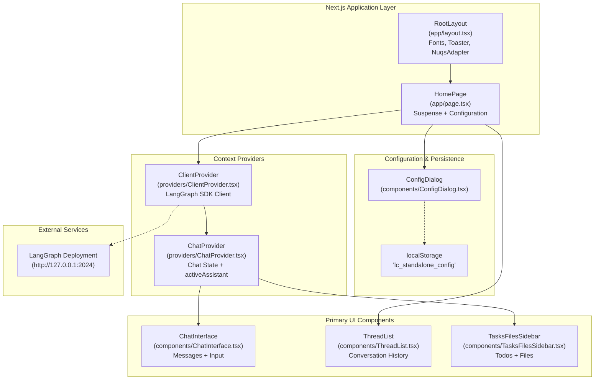
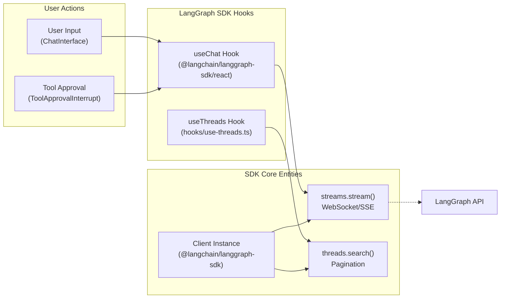

<!-- source: DeepWiki mcp.deepwiki.com · repo langchain-ai/deep-agents-ui · page 1 Overview · fetched 2026-10-26 -->

# Overview

Relevant source files

The following files were used as context for generating this wiki page:

- [README.md](README.md)
- [package.json](package.json)
- [src/app/layout.tsx](src/app/layout.tsx)
- [yarn.lock](yarn.lock)

## Purpose and Scope

Deep Agents UI is a Next.js-based web application that provides a frontend interface for interacting with LangGraph agent deployments. The application enables users to chat with AI agents, view real-time execution progress, approve tool calls, manage agent-generated files, and track task completion status. This document provides a high-level overview of the system architecture, core capabilities, and technology stack.

For detailed information about specific subsystems, see:
- Quick start and setup: [Quick Start Guide](#1.1)
- High-level architecture and hierarchy: [System Architecture](#1.2)

**Sources:** [README.md:1-4](), [README.md:59-72]()

## Core Capabilities

Deep Agents UI provides the following key features:

| Feature | Description | Primary Code Entities |
|---------|-------------|-------------------|
| **Real-time Chat** | Stream agent responses and tool execution updates | `ChatInterface`, `useChat` hook |
| **Thread Management** | Browse and search conversation history with time-based grouping | `ThreadList`, `useThreads` hook |
| **Tool Approval** | Human-in-the-loop approval for sensitive tool executions | `ToolApprovalInterrupt` |
| **File Viewing** | View and edit agent-generated files from LangGraph state | `FilesPopover`, `FileViewDialog` |
| **Task Tracking** | Monitor todo items grouped by status (pending/completed/failed) | `TasksFilesSidebar` |
| **Deployment Configuration** | Configure and persist connection settings to LangGraph deployments | `ConfigDialog`, `StandaloneConfig` |

The application supports two deployment modes:
- **Production Mode**: Connect to deployed LangGraph applications using UUID-based assistant IDs.
- **Development Mode**: Connect to local LangGraph instances (e.g., via `langgraph dev`) using graph IDs like `research`.

**Sources:** [README.md:16-58](), [package.json:15-51]()

## System Architecture

### High-Level Component Structure

This diagram maps the high-level application flow to the specific React components and providers that manage the system state.

For details, see [System Architecture](#1.2).

**Sources:** [app/layout.tsx:8-27](), [package.json:15-51](), [README.md:53-58]()

### Data Flow and SDK Integration

This diagram illustrates how the frontend interacts with the LangGraph SDK and manages real-time streaming data.

**Sources:** [package.json:16-18](), [README.md:42-51]()

## Technology Stack

### Core Framework
Deep Agents UI is built on **Next.js 16** using the App Router architecture and **React 19**. It leverages **Turbopack** for optimized development performance.

**Sources:** [package.json:7-9](), [package.json:38-41]()

### LangChain Integration
The application is tightly integrated with the LangChain ecosystem:
- **`@langchain/langgraph-sdk`**: Provides the core `Client` for communicating with deployments.
- **`@langchain/langgraph`**: Handles graph state and message structures.
- **`@langchain/core`**: Base abstractions for messages and tool calls.

**Sources:** [package.json:16-18]()

### UI and Styling
- **Styling**: **Tailwind CSS** for utility-first styling and **Sass** for complex stylesheets.
- **Components**: **Radix UI** primitives (Dialog, Select, Tabs, etc.) for accessible UI patterns.
- **Icons**: **Lucide React**.
- **State/URL**: **nuqs** for managing search params (like `threadId`) as synchronized React state.

**Sources:** [package.json:19-27](), [package.json:31-51](), [app/layout.tsx:1-4]()

## Next Steps

- **Quick Start Guide**: See [Quick Start Guide](#1.1) for installation and deployment instructions.
- **System Architecture**: See [System Architecture](#1.2) for detailed component hierarchies and provider structures.

**Sources:** [README.md:5-14]()

---

