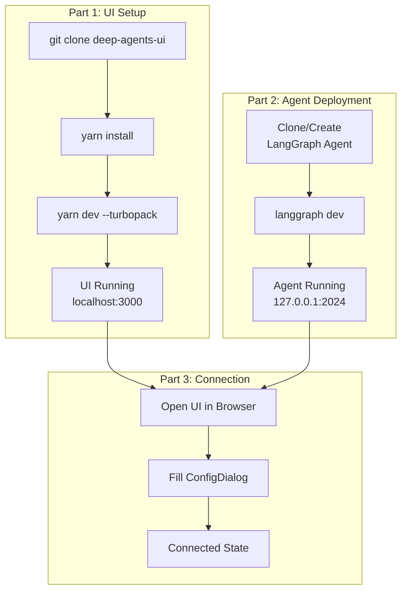
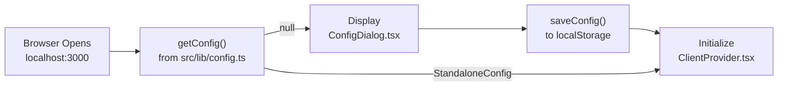
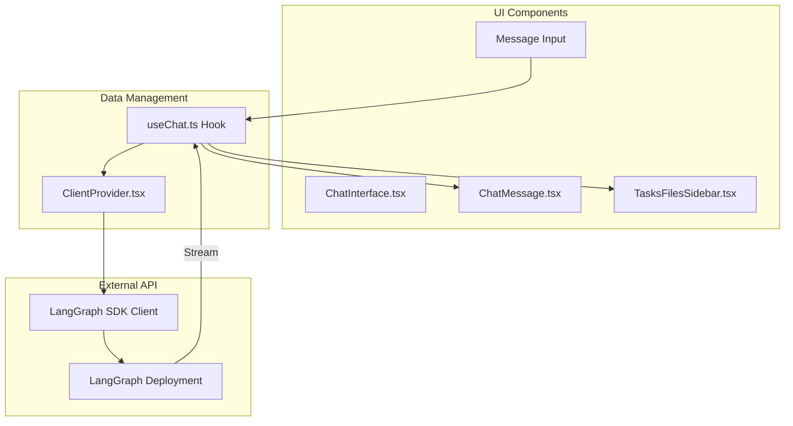

<!-- source: DeepWiki mcp.deepwiki.com · repo langchain-ai/deep-agents-ui · page 1.1 Quick Start Guide · fetched 2026-10-26 -->

# Quick Start Guide

<details>
<summary>Relevant source files</summary>

The following files were used as context for generating this wiki page:

- [.nvmrc](.nvmrc)
- [README.md](README.md)
- [package.json](package.json)

</details>


## Purpose and Scope

This guide provides step-by-step instructions for setting up and running the Deep Agents UI from a fresh clone to your first agent interaction. It covers repository cloning, dependency installation, LangGraph deployment setup, connection configuration, and basic usage patterns.

For detailed information about the system architecture and component interactions, see **1.2 System Architecture**. For configuration persistence and management details, see **2.1 Configuration Management**. For LangGraph SDK integration patterns, see **2.2 LangGraph Integration**.

---

## Prerequisites

Before starting, ensure you have the following installed on your system:

| Requirement | Version | Purpose |
|-------------|---------|---------|
| Node.js | 20.x | JavaScript runtime (defined in `.nvmrc`) |
| Yarn | 1.22.22 | Package manager (defined in `package.json`) |
| Python | ≥ 3.11 | Required for LangGraph deployment |
| LangGraph CLI | Latest | For deploying and managing agents |

**Sources:** [.nvmrc:1-1](), [package.json:76-76]()

---

## Installation Workflow

The setup process follows a three-part workflow: (1) installing and running the UI application, (2) deploying a LangGraph agent that the UI will connect to, and (3) configuring the connection.

### Installation & Execution Diagram



**Sources:** [README.md:9-14](), [package.json:7-7]()

---

## Step 1: Clone and Install UI Application

Clone the repository and install dependencies using Yarn:

```bash
git clone https://github.com/langchain-ai/deep-agents-ui.git
cd deep-agents-ui
yarn install
```

Start the development server using the `dev` script:

```bash
yarn dev
```

The application will be available at `http://localhost:3000`. At this point, the UI is running but not yet configured to connect to any agent deployment.

**Sources:** [README.md:9-14](), [package.json:7-7]()

---

## Step 2: Deploy a LangGraph Agent

The UI requires a running LangGraph deployment to connect to. This can be a local deployment (for development) or a remote hosted deployment.

### Local Development Deployment

For local development, use the LangGraph CLI to start a development server. For example, using the `deep_research` agent from the [deepagents](https://github.com/langchain-ai/deepagents) repository:

```bash
cd deepagents-quickstarts/deep_research
langgraph dev
```

The LangGraph CLI will output deployment information:

```
- 🚀 API: http://127.0.0.1:2024
- 🎨 Studio UI: https://smith.langchain.com/studio/?baseUrl=http://127.0.0.1:2024
```

Note the API URL (`http://127.0.0.1:2024`) - this will be your **Deployment URL**.

### Identifying the Assistant ID

The Assistant ID is defined in the agent's `langgraph.json` file under the `graphs` key:

```json
  "graphs": {
    "research": "./agent.py:agent"
  }
```

In this example, the **Assistant ID** is `research`.

**Sources:** [README.md:16-52]()

---

## Step 3: Configure Connection Settings

When you first open the UI at `http://localhost:3000`, the application will detect that no configuration exists and automatically display the `ConfigDialog`.

### Configuration Logic Diagram



### Configuration Fields

The `ConfigDialog` component requires the following fields:

| Field | Required | Purpose | Example |
|-------|----------|---------|---------|
| **Deployment URL** | Yes | The URL for the LangGraph deployment | `http://127.0.0.1:2024` |
| **Assistant ID** | Yes | The ID of the assistant/graph to use | `research` |
| **LangSmith API Key** | No | Key for accessing LangGraph apps | `lsv2_pt_...` |

The configuration is persisted to `localStorage` using the key `"deep-agent-config"` via the `saveConfig()` function.

**Sources:** [README.md:53-58](), [src/lib/config.ts:7-25]()

---

## Step 4: Configuration Flow Detail

The configuration system operates through a multi-step initialization flow:

1. **Retrieval**: The app calls `getConfig()` from `src/lib/config.ts` to check for an existing `StandaloneConfig` object.
2. **Input**: If missing, `ConfigDialog.tsx` is rendered. It manages internal state for `deploymentUrl`, `assistantId`, and `langsmithApiKey`.
3. **Persistence**: Upon clicking "Save", `handleSave` validates the inputs and calls `saveConfig(config)` to persist the data.

**Sources:** [src/app/components/ConfigDialog.tsx:48-60](), [src/lib/config.ts:1-26]()

---

## Step 5: Optional Environment Variables

Instead of using the UI configuration dialog, you can pre-configure settings via environment variables. Create a `.env.local` file:

```env
NEXT_PUBLIC_LANGSMITH_API_KEY="lsv2_xxxx"
```

**Precedence:** Settings configured through the `ConfigDialog` UI take precedence over environment variables.

**Sources:** [README.md:73-81]()

---

## Step 6: First Interaction

Once connected, you can interact with the agent through the chat interface.

### Chat Execution Flow



### Basic Usage Pattern

1. **Send Message**: Type a request in the chat interface and submit.
2. **Real-time Streaming**: The agent processes the request and streams updates (messages, tool calls, and state changes) back to the UI.
3. **File Interaction**: Files created by the agent appear in the LangGraph state and are accessible via the `TasksFilesSidebar`.
4. **Debug Mode**: You can toggle "Debug Mode" to execute the agent step-by-step, allowing for granular control and re-running of specific steps.

**Sources:** [README.md:59-88]()

---

## Troubleshooting Common Issues

| Issue | Potential Cause | Solution |
|-------|-----------------|----------|
| **Connection Failed** | LangGraph deployment is not running | Verify `langgraph dev` is active and the URL matches. |
| **Assistant Not Found** | Incorrect Assistant ID | Check the `graphs` key in your `langgraph.json` file. |
| **Config Not Saving** | Browser localStorage disabled | Ensure browser allows persistence for the UI domain. |

**Sources:** [README.md:1-52](), [src/lib/config.ts:7-15]()

---

