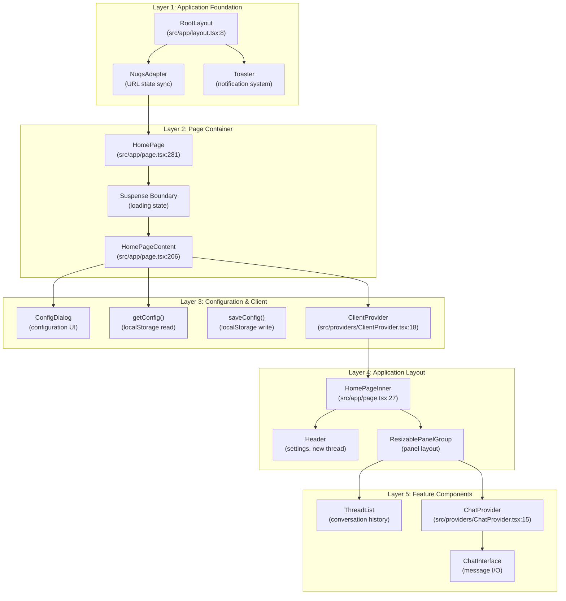
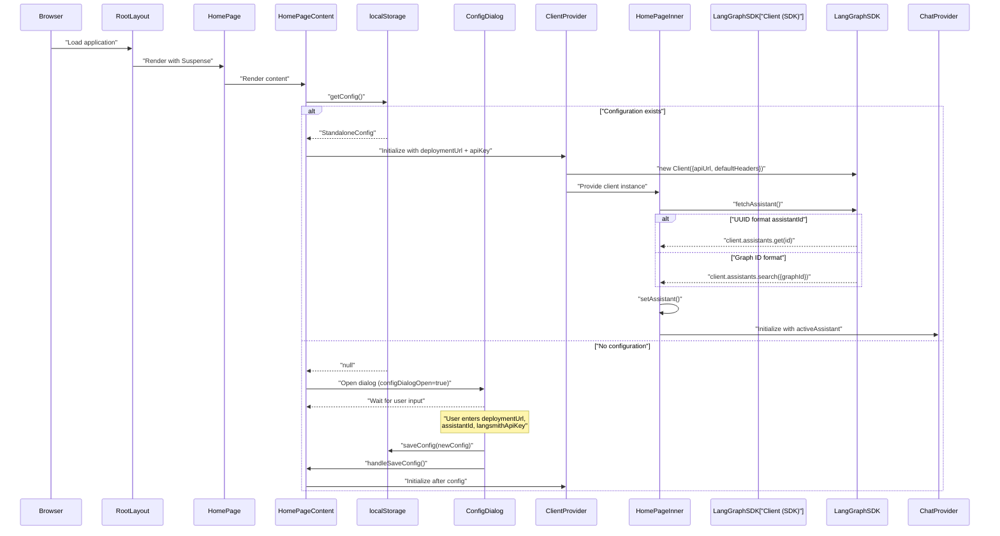
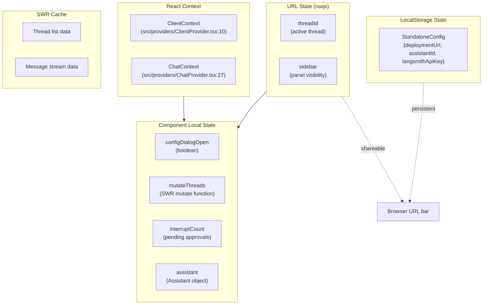
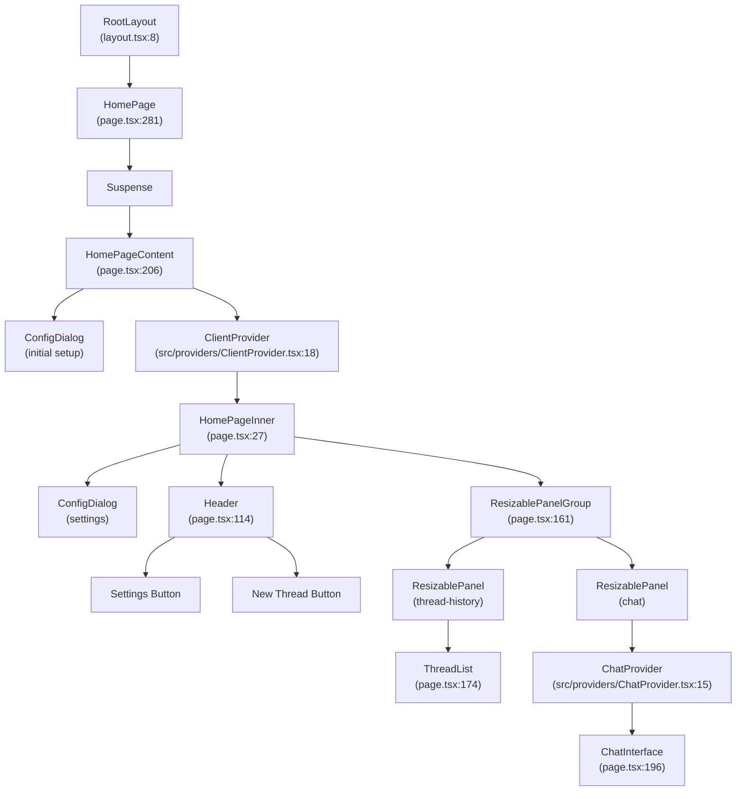
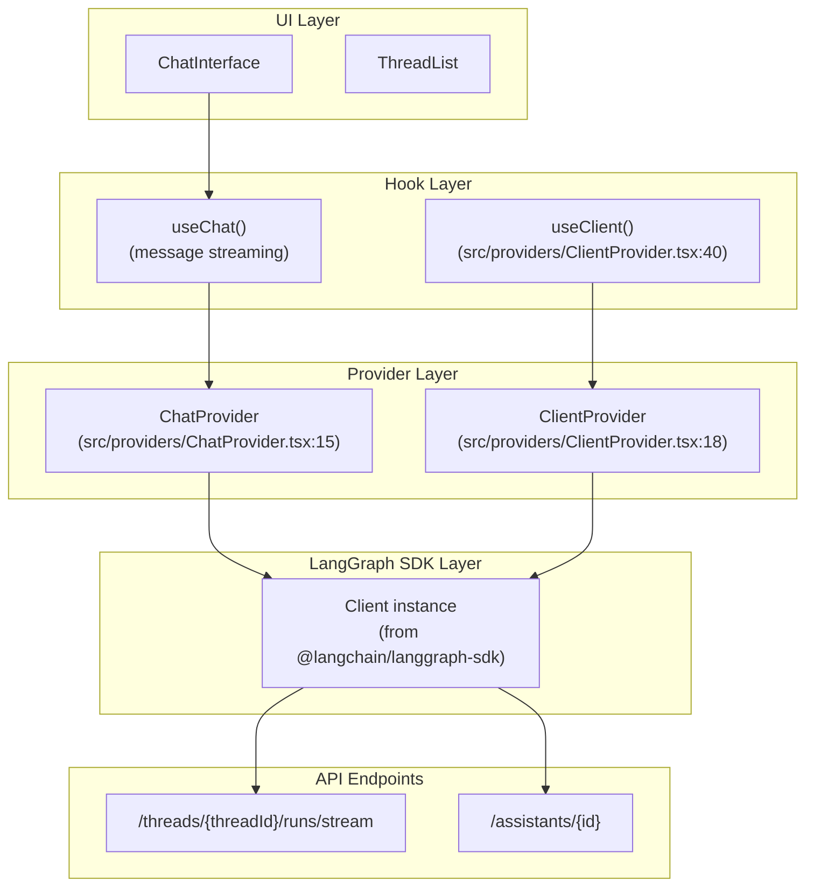
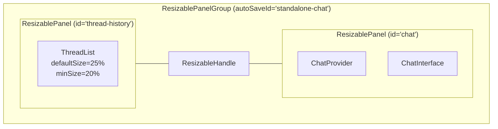

<!-- source: DeepWiki mcp.deepwiki.com · repo langchain-ai/deep-agents-ui · page 1.2 System Architecture · fetched 2026-10-26 -->

# System Architecture

Relevant source files

The following files were used as context for generating this wiki page:

- [src/app/layout.tsx](src/app/layout.tsx)
- [src/app/page.tsx](src/app/page.tsx)
- [src/providers/ChatProvider.tsx](src/providers/ChatProvider.tsx)
- [src/providers/ClientProvider.tsx](src/providers/ClientProvider.tsx)
- [yarn.lock](yarn.lock)

## Purpose and Scope

This document describes the high-level architecture of Deep Agents UI, a Next.js-based frontend application for interacting with LangGraph agent deployments. It covers the layered structure of the application, the role of context providers in managing state, the component hierarchy, and the communication patterns with the LangGraph backend.

For specific implementation details about configuration management, see [Configuration Management](#2.1). For details about the LangGraph SDK integration, see [LangGraph Integration](#2.2). For UI-specific concerns like styling and components, see [User Interface Components](#7).

---

## Architectural Layers

Deep Agents UI follows a strict layered architecture where each layer has specific responsibilities and dependencies flow downward. The application is organized into five distinct layers:

### Layer Diagram

**Sources:** [src/app/layout.tsx:8-27](), [src/app/page.tsx:1-293](), [src/providers/ClientProvider.tsx:18-38](), [src/providers/ChatProvider.tsx:15-23]()

### Layer Responsibilities

| Layer | Components | Responsibilities |
|-------|-----------|------------------|
| **Layer 1: Foundation** | `RootLayout`, `NuqsAdapter`, `Toaster` | Global HTML structure, font loading, URL state synchronization, toast notifications |
| **Layer 2: Page Container** | `HomePage`, `Suspense`, `HomePageContent` | Suspense boundary for loading states, configuration loading from localStorage |
| **Layer 3: Configuration & Client** | `ConfigDialog`, `getConfig/saveConfig`, `ClientProvider` | Configuration persistence, LangGraph SDK client initialization |
| **Layer 4: Application Layout** | `HomePageInner`, `Header`, `ResizablePanelGroup` | UI chrome (header, settings button), resizable panel system, assistant fetching |
| **Layer 5: Feature Components** | `ThreadList`, `ChatProvider`, `ChatInterface` | Thread navigation, chat state management, message display and input |

**Sources:** [src/app/page.tsx:27-293](), [src/app/layout.tsx:1-27]()

---

## Application Bootstrap Flow

The application follows a strict initialization sequence that ensures configuration is validated before establishing connections to the LangGraph backend.

### Bootstrap Sequence Diagram

**Sources:** [src/app/page.tsx:206-279](), [src/app/page.tsx:41-99](), [src/providers/ClientProvider.tsx:23-31]()

### Bootstrap Steps

1. **Layer 1 Initialization** ([src/app/layout.tsx:8-27]()): `RootLayout` renders with `NuqsAdapter` wrapping all children to enable URL state synchronization and `Toaster` for notifications.

2. **Suspense Boundary** ([src/app/page.tsx:281-293]()): `HomePage` wraps `HomePageContent` in a Suspense boundary to handle async operations during initialization.

3. **Configuration Loading** ([src/app/page.tsx:212-223]()): `HomePageContent` calls `getConfig()` on mount to retrieve stored configuration from localStorage. If no configuration exists, `configDialogOpen` is set to true.

4. **Client Initialization** ([src/providers/ClientProvider.tsx:23-31]()): Once valid configuration exists, `ClientProvider` is rendered. It uses `useMemo` to instantiate a new `@langchain/langgraph-sdk` `Client` with the provided `apiUrl` and `X-Api-Key` header.

5. **Assistant Fetching** ([src/app/page.tsx:41-99]()): `HomePageInner` determines if `config.assistantId` is a UUID or graph name, then either calls `client.assistants.get()` or `client.assistants.search()` to retrieve assistant metadata.

6. **Chat Session Initialization** ([src/app/page.tsx:192-197]()): `ChatProvider` is rendered with the fetched `activeAssistant`, enabling chat functionality.

**Sources:** [src/app/page.tsx:206-293](), [src/app/page.tsx:27-204](), [src/providers/ClientProvider.tsx:1-48]()

---

## State Management Architecture

Deep Agents UI employs four distinct state management strategies, each serving a specific purpose:

### State Management Layers

**Sources:** [src/app/page.tsx:34-38](), [src/providers/ClientProvider.tsx:10](), [src/providers/ChatProvider.tsx:27]()

### State Strategy Table

| State Type | Storage Location | Purpose | Persistence | Example |
|------------|------------------|---------|-------------|---------|
| **URL State** | Query parameters (via `useQueryState`) | Shareable UI state | Until URL changes | `threadId`, `sidebar` |
| **LocalStorage** | Browser localStorage | Configuration persistence | Across sessions | `deploymentUrl`, `assistantId` |
| **React Context** | Provider components | Cross-component shared state | Component lifecycle | `client` instance, `useChat` hook return value |
| **Local State** | `useState` hooks | Component-specific state | Component lifecycle | `configDialogOpen`, `interruptCount` |

**Sources:** [src/app/page.tsx:1-293](), [src/providers/ChatProvider.tsx:21-22]()

### State Initialization Flow

1. **URL State** ([src/app/page.tsx:34-35]()): `useQueryState` hooks create synchronized state with URL query parameters. Changes to these values automatically update the URL and vice versa.

2. **Configuration State** ([src/app/page.tsx:212-223]()): On mount, `getConfig()` reads from localStorage. If not found, the welcome screen is shown with `ConfigDialog`.

3. **Context State** ([src/providers/ClientProvider.tsx:33-36]()): `ClientProvider` wraps its children in `ClientContext.Provider`, exposing the `client` instance via the `useClient` hook ([src/providers/ClientProvider.tsx:40-47]()).

4. **Derived Chat State** ([src/providers/ChatProvider.tsx:21-22]()): `ChatProvider` initializes the `useChat` hook and provides its results (messages, submission handlers, etc.) to the entire chat subtree via `ChatContext`.

**Sources:** [src/app/page.tsx:27-204](), [src/providers/ClientProvider.tsx:1-48](), [src/providers/ChatProvider.tsx:1-37]()

---

## Component Hierarchy

The component tree follows a clear parent-child relationship that mirrors the architectural layers:

### Component Tree Structure

**Sources:** [src/app/page.tsx:1-293](), [src/app/layout.tsx:1-27](), [src/providers/ClientProvider.tsx:1-48]()

### Component Responsibility Matrix

| Component | File Location | Primary Responsibilities |
|-----------|---------------|-------------------------|
| `RootLayout` | [src/app/layout.tsx:8-27]() | HTML structure, Inter font, `NuqsAdapter`, `Toaster` |
| `HomePageContent` | [src/app/page.tsx:206-279]() | Configuration loading, `getConfig()`/`saveConfig()`, conditional rendering |
| `ClientProvider` | [src/providers/ClientProvider.tsx:18-38]() | LangGraph client initialization and distribution via `ClientContext` |
| `HomePageInner` | [src/app/page.tsx:27-204]() | Layout orchestration, assistant fetching, URL state management |
| `ChatProvider` | [src/providers/ChatProvider.tsx:15-23]() | Chat state, message management, providing `useChat` hook data to context |
| `ChatInterface` | [src/app/page.tsx:196]() | Message display, input handling, tasks/files sidebar |

**Sources:** [src/app/page.tsx:27-293](), [src/providers/ChatProvider.tsx:1-37]()

---

## Communication Architecture

The application communicates with the LangGraph backend through a layered API architecture:

### Communication Flow

**Sources:** [src/app/page.tsx:27-204](), [src/providers/ClientProvider.tsx:1-48](), [src/providers/ChatProvider.tsx:1-37]()

### Client Initialization

The `ClientProvider` creates a single LangGraph client instance that is shared across the application:

1. **Provider Setup** ([src/providers/ClientProvider.tsx:23-31]()): `ClientProvider` receives `deploymentUrl` and `apiKey` as props. It instantiates a new `Client` from the `@langchain/langgraph-sdk`.

2. **Context Distribution** ([src/providers/ClientProvider.tsx:33-37]()): The client instance is exposed via `ClientContext.Provider`, accessible through the `useClient()` hook ([src/providers/ClientProvider.tsx:40-47]()).

3. **Assistant Resolution** ([src/app/page.tsx:41-99]()): `HomePageInner` uses the client to resolve the assistant:
   - **UUID format**: Direct call to `client.assistants.get(assistantId)` ([src/app/page.tsx:50]()).
   - **Graph ID format**: Call to `client.assistants.search({graphId: assistantId})` ([src/app/page.tsx:70-73]()), then selecting the system default assistant ([src/app/page.tsx:74-76]()).

**Sources:** [src/app/page.tsx:41-99](), [src/providers/ClientProvider.tsx:1-48]()

---

## Layout System

The application uses a resizable two-panel layout managed by the `ResizablePanelGroup` component:

### Panel Configuration

**Sources:** [src/app/page.tsx:161-200]()

### Panel Behavior

| Panel | Properties | Visibility Control |
|-------|-----------|-------------------|
| **Thread History** | `id="thread-history"`, `order={1}`, `defaultSize={25}`, `minSize={20}` | Conditional render based on `sidebar` query param ([src/app/page.tsx:165-184]()) |
| **Chat** | `id="chat"`, `order={2}` | Always visible |

**Key Features:**

1. **Persistent Sizing** ([src/app/page.tsx:163]()): The `autoSaveId="standalone-chat"` prop saves panel sizes to localStorage.

2. **Conditional Thread Panel** ([src/app/page.tsx:165]()): The thread list panel only renders when the `sidebar` state is truthy.

3. **Toggle Control** ([src/app/page.tsx:117-132]()): Header contains a "Threads" button that sets `sidebar="1"` to show the panel.

**Sources:** [src/app/page.tsx:161-200](), [src/app/page.tsx:117-132]()

---

