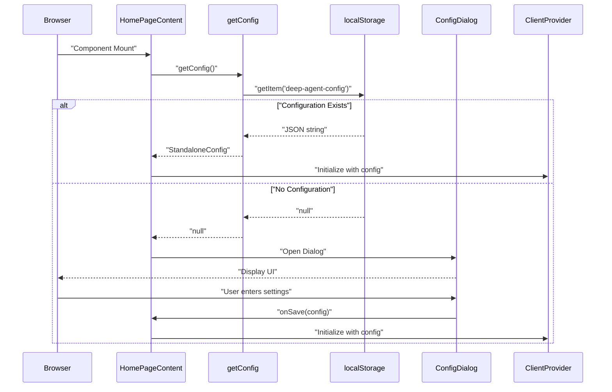
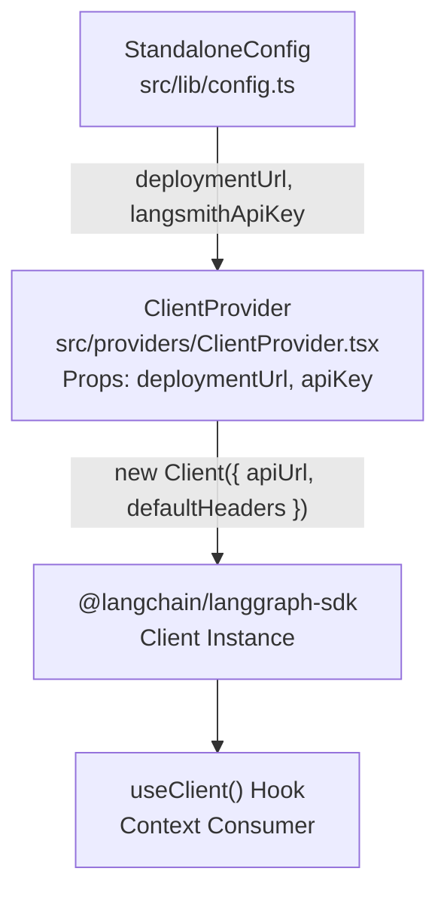
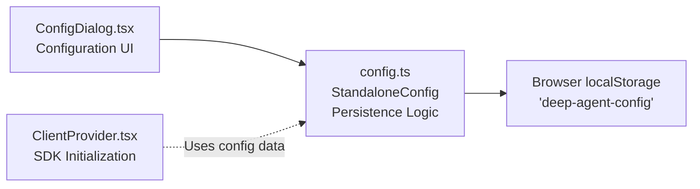

<!-- source: DeepWiki mcp.deepwiki.com · repo langchain-ai/deep-agents-ui · page 2 Configuration and Connection · fetched 2026-10-26 -->

# Configuration and Connection

Relevant source files

The following files were used as context for generating this wiki page:

- [src/app/components/ConfigDialog.tsx](src/app/components/ConfigDialog.tsx)
- [src/lib/config.ts](src/lib/config.ts)
- [src/providers/ClientProvider.tsx](src/providers/ClientProvider.tsx)

This document describes the system for configuring and establishing connections to LangGraph deployments. It covers the configuration data structure, persistence mechanism, initialization flow, and how configuration parameters are used to establish API connectivity. For detailed information about the configuration UI components and persistence layer, see [Configuration Management](#2.1). For details on LangGraph SDK integration and API communication, see [LangGraph Integration](#2.2).

## Overview

The configuration system manages three essential connection parameters that enable the Deep Agents UI to communicate with a LangGraph deployment. Configuration data is persisted in browser `localStorage` and loaded on application startup. If no configuration exists, the application displays a `ConfigDialog` to collect the required settings before proceeding.

The configuration flow consists of three phases:

1.  **Loading**: On mount, `HomePageContent` attempts to retrieve configuration from `localStorage` via `getConfig()` [src/lib/config.ts:9-20]().
2.  **Validation**: If configuration exists, it initializes the `ClientProvider` with the deployment URL and API key [src/providers/ClientProvider.tsx:18-38]().
3.  **Initialization**: The `ClientProvider` creates a LangGraph SDK `Client` instance for all subsequent API communication [src/providers/ClientProvider.tsx:23-31]().

Sources: [src/lib/config.ts:1-26](), [src/providers/ClientProvider.tsx:1-48]()

## Configuration Data Structure

The `StandaloneConfig` interface defines the required and optional connection parameters:

| Field | Type | Required | Description |
| :--- | :--- | :--- | :--- |
| `deploymentUrl` | `string` | Yes | Base URL of the LangGraph deployment (e.g., `https://my-deployment.langchain.app`) |
| `assistantId` | `string` | Yes | Either a UUID assistant ID or a graph ID string |
| `langsmithApiKey` | `string` | No | API key for authentication, typically used for LangSmith or hosted LangGraph |

Sources: [src/lib/config.ts:1-5]()

## Configuration Storage and Retrieval

Configuration persistence uses the browser's `localStorage` API with the key `"deep-agent-config"` [src/lib/config.ts:7](). The system provides two functions:

**`getConfig(): StandaloneConfig | null`**
- Retrieves configuration from `localStorage.getItem(CONFIG_KEY)` [src/lib/config.ts:12]().
- Parses the JSON string into a `StandaloneConfig` object [src/lib/config.ts:16]().
- Returns `null` if no configuration exists, parsing fails, or in server-side rendering contexts [src/lib/config.ts:10-19]().

**`saveConfig(config: StandaloneConfig): void`**
- Serializes the configuration object to JSON and stores it in `localStorage` [src/lib/config.ts:24]().
- No-op in server-side rendering contexts [src/lib/config.ts:23]().

Sources: [src/lib/config.ts:7-25]()

## Configuration Initialization Flow

**Configuration Initialization Code Path**

The initialization logic follows this sequence:
1.  **Retrieval**: `getConfig()` is called to check for existing settings [src/lib/config.ts:9-20]().
2.  **State Management**: `ConfigDialog` manages local state for `deploymentUrl`, `assistantId`, and `langsmithApiKey` before saving [src/app/components/ConfigDialog.tsx:30-38]().
3.  **Persistence**: `handleSave` in the dialog calls the `onSave` callback, which typically triggers `saveConfig()` [src/app/components/ConfigDialog.tsx:48-60]().

Sources: [src/lib/config.ts:9-25](), [src/app/components/ConfigDialog.tsx:24-60]()

## Client Provider Initialization

The `ClientProvider` is initialized with connection parameters. It uses `useMemo` to instantiate a new LangGraph `Client` [src/providers/ClientProvider.tsx:23-31](). This client includes the `apiUrl` and an `X-Api-Key` header if an API key is provided [src/providers/ClientProvider.tsx:28]().

The resulting `Client` instance is made available to the rest of the application via the `useClient` hook [src/providers/ClientProvider.tsx:40-47]().

Sources: [src/providers/ClientProvider.tsx:18-47]()

## Configuration Management UI

The `ConfigDialog` component provides the interface for users to input and modify their connection settings [src/app/components/ConfigDialog.tsx:24]().

*   **Validation**: The dialog ensures that `deploymentUrl` and `assistantId` are present before allowing a save [src/app/components/ConfigDialog.tsx:49-52]().
*   **Persistence Message**: The UI explicitly informs users that settings are saved in the browser's local storage [src/app/components/ConfigDialog.tsx:71-73]().
*   **Optional Fields**: `langsmithApiKey` is marked as optional and uses a password input type for security [src/app/components/ConfigDialog.tsx:95-105]().

Sources: [src/app/components/ConfigDialog.tsx:48-118]()

## Configuration Dependencies

The configuration system has dependencies on the following components and utilities:

The `StandaloneConfig` interface serves as the shared type definition across all configuration-related components, ensuring type safety throughout the configuration lifecycle [src/lib/config.ts:1-5]().

Sources: [src/lib/config.ts:1-26](), [src/app/components/ConfigDialog.tsx:15-22](), [src/providers/ClientProvider.tsx:6-8]()

---

