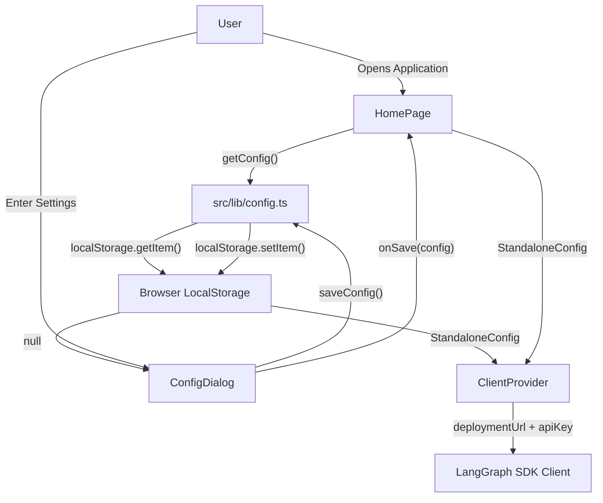
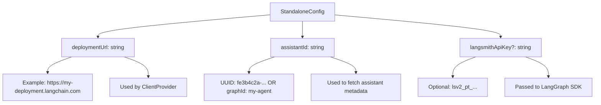
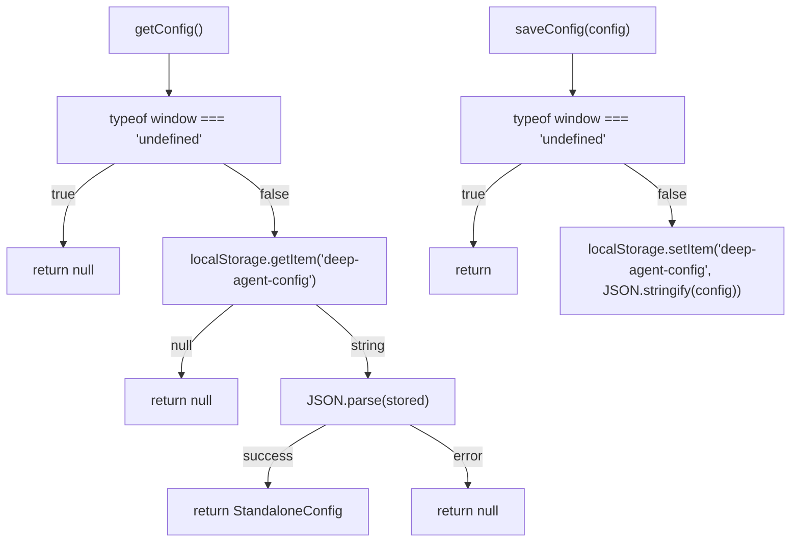
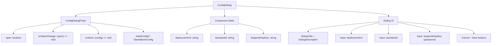
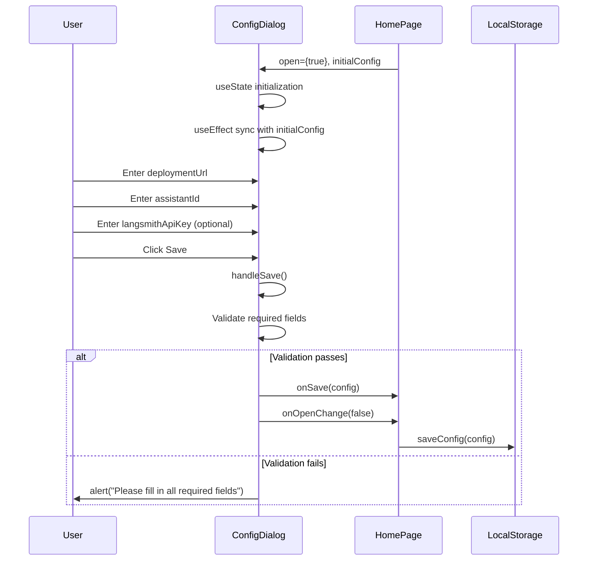

<!-- source: DeepWiki mcp.deepwiki.com · repo langchain-ai/deep-agents-ui · page 2.1 Configuration Management · fetched 2026-10-26 -->

# Configuration Management

Relevant source files

The following files were used as context for generating this wiki page:

- [src/app/components/ConfigDialog.tsx](src/app/components/ConfigDialog.tsx)
- [src/lib/config.ts](src/lib/config.ts)

This document covers the configuration management system in Deep Agents UI, which handles deployment connection settings and their persistence in browser local storage. The configuration system collects and stores the necessary parameters to connect to a LangGraph deployment.

For information about how configuration is used to initialize the LangGraph client, see page 2.2. For details about the overall application layout and initialization flow, see page 3.1.

## Configuration Architecture

Deep Agents UI requires configuration to establish a connection to a LangGraph deployment. The configuration system is built around three key components: the `StandaloneConfig` type definition, the `ConfigDialog` UI component, and browser local storage persistence functions.

### Configuration Flow Diagram

The configuration flow operates as follows:
1. Application checks for existing configuration in local storage using `getConfig()` [src/lib/config.ts:9-20]().
2. If not found, the UI triggers the `ConfigDialog` [src/app/components/ConfigDialog.tsx:24-120]().
3. User inputs deployment URL, assistant ID, and optional LangSmith API key.
4. Configuration is saved to local storage via `saveConfig()` [src/lib/config.ts:22-25]() and passed to the application state.
5. The `ClientProvider` initializes the LangGraph SDK client with the provided configuration.

Sources: [src/lib/config.ts:9-25](), [src/app/components/ConfigDialog.tsx:24-60]()

## Configuration Data Model

The configuration system is defined by the `StandaloneConfig` interface, which specifies the parameters required to connect to a LangGraph deployment.

### StandaloneConfig Interface

The `StandaloneConfig` interface in [src/lib/config.ts:1-5]() defines the configuration structure:

| Field | Type | Required | Purpose |
|-------|------|----------|---------|
| `deploymentUrl` | `string` | Yes | URL of the LangGraph deployment server |
| `assistantId` | `string` | Yes | UUID or graph ID identifying the target assistant |
| `langsmithApiKey` | `string` | No | Optional API key for LangSmith analytics integration |

### Configuration Fields Explained

The `deploymentUrl` specifies the target LangGraph server endpoint. The `assistantId` can be either a full UUID for production deployments or a graph name/ID for development environments. The optional `langsmithApiKey` enables analytics and tracing features when provided.

Sources: [src/lib/config.ts:1-5]()

## Local Storage Persistence

Configuration is persisted in browser local storage under the key `"deep-agent-config"`, allowing settings to survive page refreshes and browser sessions.

### Storage Functions

The [src/lib/config.ts]() module provides two utility functions for configuration persistence:

| Function | Parameters | Returns | Purpose |
|----------|------------|---------|---------|
| `getConfig()` | None | `StandaloneConfig \| null` | Retrieves stored configuration from local storage |
| `saveConfig(config)` | `StandaloneConfig` | `void` | Saves configuration to local storage |

### Storage Implementation Details

The `getConfig()` function in [src/lib/config.ts:9-20]() performs the following operations:
1. Checks if running in browser environment (`window` is defined) [src/lib/config.ts:10-10]().
2. Attempts to retrieve the stored configuration string using the `CONFIG_KEY` ("deep-agent-config") [src/lib/config.ts:7-12]().
3. Parses the JSON string, catching any parsing errors [src/lib/config.ts:15-19]().
4. Returns `null` if configuration doesn't exist or parsing fails.

The `saveConfig()` function in [src/lib/config.ts:22-25]() serializes the configuration object to JSON and stores it in local storage. Both functions include server-side rendering guards to prevent errors during Next.js pre-rendering.

Sources: [src/lib/config.ts:7-25]()

## ConfigDialog Component

The `ConfigDialog` component provides a modal dialog interface for collecting configuration parameters from the user. It is displayed when no valid configuration exists in local storage or when the user chooses to edit settings.

### ConfigDialog Component Structure

### Configuration Input Fields

The dialog presents three input fields to the user:

| Field Label | Input ID | Validation | Placeholder |
|-------------|----------|------------|-------------|
| Deployment URL | `deploymentUrl` | Required | `https://<deployment-url>` |
| Assistant ID | `assistantId` | Required | `<assistant-id>` |
| LangSmith API Key | `langsmithApiKey` | Optional | `lsv2_pt_...` |

The component in [src/app/components/ConfigDialog.tsx:24-120]() maintains local state for each input field using `useState` [src/app/components/ConfigDialog.tsx:30-38]() and synchronizes with `initialConfig` via `useEffect` when the dialog opens [src/app/components/ConfigDialog.tsx:40-46](). The LangSmith API Key input uses `type="password"` to mask the entered value [src/app/components/ConfigDialog.tsx:101-101]().

### ConfigDialog Interaction Flow

The `handleSave` function in [src/app/components/ConfigDialog.tsx:48-60]() performs validation to ensure both `deploymentUrl` and `assistantId` are provided before invoking the `onSave` callback with the configuration object [src/app/components/ConfigDialog.tsx:54-58]().

Sources: [src/app/components/ConfigDialog.tsx:17-120](), [src/lib/config.ts:22-25]()

---

