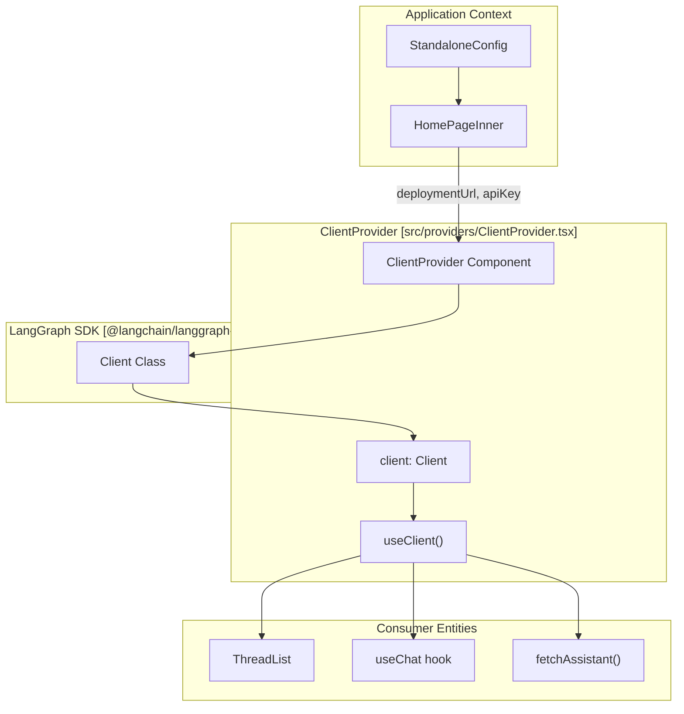
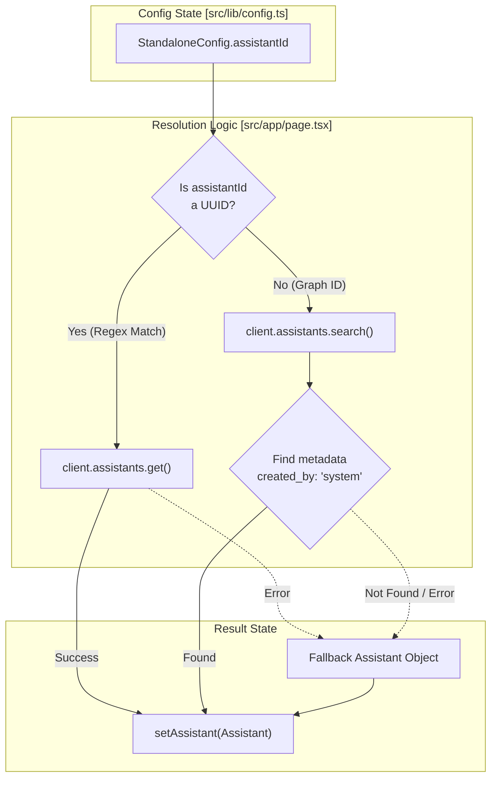
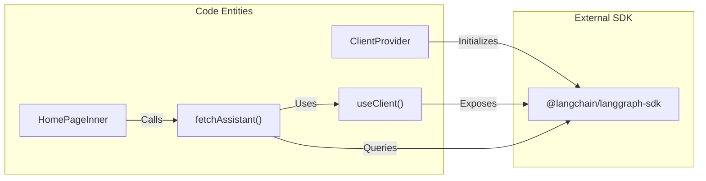

<!-- source: DeepWiki mcp.deepwiki.com · repo langchain-ai/deep-agents-ui · page 2.2 LangGraph Integration · fetched 2026-10-26 -->

# LangGraph Integration

Relevant source files

The following files were used as context for generating this wiki page:

- [src/app/page.tsx](src/app/page.tsx)
- [src/providers/ClientProvider.tsx](src/providers/ClientProvider.tsx)

This document covers how the Deep Agents UI integrates with the LangGraph SDK to connect to LangGraph deployments. The integration includes client initialization, assistant fetching, and API communication patterns managed through the `ClientProvider`.

For configuration management and localStorage persistence, see page 2.1. For the chat system that utilizes these connections, see page 4.2.

## Client Initialization

The `ClientProvider` component initializes the LangGraph SDK client and makes it available throughout the application via the `useClient()` hook. It uses the `deploymentUrl` and `apiKey` provided by the application configuration.

### Client Provider Architecture

The `ClientProvider` initializes the client using a `useMemo` hook to ensure the instance is only recreated when the `deploymentUrl` or `apiKey` changes [src/providers/ClientProvider.tsx:23-31]().

**Sources:** [src/providers/ClientProvider.tsx:18-38](), [src/app/page.tsx:9](), [src/app/page.tsx:33]()

## Assistant Fetching

The application fetches assistant metadata after client initialization to validate the connection and retrieve assistant configuration. This logic resides in the `fetchAssistant` function within `HomePageInner` [src/app/page.tsx:41-99]().

### Assistant Resolution Flow

### UUID-Based Resolution
If the `assistantId` matches a UUID regex pattern, the system attempts a direct fetch using `client.assistants.get(config.assistantId)` [src/app/page.tsx:42-51]().

### Graph Name-Based Resolution
If the `assistantId` is a graph name (not a UUID), the system:
1. Searches for assistants associated with that `graphId` [src/app/page.tsx:70-73]().
2. Filters the results to find the default assistant where `metadata["created_by"] === "system"` [src/app/page.tsx:74-76]().

### Fallback Behavior
If the assistant cannot be found or an error occurs during fetching, the system constructs a manual `Assistant` object. This ensures the UI remains functional by providing a valid object structure with default names and IDs [src/app/page.tsx:54-64](), [src/app/page.tsx:86-96]().

**Sources:** [src/app/page.tsx:41-103](), [src/providers/ClientProvider.tsx:40-47]()

## Data Flow and SDK Usage

The application interacts with the LangGraph SDK through the client instance provided by `useClient()`. Key interaction points include:

### Client API Methods

| Area | Code Entity | SDK Method | Purpose |
| :--- | :--- | :--- | :--- |
| **Assistant Management** | `fetchAssistant` | `client.assistants.get` | Retrieve specific assistant details [src/app/page.tsx:50]() |
| **Assistant Discovery** | `fetchAssistant` | `client.assistants.search` | Find assistants by graph name [src/app/page.tsx:70]() |
| **Thread History** | `ThreadList` | `client.threads.search` | (Internal to ThreadList) List user threads |

### System Integration Summary

**Sources:** [src/providers/ClientProvider.tsx:4-38](), [src/app/page.tsx:33-41]()

---

