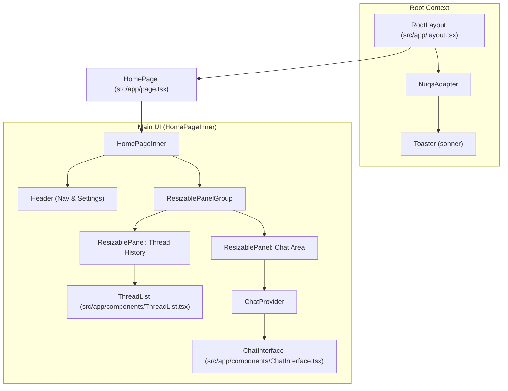
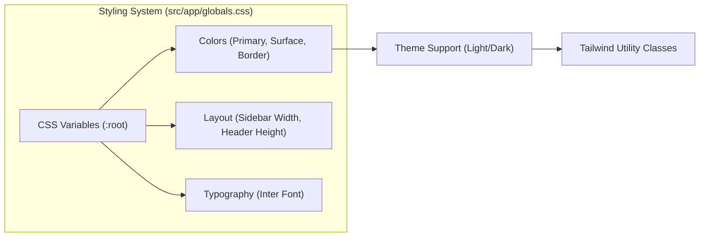

<!-- source: DeepWiki mcp.deepwiki.com · repo langchain-ai/deep-agents-ui · page 3 Application Layout · fetched 2026-10-26 -->

# Application Layout

Relevant source files

The following files were used as context for generating this wiki page:

- [src/app/components/ThreadList.tsx](src/app/components/ThreadList.tsx)
- [src/app/globals.css](src/app/globals.css)
- [src/app/layout.tsx](src/app/layout.tsx)
- [src/app/page.tsx](src/app/page.tsx)
- [yarn.lock](yarn.lock)

This page describes the high-level organization of the Deep Agents UI. The application uses a modern Next.js structure with a focus on resizable panels and real-time state management via URL query parameters. The layout is designed to facilitate complex agent interactions by providing dedicated areas for thread history, chat execution, and configuration.

For details on specific areas of the layout, see the following child pages:
- [Main Application Shell](#3.1) — Documents the `RootLayout`, `HomePage`, and `HomePageInner` components, including the resizable panel system.
- [Thread Navigation](#3.2) — Explains the `ThreadList` component, thread filtering, grouping by time, and the `useThreads` hook.

## Layout Structure Overview

The application follows a standard Next.js App Router structure. The `RootLayout` establishes the global provider context, while the `HomePageInner` component manages the primary visual segments using a resizable panel system.

**Layout Organization**

The interface is divided into three primary vertical zones:
1.  **Header**: Contains the application title, current assistant ID, settings toggle, and "New Thread" action [src/app/page.tsx:114-158]().
2.  **Thread Sidebar**: A collapsible and resizable panel on the left that lists historical and active chat threads [src/app/page.tsx:167-182]().
3.  **Chat Interface**: The main workspace where message streaming and agent tool execution occur [src/app/page.tsx:187-198]().

Sources: [src/app/layout.tsx:8-27](), [src/app/page.tsx:27-204]()

## State and Persistence

The layout state is largely driven by URL query parameters using the `nuqs` library. This ensures that the UI state (such as which thread is open or whether the sidebar is visible) is bookmarkable and persists across refreshes.

| Parameter | Hook / Usage | Description |
|-----------|--------------|-------------|
| `threadId` | `useQueryState("threadId")` | Determines the active conversation context [src/app/page.tsx:34](). |
| `sidebar` | `useQueryState("sidebar")` | Controls the visibility of the `ThreadList` panel [src/app/page.tsx:35](). |

The resizable panel positions are persisted locally using the `autoSaveId="standalone-chat"` attribute on the `ResizablePanelGroup` [src/app/page.tsx:163]().

Sources: [src/app/page.tsx:33-35](), [src/app/page.tsx:161-164]()

## Global Styling

The application uses Tailwind CSS for styling, with a comprehensive set of CSS variables defined in `globals.css` to handle theming and layout constants.

**Theming and Variables**
- **Colors**: Defines semantic colors like `--color-primary`, `--color-user-message`, and status colors for threads [src/app/globals.css:20-54]().
- **Layout Constants**: Defines standard dimensions such as `--header-height: 64px` and `--sidebar-width: 320px` [src/app/globals.css:104-106]().
- **Dark Mode**: Supports system-level dark mode preferences using the `@media (prefers-color-scheme: dark)` block [src/app/globals.css:139-189]().

Sources: [src/app/globals.css:18-137](), [src/app/layout.tsx:4-6]()

## Navigation and Actions

The layout provides global actions in the header that interact with the application state:
- **Settings**: Opens the `ConfigDialog` to manage LangGraph connection strings [src/app/page.tsx:142-146]().
- **New Thread**: Clears the `threadId` query parameter, effectively resetting the chat interface for a new session [src/app/page.tsx:147-156]().
- **Thread Toggle**: When the sidebar is hidden, a "Threads" button appears in the header to restore it [src/app/page.tsx:117-132]().

Sources: [src/app/page.tsx:107-112](), [src/app/page.tsx:134-157]()

---

