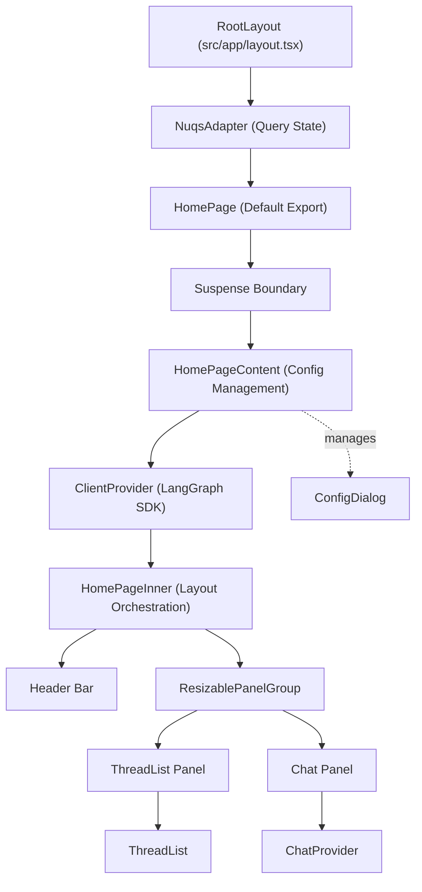
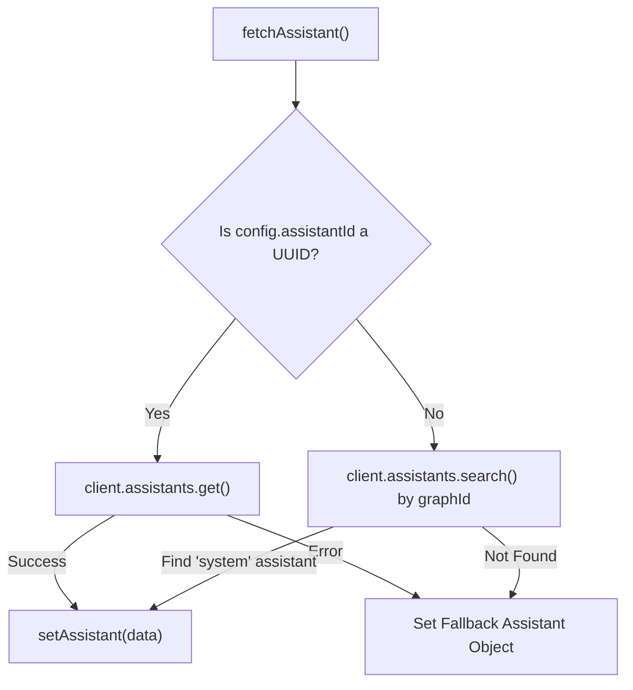
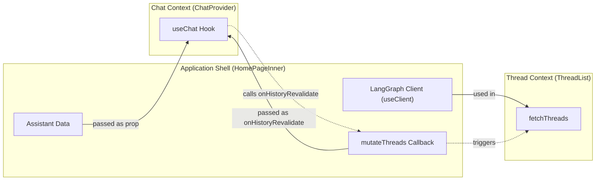

<!-- source: DeepWiki mcp.deepwiki.com · repo langchain-ai/deep-agents-ui · page 3.1 Main Application Shell · fetched 2026-10-26 -->

# Main Application Shell

Relevant source files

The following files were used as context for generating this wiki page:

- [src/app/layout.tsx](src/app/layout.tsx)
- [src/app/page.tsx](src/app/page.tsx)
- [src/components/ui/resizable.tsx](src/components/ui/resizable.tsx)
- [yarn.lock](yarn.lock)

## Purpose and Scope

The Main Application Shell encompasses the top-level page components responsible for initializing the application, managing configuration, orchestrating the layout, and providing context to child components. This document covers the `RootLayout` in [src/app/layout.tsx](), and the `HomePage`, `HomePageContent`, and `HomePageInner` components located in [src/app/page.tsx]().

The shell provides the fundamental UI structure, including the resizable panel system, the header bar, and the integration of the LangGraph SDK client via context providers.

---

## Component Hierarchy

The application shell consists of a root layout followed by three nested page components, each with distinct responsibilities:

**Sources**: [src/app/layout.tsx:8-27](), [src/app/page.tsx:27-293]()

---

## Root Layout

The `RootLayout` is the entry point for the Next.js application. It configures the global environment for all routes.

| Entity | Role |
|--------|------|
| `NuqsAdapter` | Wraps the application to enable URL query state management using the `nuqs` library [src/app/layout.tsx:22-22](). |
| `Toaster` | Provides global toast notification support via `sonner` [src/app/layout.tsx:23-23](). |
| `Inter` | Applies the Inter font subset to the entire document body [src/app/layout.tsx:19-19](). |

**Sources**: [src/app/layout.tsx:1-27]()

---

## HomePage Component

The `HomePage` component serves as the default export for the root route. Its primary responsibility is to wrap the content in a `Suspense` boundary to handle asynchronous query state initialization.

| Aspect | Details |
|--------|---------|
| **Location** | [src/app/page.tsx:281-293]() |
| **Responsibilities** | Provide Suspense boundary with a "Loading..." fallback [src/app/page.tsx:287-287](). |
| **Children** | `HomePageContent` |

---

## HomePageContent Component

The `HomePageContent` component manages the application's configuration lifecycle. It determines whether to show the configuration dialog or render the main application interface based on the presence of a valid configuration.

### Configuration Lifecycle

1.  **Loading**: On mount, it calls `getConfig()` to retrieve settings from local storage [src/app/page.tsx:212-212]().
2.  **Validation**: If no configuration exists, it defaults `configDialogOpen` to `true` [src/app/page.tsx:216-216]().
3.  **Client Initialization**: Once configuration is available, it wraps the application in the `ClientProvider` [src/app/page.tsx:267-277](), passing the `deploymentUrl` and `apiKey` (resolved from config or environment variables) [src/app/page.tsx:237-238]().

**Sources**: [src/app/page.tsx:206-279]()

---

## HomePageInner Component

`HomePageInner` is the core layout orchestrator. It fetches assistant information from the LangGraph API and manages the resizable panel system.

### Assistant Fetching Logic

The component uses `useClient()` to access the LangGraph SDK [src/app/page.tsx:33-33]() and fetches assistant details via `fetchAssistant` [src/app/page.tsx:41-99]().

**Sources**: [src/app/page.tsx:41-103]()

### Resizable Panel System

The UI is divided using a `ResizablePanelGroup` from the local UI library [src/components/ui/resizable.tsx](), which wraps `react-resizable-panels`.

| Panel ID | Role | Configuration |
|----------|------|---------------|
| `thread-history` | Displays the `ThreadList` [src/app/page.tsx:174-181](). | `defaultSize={25}`, `minSize={20}` [src/app/page.tsx:170-171](). |
| `chat` | Displays the `ChatInterface` wrapped in a `ChatProvider` [src/app/page.tsx:192-197](). | `order={2}` [src/app/page.tsx:190-190](). |

The panels are separated by a `ResizableHandle` [src/app/page.tsx:183-183](). The `autoSaveId="standalone-chat"` attribute ensures that user-adjusted panel sizes persist across sessions [src/app/page.tsx:163-163]().

**Sources**: [src/app/page.tsx:161-199](), [src/components/ui/resizable.tsx:8-45]()

### Header Bar

The header provides global controls and status information:
*   **Threads Toggle**: Visible only when the sidebar is hidden; clicking it sets the `sidebar` query state to `"1"` [src/app/page.tsx:117-132]().
*   **Interrupt Badge**: Displays the `interruptCount` (number of threads requiring human intervention) [src/app/page.tsx:126-130]().
*   **Settings**: Opens the `ConfigDialog` [src/app/page.tsx:142-142]().
*   **New Thread**: Resets the `threadId` query state to `null` to start a fresh conversation [src/app/page.tsx:150-150]().

**Sources**: [src/app/page.tsx:114-158]()

---

## Data Flow: Shell to Context

The shell orchestrates data flow between the LangGraph SDK and the application's feature providers.

**Sources**: [src/app/page.tsx:174-197]()

---

