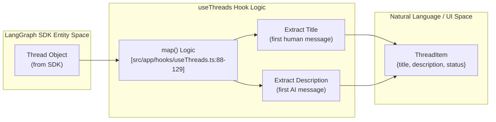
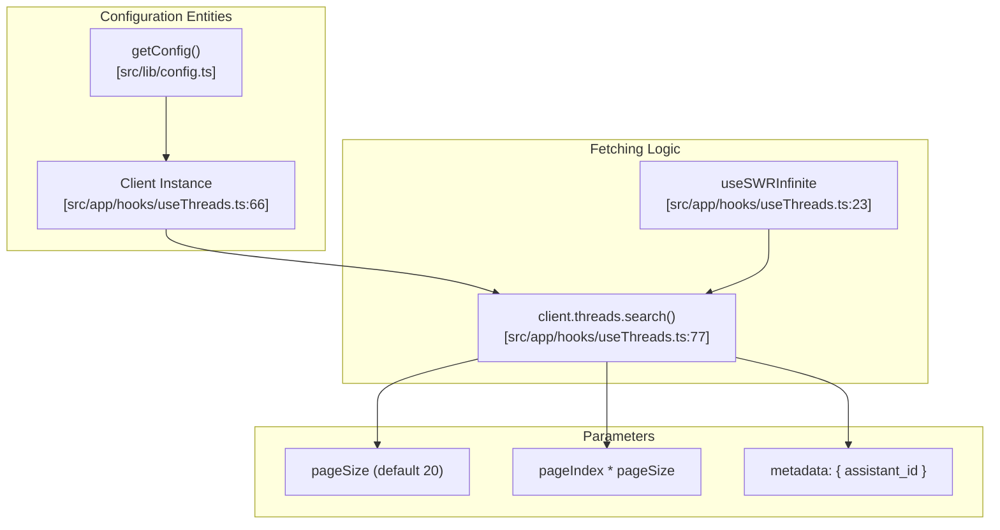

<!-- source: DeepWiki mcp.deepwiki.com · repo langchain-ai/deep-agents-ui · page 3.2 Thread Navigation · fetched 2026-10-26 -->

# Thread Navigation

<details>
<summary>Relevant source files</summary>

The following files were used as context for generating this wiki page:

- [src/app/components/ChatMessage.tsx](src/app/components/ChatMessage.tsx)
- [src/app/components/ThreadList.tsx](src/app/components/ThreadList.tsx)
- [src/app/globals.css](src/app/globals.css)
- [src/app/hooks/useThreads.ts](src/app/hooks/useThreads.ts)

</details>


## Purpose and Scope

This document covers the thread navigation system, which allows users to browse, filter, and select conversation threads in the Deep Agents UI. The primary components are the `ThreadList` component [src/app/components/ThreadList.tsx:120-125]() and the `useThreads` hook [src/app/hooks/useThreads.ts:17-20](), which together implement a searchable, filterable list of conversation threads with infinite scroll pagination.

For information about the chat interface and message display within a selected thread, see **4. Chat System**. For the overall application layout and panel system, see **3. Application Layout**.

## Thread Data Model

The thread navigation system operates on a normalized data structure called `ThreadItem`, which represents a conversation thread with display-optimized metadata.

### ThreadItem Interface

```typescript
export interface ThreadItem {
  id: string;
  updatedAt: Date;
  status: Thread["status"];
  title: string;
  description: string;
  assistantId?: string;
}
```

**Key Fields:**
- **id**: The unique thread identifier (`thread_id`) from the LangGraph SDK [src/app/hooks/useThreads.ts:122]().
- **updatedAt**: Timestamp for sorting and time-based grouping [src/app/hooks/useThreads.ts:123]().
- **status**: Current execution state (`idle`, `busy`, `interrupted`, `error`), used for filtering and visual indicators [src/app/hooks/useThreads.ts:124]().
- **title**: Extracted from the first human message (first 50 characters) [src/app/hooks/useThreads.ts:103]().
- **description**: Extracted from the first AI response (first 100 characters) [src/app/hooks/useThreads.ts:113]().
- **assistantId**: Associated assistant for thread filtering [src/app/hooks/useThreads.ts:127]().

**Sources:** [src/app/hooks/useThreads.ts:6-13]()

### Thread Data Transformation Flow



**Sources:** [src/app/hooks/useThreads.ts:88-129]()

## Data Fetching Architecture

### useThreads Hook Implementation

The `useThreads` hook uses `useSWRInfinite` from the SWR library to implement infinite scroll pagination with automatic caching and revalidation.



**Sources:** [src/app/hooks/useThreads.ts:17-136]()

### Pagination Strategy

| Parameter | Value | Purpose |
|-----------|-------|---------|
| `DEFAULT_PAGE_SIZE` | 20 | Number of threads per page [src/app/hooks/useThreads.ts:15]() |
| `offset` | `pageIndex * pageSize` | Pagination offset for fetching [src/app/hooks/useThreads.ts:79]() |
| `sortBy` | `"updated_at"` | Sort field [src/app/hooks/useThreads.ts:80]() |
| `sortOrder` | `"desc"` | Most recent threads first [src/app/hooks/useThreads.ts:81]() |

**Pagination Logic:**
1. Initial page (index 0) loads first 20 threads.
2. User clicks "Load More" button, triggering `setSize(size + 1)` [src/app/components/ThreadList.tsx:349]().
3. SWR fetches next page with `offset = pageIndex * 20` [src/app/hooks/useThreads.ts:79]().
4. Stop fetching when a page returns fewer items than the `pageSize` [src/app/components/ThreadList.tsx:141]().

**Sources:** [src/app/hooks/useThreads.ts:15-86](), [src/app/components/ThreadList.tsx:138-142]()

### Assistant Filtering Strategy

The hook implements different filtering strategies based on whether the `assistantId` is a UUID (deployed graph) or a graph name (local development):

- **Deployed Graph**: If `assistantId` is a UUID, it adds a metadata filter: `{ metadata: { assistant_id: assistantId } }` [src/app/hooks/useThreads.ts:85]().
- **Local Graph**: No metadata filter is applied, as local dev graphs do not set this metadata [src/app/hooks/useThreads.ts:84]().

**Sources:** [src/app/hooks/useThreads.ts:72-86]()

## ThreadList Component Architecture

### Component Structure

The `ThreadList` component manages the UI for thread browsing, including status filtering and time-based grouping.

- **URL State**: The `currentThreadId` is synced with the `threadId` query parameter using `useQueryState` [src/app/components/ThreadList.tsx:126]().
- **Status Filter**: Local state `statusFilter` determines which threads are fetched [src/app/components/ThreadList.tsx:127]().
- **Grouping**: Threads are grouped by status (interrupted) and time (Today, Yesterday, etc.) [src/app/components/ThreadList.tsx:144-175]().

**Sources:** [src/app/components/ThreadList.tsx:1-369]()

### Props Interface

```typescript
interface ThreadListProps {
  onThreadSelect: (id: string) => void;
  onMutateReady?: (mutate: () => void) => void;
  onClose?: () => void;
  onInterruptCountChange?: (count: number) => void;
}
```

| Prop | Type | Purpose |
|------|------|---------|
| `onThreadSelect` | `(id: string) => void` | Callback when user selects a thread [src/app/components/ThreadList.tsx:114]() |
| `onMutateReady` | `(mutate: () => void) => void` | Exposes revalidation function to parent [src/app/components/ThreadList.tsx:115]() |
| `onClose` | `() => void` | Optional callback to close the sidebar [src/app/components/ThreadList.tsx:116]() |
| `onInterruptCountChange` | `(count: number) => void` | Notifies parent of threads needing attention [src/app/components/ThreadList.tsx:117]() |

**Sources:** [src/app/components/ThreadList.tsx:113-118]()

## Thread Grouping and Organization

### Grouping Algorithm

Threads are organized into groups based on their status and age. The `interrupted` status takes precedence, placing threads in the "Requiring Attention" group [src/app/components/ThreadList.tsx:155-158]().

**Group Labels:**
- `interrupted`: "Requiring Attention"
- `today`: "Today"
- `yesterday`: "Yesterday"
- `week`: "This Week"
- `older`: "Older"

**Sources:** [src/app/components/ThreadList.tsx:26-32](), [src/app/components/ThreadList.tsx:144-175]()

### Time Calculation Logic

The grouping logic calculates the number of days between the thread's `updatedAt` timestamp and the current time:

```typescript
const diff = now.getTime() - thread.updatedAt.getTime();
const days = Math.floor(diff / (1000 * 60 * 60 * 24));
```

**Time Display Format:**
- **Same day**: `HH:mm` (e.g., "14:35") [src/app/components/ThreadList.tsx:49]()
- **Yesterday**: "Yesterday" [src/app/components/ThreadList.tsx:50]()
- **Within week**: Day name (e.g., "Monday") [src/app/components/ThreadList.tsx:51]()
- **Older**: `MM/dd` (e.g., "12/15") [src/app/components/ThreadList.tsx:52]()

**Sources:** [src/app/components/ThreadList.tsx:45-53](), [src/app/components/ThreadList.tsx:160-171]()

## Status Filtering

### Status Color Scheme

The UI uses a consistent color mapping for thread statuses:

```typescript
const STATUS_COLORS: Record<ThreadItem["status"], string> = {
  idle: "bg-green-500",
  busy: "bg-blue-500",
  interrupted: "bg-orange-500",
  error: "bg-red-600",
};
```

**Sources:** [src/app/components/ThreadList.tsx:34-39]()

### Filter Dropdown Implementation

The `Select` component allows users to filter by `all`, `idle`, `busy`, `interrupted`, or `error` [src/app/components/ThreadList.tsx:215-258](). When a status is selected, it is passed to the `useThreads` hook to filter the API search results [src/app/components/ThreadList.tsx:129-132]().

**Sources:** [src/app/components/ThreadList.tsx:24](), [src/app/components/ThreadList.tsx:127-132](), [src/app/components/ThreadList.tsx:215-258]()

## Visual States

### State Components

- **LoadingState**: Displays `Skeleton` components during initial data fetch [src/app/components/ThreadList.tsx:91-102]().
- **ErrorState**: Displays an error message if the fetch fails [src/app/components/ThreadList.tsx:82-89]().
- **EmptyState**: Displays a message when no threads match the criteria [src/app/components/ThreadList.tsx:104-111]().

**Sources:** [src/app/components/ThreadList.tsx:82-111]()

## Integration Points

### Revalidation Mechanism

The `ThreadList` component exposes the SWR `mutate` function to its parent through the `onMutateReady` prop [src/app/components/ThreadList.tsx:181-202](). This allows the application to refresh the thread list when new messages are sent or thread statuses change elsewhere in the UI.

**Sources:** [src/app/components/ThreadList.tsx:181-202]()

### Interrupt Count Notification

The component tracks the number of threads with the `interrupted` status and notifies the parent via `onInterruptCountChange` [src/app/components/ThreadList.tsx:177-207](). This is typically used to display a notification badge in the application shell.

**Sources:** [src/app/components/ThreadList.tsx:177-207]()

---

