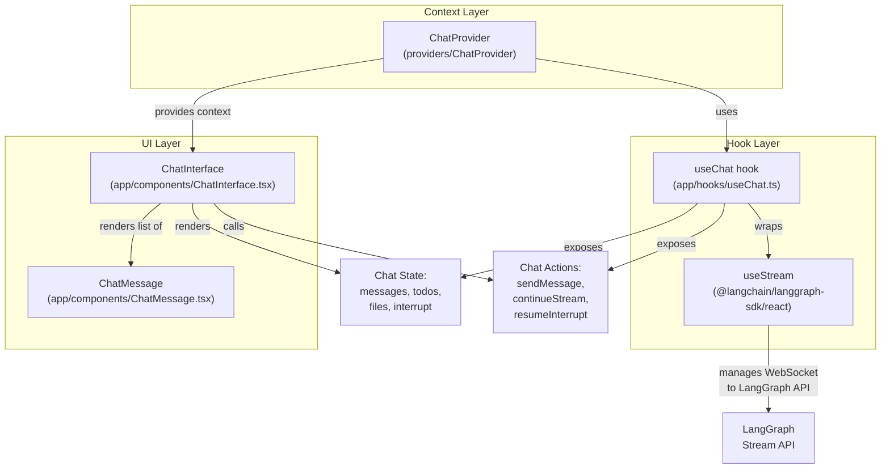
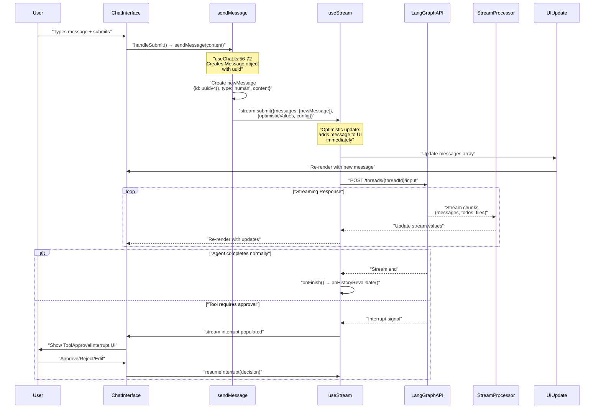
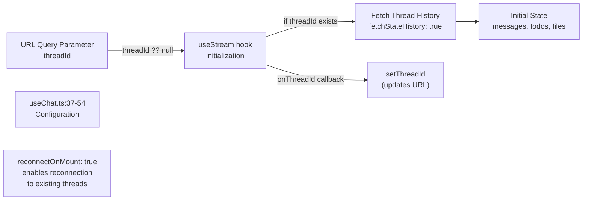
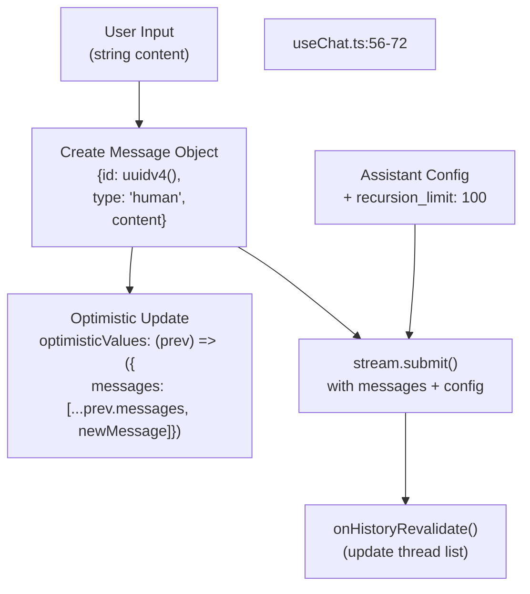
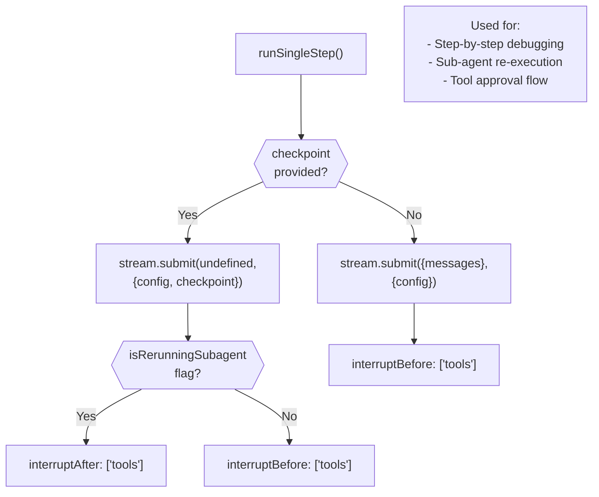
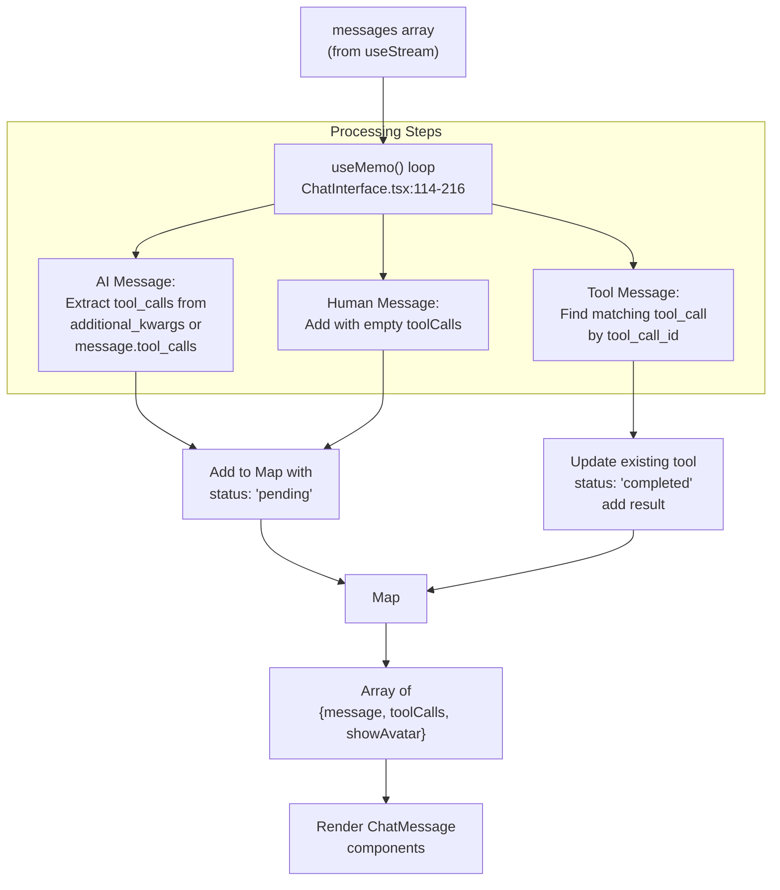
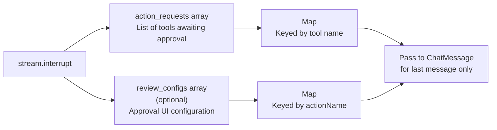
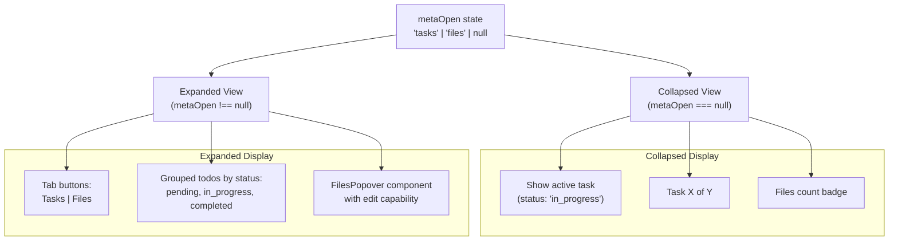
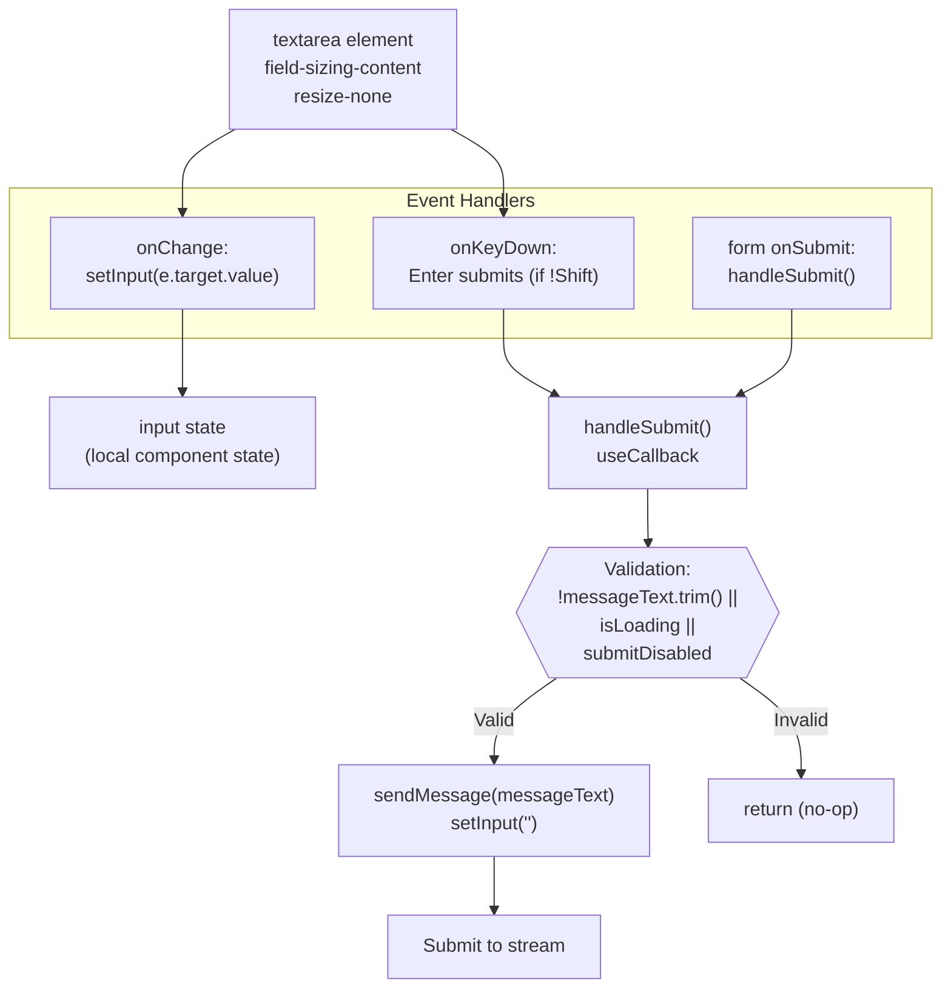
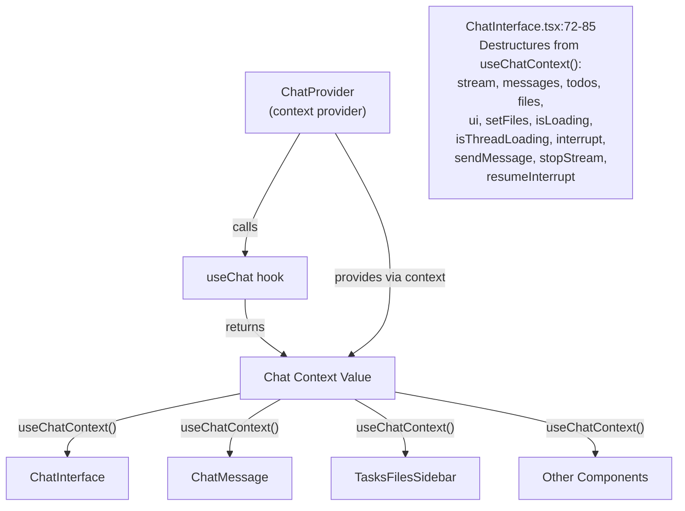

<!-- source: DeepWiki mcp.deepwiki.com · repo langchain-ai/deep-agents-ui · page 4 Chat System · fetched 2026-10-26 -->

# Chat System

<details>
<summary>Relevant source files</summary>

The following files were used as context for generating this wiki page:

- [src/app/components/ChatInterface.tsx](src/app/components/ChatInterface.tsx)
- [src/app/components/ChatMessage.tsx](src/app/components/ChatMessage.tsx)
- [src/app/hooks/useChat.ts](src/app/hooks/useChat.ts)
- [src/app/hooks/useThreads.ts](src/app/hooks/useThreads.ts)
- [src/app/utils/utils.ts](src/app/utils/utils.ts)

</details>


## Purpose and Scope

The Chat System is the core functionality layer of Deep Agents UI responsible for managing real-time communication between users and LangGraph agents. It handles message submission, streaming responses, tool execution visualization, and state synchronization including tasks and files.

This document covers the overall chat architecture, message flow, and state management. For details on specific components, see:
- **ChatInterface UI component and input handling**: [ChatInterface Component](#4.1)
- **useChat hook internals and streaming**: [useChat Hook](#4.2)
- **Message rendering and tool call display**: [Message Processing and Display](#4.3)

For information about the context providers that wrap the chat system, see [Configuration and Connection](#2) and [System Architecture](#1.2). For tool approval mechanisms, see [Tool Approval and Interrupts](#5.2).

---

## System Architecture

The Chat System is organized into three primary layers: the `useChat` hook for state management and API communication, the `ChatProvider` context for sharing chat state across components, and the `ChatInterface` component for user interaction and display.

### Component and Hook Structure



**Sources:** [src/app/hooks/useChat.ts:1-168](), [src/app/components/ChatInterface.tsx:1-546]()

---

## Data Flow Architecture

The following diagram shows how user actions flow through the chat system, including the key functions and state transformations at each stage.



**Sources:** [src/app/hooks/useChat.ts:56-72](), [src/app/components/ChatInterface.tsx:89-100]()

---

## State Management

The Chat System manages multiple types of state through the `useChat` hook, which wraps the LangGraph SDK's `useStream` hook.

### State Type Definition

The primary state interface is `StateType`, defined in [src/app/hooks/useChat.ts:16-26]():

| Field | Type | Description |
|-------|------|-------------|
| `messages` | `Message[]` | Array of chat messages (human, ai, tool) |
| `todos` | `TodoItem[]` | Task list tracked by agent |
| `files` | `Record<string, string>` | File content keyed by path |
| `email` | `object` (optional) | Email context with id, subject, page_content |
| `ui` | `any` (optional) | Custom UI components from agent |

### State Initialization



The `useChat` hook initializes with configuration from [src/app/hooks/useChat.ts:40-54]():

- **assistantId**: From `activeAssistant.assistant_id` [src/app/hooks/useChat.ts:41]()
- **client**: LangGraph SDK client instance [src/app/hooks/useChat.ts:42]()
- **reconnectOnMount**: `true` - reconnects to WebSocket on component mount [src/app/hooks/useChat.ts:43]()
- **threadId**: From URL query parameter via `nuqs` [src/app/hooks/useChat.ts:37, 44]()
- **onThreadId**: Callback to update URL when thread changes [src/app/hooks/useChat.ts:45]()
- **fetchStateHistory**: `true` - fetches existing messages when switching threads [src/app/hooks/useChat.ts:48]()
- **defaultHeaders**: `{ "x-auth-scheme": "langsmith" }` [src/app/hooks/useChat.ts:46]()

**Sources:** [src/app/hooks/useChat.ts:16-54]()

---

## Message Submission Flow

### sendMessage Function

The `sendMessage` function handles user message submission with optimistic updates:



**Implementation details:**

1. **Message Creation** [src/app/hooks/useChat.ts:58](): Creates a new `Message` object with UUID, type "human", and user content
2. **Optimistic Update** [src/app/hooks/useChat.ts:62-64](): Immediately adds message to UI before server response
3. **Submit to Stream** [src/app/hooks/useChat.ts:59-67](): Sends message with assistant config and recursion limit of 100
4. **Thread List Update** [src/app/hooks/useChat.ts:69](): Triggers revalidation to update thread list sidebar

**Sources:** [src/app/hooks/useChat.ts:56-72]()

---

## Stream Control Functions

The `useChat` hook exposes several functions for controlling the agent execution stream:

### Function Reference

| Function | Parameters | Purpose | Location |
|----------|-----------|---------|----------|
| `sendMessage` | `content: string` | Submit user message | [src/app/hooks/useChat.ts:56-72]() |
| `runSingleStep` | `messages, checkpoint?, isRerunningSubagent?, optimisticMessages?` | Execute single step with interrupt | [src/app/hooks/useChat.ts:74-100]() |
| `continueStream` | `hasTaskToolCall?: boolean` | Resume agent execution | [src/app/hooks/useChat.ts:112-127]() |
| `stopStream` | none | Stop streaming execution | [src/app/hooks/useChat.ts:144-146]() |
| `resumeInterrupt` | `value: any` | Resume from human approval interrupt | [src/app/hooks/useChat.ts:135-142]() |
| `markCurrentThreadAsResolved` | none | Mark thread complete and goto `__end__` | [src/app/hooks/useChat.ts:129-133]() |
| `setFiles` | `files: Record<string, string>` | Update file state | [src/app/hooks/useChat.ts:102-110]() |

### runSingleStep Configuration

The `runSingleStep` function [src/app/hooks/useChat.ts:74-100]() supports stepping through agent execution with interrupts:



**Sources:** [src/app/hooks/useChat.ts:74-100]()

---

## Message Processing

The `ChatInterface` component processes messages from the stream into a renderable format with tool calls attached.

### Message-to-ToolCall Association



**Implementation details** [src/app/components/ChatInterface.tsx:114-216]():

1. **Create Message Map**: Initialize `Map<string, {message, toolCalls}>` to associate tool calls with AI messages.
2. **Process AI Messages**: Extract tool calls from `additional_kwargs.tool_calls` [src/app/components/ChatInterface.tsx:135](), `message.tool_calls` [src/app/components/ChatInterface.tsx:139](), or content blocks with type `"tool_use"` [src/app/components/ChatInterface.tsx:146]().
3. **Handle Tool Messages**: Find matching tool call by `tool_call_id` [src/app/components/ChatInterface.tsx:183]() and update status to "completed" with result extracted via `extractStringFromMessageContent` [src/app/components/ChatInterface.tsx:197]().
4. **Determine Avatar Display**: Compare current message type with previous to decide whether to show avatar [src/app/components/ChatInterface.tsx:213]().
5. **Return Processed Array**: Convert map to array with tool call associations preserved.

**Sources:** [src/app/components/ChatInterface.tsx:114-216](), [src/app/utils/utils.ts:9-31]()

---

## Interrupt Handling

The Chat System supports human-in-the-loop interrupts for tool approval. When an agent requests approval, the `interrupt` state is populated with `action_requests` and optional `review_configs`.

### Interrupt State Structure



The interrupt parsing logic [src/app/components/ChatInterface.tsx:228-242]():

1. Extract `action_requests` from `interrupt.value` [src/app/components/ChatInterface.tsx:229-230]().
2. Extract `review_configs` (if present) from `interrupt.value` [src/app/components/ChatInterface.tsx:234-235]().
3. Create maps keyed by tool name / action name for efficient lookup.
4. Pass maps only to the last message for rendering approval UI.

**Sources:** [src/app/components/ChatInterface.tsx:228-242]()

---

## Tasks and Files UI

The `ChatInterface` includes an embedded UI section above the input box for displaying tasks and files.

### UI State Management



**Key features** [src/app/components/ChatInterface.tsx:296-501]():

- **Conditional Rendering**: Only shows when `hasTasks || hasFiles` is true.
- **Collapsed State**: Displays single-line summary of active task and file count.
- **Expanded State**: Shows full task list grouped by status or file list with editing via `FilesPopover` [src/app/components/ChatInterface.tsx:456]().
- **Max Height**: `max-h-72` with scroll for long lists [src/app/components/ChatInterface.tsx:327]().
- **Edit Locking**: File editing disabled when `isLoading === true || interrupt !== undefined` [src/app/components/ChatInterface.tsx:459]().

**Sources:** [src/app/components/ChatInterface.tsx:296-501]()

---

## Input Handling

The message input uses a `<textarea>` with auto-resizing via CSS `field-sizing-content` property.

### Input Component Structure



**Implementation details** [src/app/components/ChatInterface.tsx:503-539]():

- **Auto-resize**: CSS property `field-sizing-content` enables automatic height adjustment based on content [src/app/components/ChatInterface.tsx:511]().
- **Enter Key**: Submits message; Shift+Enter adds newline [src/app/components/ChatInterface.tsx:105-108]().
- **Submit Button**: Toggles between "Send" (with `ArrowUp` icon) and "Stop" (with `Square` icon) based on `isLoading` state [src/app/components/ChatInterface.tsx:526-533]().
- **Disabled State**: Submit disabled when `!isLoading && (submitDisabled || !input.trim())` [src/app/components/ChatInterface.tsx:524]().
- **Placeholder**: Changes to "Running..." when `isLoading === true` [src/app/components/ChatInterface.tsx:516]().

**Sources:** [src/app/components/ChatInterface.tsx:89-111, 503-539]()

---

## Exposed API

The `useChat` hook returns an object with the following properties and methods:

### Return Value Structure

```typescript
{
  // Stream management
  stream: UseStreamThread<StateType>
  
  // State values (from stream.values)
  todos: TodoItem[]
  files: Record<string, string>
  email?: { id?: string; subject?: string; page_content?: string }
  ui?: any
  
  // Message management
  messages: Message[]
  isLoading: boolean
  isThreadLoading: boolean
  interrupt: Interrupt | undefined
  getMessagesMetadata: () => MessagesMetadata
  
  // Actions
  sendMessage: (content: string) => void
  runSingleStep: (messages, checkpoint?, isRerunningSubagent?, optimisticMessages?) => void
  continueStream: (hasTaskToolCall?: boolean) => void
  stopStream: () => void
  markCurrentThreadAsResolved: () => void
  resumeInterrupt: (value: any) => void
  setFiles: (files: Record<string, string>) => Promise<void>
}
```

**Sources:** [src/app/hooks/useChat.ts:148-167]()

---

## Integration with ChatProvider

The `useChat` hook is consumed by `ChatProvider` context, which makes the chat state and actions available to all descendant components via the `useChatContext()` hook.



**Sources:** [src/app/components/ChatInterface.tsx:72-85]()

---

