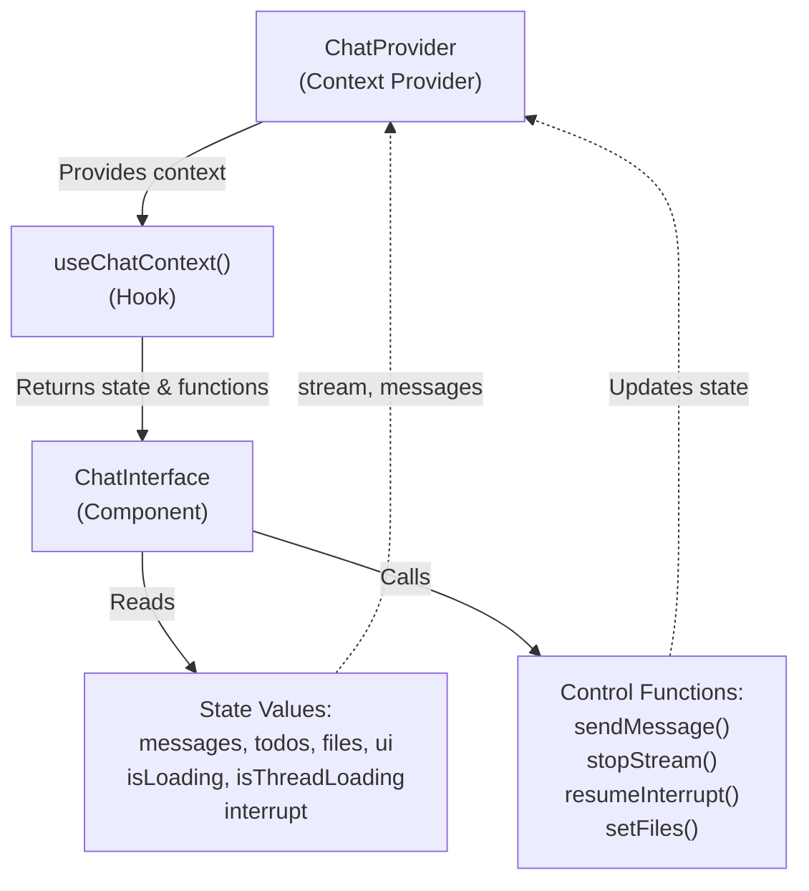
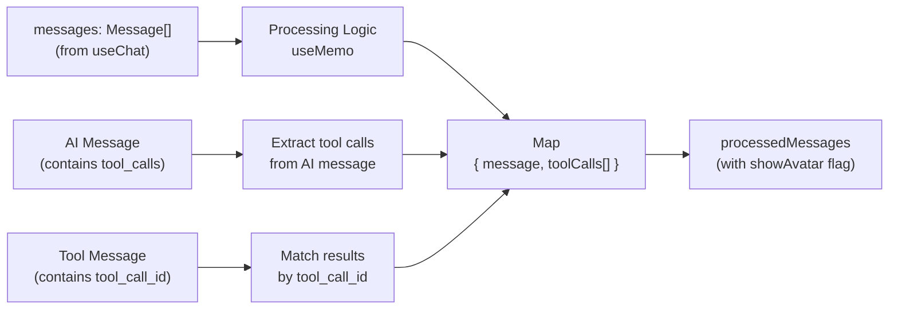
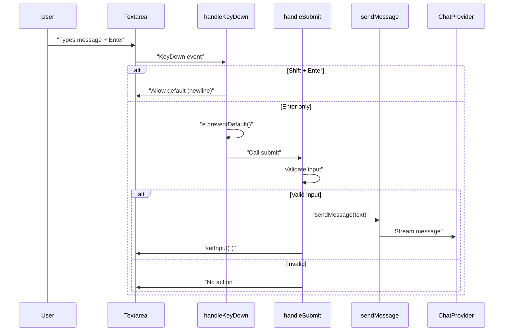
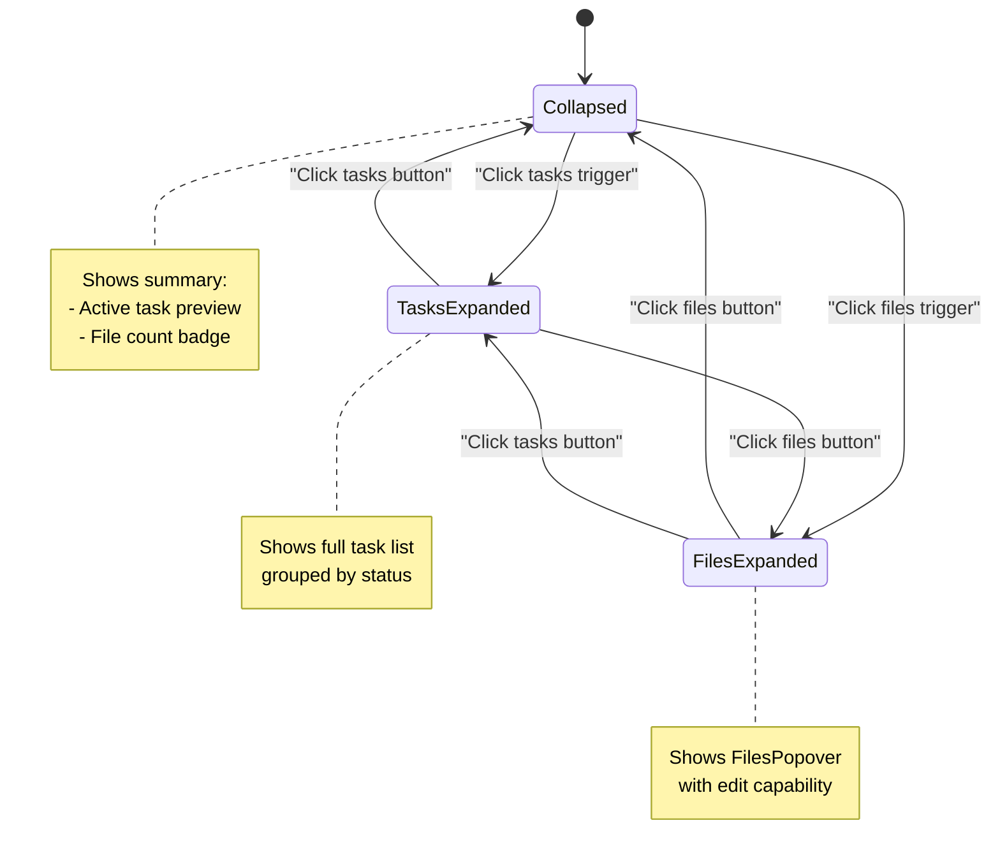
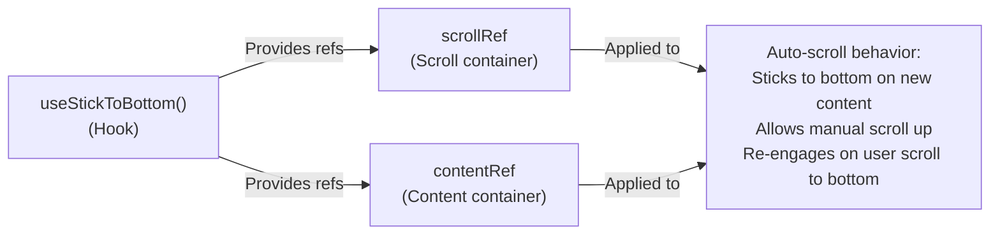
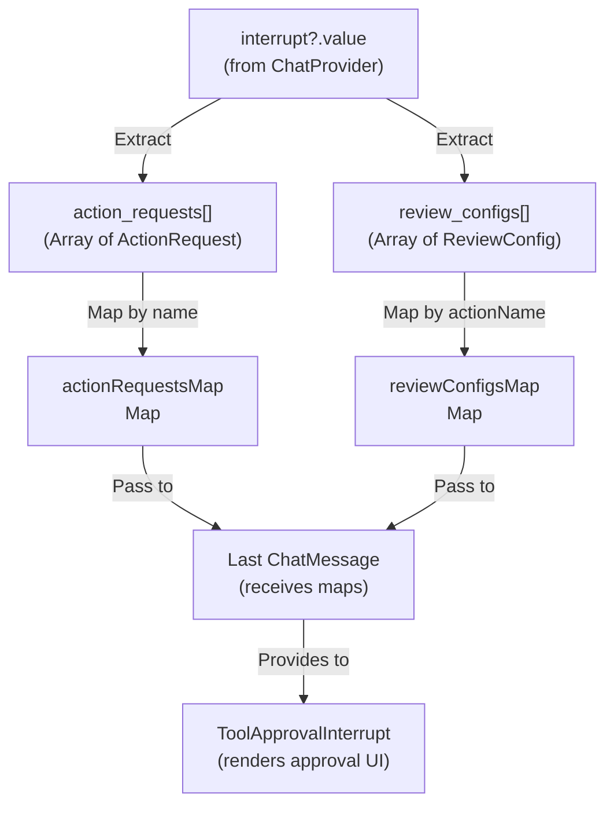

<!-- source: DeepWiki mcp.deepwiki.com · repo langchain-ai/deep-agents-ui · page 4.1 ChatInterface Component · fetched 2026-10-26 -->

# ChatInterface Component

<details>
<summary>Relevant source files</summary>

The following files were used as context for generating this wiki page:

- [src/app/components/ChatInterface.tsx](src/app/components/ChatInterface.tsx)
- [src/providers/ChatProvider.tsx](src/providers/ChatProvider.tsx)

</details>


## Purpose and Scope

The `ChatInterface` component is the primary chat interaction interface in the Deep Agents UI. It manages the display of conversation messages, handles user input, and provides inline access to agent-generated tasks and files. This component orchestrates the visual presentation of the chat experience, including message rendering, input submission, and auto-scrolling behavior.

For information about the underlying state management and streaming logic, see [useChat Hook](#4.2). For details on how individual messages are rendered and processed, see [Message Processing and Display](#4.3).

**Sources**: [src/app/components/ChatInterface.tsx:1-546]()

---

## Component Overview

### Component Interface

The `ChatInterface` component is defined as a memoized React component with a single prop:

```typescript
interface ChatInterfaceProps {
  assistant: Assistant | null;
}
```

The `assistant` prop provides metadata about the connected LangGraph assistant and is used to enable/disable message submission when no assistant is configured.

**Sources**: [src/app/components/ChatInterface.tsx:34-36](), [src/app/components/ChatInterface.tsx:64-64]()

---

### Integration with ChatProvider

The component obtains all chat state and control functions through the `useChatContext` hook:



The context provides:
- **State values**: `stream`, `messages`, `todos`, `files`, `ui`, `isLoading`, `isThreadLoading`, `interrupt`
- **Control functions**: `sendMessage`, `stopStream`, `resumeInterrupt`, `setFiles`

**Sources**: [src/providers/ChatProvider.tsx:15-37](), [src/app/components/ChatInterface.tsx:72-85]()

---

## Component Structure

### Visual Layout Hierarchy

```mermaid
graph TD
    Root["<div> Root Container<br/>flex flex-col"]
    ScrollArea["<div> Scroll Area<br/>ref=scrollRef"]
    Content["<div> Content Container<br/>ref=contentRef<br/>max-w-1024px"]
    Messages["ChatMessage Components<br/>(mapped from processedMessages)"]
    
    InputArea["<div> Input Area<br/>bg-background"]
    InputContainer["<div> Input Container<br/>border rounded-xl"]
    MetaSection["Tasks/Files Section<br/>(conditional)"]
    Form["<form> Message Form"]
    Textarea["<textarea> Message Input"]
    ButtonArea["<div> Button Area"]
    SubmitBtn["<Button> Submit/Stop"]
    
    Root --> ScrollArea
    ScrollArea --> Content
    Content --> Messages
    
    Root --> InputArea
    InputArea --> InputContainer
    InputContainer --> MetaSection
    InputContainer --> Form
    Form --> Textarea
    Form --> ButtonArea
    ButtonArea --> SubmitBtn
```



The component has two main sections:
1. **Scrollable message area** (top) - displays conversation history using `useStickToBottom` for management.
2. **Fixed input area** (bottom) - contains tasks/files and message input.

**Sources**: [src/app/components/ChatInterface.tsx:70-70](), [src/app/components/ChatInterface.tsx:244-542]()

---

## Message Processing

### Message-to-ToolCall Mapping

The component processes raw messages into a display-ready format by associating tool calls with their results:



The processing algorithm ([src/app/components/ChatInterface.tsx:114-216]()):

1. **Initialize Map**: Creates a `Map<string, { message, toolCalls }>` to store message data.
2. **Process AI Messages**: 
   - Extracts tool calls from `additional_kwargs.tool_calls`, `tool_calls`, or content blocks (`type === "tool_use"`).
   - Normalizes tool call format to `{ id, name, args, status }`.
   - Sets initial status to `"interrupted"` if an interrupt exists, otherwise `"pending"`.
3. **Process Tool Messages**:
   - Finds corresponding tool call by matching `tool_call_id`.
   - Updates status to `"completed"` and adds result content via `extractStringFromMessageContent`.
4. **Process Human Messages**: Adds to map with empty tool calls array.
5. **Add Avatar Flag**: Determines if avatar should be shown based on whether the previous message was from a different sender type.

| Tool Call Source | Extraction Path | Priority |
|------------------|-----------------|----------|
| OpenAI-style | `message.additional_kwargs.tool_calls` | 1st |
| LangChain-style | `message.tool_calls` | 2nd |
| Anthropic-style | `message.content[].type === "tool_use"` | 3rd |

**Sources**: [src/app/components/ChatInterface.tsx:114-216](), [src/app/utils/utils.ts:1-20]()

---

## Message Display

The processed messages are rendered using the `ChatMessage` component:

```typescript
{processedMessages.map((data, index) => {
  const messageUi = ui?.filter(
    (u: any) => u.metadata?.message_id === data.message.id
  );
  const isLastMessage = index === processedMessages.length - 1;
  return (
    <ChatMessage
      key={data.message.id}
      message={data.message}
      toolCalls={data.toolCalls}
      isLoading={isLoading}
      actionRequestsMap={isLastMessage ? actionRequestsMap : undefined}
      reviewConfigsMap={isLastMessage ? reviewConfigsMap : undefined}
      ui={messageUi}
      stream={stream}
      onResumeInterrupt={resumeInterrupt}
      graphId={assistant?.graph_id}
    />
  );
})}
```

Key features:
- **UI Components**: Filters custom UI components by matching `metadata.message_id`.
- **Interrupt Handling**: Only passes `actionRequestsMap` and `reviewConfigsMap` to the last message.
- **Stream Reference**: Passes the stream object for dynamic UI rendering.

**Sources**: [src/app/components/ChatInterface.tsx:260-283]()

---

## Input Handling

### Message Submission Flow



### Submit Conditions

Message submission is controlled by multiple conditions:

| Condition | Check | Effect |
|-----------|-------|--------|
| `assistant` | `!assistant` | Disables submit button |
| `isLoading` | `isLoading === true` | Changes button to "Stop" mode |
| `input` | `!input.trim()` | Disables submit button |
| `submitDisabled` | `isLoading \|\| !assistant` | Overall disabled state |

**Sources**: [src/app/components/ChatInterface.tsx:87-111]()

---

### Keyboard Interaction

The textarea supports the following keyboard interactions:

- **Enter (no Shift)**: Submits the message if valid via `handleSubmit`.
- **Shift + Enter**: Inserts a newline.
- **Textarea auto-resize**: Uses `field-sizing-content` CSS for automatic height adjustment.

**Sources**: [src/app/components/ChatInterface.tsx:102-111](), [src/app/components/ChatInterface.tsx:507-515]()

---

## Tasks and Files Display

### Collapsible Meta Section

The component displays agent-generated tasks and files in a collapsible section above the input area:



### Task Display Logic

When collapsed, the component displays an intelligent task summary:

| Condition | Display |
|-----------|---------|
| All tasks completed | `<CheckCircle />` "All tasks completed" |
| Active task exists | `<Clock />` "Task N of M" + task content preview |
| Only pending tasks | `<Circle />` "Task N of M" |

**Sources**: [src/app/components/ChatInterface.tsx:296-410]()

---

### Task Grouping

Tasks are grouped by status for the expanded view:

```typescript
const groupedTodos = {
  in_progress: todos.filter((t) => t.status === "in_progress"),
  pending: todos.filter((t) => t.status === "pending"),
  completed: todos.filter((t) => t.status === "completed"),
};
```

The groups are displayed in order: In Progress → Pending → Completed, with each group showing only if it contains tasks.

**Sources**: [src/app/components/ChatInterface.tsx:218-222](), [src/app/components/ChatInterface.tsx:457-485]()

---

## Scroll Behavior

### Auto-Scroll Implementation

The component uses the `use-stick-to-bottom` library for automatic scrolling:



The scroll container is the outer div with `overflow-y-auto`, and the content container is the inner div that holds all messages. When new messages arrive, the scroll position automatically adjusts to show the latest content, unless the user has manually scrolled up.

**Sources**: [src/app/components/ChatInterface.tsx:70](), [src/app/components/ChatInterface.tsx:246-252]()

---

## Interrupt Handling

### Action Request and Review Config Mapping

The component processes interrupt data to enable tool approval workflows:



Both maps are computed using `useMemo` and passed only to the last message for efficiency:

```typescript
const actionRequestsMap: Map<string, ActionRequest> | null = useMemo(() => {
  const actionRequests = interrupt?.value && (interrupt.value as any)["action_requests"];
  if (!actionRequests) return new Map<string, ActionRequest>();
  return new Map(actionRequests.map((ar: ActionRequest) => [ar.name, ar]));
}, [interrupt]);
```

**Sources**: [src/app/components/ChatInterface.tsx:228-242](), [src/app/components/ChatInterface.tsx:271-276]()

---

## Status Icons

### Helper Function

The component includes a utility function for rendering status icons:

```typescript
const getStatusIcon = (status: TodoItem["status"], className?: string)
```

| Status | Icon | Color Class |
|--------|------|-------------|
| `completed` | `<CheckCircle />` | `text-success/80` |
| `in_progress` | `<Clock />` | `text-warning/80` |
| `pending` | `<Circle />` | `text-tertiary/70` |

This function is used both in the collapsed task preview and the expanded task list display.

**Sources**: [src/app/components/ChatInterface.tsx:38-62]()

---

## Component State

### Local State Management

The component maintains local state for UI interactions:

| State Variable | Type | Purpose |
|----------------|------|---------|
| `metaOpen` | `"tasks" \| "files" \| null` | Controls which meta section (tasks or files) is expanded |
| `input` | `string` | Current value of the message textarea |
| `tasksContainerRef` | `RefObject<HTMLDivElement>` | Reference to tasks container |
| `textareaRef` | `RefObject<HTMLTextAreaElement>` | Reference to message input textarea |

**Sources**: [src/app/components/ChatInterface.tsx:65-67]()

---

## Styling and Layout

### Responsive Container

The input container uses a responsive width strategy:

```
mx-auto w-[calc(100%-32px)] max-w-[1024px]
```

This creates:
- 16px margin on each side (`calc(100% - 32px)`)
- Maximum width of 1024px (matches content width)
- Automatic centering (`mx-auto`)

### Textarea Styling

The textarea uses CSS `field-sizing-content` for automatic height adjustment based on content, with a minimum of 1 row.

**Sources**: [src/app/components/ChatInterface.tsx:290-295](), [src/app/components/ChatInterface.tsx:507-515]()

---

## Loading States

The component handles two types of loading states:

| State | Condition | Effect |
|-------|-----------|--------|
| `isThreadLoading` | Thread data is being fetched | Shows "Loading..." message in content area |
| `isLoading` | Stream is active | Changes submit button to "Stop" (calling `stopStream`), updates placeholder text |

**Sources**: [src/app/components/ChatInterface.tsx:254-258](), [src/app/components/ChatInterface.tsx:519-534](), [src/app/components/ChatInterface.tsx:537-537]()

---

## Sources Summary

Primary implementation: [src/app/components/ChatInterface.tsx:1-546]()
Context management: [src/providers/ChatProvider.tsx:1-38]()
Utility extraction: [src/app/utils/utils.ts:1-20]()

---

